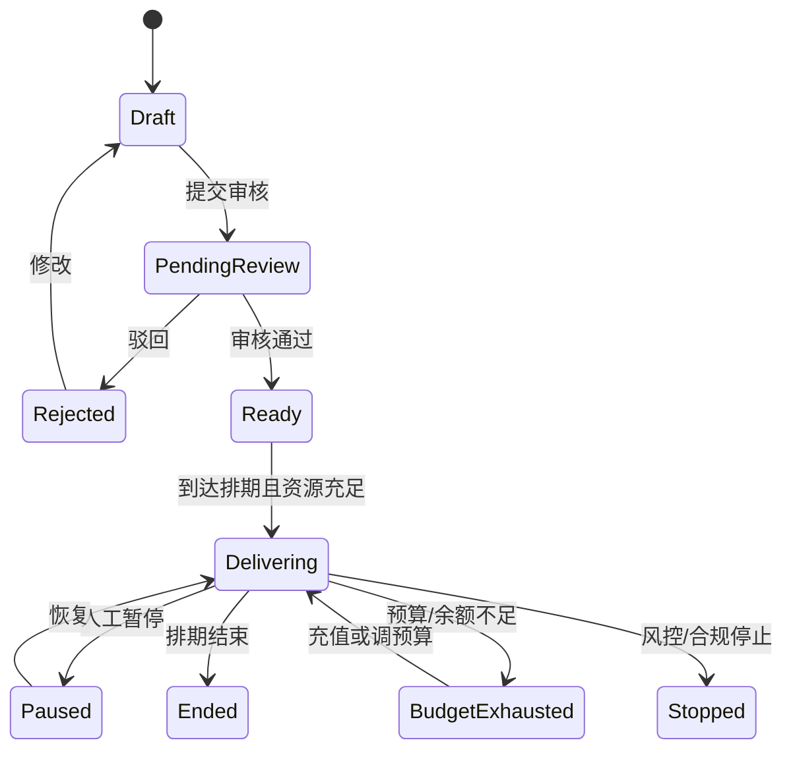

# 02 业务规则与流程

## 1. 分阶段投放流程

### 1.1 一期：配置投放与追踪

一期不由 SCX 实时选择广告。运营把已审核投放绑定到媒体/广告位，平台生成签名追踪链接或接入参数；媒体完成实际展示后上报事件。

一期预算和状态控制发生在配置发布、事件计费和运营监控环节；不声称具备实时流量选择、竞价或在线频控能力。

### 1.2 M6：实时决策与竞价

#### 候选过滤规则

候选广告必须同时满足：账户、活动、计划、广告和创意均可投放；媒体与广告位启用；广告格式匹配；当前在排期内；预算和余额充足；通过定向；未超频；未命中黑名单；无审核或风险拦截。

过滤顺序必须固定并记录淘汰原因，以支持投放诊断。预算、频控和扣费检查必须使用原子操作，避免并发超投。

#### 排序规则

M6 初始版本采用可解释排序：`eCPM = 出价 × 预估转化/点击概率 × 质量系数`。质量系数可由素材审核评级、媒体质量、落地页质量和风险等级构成。一价/二价、底价和封顶价由接受的交易 ADR 确定。每次最终选择必须记录排序输入、结果和规则版本。

## 2. 事件、归因与回传

### 2.1 统一事件模型

| 事件 | 触发方 | 关键字段 |
| --- | --- | --- |
| REQUEST | M6 媒体/SDK | request_id、slot_id、设备、IP、UA、上下文；一期不要求。 |
| IMPRESSION | 媒体 | impression_id、request_id、时间、展示位置。 |
| CLICK | 媒体 | click_id、impression_id/request_id、时间、跳转参数。 |
| CONVERSION | 广告主 | conversion_id、click_id/request_id、事件类型、事件时间、金额。 |
| WIN/LOSS | M6 交易平台 | auction_id、出价、成交价、失败原因；一期不产生。 |

### 2.2 去重规则

- 请求（M6）：`source + request_id` 幂等，保留首条和重复计数。
- 展示：优先 `impression_id`，缺失时使用 `request_id + event_type + 时间桶`。
- 点击：优先 `click_id`，缺失时使用 `request_id + event_type + 时间桶`。
- 转化：`advertiser_id + conversion_id`；无 conversion_id 时使用归因标识、事件类型、事件时间桶和设备标识的组合。
- 去重结果必须区分“重复接收”“数据非法”“归因失败”，不可静默丢弃。

### 2.3 归因规则

一期默认采用最后一次有效点击归因；没有点击时可按广告主配置采用最后一次展示归因。默认窗口：点击 7 天、展示 1 天，具体由广告主或计划配置。归因必须验证追踪令牌、广告/计划有效性、事件时间、来源签名和反作弊结果。

可选归因结果：已归因、超窗、找不到触点、重复转化、签名失败、风控拒绝、被其他渠道归因。所有结果保存原始请求和决策原因。

### 2.4 回传规则

向媒体回传前必须完成：归因成功、事件在媒体支持范围、事件未重复、回传比例规则通过、媒体密钥与回调地址有效。采用异步队列、指数退避和最大重试次数；超过重试阈值进入死信队列，允许人工重放。

## 3. 预算、费用与结算

### 3.1 预算规则

- 总预算：活动累计消耗不得超过总预算。
- 日预算：按账户时区统计，支持均匀投放和尽快投放。
- 一期扣减：计费事实确认时原子校验并扣减计划预算和账户余额。
- M6 预算预占：竞价/响应阶段预占，确认事件后扣减；超时未确认的预占自动释放。
- 余额：广告主可用余额不足时停止投放；授信账户按信用额度校验。

### 3.2 账务规则

所有余额变化使用不可变流水：充值、冻结、解冻、扣费、退款、调整、结算。余额由流水汇总或受事务保护的余额快照得出，禁止直接修改余额字段。金额使用分/厘等整数，禁止浮点数。

### 3.3 对账规则

每日生成广告主账单和媒体账单，按约定时区、计费事件和去重口径聚合。支持差异单：平台数、广告主数、媒体数、差异量、差异率、原因、处理人和结论。账单关闭后只允许通过冲正单调整，不得覆盖历史。

## 4. 审核、风控与申诉

### 4.1 审核流程

广告主资质、创意、落地页均须审核。审核结论为通过、驳回、限制投放；驳回必须带标准原因码和说明。修改后的创意形成新版本并重新审核。审核通过不是永久有效，平台可因投诉或合规风险下线。

### 4.2 风控规则

一期规则：异常高频设备/IP、数据中心/代理 IP、短周期点击/转化爆发、点击转化时间异常、相同设备多账户、媒体回传签名失败、黑名单命中。风控结论：放行、降权、延迟确认、拦截、冻结账户。规则版本和命中证据必须可审计。

## 5. 关键状态机

