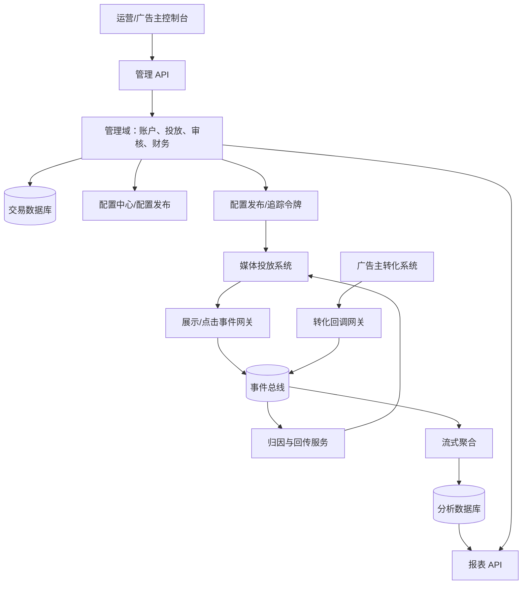
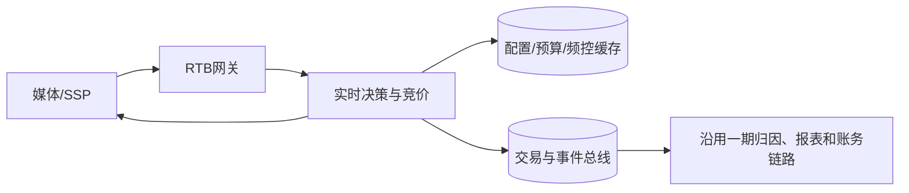

# 03 系统架构与模块

## 1. 架构原则

1. 管理面与高并发数据面分离。
2. 事件先可靠接收再异步处理；所有消费者可幂等。
3. 配置和规则版本化，历史决策可回溯。
4. 交易链路不依赖慢查询和跨网络同步调用。
5. 财务、归因、风控均以不可变事件/流水为审计基础。

## 2. 分阶段逻辑架构

### 2.1 一期架构：配置、追踪、归因与结算

一期的触点来自已发布投放配置生成的签名追踪参数，不依赖 SCX 在线选择广告。

### 2.2 M6 目标架构：加入实时交易

M6 只替换“媒体实施投放前的广告选择与响应”部分，事件、归因、回传、计费和数据模型通过版本化契约兼容。

## 3. 模块边界

| 模块 | 职责 | 关键数据 |
| --- | --- | --- |
| IAM | 用户、组织、角色、权限、API 密钥、审计。 | user、role、permission、api_key、audit_log |
| 投放中心 | 活动、计划、广告、创意、预算、定向、频控。 | campaign、ad_group、ad、creative、targeting |
| 资源中心 | 媒体、应用、广告位、格式、库存、媒体密钥。 | publisher、app、placement、inventory |
| 审核风控 | 资质、素材审核、反作弊、黑白名单、申诉。 | review、risk_rule、risk_event、blocklist |
| 实时交易（M6） | 请求解析、候选检索、过滤、排序、竞价、广告响应。 | request log、decision log、cache |
| 事件中心 | 事件接收、验签、去重、持久化、事件总线。 | raw_event、dedup_key、outbox |
| 归因回传 | 触点检索、归因、事件映射、回调、重试、死信。 | touchpoint、attribution、callback_task |
| 数据中心 | 明细入湖、流式聚合、报表、导出、数据修复。 | fact_event、aggregate_report |
| 财务中心 | 资金流水、计费、账单、对账、结算、发票。 | ledger、bill、reconciliation、settlement |

## 4. 技术选型状态

以下仅为候选能力类别，不是已接受选型。M0 必须通过 ADR 确定语言、版本、数据库、消息系统、分析库、仓库结构和部署方式后才能生成工程骨架。

| 层 | 推荐 |
| --- | --- |
| 管理 API | Java/Kotlin + Spring Boot 或 Go；REST/OpenAPI（待 ADR）。 |
| 实时网关/决策 | Go、Java 或 Rust；无状态水平扩容，连接池与超时控制。 |
| 主数据库 | MySQL 或 PostgreSQL，负责交易配置、账务和审计。 |
| 缓存/限流 | Redis Cluster，存预算计数、频控、幂等键、热点配置。 |
| 事件总线 | Kafka/Pulsar，分区顺序、重放、DLQ。 |
| 分析库 | ClickHouse/Doris，支撑高维聚合和明细查询。 |
| 对象存储 | S3 兼容存储，保存素材、导出、原始日志归档。 |
| 可观测性 | OpenTelemetry + Prometheus + Grafana + 日志检索。 |

## 5. 性能与可靠性指标

| 指标 | 一期目标 |
| --- | --- |
| 管理 API 可用性 | 月度不低于 99.9%。 |
| 事件接入可用性 | 月度不低于 99.95%。 |
| 事件接收响应 | P99 小于 100 ms（不含外部网络）。 |
| 竞价响应（M6） | P99 小于媒体规定 `tmax`；内部决策预留至少 30% 超时余量。 |
| 事件丢失 | 可确认事件零丢失；不可解析事件进入隔离存储。 |
| 报表延迟 | 实时看板 5 分钟内，日结报表次日 10:00 前。 |
| 恢复目标 | 非资金事件初始 RPO 不超过 5 分钟、RTO 不超过 1 小时；账务以已提交事务不丢失为目标。 |

## 6. 配置发布与数据修复

- 投放、风控和媒体配置采用草稿—审核—发布流程，生成不可变版本号。
- 实时节点订阅配置变更；发布失败可回滚至上一版本。
- 所有事件原文进入低成本归档，支持按时间段、媒体、广告主重放。
- 重放必须指定隔离模式或去重策略，禁止直接污染正式账务。
