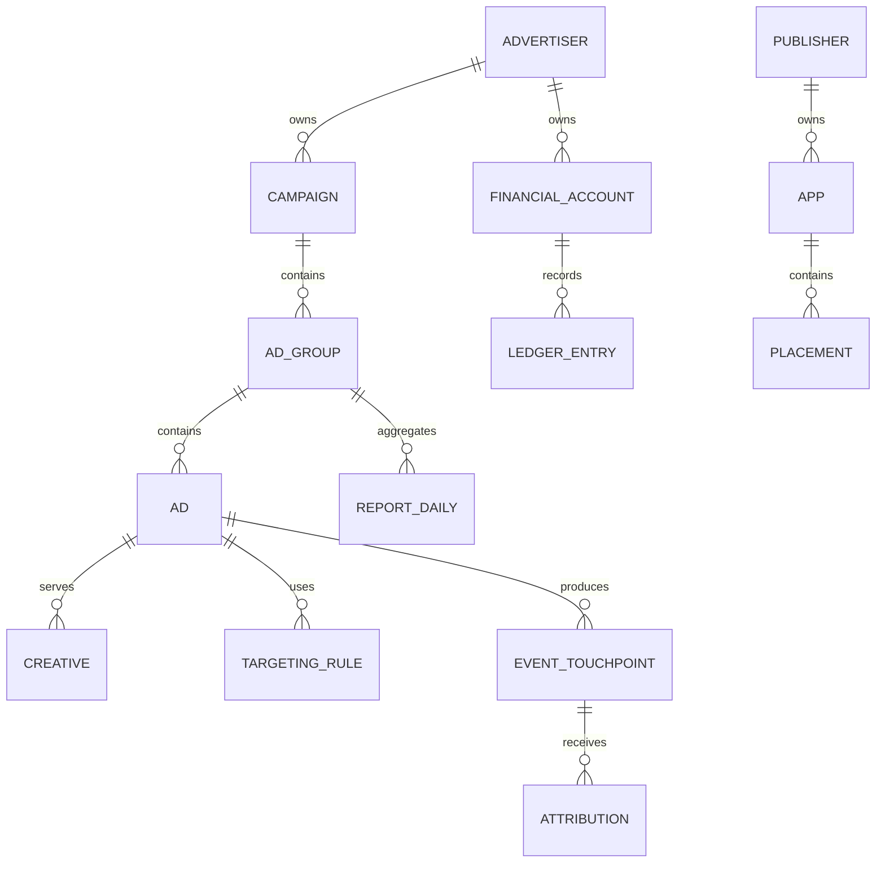

# 04 数据模型与接口

## 1. 数据建模约定

- 业务主键使用全局唯一 ID；内部关系表可使用雪花 ID/UUID。
- 可编辑配置表含 `id`、`created_at`、`updated_at`、`created_by`、`version`；原始事件、归因、流水、账单和审计采用只追加/冲正，不使用通用软删除。
- 金额字段为 `BIGINT` 最小货币单位；比例使用 `DECIMAL`；时间统一存 UTC，展示按账户时区转换。
- 广告主与媒体属于平台下独立主体；本设计不增加 SaaS `tenant_id`。

## 2. 核心实体关系



## 3. 关键表设计

| 表 | 核心字段 | 说明 |
| --- | --- | --- |
| `advertiser` | id、name、status、credit_limit、timezone | 广告主主体。 |
| `publisher` | id、name、status、settlement_mode | 媒体主体。 |
| `campaign` | advertiser_id、objective、total_budget、start_at、end_at、status | 投放活动。 |
| `ad_group` | campaign_id、billing_type、optimization_event、bid_strategy、daily_budget | 投放计划。 |
| `ad` | ad_group_id、landing_page、frequency_cap、status | 定向与频控承载实体。 |
| `creative` | ad_id、format、asset_uri、title、review_status、version | 创意版本。 |
| `placement` | publisher_id、app_id、format、floor_price、status | 广告位。 |
| `targeting_rule` | ad_id、dimension、operator、value_json | 统一定向表达。 |
| `event_raw` | event_id、source、event_type、payload、received_at、verify_result | 原始事件，不更新。 |
| `event_touchpoint` | request_id、impression_id、click_id、ad_id、placement_id、device_hash、occurred_at | 可归因触点。 |
| `attribution` | conversion_id、touchpoint_id、event_type、model、result、reason | 归因结果。 |
| `ledger_entry` | account_id、business_key、entry_type、amount、currency、reference_id | 不可变资金流水；余额快照另行维护和勾稽。 |
| `billing_statement` | subject_type、subject_id、period、amount、status | 账单。 |
| `report_daily` | date、dimension_key、imps、clicks、conversions、spend、revenue | 日聚合报表。 |
| `callback_task` | attribution_id、target_url、payload、status、retry_count、next_retry_at | 媒体回传任务。 |

## 4. 外部接口通用规范

### 4.1 认证与签名

管理端采用 OAuth2/OIDC 或 JWT；机器接口使用 `X-App-Id`、`X-Timestamp`、`X-Nonce`、`X-Signature`。签名原文为：`METHOD + PATH + TIMESTAMP + NONCE + SHA256(BODY)`，使用分配密钥做 HMAC-SHA256。

校验规则：时间戳偏差不超过 5 分钟；nonce 在有效期内不可重复；密钥可轮换并保留短暂双密钥窗口；可配置 IP 白名单。

### 4.2 统一响应

```json
{
  "requestId": "01H...",
  "code": "OK",
  "message": "success",
  "data": {}
}
```

错误码分为 `AUTH_*`、`VALIDATION_*`、`BUDGET_*`、`REVIEW_*`、`RISK_*`、`RATE_LIMITED`、`INTERNAL_ERROR`。所有写接口支持 `Idempotency-Key`。

## 5. 管理接口（示例契约）

| 方法 | 路径 | 用途 |
| --- | --- | --- |
| POST | `/v1/campaigns` | 创建活动。 |
| POST | `/v1/ad-groups` | 创建计划。 |
| PATCH | `/v1/campaigns/{id}` | 修改草稿或允许修改字段。 |
| POST | `/v1/campaigns/{id}/submit-review` | 提交审核。 |
| POST | `/v1/ad-groups/{id}/pause` | 暂停计划。 |
| POST | `/v1/creatives` | 创建素材/创意。 |
| GET | `/v1/reports/performance` | 按时间、维度、指标查询。 |
| POST | `/v1/advertisers/{id}/recharges` | 创建充值单。 |
| GET | `/v1/statements` | 查询账单。 |
| POST | `/v1/risk/blocklists` | 添加风险黑名单。 |

创建计划示例：

```json
{
  "campaignId": "cmp_123",
  "name": "应用拉新-华东",
  "billingType": "CPA",
  "optimizationEvent": "REGISTER",
  "bidStrategy": {"type": "TARGET_CPA", "targetAmount": 2800},
  "dailyBudget": 500000,
  "schedule": {"startAt": "2026-08-01T00:00:00Z", "endAt": "2026-08-31T15:59:59Z"}
}
```

## 6. 事件接入接口

`POST /v1/events` 接收展示、点击和转化。要求来源通过签名认证，服务端将原始请求保存后异步处理。

```json
{
  "eventId": "evt_001",
  "eventType": "CONVERSION",
  "occurredAt": "2026-08-02T08:30:01Z",
  "requestId": "req_001",
  "clickId": "clk_001",
  "conversionId": "order_987",
  "conversionType": "PAYMENT",
  "conversionValue": 19900,
  "device": {"oaidHash": "...", "ip": "...", "ua": "..."},
  "metadata": {"orderId": "masked"}
}
```

响应使用 `202 Accepted`，仅表示已接收，并返回接收凭证。归因结果通过当前广告主作用域下的 `GET /v1/advertisers/{advertiserId}/conversions/{conversionId}/attribution` 或内部归因 ID 查询，也可经 Webhook 推送；禁止使用全局裸 conversionId 越权查询。

## 7. OpenRTB 扩展边界

二期对接采用 OpenRTB 2.x 兼容请求；平台将媒体的 `imp`、`site/app`、`device`、`user`、`regs` 解析为内部请求模型。内部响应至少包含广告 ID、创意、价格、nurl、burl、lurl、点击 URL 与扩展回调字段。不得将内部数据库字段直接暴露为协议字段。
