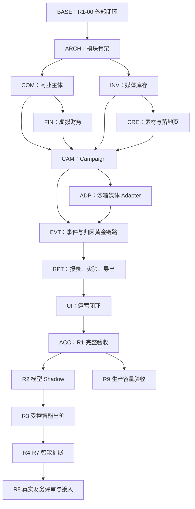

# SCX OCPX：Claude Code 多 Agent 最小任务实施手册

> 适用工作区：`/Users/karl/code/yw-tech/smart-converge-x`
>
> 状态：执行方案；任务状态仍以当前代码、数据库和验收证据为准
>
> 更新日期：2026-07-27

## 1. 使用方法

本手册把 SCX 完整 OCPX 路线拆成可单独领取、单独验证、单独交接的最小 Task。推荐用法：

1. 第一次启动 Claude Code 时粘贴“会话总控 Prompt”。
2. 每次只从任务索引领取一个依赖已满足的 Task，再粘贴对应“Task Prompt”。
3. Claude 主 Agent 负责边界、依赖、文件归属、最终集成和验收；子 Agent 不得自行扩展范围。
4. 同一个 Task 内可以多 Agent、多终端并行；多个写 Task 不得在同一工作树同时进行。
5. 每完成一个 Task，必须更新任务权威文档并留下命令、退出码、数据、权限和运行证据。
6. 未满足依赖、涉及真实资金、真实媒体、生产环境、公开协议或不可恢复数据操作时必须暂停请求授权。

本文档中的 Prompt 均按“会话总控 Prompt + 单项 Task Prompt”组合使用。不要一次粘贴多个写
Task，也不要让 Claude 根据任务标题跳过现状审计。

## 2. 当前起点

- R1-00 本地代码切片已经实现并通过后端、前端构建、契约、隔离 MySQL 和 Redis 恢复验证。
- R1-00 仍缺目标环境 V43–V46、多角色浏览器/API 回归、历史凭据轮换、真实第三方 UAT、
  RocketMQ/Outbox 目标环境恢复以及专用容量验收。
- R1-01 及 `scx-commercial`、`scx-finance`、`scx-inventory`、`scx-creative`、
  `scx-campaign` 尚未开始。
- 当前工作树存在未提交修改。Claude 必须保护这些修改，不得 reset、checkout、clean、stash、
  rebase、覆盖或擅自提交。
- 既有本地 20,000 QPS 门禁失败，不能作为生产容量证明。

## 3. 多 Agent 与多终端模型

### 3.1 一个 Task 内的 Agent 分工

| Agent | 默认角色 | 写入边界 |
|---|---|---|
| 主 Agent | 任务合同、依赖、文件分配、集成、最终验收 | 共享 POM、迁移序号、里程碑文档 |
| Scout Agent | 代码、Schema、权限、调用链和测试基线审计 | 只读 |
| Backend Agent | 领域模型、Service、Mapper、Controller、迁移 | 仅任务所属后端模块 |
| Frontend/Contract Agent | OpenAPI/AsyncAPI、前端、接入/UAT 文档 | 仅明确分配的契约和前端文件 |
| Test/Review Agent | 测试设计、安全审查、差异审查 | 默认只读；测试文件须由主 Agent 分配 |

最多同时运行四个 Agent。没有足够独立子范围时减少 Agent 数量，不为“并行”人为放大任务。

### 3.2 文件所有权硬规则

- 任一时刻，一个文件只能有一个写 Agent。
- 父 POM、`scx-boot/pom.xml`、迁移目录、OpenAPI 根文件、菜单迁移、MVP/ToDo 文档属于共享文件，
  只能由主 Agent 串行修改。
- 子 Agent 开始前必须报告预计写入文件；发现重叠立即停止写入并通知主 Agent。
- 多 Agent 不得同时运行会机械改写全仓的 formatter、lint fix 或依赖升级。
- 未经用户明确授权，不创建分支、提交、合并、推送、部署或连接生产资源。
- 若用户明确授权多个 Task 真并行，应为每个 Task 使用独立 worktree/分支，并由单一集成 Agent
  按依赖顺序审查合入；不能让多个 Task 共享脏工作树。

### 3.3 多终端建议

| 终端 | 用途 | 允许并行条件 |
|---|---|---|
| T1 | 主 Agent、Git 状态、差异审查 | 始终保留给主 Agent |
| T2 | 受影响后端模块测试 | 所有后端写入停止后 |
| T3 | 前端类型、单测、构建 | 所有前端写入停止后，可与 T2 并行 |
| T4 | 契约、迁移、隔离数据库或只读日志 | 不写共享产物时可与 T2/T3 并行 |

不得并行运行多个共享同一 Maven `target` 的 Reactor 构建，也不得让两个数据库验证进程使用同一
Schema。隔离验证必须使用不同容器、端口、数据库名和 `runId`。

## 4. 会话总控 Prompt

把下面内容作为每个新 Claude Code 会话的第一条指令：

```text
你是 SCX OCPX 项目的主协调 Agent。工作区固定为：
/Users/karl/code/yw-tech/smart-converge-x

开始前完整阅读：
1. AGENTS.md
2. docs/广告平台设计/README.md
3. docs/广告平台设计/MVP开发规划.md
4. docs/广告平台设计/OCPX智能投放技术开发设计.md
5. docs/广告平台设计/SCX-OCPX平台使用与功能验收手册.md
6. docs/广告平台设计/Claude-Code多Agent最小任务实施手册.md
7. docs/广告平台设计/2026-07-20-ocpx对标待补齐与目标模式TODO.md

执行硬规则：
- 先检查 git status、diff、当前迁移最大版本、相关代码和测试，再输出任务合同。
- 一次只实现我指定的一个 Task，不领取后续 Task，不顺手重构无关代码。
- 保护用户未提交修改；禁止 reset、checkout、clean、rebase、覆盖、删除或擅自 stash。
- 未经明确授权，不创建分支、提交、合并、推送、部署、连接生产库或使用真实资金/真实媒体凭据。
- 数据库只做前向迁移；不得修改已执行迁移、绕过校验和或破坏性清理。
- 管理端菜单不是授权边界；后端权限码、组织/媒体/账户对象 Scope 必须同时成立。
- 不记录或持久化原始 IDFA、IMEI、OAID、GAID、IDFV、CAID、完整设备哈希、密钥或令牌。
- HTTP 202 只表示可靠受理；必须继续核对 RawEvent、归因、Callback、Outbox、MQ、Redis 和报表。
- 代码、契约、迁移、权限、测试、运行证据、文档必须同步；不得用编译替代运行验收。
- 格式化只限定任务文件；立即执行 git diff --stat 和 git diff --check。

多 Agent 规则：
- 先派一个只读 Scout Agent 审计调用链、Schema、权限、测试和工作树风险。
- 有互不重叠的写入范围时，再并行派 Backend Agent、Frontend/Contract Agent。
- 最后派只读 Test/Review Agent 做安全、并发、权限、迁移和维护性审查。
- 开始前由主 Agent给出文件所有权表；任何两个 Agent 不得写同一文件。
- POM、迁移序号、OpenAPI 根文件和里程碑文档由主 Agent 串行集成。
- 主 Agent 对子 Agent 结果逐项复核，不得直接相信“已完成”声明。

每个 Task 开始时输出：
Task ID、业务目标、范围内、范围外、依赖、当前基线、工作树风险、预计文件、迁移、API/事件、
权限/隐私、失败/降级、测试范围、完成条件、Agent/文件分工。

每个 Task 完成时输出：
状态、业务闭环、变更文件、迁移、契约、命令与退出码、运行环境、真实请求、数据库事实、
Redis/MQ/Outbox、浏览器、权限、故障恢复、开放风险、未验收边界、工作树重叠和下一 Task 领取条件。

只有以下状态可用：
已实现并验证、已实现但未运行验证、部分完成、未开始、外部依赖阻塞、目标环境待验收、
生产容量未验收。
```

## 5. 任务依赖与并行波次



可并行原则：

- ARCH 子模块骨架可由不同 Agent 准备，但父 POM 和启动装配串行集成。
- COM 与 INV 在稳定的模块骨架之后可以作为两个独立 Task 流并行。
- FIN 依赖 COM 的广告账户稳定引用；CRE 依赖 INV 能力模型。
- CAM 必须等待 COM、FIN、INV、CRE 的稳定 Port/DTO。
- ADP 和 EVT 可以并行准备，端到端黄金链路必须在两者完成后执行。
- RPT 只读取稳定投影，不得反向依赖写模型。
- UI 可以在对应 API 稳定后分页面并行，但路由、菜单和权限迁移由单一 Agent 集成。

## 6. R1 最小任务索引

| Task ID | 最小可验收功能 | 依赖 |
|---|---|---|
| BASE-01 | 目标环境 V43–V46 迁移与账本核对 | 环境授权 |
| BASE-02 | 四角色媒体/渠道 Scope 真实回归 | BASE-01 |
| BASE-03 | 历史凭据轮换清单与安全处置验证 | 安全授权 |
| BASE-04 | 第三方 v1.1 签名、回执、轮换 UAT | BASE-02、外部渠道 |
| BASE-05 | RocketMQ/Outbox 故障恢复对账 | 独立测试环境 |
| ARCH-01 | `scx-commercial` 模块骨架 | BASE-01～05 |
| ARCH-02 | `scx-finance` 模块骨架 | ARCH-01 |
| ARCH-03 | `scx-inventory` 模块骨架 | BASE-01～05 |
| ARCH-04 | `scx-creative` 模块骨架 | ARCH-03 |
| ARCH-05 | `scx-campaign` 模块骨架 | ARCH-01～04 |
| ARCH-06 | 单向依赖、启动装配和占位权限验收 | ARCH-01～05 |
| COM-01 | Organization/Advertiser 创建与范围查询 | ARCH-01 |
| COM-02 | 最多二级 AgencyRelation | COM-01 |
| COM-03 | AdAccount 创建、归属和账户树 | COM-02 |
| COM-04 | QualificationCase 状态机和不可变审核日志 | COM-03 |
| COM-05 | AgreementTemplate/Instance | COM-03 |
| COM-06 | DataAuthorization 与发布资格只读 Port | COM-04、COM-05 |
| FIN-01 | 财务科目与 FinAccount | ARCH-02、COM-03 |
| FIN-02 | 平衡 FinJournal/FinEntry 引擎 | FIN-01 |
| FIN-03 | 虚拟充值和赠送 | FIN-02 |
| FIN-04 | CreditLine 授信与到期 | FIN-02 |
| FIN-05 | BudgetReservation 预留与释放 | FIN-03、FIN-04 |
| FIN-06 | 估算/确认消耗和冲正 | FIN-05 |
| FIN-07 | 可用余额与 LedgerBalanceSnapshot | FIN-06 |
| FIN-08 | 财务幂等、并发和不变量测试 | FIN-02～07 |
| FIN-09 | 版本化返点规则与差额重算 | FIN-08 |
| FIN-10 | RefundCase 经办/审批和冲正 | FIN-08 |
| FIN-11 | InvoiceApplication 防重复模拟流程 | FIN-08 |
| FIN-12 | ReconciliationRun 差异明细 | FIN-09～11 |
| FIN-13 | ClosingPeriod 关账与 AdjustmentJournal | FIN-12 |
| INV-01 | MediaAccount 创建与范围控制 | ARCH-03 |
| INV-02 | Placement/PlacementFormat | INV-01 |
| INV-03 | MediaCapabilityMatrix | INV-02 |
| INV-04 | PlacementQualitySnapshot | INV-02 |
| INV-05 | MediaAdapterConfig 脱敏配置 | INV-03 |
| CRE-01 | CreativeAsset/AssetBinary 元数据与不可变引用 | ARCH-04、INV-03 |
| CRE-02 | MIME、文件头、大小和哈希校验 | CRE-01 |
| CRE-03 | 素材扫描/审核状态机和日志 | CRE-02 |
| CRE-04 | CreativeAssetRevision 发布与暂停 | CRE-03 |
| CRE-05 | LandingPage 版本化 Schema 和 URL 安全 | CRE-03 |
| CRE-06 | CreativeBinding 与媒体能力校验 | CRE-04、CRE-05 |
| CAM-01 | Campaign/CampaignRevision | ARCH-05、COM-06 |
| CAM-02 | AdGroup/AdGroupRevision | CAM-01 |
| CAM-03 | Ad/AdRevision/CreativeBinding 引用 | CAM-02、CRE-06 |
| CAM-04 | TargetingRevision 版本化 AST | CAM-02、INV-03 |
| CAM-05 | OptimizationGoal/BudgetPlan | CAM-01、FIN-05 |
| CAM-06 | 发布前验证器 | CAM-03～05 |
| CAM-07 | Campaign 状态机、PublishingOperation | CAM-06 |
| ADP-01 | 统一 MediaAdapter Port 和防腐 DTO | CAM-07、INV-05 |
| ADP-02 | 沙箱幂等发布与外部 ID 映射 | ADP-01 |
| ADP-03 | 状态同步与增量游标 | ADP-02 |
| ADP-04 | 报表/账单拉取与迟到数据 | ADP-02 |
| ADP-05 | 429/5xx/超时/部分成功故障注入 | ADP-03、ADP-04 |
| EVT-01 | EventDefinition 及版本目录 | CAM-01 |
| EVT-02 | 业务键、有效性、价值和优化资格规则 | EVT-01 |
| EVT-03 | FORM_SUBMIT v1.1 canonical/去重 | EVT-02 |
| EVT-04 | Last Click 7d 规则版本和重算 | EVT-03 |
| EVT-05 | 归因后幂等媒体 Postback | EVT-04、ADP-02 |
| EVT-06 | 虚拟消耗与 CPA=50 对账 | EVT-05、FIN-06 |
| RPT-01 | 广告层级日/小时只读投影 | EVT-06 |
| RPT-02 | REQUEST→FORM_SUBMIT 漏斗 | RPT-01 |
| RPT-03 | 消耗、CPA、返点、退款、可开票指标 | RPT-01、FIN-13 |
| RPT-04 | 固定水位、规则版本和输入哈希的 ReportRun | RPT-02、RPT-03 |
| RPT-05 | HMAC 稳定实验分桶 | RPT-04 |
| RPT-06 | Scope 快照、重新鉴权、过期和脱敏导出 | RPT-04 |
| UI-01 | 商业主体、代理和账户树页面 | COM-03 |
| UI-02 | 资质、合同、数据授权页面 | COM-06 |
| UI-03 | 财务账户、充值、授信、预留页面 | FIN-08 |
| UI-04 | 返点、退款、发票、对账和月结页面 | FIN-13 |
| UI-05 | 媒体账户、广告位、能力和质量页面 | INV-05 |
| UI-06 | 素材库和落地页页面 | CRE-06 |
| UI-07 | Campaign/AdGroup/Ad 编辑与校验页面 | CAM-07 |
| UI-08 | 发布记录和沙箱媒体运行页面 | ADP-05 |
| UI-09 | 事件目录、漏斗和实验页面 | EVT-06、RPT-05 |
| UI-10 | 投放/财务报表与安全导出页面 | RPT-06 |
| ACC-01 | 八角色权限矩阵自动化验收 | UI-01～10 |
| ACC-02 | FORM_SUBMIT 黄金 E2E | ACC-01 |
| ACC-03 | Redis/MQ/Outbox/Adapter 故障恢复 | ACC-02 |
| ACC-04 | 隐私、密钥、日志和审计验收 | ACC-02 |
| ACC-05 | 独立目标环境 R1 签收 | ACC-01～04 |

## 7. R1 Task Prompt

以下 Prompt 只描述当前 Task 的增量目标；执行时必须同时遵守第 4 节会话总控 Prompt。

### BASE-01～BASE-05

```text
Task ID: BASE-01
目标：在已授权、可备份的目标环境显式应用已批准的 V43–V46，并验证 SQL SHA-256、真实结构、字段、凭据修复和菜单。
范围外：业务功能开发、生产发布、历史迁移改写。先做备份和只读检查；任何真实环境写入都需本次明确授权。
多 Agent：Scout 只读核对目标 Schema；DB Agent准备命令和核对 SQL；Review Agent检查可恢复性；主 Agent独占执行窗口。
验收：升级前后数据量对账、重复执行策略、发布包 SQL SHA-256、V43–V46 结构后置条件、db-verify、证据脱敏、Runbook/ToDo 更新。禁止使用已退役的数据库迁移账本。
```

```text
Task ID: BASE-02
目标：用管理员、授权运营、授权分析员、无范围用户完成媒体和渠道客户端的浏览器、直接路由、直接 API 越权回归。
范围外：新角色设计和菜单重构。无权限与不存在必须不可区分，分析员只读，运营只能操作授权媒体。
多 Agent：API Agent执行接口矩阵；Browser Agent执行页面矩阵；Review Agent审计日志和对象枚举；主 Agent汇总。
验收：每个角色的读/写/导出/直接 URL/跨媒体结果、HTTP 状态、审计记录和浏览器证据齐全。
```

```text
Task ID: BASE-03
目标：形成历史凭据暴露清单、轮换计划、责任人和验证证据，并确认仓库/日志/产物不再含有效凭据。
范围外：Claude 不读取、打印或保存新密钥，不自行操作生产密钥管理系统。
多 Agent：Scanner Agent只报告文件和规则不回显值；Config Agent修复安全占位；Review Agent复核历史与部署面；主 Agent协调人工轮换。
验收：旧凭据失效、新凭据可用、日志无明文、密钥扫描通过、事故/处置记录和剩余风险明确。
```

```text
Task ID: BASE-04
目标：让一个真实第三方沙箱渠道完成 OCPX v1.1 五头签名、端点 Scope、nonce、限流、回执、Postback 和密钥轮换 UAT。
范围外：真实生产流量、公开协议破坏性变更、向浏览器发放签名密钥。
多 Agent：Protocol Agent核对契约；Runtime Agent跟踪请求到数据库/Redis；Docs Agent记录 UAT；主 Agent处理协议差异。
验收：成功和全部失败用例、重试幂等、轮换重叠窗口、双方签收、脱敏日志、OpenAPI/接入指南同步。
```

```text
Task ID: BASE-05
目标：在独立测试环境验证 RawEvent、Outbox、RocketMQ、Callback、Redis Stream 的停机、重启、reclaim、DLQ 和最终对账。
范围外：生产环境故障注入和 20k QPS。
多 Agent：Fault Agent编排故障；Data Agent核对 MySQL/Outbox；Redis/MQ Agent核对 Pending/lag/DLQ；主 Agent控制 runId。
验收：accepted 数与 RawEvent/PROCESSED/Outbox/Postback 精确对账，积压在门限内归零，重复 Postback=0，恢复 Runbook 完成。
```

### ARCH-01～ARCH-06

```text
Task ID: ARCH-01
目标：创建只含标准目录、最小 POM、占位测试和稳定公共类型的 scx-commercial 模块并接入父 POM。
范围外：商业表、CRUD、菜单页面。禁止提前依赖 finance/inventory/creative/campaign。
多 Agent：Scout核对现有模块模式；Backend Agent创建模块；Review Agent检查依赖方向；主 Agent修改共享父 POM。
验收：模块测试、scx-boot 聚合编译、依赖树无循环、无无用框架抽象。
```

```text
Task ID: ARCH-02
目标：创建 scx-finance 骨架，只允许依赖 commercial 的稳定 Port/DTO，不实现账本。
范围外：充值、余额和真实资金。主 Agent独占父 POM和启动装配文件。
验收：模块单测占位、聚合编译、依赖方向检查、架构测试证明 commercial 不反向依赖 finance。
```

```text
Task ID: ARCH-03
目标：创建 scx-inventory 骨架，可依赖 subject/delivery 稳定接口，不实现媒体账户和广告位。
范围外：媒体 Adapter 和 Campaign。检查不能把外部媒体枚举放进核心模型。
验收：模块编译、启动装配、依赖树、基础包结构和维护说明通过。
```

```text
Task ID: ARCH-04
目标：创建 scx-creative 骨架，只依赖 commercial/inventory 稳定接口，不接真实对象存储。
范围外：素材上传和审核实现。
验收：模块编译、依赖单向、对象存储 Port 占位不泄漏具体厂商类型。
```

```text
Task ID: ARCH-05
目标：创建 scx-campaign 骨架，通过 Port 依赖 commercial/finance/inventory/creative/delivery。
范围外：Campaign 表和状态机；tracking 不能反向形成 Maven 循环。
验收：依赖树无环、scx-boot 可装配、用于 tracking/reporting 的稳定只读引用接口有最小契约测试。
```

```text
Task ID: ARCH-06
目标：串行完成五个新模块的 scx-boot 装配、基础权限码/菜单占位和架构依赖测试。
范围外：真实菜单业务页、领域 CRUD。
多 Agent：Dependency Agent只读审查；Permission Agent核对权限命名；主 Agent独占 POM/菜单迁移。
验收：全后端测试、启动 Smoke、菜单迁移空库/升级/重复执行、无循环依赖和未授权占位入口。
```

### COM-01～COM-06

```text
Task ID: COM-01
目标：实现 Organization 和 Advertiser 的创建、稳定分页查询、详情及组织范围隔离。
范围外：代理关系、广告账户、资质。新增唯一前向迁移、权限码、OpenAPI、服务/控制器测试和最小管理入口。
关键约束：组织类型使用锁定枚举；跨组织不可枚举；状态和审计字段不可由客户端任意覆盖。
验收：管理员/本组织/跨组织 API 矩阵、数据库唯一约束、分页稳定性、前后端任务文件质量门通过。
```

```text
Task ID: COM-02
目标：实现 AgencyRelation 的建立和撤销，严格限制一级代理加一层子代理。
范围外：返点和退款责任计算。用数据库约束和事务防止环、第三层、重复激活和越级授权。
验收：合法直客/一级/二级关系，环路/第三层/并发重复失败，撤销后新发布资格为 false，历史关系保留。
```

```text
Task ID: COM-03
目标：实现 AdAccount 创建、归属、状态、广告主/代理关联和受 Scope 控制的账户树。
范围外：财务余额和 Campaign。账户归属不可通过更新绕过，树查询不得 N+1 或泄漏其他组织。
验收：直客、一级代理、二级代理账户路径，跨范围查询/导出拒绝，稳定分页和账户树测试通过。
```

```text
Task ID: COM-04
目标：实现 QualificationCase/Document/ReviewLog 及完整资质状态机。
范围外：外部 OCR 和真实监管审核。审核日志追加不可改；到期、暂停、拒绝阻止新发布。
验收：所有合法/非法状态迁移、经办/审核权限、补件、到期边界、并发审核和历史追溯测试通过。
```

```text
Task ID: COM-05
目标：实现 AgreementTemplate 和 AgreementInstance 的版本化创建、签署模拟、终止和查询。
范围外：电子签章和真实法律文件。已生效模板不可覆盖；实例固定模板版本、主体、时区和有效期。
验收：有效/过期/终止合同发布资格、跨组织访问、版本不可变和审计证据通过。
```

```text
Task ID: COM-06
目标：实现 DataAuthorization 和统一 PublishingEligibilityPort，汇总主体、代理、资质、合同和数据授权资格。
范围外：预算、素材和媒体能力校验。返回稳定原因码，不让 campaign 直接访问 commercial 内部 Mapper。
验收：每个失败原因、组合优先级、Scope、到期时间和只读 Port 契约测试通过。
```

### FIN-01～FIN-13

```text
Task ID: FIN-01
目标：实现 CNY 单币种 FinAccount 和锁定账户类型，账户归属 AdAccount，禁止删除已有事实的账户。
范围外：余额变动。金额使用定点数；账户创建幂等且受组织/账户 Scope。
验收：账户唯一性、类型、币种、状态和跨账户越权测试通过。
```

```text
Task ID: FIN-02
目标：实现不可变 FinJournal/FinEntry 双分录引擎，业务幂等键为 businessType+businessId。
范围外：具体充值/消耗流程。只暴露领域命令，不允许 Controller 直接写 Entry。
验收：每笔借贷平衡、同幂等键单一效果、事务回滚无半笔账、并发重复只有一笔 Journal。
```

```text
Task ID: FIN-03
目标：基于账本实现虚拟充值和虚拟赠送，形成独立业务类型和审计。
范围外：真实支付。输入金额必须正数，重复请求幂等，撤销通过冲正而非覆盖。
验收：充值/赠送余额投影、重复/并发/非法金额、权限和不可变分录测试通过。
```

```text
Task ID: FIN-04
目标：实现 CreditLine 创建、激活、使用、到期和失效，固定额度、有效期和责任主体。
范围外：银行授信。过期授信不得进入 available；历史使用和失效可追溯。
验收：边界时刻使用数据库时钟、并发额度占用、过期后余额和审计测试通过。
```

```text
Task ID: FIN-05
目标：实现 BudgetReservation 预留、部分释放和全部释放，防止 available 变为负数。
范围外：确认消耗。使用行锁/条件更新/乐观锁，释放后额度不可再次消费。
验收：并发超扣、重复预留、部分释放、到期释放和跨账户 Scope 测试通过。
```

```text
Task ID: FIN-06
目标：实现 estimatedSpend→confirmedSpend、差额释放和冲正，确认消耗不能超过允许资金。
范围外：真实媒体账单。每次变动生成新 Journal，迟到消耗需稳定处理策略和原因码。
验收：正常、部分确认、超额、重复、乱序、冲正和余额重建测试通过。
```

```text
Task ID: FIN-07
目标：实现 available 计算、账本明细和 LedgerBalanceSnapshot，只把快照作为可重建投影。
范围外：报表聚合。查询必须固定水位并受账户 Scope，不能依赖浮点数。
验收：从 Entry 重放得到相同余额，cash+credit-reservation-riskHold 公式和分页查询通过。
```

```text
Task ID: FIN-08
目标：集中补齐财务属性测试、数据库并发测试和故障回滚测试。
范围外：新业务功能。覆盖借贷平衡、非负可用余额、幂等、不可重复释放、确认消耗上限。
多 Agent：Test Agent生成性质用例；Concurrency Agent做双 Worker；Review Agent审计锁顺序；主 Agent修复。
验收：随机序列和真实 MySQL 并发重复运行稳定，无死锁掩盖和脆弱 sleep。
```

```text
Task ID: FIN-09
目标：实现结构化 RebateRule/Version/Calculation，生效版本不可改，重算产生新 revision 和差额分录。
范围外：任意脚本 DSL。相同事实只命中一个主规则，条件树字段使用白名单。
验收：规则优先级、版本、生效区间、重算差额、输入哈希和冲突规则测试通过。
```

```text
Task ID: FIN-10
目标：实现 RefundCase 经办/审批分离、可退款余额校验、复核和账本冲正。
范围外：真实退款通道。原分录不覆盖，大额/异常阈值可配置且有审计。
验收：同人审批拒绝、超额/重复退款拒绝、失败可恢复、权限和并发测试通过。
```

```text
Task ID: FIN-11
目标：实现 InvoiceApplication/Item 模拟流程，仅使用已结算且未开票金额并防重复。
范围外：真实税务发票和税控接口。发票状态与账本事实分离。
验收：并发申请、部分申请、撤回、拒绝、跨期和 Scope 测试通过。
```

```text
Task ID: FIN-12
目标：实现 ReconciliationRun/Item，固定账户范围、账期、时区、成本/返点版本和输入哈希。
范围外：关账动作。差异原因码稳定，可重跑但不能覆盖历史 Run。
验收：一致、缺失、重复、迟到、金额差异和阈值阻断测试通过。
```

```text
Task ID: FIN-13
目标：实现 ClosingPeriod 和 AdjustmentJournal；关账后只允许新调整/冲正，不允许改旧事实。
范围外：真实会计总账。关账要求差异门禁、双人权限和数据库事务。
验收：重复关账、并发关账、跨期写入阻断、解锁禁用、调整和余额重建通过。
```

### INV-01～INV-05

```text
Task ID: INV-01
目标：实现 MediaAccount 创建、状态、归属和媒体/广告账户双 Scope。
范围外：真实 OAuth 和 Adapter 调用。凭据只存安全引用，不返回明文。
验收：Scope 矩阵、唯一外部账户引用、状态和脱敏序列化测试通过。
```

```text
Task ID: INV-02
目标：实现 Placement/PlacementFormat，支持锁定的八类广告位和稳定分页查询。
范围外：能力矩阵和质量分。尺寸、时长、文件大小使用结构化字段和明确单位。
验收：媒体账户归属、格式约束、重复外部 ID、跨媒体访问和分页测试通过。
```

```text
Task ID: INV-03
目标：实现版本化 MediaCapabilityMatrix，表达计费、事件、定向、素材和同步能力。
范围外：核心模型直接使用供应商枚举。发布校验只能通过只读 CapabilityPort。
验收：版本生效、未知能力默认拒绝、格式兼容、跨媒体 Scope 和 Port 契约测试通过。
```

```text
Task ID: INV-04
目标：实现 PlacementQualitySnapshot，只追加质量水位、时间和来源，不覆盖历史。
范围外：机器学习质量预测。查询固定最新/指定水位语义。
验收：迟到快照、同水位幂等、历史查询和 Scope 测试通过。
```

```text
Task ID: INV-05
目标：实现 MediaAdapterConfig 的版本化非敏感配置和 Secret Reference。
范围外：保存真实密钥值。URL 必须 HTTPS、白名单、禁止内网/环回/重定向绕过。
验收：SSRF 用例、脱敏日志、版本切换、失效配置和权限测试通过。
```

### CRE-01～CRE-06

```text
Task ID: CRE-01
目标：实现 CreativeAsset、AssetBinary 元数据和对象存储不可变引用，不接收数据库 BLOB。
范围外：审核和发布。哈希、长度、MIME、存储 key 和上传者可追溯。
验收：重复哈希、跨账户引用、对象不存在和 Scope 测试通过。
```

```text
Task ID: CRE-02
目标：实现 MIME、扩展名、文件头、大小和 SHA-256 一致性校验，并预留病毒扫描 Port。
范围外：伪造“已病毒扫描”。校验失败不得进入可审核状态。
验收：常见伪装文件、超限、截断、哈希冲突和失败清理测试通过。
```

```text
Task ID: CRE-03
目标：实现素材 SCANNING→REVIEWING→APPROVED/REJECTED 状态机和不可变 ReviewLog。
范围外：外部内容审核服务。审核人与提交人权限分离，非法迁移拒绝。
验收：全状态矩阵、并发审核、补充原因、日志不可更新和 Scope 测试通过。
```

```text
Task ID: CRE-04
目标：实现 CreativeAssetRevision 的版本发布、暂停和具体 revision 引用。
范围外：DCO/AIGC。未审核和已暂停版本不能用于新发布，旧 Campaign 历史引用保留。
验收：版本不可覆盖、并发发布、暂停边界和引用完整性通过。
```

```text
Task ID: CRE-05
目标：实现 LandingPage/Revision 的白名单 Schema、跳转 URL 安全和版本发布。
范围外：用户任意 JavaScript。URL 禁止原始设备标识、手机号、内网地址和开放重定向。
验收：Schema 校验、XSS/SSRF/敏感查询参数、版本不可变和 Scope 测试通过。
```

```text
Task ID: CRE-06
目标：实现 CreativeBinding，把审核通过的素材/落地页 revision 与广告位能力绑定。
范围外：自动组合。绑定时校验尺寸、类型、时长、大小和当前可用状态。
验收：全部不兼容原因码、暂停后新绑定拒绝、历史绑定可追溯和跨账户拒绝通过。
```

### CAM-01～CAM-07

```text
Task ID: CAM-01
目标：实现 Campaign/CampaignRevision 的草稿创建和版本查询，默认 FORM_SUBMIT、CPA 50 CNY、Asia/Shanghai。
范围外：发布和自动出价。已发布 revision 永不覆盖，金额和时间字段精确定义。
验收：版本、并发编辑、币种、时间范围、权限和对象 Scope 测试通过。
```

```text
Task ID: CAM-02
目标：实现 AdGroup/AdGroupRevision，归属 Campaign revision，支持草稿和版本化修改。
范围外：Ad 和定向执行。父对象跨账户引用必须被拒绝。
验收：层级完整、版本链、并发更新和 Scope 测试通过。
```

```text
Task ID: CAM-03
目标：实现 Ad/AdRevision 并引用明确 CreativeBinding revision。
范围外：媒体发布。审核/暂停状态在创建和发布验证阶段分别检查。
验收：跨层级、跨账户、失效素材、版本不可变和稳定查询通过。
```

```text
Task ID: CAM-04
目标：实现 TargetingRevision 的版本化白名单 AST，不拼接用户 SQL。
范围外：智能扩量。未知节点默认拒绝，硬定向与可扩量定向显式区分。
验收：AST Schema、深度/节点限制、注入、版本哈希和媒体能力兼容测试通过。
```

```text
Task ID: CAM-05
目标：实现 OptimizationGoal 和 BudgetPlan，支持 CPM/CPC/MEDIA_MANAGED_OCPC，不实现 SCX 自主竞价。
范围外：模型推理。目标事件来自事件目录；预算绑定 reservation，不直接改余额。
验收：目标 CPA、日/总预算、排期、时区、余额不足和幂等测试通过。
```

```text
Task ID: CAM-06
目标：实现发布前验证器，聚合商业资格、余额、预留、媒体能力、素材、落地页、事件、时间和目标成本。
范围外：实际发布。各领域通过 Port 调用，返回稳定、可解释、可排序的原因列表。
验收：每一门禁失败、组合失败、Scope、超时降级和无循环依赖测试通过。
```

```text
Task ID: CAM-07
目标：实现 Campaign 状态机和 PublishingOperation，覆盖验证、审核、发布、部分成功、投放、暂停、失败和结束。
范围外：Adapter 内部实现。命令使用乐观锁和幂等键，每次变化记录操作者、原因和 revision。
验收：合法/非法迁移、重复命令、并发暂停/发布、部分成功和审计测试通过。
```

### ADP-01～ADP-05

```text
Task ID: ADP-01
目标：定义 MediaAdapter Port、内部 DTO、稳定错误码和防腐转换，不泄漏外部媒体枚举。
范围外：具体媒体 SDK。接口包括 capabilities、placements、publish、status、report、billing。
验收：模块依赖无环、DTO 兼容性、错误归一和契约测试通过。
```

```text
Task ID: ADP-02
目标：实现 GenericSandboxMediaAdapter 幂等发布、外部 ID 映射和重复响应处理。
范围外：真实媒体。相同发布幂等键只产生一个外部对象，部分成功逐对象记录。
验收：首次、重复、冲突、超时后重试和映射恢复测试通过。
```

```text
Task ID: ADP-03
目标：实现沙箱状态同步、增量游标和状态漂移检测。
范围外：报表成本。游标只有成功处理后推进，迟到/重复状态幂等。
验收：分页、游标重放、乱序、未知外部状态和漂移告警测试通过。
```

```text
Task ID: ADP-04
目标：实现 pullReport/pullBilling 的增量导入、数据水位、迟到数据和重复批次处理。
范围外：财务关账。原始外部快照不可变，归一事实带来源和哈希。
验收：重复、迟到、缺页、金额精度、游标恢复和对账输入测试通过。
```

```text
Task ID: ADP-05
目标：为沙箱 Adapter 增加可控 429、5xx、超时、部分成功、重复、迟到和状态漂移注入。
范围外：生产故障。故障配置只在 sandbox/test profile 可用，默认关闭。
验收：重试退避、熔断、幂等、人工重放、告警和恢复后对账通过。
```

### EVT-01～EVT-06

```text
Task ID: EVT-01
目标：实现版本化 EventDefinition，内置锁定事件目录并支持受控 CUSTOM。
范围外：归因和回传。事件码、阶段、值类型和生效区间不可由普通用户破坏。
验收：版本、重复码、状态、Scope 和 API/Schema 测试通过。
```

```text
Task ID: EVT-02
目标：实现 BusinessKeyRule、ValidityRule、ValueRule、AttributionPolicyReference、OptimizationEligibility。
范围外：执行任意脚本。只允许结构化规则和字段白名单。
验收：FORM_SUBMIT 的 lead_id、有效性、价值、canonical 和优化资格全分支通过。
```

```text
Task ID: EVT-03
目标：保持 v1.1 公开契约，实现 FORM_SUBMIT canonical、业务去重和有效转化落库。
范围外：修改设备字段或五头签名。无效/作弊/重复事件不得进入优化和 CPA。
验收：签名、nonce、eventId 幂等、lead_id 去重、乱序和回执原因码通过。
```

```text
Task ID: EVT-04
目标：实现 Last Click 7 天、Asia/Shanghai 的归因规则版本、结果版本和受限重算。
范围外：MTA。重算追加新结果，不覆盖历史；原因码稳定。
验收：窗口边界、多个点击、跨任务、无匹配、迟到、重算和 Scope 测试通过。
```

```text
Task ID: EVT-05
目标：归因成功后创建幂等 Postback 任务，通过 Adapter/HTTP 安全 Port 回传。
范围外：把原始标识放入 URL。固定载荷快照、HMAC、重试、DLQ、禁止重定向和 SSRF。
验收：成功、重复、429、5xx、超时、永久失败和人工重放，重复 Postback=0。
```

```text
Task ID: EVT-06
目标：把沙箱媒体消耗映射为 estimated/confirmed spend，并生成 FORM_SUBMIT CPA=50 的可解释对账。
范围外：自动调价。固定成本/事件/归因水位，差异不覆盖原事实。
验收：正常、迟到、重复、成本修订、无有效转化和跨账户 Scope 测试通过。
```

### RPT-01～RPT-06

```text
Task ID: RPT-01
目标：实现账户/Campaign/AdGroup/Ad/Creative/Media/Placement 的日和小时只读投影。
范围外：直接跨模块 JOIN 写模型。聚合可重建、幂等，维度 Scope 在服务端强制。
验收：重复消息、迟到修订、零数据、时区边界和汇总一致性通过。
```

```text
Task ID: RPT-02
目标：实现 REQUEST→IMPRESSION→CLICK→LANDING→FORM_SUBMIT 漏斗及 CTR/CVR。
范围外：无来源定义的留存指标。分母为零语义明确。
验收：逐层不增约束、有效点击/转化口径、时区和多维筛选通过。
```

```text
Task ID: RPT-03
目标：实现 estimated/confirmed spend、CPA、rebate、refund、invoiceableAmount 指标投影。
范围外：从报表反写账本。财务数必须能追溯到固定 Journal/Reconciliation 水位。
验收：报表与账本逐项对账、修订、关账期间和 Scope 测试通过。
```

```text
Task ID: RPT-04
目标：实现 ReportRun，冻结时区、事件/成本水位、归因/规则版本和输入哈希。
范围外：实验和导出。重复相同输入可复用，任何输入变化产生新 Run。
验收：快照可复现、迟到数据不静默改变旧 Run、状态机和失败重试通过。
```

```text
Task ID: RPT-05
目标：实现 HMAC internalDeviceKey 的 0..9999 稳定实验分桶和请求级降级标记。
范围外：宣称因果增量。盐不可返回前端，原始设备标识不入库。
验收：稳定性、均匀性、盐版本、缺失设备键和跨实验隔离测试通过。
```

```text
Task ID: RPT-06
目标：实现冻结筛选/Scope/水位的异步导出，下载重新鉴权、自动过期和默认脱敏。
范围外：导出明文敏感标识。任务创建与下载均做对象 Scope。
验收：权限变化、过期、重复创建、失败重试、文件清理和内容对账通过。
```

### UI-01～UI-10

所有 UI Task 都必须使用现有 Element Plus、系统布局和 Token，并覆盖加载、空、错误、稳定分页、
状态/关键字筛选、直接路由、直接 API、危险操作原因与确认、浏览器控制台和响应式布局。

```text
Task ID: UI-01
目标：实现广告主、代理关系和账户树的最小运营页面，后端 Scope 是唯一授权来源。
范围外：资质和财务。使用现有布局，不复制一套新设计系统。
验收：八类关键组织路径、分页筛选、跨组织直接 URL/API 和浏览器证据通过。
```

```text
Task ID: UI-02
目标：实现资质提交/审核、合同实例和数据授权页面，展示状态历史但不允许改审计记录。
验收：经办/审核分离、到期、补件、拒绝、直接 API 越权和错误恢复通过。
```

```text
Task ID: UI-03
目标：实现财务账户、虚拟充值、赠送、授信、预算预留和账本明细页面。
范围外：真实支付入口。金额二次确认，不显示可伪造余额。
验收：幂等重复提交、并发冲突、权限、金额格式和账本追溯通过。
```

```text
Task ID: UI-04
目标：实现返点、退款、发票、对账、月结和调整页面。
验收：经办/审批分离、差异阻断、关账后只调整、导出 Scope 和审计证据通过。
```

```text
Task ID: UI-05
目标：实现媒体账户、广告位、能力矩阵、质量快照和 Adapter 配置页面。
范围外：显示明文密钥。Secret 只能选择引用或一次性输入。
验收：跨媒体 Scope、版本、SSRF 前端提示、空/错状态和浏览器证据通过。
```

```text
Task ID: UI-06
目标：实现素材上传元数据、扫描/审核、版本、暂停、落地页和绑定页面。
范围外：DCO/AIGC。上传失败可恢复，安全校验原因清晰。
验收：不兼容素材、未审核发布、XSS/URL 安全、跨账户和浏览器证据通过。
```

```text
Task ID: UI-07
目标：实现 Campaign/AdGroup/Ad 分层编辑、版本、预算、定向 AST 和发布前校验页面。
范围外：自主实时出价。保存草稿与发布命令分离。
验收：并发版本冲突、所有门禁原因、Scope、直接 API 和浏览器证据通过。
```

```text
Task ID: UI-08
目标：实现发布记录、部分成功、状态同步、沙箱故障注入和人工重试页面。
范围外：生产 profile 故障开关。高风险重试必须确认并记录原因。
验收：429/5xx/超时/漂移、幂等重试、权限和恢复视图通过。
```

```text
Task ID: UI-09
目标：实现事件目录、FORM_SUBMIT 配置、漏斗和实验页面。
范围外：把实验结果描述为因果增量。展示规则/归因/盐版本和水位。
验收：事件版本、无效转化原因、漏斗口径、请求级实验标记和 Scope 通过。
```

```text
Task ID: UI-10
目标：实现投放/财务报表、统一筛选、总计、ReportRun 和安全导出页面。
验收：筛选快照、权限变化后下载拒绝、过期、脱敏、报表账本对账和浏览器证据通过。
```

### ACC-01～ACC-05

```text
Task ID: ACC-01
目标：建立平台管理员、直客、一级代理、二级代理、财务经办、财务审批、安全审计、只读运营权限矩阵。
范围外：新增业务功能。覆盖菜单、直接路由、直接 API、对象 Scope、导出和敏感字段。
验收：自动化矩阵加人工浏览器复核，无权限与不存在不可区分，所有越权结果可审计。
```

```text
Task ID: ACC-02
目标：执行从主体、代理、账户、资质、合同、虚拟资金、素材、Campaign、沙箱发布、点击、FORM_SUBMIT、
归因、Postback、消耗、CPA、返点、退款、发票、月结、报表和导出的完整黄金 E2E。
范围外：真实资金和真实媒体。使用唯一 runId 和隔离基础设施。
验收：28 步业务证据、数据库事实、Redis/MQ/Outbox 和八角色结果完整，不以 HTTP 202 结束验收。
```

```text
Task ID: ACC-03
目标：在黄金链路中注入 Redis、RocketMQ、Worker、Adapter、数据库短时故障并验证恢复。
验收：accepted 不丢失、幂等、重复 Postback=0、Pending/DLQ/Outbox 在门限内归零、Runbook 可复演。
```

```text
Task ID: ACC-04
目标：完成设备标识、密钥、URL、日志、导出、审计、依赖和静态安全检查。
范围外：宣称没有工具覆盖的安全保证。
验收：无原始标识/密钥泄漏、SSRF/XSS/注入/对象越权用例、密钥轮换和审计保留策略通过。
```

```text
Task ID: ACC-05
目标：在独立测试环境重跑 R1 全部迁移、黄金 E2E、角色矩阵、恢复和数据对账，由负责人签收。
范围外：生产容量和真实财务。任何缺项保持“目标环境待验收”。
验收：版本化验收报告、环境清单、命令退出码、证据链接、开放风险和 Go/No-Go 结论完整。
```

## 8. R2–R9 最小任务与 Prompt

R2–R9 只有在 R1-ACC-05 签收后才能领取。每项仍使用第 4 节总控 Prompt。

### R2：模型 Shadow

| Task ID | 功能 | 依赖 |
|---|---|---|
| ML-01 | Feature Registry 与版本 | ACC-05 |
| ML-02 | Dataset Snapshot 与 point-in-time join | ML-01 |
| ML-03 | TrainingRun：LR、GBDT+LR | ML-02 |
| ML-04 | ModelVersion/Artifact/Evaluation | ML-03 |
| ML-05 | Shadow 在线推理与一致性 | ML-04 |

```text
Task ID: ML-01
实现版本化 Feature Registry，定义来源、类型、时效、缺失策略、隐私级别和在线/离线所有者。
禁止直接读取原始设备标识和无授权客户数据。验收 Schema 兼容、血缘、版本和权限。
```

```text
Task ID: ML-02
实现不可变 Dataset Snapshot 和 point-in-time join，固定事件/归因/成本水位、时间范围和输入哈希。
重点验证无未来泄漏、迟到数据、重跑一致性、数据授权和删除策略。
```

```text
Task ID: ML-03
实现 TrainingRun，先支持 Logistic Regression 与 GBDT+LR，固定代码、配置、数据、seed 和产物引用。
不引入 Transformer。验收可复现训练、失败恢复、资源限制和元数据完整性。
```

```text
Task ID: ML-04
实现 ModelVersion、ModelArtifact、ModelEvaluation，输出 AUC、GAUC、LogLoss、PR-AUC、Calibration 及分媒体/
人群/冷启动切片。产物不可覆盖，指标必须关联 Dataset/TrainingRun。
```

```text
Task ID: ML-05
实现只 Shadow 的在线推理，不影响投放决策；记录模型版本、特征版本、缺失、耗时和基线差异。
验收推理 p99、训练/在线一致性、降级和隐私；禁止把 Shadow 描述为增量收益。
```

### R3：受控智能出价

| Task ID | 功能 | 依赖 |
|---|---|---|
| BID-01 | Decision API 与回退 | ML-05 |
| BID-02 | CTR/CVR 推理与校准 | BID-01 |
| BID-03 | oCPC/oCPM 出价、cap、floor | BID-02 |
| BID-04 | PID 成本控制与 Pacing | BID-03 |
| BID-05 | 预算保护、Kill Switch、Canary | BID-04 |

```text
Task ID: BID-01
实现有版本、幂等、超时和稳定回退的 Decision API；不改变现有 v1.1 RTA 契约。
验收缺特征、模型不可用、超时、旧版本和审计，不允许失败时无限出价。
```

```text
Task ID: BID-02
接入校准后的 CTR/CVR 推理，固定模型和特征版本，输出可解释质量标记。
验收离线/在线一致、校准、缺失降级、p99 和分切片漂移。
```

```text
Task ID: BID-03
实现受限 oCPC/oCPM 出价公式、bid cap 和 floor，金额精度和边界显式。
验收极端概率、零值、上限/下限、模型回退和确定性属性测试。
```

```text
Task ID: BID-04
实现 PID 成本控制和预算 Pacing，状态按账户/Campaign 隔离且可恢复。
验收时间跳变、冷启动、过冲、恢复、乱序反馈和 CPA 保护。
```

```text
Task ID: BID-05
实现硬预算保护、模型回退、Kill Switch 和 Shadow→1%→5%→20% Canary 状态机。
未有 Holdout 不宣称增量。验收紧急关闭、回滚、审计和每阶段自动门禁。
```

### R4：DCO、Lookalike 与扩量

```text
Task ID: DCO-01
实现只使用已审核素材 revision 的合规创意组合和组合审计；不自动发布。
验收媒体能力、落地页、版权/内容状态和确定性组合。
```

```text
Task ID: DCO-02
实现 DCO Bandit、新素材探索预算和创意疲劳指标，保留 propensity 和 Holdout。
验收冷启动、预算上限、退出条件和离线回放。
```

```text
Task ID: AUD-01
实现 Lookalike 训练集/特征授权和评估，不使用无授权数据或原始标识。
验收数据血缘、删除、偏差切片、冷启动和 Shadow。
```

```text
Task ID: AUD-02
实现严格定向、受控扩量和退出条件；硬定向永不放宽，每次扩量可审计并支持 Holdout。
验收边界、成本熔断、覆盖量和回退。
```

### R5：诊断与建议

```text
Task ID: DIAG-01
建立掉量、成本、预算、回传、模型、创意、定向和媒体漂移的版本化诊断信号。
验收口径、数据水位、误报抑制和 Scope。
```

```text
Task ID: DIAG-02
实现规则化根因诊断，输出证据链、置信度和不可诊断原因，不生成黑盒结论。
验收已知故障回放、冲突信号和迟到数据。
```

```text
Task ID: DIAG-03
实现出价、定向、素材和预算建议，固定输入、约束、预期影响和风险。
默认 INSIGHT_ONLY，不自动修改投放。
```

```text
Task ID: DIAG-04
实现 INSIGHT_ONLY、REQUIRES_APPROVAL、AUTO_EXECUTE_WITH_LIMIT、FULL_AUTO 状态机。
默认人工审批；验收审批分离、额度、撤销、Kill Switch 和审计。
```

### R6：深度归因

```text
Task ID: ATTR-01
实现只用于分析的规则 MTA、时间衰减和位置模型，版本化规则且不进入财务结算。
验收和 Last Click 并存、重算、窗口和解释性。
```

```text
Task ID: ATTR-02
实现 Markov/Shapley 离线分析，固定样本、水位和假设，输出不确定性。
禁止直接用于账本或自动出价；验收小样本、缺路径和可复现性。
```

```text
Task ID: ATTR-03
通过独立 Adapter 接入 SKAdNetwork 及经批准第三方聚合归因，只保存允许的聚合事实。
公开协议、隐私和数据授权变化必须先 ADR/RFC 与用户决策。
```

```text
Task ID: ATTR-04
实现增量实验设计、分桶、曝光、结果和 Holdout 报告，区分相关性与因果结论。
验收样本量、污染、退出条件和不可证明场景。
```

### R7：强化学习与 AIGC

```text
Task ID: RL-01
只在 PID、propensity、离线回放、安全 Action Space、Shadow、Holdout 和硬熔断均有证据后，
建立 RL 离线日志和回放门禁；缺任一依赖则输出阻塞报告，不实现在线动作。
```

```text
Task ID: RL-02
实现受限 Action Space 的 RL Shadow 和离线安全评估，不影响真实投放。
验收 OPE、预算/CPA 约束、分布漂移、Kill Switch 和人工审批。
```

```text
Task ID: AIGC-01
实现统一 ModelGateway，记录授权、Prompt 模板版本、模型、seed、输出哈希和成本。
不得发送未授权客户数据；密钥只用安全引用。
```

```text
Task ID: AIGC-02
实现 AIGC 产物的事实、版权、内容和人工审核工作流，审核通过后才能形成新素材 revision。
验收拒绝、重生成、模型变更、追溯和下架。
```

### R8：真实财务

```text
Task ID: REALFIN-01
只编写真实支付、银行、税务和媒体账单接入 ADR/RFC，包含财务、法务、安全、权限、幂等、
对账、备份、回滚和双人审批；未经明确批准不写接入代码。
```

```text
Task ID: REALFIN-02
在 REALFIN-01 获批后，每个外部系统单独实现 Adapter、防腐层、签名、幂等和对账。
一次 Task 只接一个外部系统和一个最小业务动作，不共享真实凭据。
```

```text
Task ID: REALFIN-03
为单个真实财务 Adapter 执行隔离 UAT、失败恢复、双人审批、审计、备份和回滚演练。
没有财务/法务/安全签收保持“外部依赖阻塞”。
```

### R9：生产容量

```text
Task ID: CAP-01
准备多实例应用、独立 MySQL/Redis/RocketMQ、分布式发压、端口/连接规划和隔离 runId。
只交付环境与观测 Smoke，不执行高压；需要明确容量测试授权。
```

```text
Task ID: CAP-02
实现容量测试全链路对账器：accepted、RawEvent、PROCESSED、Outbox、Postback、Redis lag/Pending/DLQ。
验收对小流量已知数据精确对账，不能以抽样替代零丢失证明。
```

```text
Task ID: CAP-03
按 Feedback/Callback/RTA=70%/20%/10% 执行 20,000 QPS 稳态至少 5 分钟。
门限：受理 p99≤100ms、RTA p99≤80ms、非预期错误<0.1%、已受理丢失0、重复 Postback 0。
```

```text
Task ID: CAP-04
执行 40,000 QPS 30 秒突发、实例/Redis/MQ/数据库故障注入和恢复。
区分发压端瓶颈与服务端瓶颈；积压必须在规定时间内归零。
```

```text
Task ID: CAP-05
生成不可篡改的容量验收报告，包含环境、版本、配置、原始结果、阈值、对账、瓶颈和 Go/No-Go。
任何阈值失败都不得表述为通过，也不得用单机结果替代生产容量。
```

## 9. 每个 Task 的统一完成定义

适用项必须全部满足：

1. Task 合同和文件所有权已在写代码前确认。
2. 数据模型、数据库约束和前向迁移完成。
3. 后端权限码、对象 Scope、审计和不存在防枚举完成。
4. API、事件、错误码和 OpenAPI/AsyncAPI/Schema 同步。
5. 领域、边界、幂等、并发、权限和失败测试完成。
6. 前端具备加载、空、错误、确认、失败恢复和敏感字段保护。
7. 运行真实请求并核对数据库事实。
8. 涉及异步链路时核对 Redis、MQ、Outbox、Pending、lag、DLQ。
9. 涉及故障时验证重试、恢复、重复副作用和审计。
10. 更新 MVP、OCPX ToDo、技术设计、UAT/排查文档和 Runbook。
11. 记录命令、退出码、环境、证据、已知风险和未验收边界。
12. `git diff --stat`、`git diff --check` 通过，且未覆盖用户原有修改。

常用质量门：

```bash
cd /Users/karl/code/yw-tech/smart-converge-x

make migration-packaging-check
make prod-secret-injection-check
make contract-check
make backend-test
make backend-build
make frontend-build

cd scx-fronted
pnpm -F @boot/web-ele run typecheck
pnpm lint
pnpm test:unit

cd ..
git diff --stat
git diff --check
```

全量门禁若被未修改文件的既有基线问题阻断，必须记录文件、命令、退出码和是否覆盖本 Task；同时
执行任务文件的定向检查。不得擅自扩大修复范围，也不得把定向通过描述为全仓通过。

## 10. Claude 最终交付模板

```text
## 交付结果

Task ID:
状态:
完成的最小业务闭环:

## 多 Agent 执行

主 Agent:
Scout:
Backend:
Frontend/Contract:
Test/Review:
文件所有权冲突:

## 变更

后端:
前端:
数据库迁移:
接口/事件契约:
权限/隐私:
文档:

## 验证证据

命令与退出码:
覆盖模块:
运行环境:
真实请求:
数据库结果:
Redis/RocketMQ/Outbox:
浏览器:
权限矩阵:
故障恢复:

## 质量与维护性

并发/幂等:
错误与降级:
依赖方向:
安全审查:
git diff --check:

## 边界

未执行:
未验收:
外部依赖:
已知风险:

## 工作树

任务文件:
用户原有修改:
重叠处理:
是否提交/推送/部署:

## 下一任务

Task ID:
领取条件:
```
