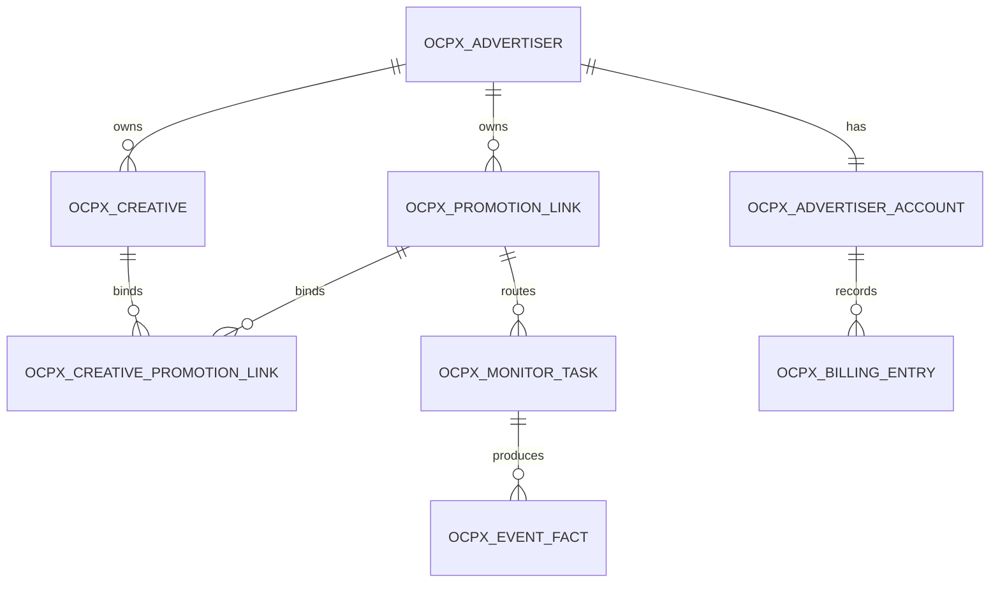

# OCPX 创意管理与可配置计费实现方案 V111

> 文档状态：Accepted，作为 V111 源码与前向迁移实施基线；不代表目标库已迁移、服务已部署或合作方已验收。  
> 编写日期：2026-08-17  
> 前置源码基线：V110 人工余额扣减、V108 MySQL 账户/事实/流水/小时指标。  
> 交付版本：V111；V108-V110 均为不可修改、不可重放的历史前向迁移。

## 1. 背景与目标

### 1.1 原始需求

1. 面向上游客户提供轻量 DSP 式自助能力。
2. 上游客户可以创建创意，并把创意绑定到一个或多个推广链接。
3. 一个推广链接也可以绑定多个创意，即创意和推广链接为多对多关系。
4. 广告主管理保留充值能力。
5. 内部运营可以配置：
   - 是否开启扣费：`0=关闭`、`1=开启`；
   - 扣费形式：`1=点击`、`2=转化`；
   - 单次扣费金额。

### 1.2 本期目标

本期在现有 OCPX 四维路由和 V108 账务事实基础上增加两个纵向能力：

- **创意自助管理**：广告主账号维护自己的创意、素材和推广链接绑定关系。
- **可配置消费**：监测任务支持关闭扣费、点击计费和目标转化计费，仍以 MySQL
  唯一事实、账户行锁和不可变流水作为最终计费边界。

### 1.3 明确不做

本期不是完整 DSP，不新增以下能力：

- Campaign、广告组 AdGroup、广告 Ad 的完整层级；
- 预算、日限额、出价策略、定向、排期、频控和竞价；
- 创意机器审核、人工审核工作流和媒体审核同步；
- 退款、冲正、授信、负余额、欠款补扣、多币种和结算；
- DCO、AIGC、素材自动裁剪和多版本实验；
- `cId`、创意级监测地址、Engine 创意校验、创意事实和创意报表维度。

如果未来需要把一批创意和链接放在同一预算、出价、定向和投放状态下，再独立引入
`scx_ocpx_campaign` 与 `scx_ocpx_ad_group`，不能把本期关联表伪装成广告组。

## 2. 术语与领域边界

| 名称 | 定义 | 是否为独立业务对象 |
|---|---|---|
| 素材 | 图片或视频文件及其存储元数据 | 是文件资产，不等于可投放创意 |
| 创意 | 广告主创建的投放内容，包含名称、类型、素材快照和状态 | 是 |
| 推广链接 | 广告主已有的落地页/唤起链接 | 是 |
| 创意链接关联 | 记录某个创意可以使用哪些推广链接 | 否，只是多对多关系 |
| 监测任务 | 广告主、推广链接、媒体组成的实际 OCPX 路由 | 是 |
| 广告组 | 管理预算、出价、定向、排期和一组广告的投放对象 | 本期不存在 |

`scx_ocpx_creative_promotion_link` 只是创意和推广链接的关联表，不是广告组：

```text
创意 A -> 链接 1
创意 A -> 链接 2
创意 B -> 链接 1
```

上例表示创意 A 可使用两个链接，链接 1 可被两个创意使用。关联记录本身没有名称、预算、
出价、定向或投放状态，因此不应提供独立的“广告组”菜单。

## 3. 当前源码事实与差距

### 3.1 已有能力

- `scx_ocpx_advertiser`：上游广告主及登录账号绑定。
- `scx_ocpx_promotion_link`：广告主推广链接。
- `scx_ocpx_monitor_task`：广告主、推广链接、媒体的路由，已有 `unit_price` 和
  `conversion_event`。
- `scx_ocpx_advertiser_account`：CNY 可用余额。
- `scx_ocpx_billing_entry`：充值和点击扣费的不可变流水。
- `scx_ocpx_event_fact`：Feedback/Callback 唯一事实和消费冻结。
- `scx_ocpx_hourly_metric`：Dashboard 和报表的小时指标数据源。
- `POST /ocpx/advertisers/{id}/recharge`：管理员幂等充值。
- 首次有效 CLICK CPC：余额充足时扣费，余额不足时拒绝扣费并停止上游投递。

### 3.2 当前缺口

- OCPX 域没有创意实体、创意页面或创意和链接的绑定关系。
- 系统级 `sys_material` 只是一套通用素材库，不具备完整的广告主对象范围、创意状态、
  推广链接绑定和投放事实，不应直接作为 OCPX 创意表。
- 监测任务没有 `billing_enabled` 和 `billing_type`。
- Callback 目前只冻结目标转化并计数，不扣费。
- 账务流水类型目前只有 `RECHARGE` 和 `CLICK_CHARGE`。
- 计费配置当前强制真实 `ROLE_ADMIN`，没有可独立授予内部运营的写权限边界。
- 当前外部参数 `creative_id` 是媒体宏传入的合作方创意编号，不是 SCX 内部创意主键。

## 4. 角色与权限

### 4.1 角色职责

| 角色 | 能力 | 禁止能力 |
|---|---|---|
| 上游客户/广告主账号 | 管理自身创意、绑定自身链接、查看自身余额/消费 | 充值、修改计费、访问其他广告主 |
| 内部运营 | 查看业务数据、配置监测任务计费 | 冒充广告主、自行修改账户余额 |
| 管理员/财务 | 广告主充值、查看账务和权限配置 | 直接 SQL 改余额或流水 |
| Engine | 事件去重、扣费、流水、指标和转发决策 | 接收浏览器传入的余额或最终消费值 |

### 4.2 权限码

```text
ocpx:creative:view
ocpx:creative:add
ocpx:creative:edit
ocpx:creative:delete
ocpx:creative:bind
ocpx:monitor-task:billing
ocpx:billing-entry:view
ocpx:advertiser:recharge
```

约束：

1. 创意权限可授予共享 `ROLE_ADVERTISER`，但服务端必须按登录账号绑定的
   `shopId=advertiserId` 强制收口。
2. 广告主的“全量 OCPX 数据范围”可以影响统计查看，但不得放大创意、链接绑定、资金和计费写权限。
3. 应增加严格自有对象校验，例如 `requireSelfOwnedAdvertiser(...)`；广告主类型账号即使拥有全量查看权限，
   也只能写自己的创意和绑定关系。
4. `ocpx:monitor-task:billing` 可授予内部运营角色。服务层应校验“非广告主账号 + 指定权限”，
   不再硬编码必须 `ROLE_ADMIN`。
5. 充值继续要求真实管理员/财务授权，不能因拥有计费权限而自动获得充值权限。

## 5. 领域模型



### 5.1 `scx_ocpx_creative`

字段：

| 字段 | 类型 | 规则 |
|---|---|---|
| `id` | `VARCHAR(32)` | 主键 |
| `advertiser_id` | `VARCHAR(32)` | 必填，创意归属广告主 |
| `creative_name` | `VARCHAR(128)` | 必填，活动创意在同广告主下唯一 |
| `creative_type` | `TINYINT` | `1=图片`、`2=视频`；首期只开放图片 |
| `asset_url` | `VARCHAR(2000)` | 服务端上传后返回的素材 URL 快照 |
| `source_material_id` | `VARCHAR(32)` | 必填，指向有广告主归属的 `sys_material` 素材凭证 |
| `file_name` | `VARCHAR(255)` | 原始文件名 |
| `mime_type` | `VARCHAR(128)` | 由服务端检测，不信任前端声明 |
| `file_size` | `BIGINT` | 字节数 |
| `width`/`height` | `INT` | 图片尺寸，必填并由服务端真实解析 |
| `checksum_sha256` | `CHAR(64)` | 同广告主范围内辅助查重 |
| `status` | `TINYINT` | `0=停用`、`1=启用` |
| `remark` | `VARCHAR(500)` | 可空 |
| `is_delete` | `TINYINT(1)` | 逻辑删除 |
| 审计字段 |  | 创建人、创建时间、更新时间 |

索引：

- `UNIQUE(advertiser_id,id)`：供关联表建立同广告主复合外键。
- `UNIQUE(advertiser_id,creative_name,IF(is_delete=0,1,NULL))`：活动创意名称唯一。
- `INDEX(advertiser_id,status,is_delete,update_time)`：广告主列表查询。
- `INDEX(advertiser_id,checksum_sha256,is_delete)`：素材查重提示。

### 5.2 `scx_ocpx_creative_promotion_link`

| 字段 | 类型 | 规则 |
|---|---|---|
| `advertiser_id` | `VARCHAR(32)` | 冗余保存归属，用于数据库级同主体约束 |
| `creative_id` | `VARCHAR(32)` | 创意主键 |
| `promotion_link_id` | `VARCHAR(32)` | 推广链接主键 |
| `create_by` | `VARCHAR(64)` | 操作人 |
| `create_time` | `DATETIME(3)` | 绑定时间 |

约束：

- 主键或唯一键：`(creative_id,promotion_link_id)`，重复提交不产生重复绑定。
- 外键：`(advertiser_id,creative_id)` 指向创意的同主体唯一键。
- 外键：`(advertiser_id,promotion_link_id)` 指向推广链接现有同主体唯一键。
- 关联表不设业务状态，也不作为独立菜单；解绑可物理删除当前配置关系，操作写系统审计日志。
- 创意逻辑删除前先解除活动绑定；历史事件事实不删除。

### 5.3 监测任务计费字段

在 `scx_ocpx_monitor_task` 增加：

| 字段 | 类型 | 规则 |
|---|---|---|
| `billing_enabled` | `TINYINT(1)` | `0=关闭`、`1=开启` |
| `billing_type` | `TINYINT` | `1=点击`、`2=转化` |
| `unit_price` | `DECIMAL(20,6)` | 沿用现有字段，开启计费时必须大于 0 |
| `conversion_event` | `VARCHAR(32)` | 沿用；转化计费时为唯一目标扣费事件 |

兼容策略：

- 现有任务已经按 CPC 运行，迁移时将现有活动任务显式回填为
  `billing_enabled=1,billing_type=1`，避免升级后静默停止原有扣费。
- 新创建任务默认 `billing_enabled=0,billing_type=1`，由有权限的运营明确开启，避免误扣费。
- 关闭扣费时保留上一次计费类型和单价，重新开启前要求运营确认。

### 5.4 事实、流水和指标扩展

`scx_ocpx_event_fact` 冻结：

- `billing_enabled_snapshot`；
- `billing_type_snapshot`；
- `billing_unit_price_snapshot`；
- `billing_status` 与可解释的 `billing_reason_code`；
- `conversion_event_snapshot`，与开关、类型和单价一起冻结完整计费配置。

`scx_ocpx_billing_entry.entry_type` 增加：

```text
RECHARGE
MANUAL_DEBIT
CLICK_CHARGE
CONVERSION_CHARGE
```

转化流水业务唯一键使用 `CONVERSION:{eventFactId}`。小时指标增加
`rejected_conversion_count` 或统一的 `rejected_charge_count`，同时保留现有
`rejected_click_count` 兼容字段。

## 6. 素材与创意创建流程

### 6.1 首期素材范围

首期只开放图片：JPG、JPEG、PNG、WEBP；最大 20MB、最长边不超过 8192px、总像素不超过
4000 万。数据库和接口均固定 `creative_type=1`，视频规格另立增量设计。

### 6.2 上传边界

新增 OCPX 专用上传接口，复用系统已经配置的 `StorageFactory`/存储策略，但不直接调用通用
`/system/file/upload` 作为完整创意创建流程：

```http
POST /ocpx/creatives/assets
Content-Type: multipart/form-data
```

服务端必须：

1. 校验广告主对象范围和 `ocpx:creative:add` 权限。
2. 校验真实文件头、MIME、大小和图片尺寸，不能只看扩展名。
3. 由服务端计算 SHA-256；前端不得提交最终哈希作为可信值。
4. 通过现有存储配置上传，不向浏览器返回 AccessKey、Bucket 密钥或内部凭据。
5. 使用 ImageIO 和 TwelveMonkeys WebP 插件真实解码，返回
   `sourceMaterialId/assetUrl/fileName/mimeType/fileSize/width/height/checksumSha256`。
6. 存储成功但 `sys_material` 登记失败时删除存储对象；登记成功后素材成为可复用自有资产，创意创建失败或
   删除创意时不自动删除素材。
7. 创建创意只接受 `sourceMaterialId`；服务端重新读取素材并复核归属、文件头、格式、尺寸和哈希，
   不接受浏览器提交最终 URL 或哈希。

### 6.3 创建与绑定

```text
广告主选择/上传素材
  -> 填写创意名称、状态、备注
  -> 服务端创建 scx_ocpx_creative
  -> 选择零个或多个自身推广链接
  -> 事务内写入 scx_ocpx_creative_promotion_link
  -> 返回创意详情和绑定链接
```

创建创意允许暂不绑定链接；空数组表示当前不绑定任何推广链接。本期不生成创意级投放地址。

## 7. 创意运行维度边界

V111 只交付创意管理与推广链接绑定闭环。创意不进入当前
`mId+tId+aId+lId` 路由，不影响 Feedback/Callback 的既有接口和幂等键。

### 7.2 内部创意标识

现有外部 `creative_id` 是媒体宏字段。SCX 内部创意应使用不同字段，例如：

```text
cId               URL 路由参数
scxCreativeId     Java/JSON 内部字段
scx_creative_id   MySQL 字段
```

Engine 收到 `cId` 后必须校验：

1. 创意存在、启用且未删除；
2. 创意归属 `aId`；
3. 创意已绑定 `lId`；
4. `tId` 对应的监测任务本身也属于 `aId+lId+mId`。

V111 不新增 `cId`，也不新增 `scx_creative_id` 事实字段。现有外部 `creative_id` 继续表示合作方宏值，
不得解释为 SCX 创意主键。未来如需创意级归因，必须另立前向迁移、路由兼容和合作方 UAT 方案。

## 8. 计费规则

### 8.1 规则矩阵

| 扣费开关 | 扣费形式 | CLICK | 目标转化 Callback | 非目标转化 Callback |
|---|---|---|---|---|
| 关闭 | 任意 | 统计并转发，不扣费 | 统计并回传，不扣费 | 统计并回传，不扣费 |
| 开启 | 点击 | 首次有效点击扣一次 | 不扣费 | 不扣费 |
| 开启 | 转化 | 不扣费，正常向上游投递 | 首次有效目标转化扣一次 | 不扣费 |

共同规则：

- 重复事实不重复统计、不重复扣费、不重复投递。
- 计费配置以事件接收时的监测任务快照为准，配置变更不重算历史。
- 扣费开关只控制消费，不等价于投放启停开关。
- 单价单位为 CNY 元，精度沿用 `DECIMAL(20,6)`，不做隐式倍率换算。
- `billing_enabled=1` 时，`unit_price` 必须大于 0；关闭时可以保留原单价。

### 8.2 点击计费

沿用 V108 事务边界：

1. 写入唯一 CLICK 事实。
2. 读取监测任务计费快照。
3. 关闭扣费或采用转化计费：不锁账户、不写消费流水，允许上游投递。
4. 采用点击计费：锁定广告主账户。
5. 余额充足：扣余额、写 `CLICK_CHARGE/POSTED`、更新事实消费和小时指标。
6. 余额不足：写 `CLICK_CHARGE/REJECTED/INSUFFICIENT_BALANCE`，消费为 0，维持现有“不向上游投递”行为。

### 8.3 转化计费

只有 `actionType == conversion_event` 的首次 Callback 扣费：

1. 写入唯一 Callback 事实并冻结是否目标转化。
2. 非目标事件只计数，不扣费。
3. 目标事件且计费关闭/点击计费：只计数，不扣费。
4. 目标事件且转化计费：锁定账户并尝试扣除 `unit_price`。
5. 余额充足：写 `CONVERSION_CHARGE/POSTED`，更新事实消费、余额和小时指标。
6. 余额不足：写 `CONVERSION_CHARGE/REJECTED/INSUFFICIENT_BALANCE`，余额和消费不变。

推荐默认：转化已经发生，余额不足不能抹掉事实，也不应通过吞掉 Callback 惩罚下游媒体；因此仍执行原有扣量和下游回传，
同时记录结构化 WARN 和拒绝指标。余额不足不阻断本次下游 Callback；后续新点击是否允许由独立投放状态决定，
不复用扣费开关。

## 9. API

### 9.1 创意 API

```http
GET    /ocpx/creatives
POST   /ocpx/creatives
GET    /ocpx/creatives/{id}
PUT    /ocpx/creatives/{id}
DELETE /ocpx/creatives/{id}
POST   /ocpx/creatives/assets
GET    /ocpx/creatives/assets
GET    /ocpx/creatives/{id}/promotion-links
PUT    /ocpx/creatives/{id}/promotion-links
```

创建示例：

```json
{
  "advertiserId": "advertiser-1",
  "creativeName": "暑期活动主图",
  "sourceMaterialId": "material-1",
  "status": 1,
  "promotionLinkIds": ["link-1", "link-2"],
  "remark": "首期素材"
}
```

整组替换绑定：

```http
PUT /ocpx/creatives/{id}/promotion-links
```

```json
{
  "promotionLinkIds": ["link-1", "link-3"]
}
```

语义为“最终绑定集合”，相同请求重复提交结果一致；空数组表示解除全部当前绑定。

### 9.2 计费 API

不新增独立计费接口，继续使用监测任务新增、编辑接口：

```http
POST /ocpx/monitor-tasks
PUT  /ocpx/monitor-tasks/{id}
```

```json
{
  "billingEnabled": 1,
  "billingType": 2,
  "unitPrice": 12.500000,
  "conversionEvent": "ACTIVATE"
}
```

没有计费权限的账号只能原样提交现有计费字段；任一计费字段变化均返回 403。更新在同一事务写系统操作日志和
不可变计费配置审计快照，保存操作者、任务、广告主及修改前后配置。

### 9.3 账务查询 API

```http
GET /ocpx/billing-entries
```

筛选项：广告主、监测任务、流水类型、状态、时间范围、业务唯一键；广告主账号始终只能读取自身流水。
账务查询是审计和对账能力，不允许提供流水编辑或删除接口。

## 10. 管理端页面

### 10.1 创意管理

新增菜单：`创意管理`，路径 `/ocpx/creative`。

列表字段：

- 创意 ID、创意名称、广告主；
- 素材缩略图、类型、尺寸、文件大小；
- 状态、已绑定链接数；
- 创建时间、更新时间；
- 查看、编辑、绑定链接、停用/启用、删除。

创建/编辑弹窗：

- 广告主：广告主账号固定为自身，内部账号可选择；
- 上传图片或选择允许访问的自有素材；
- 创意名称、状态、备注；
- 多选推广链接，只返回同一广告主的活动链接；
- 上传进度、校验错误、重复素材提示和失败重试。

### 10.2 监测任务计费配置

- 普通任务弹窗向无计费权限用户只读展示 `unitPrice/billingType/billingEnabled/conversionEvent`。
- 有 `ocpx:monitor-task:billing` 的内部运营在原任务弹窗编辑计费配置。
- 弹窗展示扣费开关、点击/转化、单次金额、目标转化事件和风险提示。
- 从点击切换到转化或重新开启扣费时二次确认。
- 广告主可只读查看自身计费条款，不可编辑。

### 10.3 账户与流水

- 广告主管理继续保留充值入口。
- 增加账户详情/流水抽屉，展示充值、点击消费、转化消费和余额不足拒绝。
- Dashboard 和报表消费只汇总 `POSTED` 消费流水对应的事实金额。

## 11. 删除、停用与历史数据

- 创意默认逻辑删除；删除前解除当前链接绑定。
- V111 不产生创意事实或创意报表维度；创意逻辑删除只解除当前绑定，不删除素材凭证。
- 推广链接已有监测任务或创意绑定时，删除前必须明确提示并按当前引用保护策略处理。
- 停用创意不影响既有监测任务；V111 不生成创意级地址或创意事实。
- 账务流水永不因创意、任务、链接或广告主页面删除而删除。
- 广告主有余额、事实或流水时继续禁止物理删除。

## 12. 幂等、并发与一致性

1. 创意链接唯一键保证重复绑定不重复写入。
2. 整组替换绑定在一个事务中完成：锁定创意、校验全部链接归属，再计算新增/删除差集。
3. 事件唯一事实仍是计费和指标幂等边界；Redis 不决定是否扣费。
4. 扣费事务顺序保持“唯一事实 -> 账户行锁 -> 流水 -> 事实消费 -> 小时指标”。
5. 充值与消费共用广告主账户行锁，保证并发后余额不为负。
6. 配置修改与事件并发时，以事件事务读取并冻结的计费快照为准。
7. 任一账务步骤失败必须回滚账户、流水、事实消费和小时指标；兼容日志队列失败不能反向篡改已提交账务。

## 13. 数据库与发布方案

新增前向 SQL `V111__add_creative_and_configurable_billing.sql`，不得修改或重放 V108-V110。

V111 包括：

- 创建 `scx_ocpx_creative`；
- 创建 `scx_ocpx_creative_promotion_link`；
- 监测任务增加计费开关和类型；
- 事实、流水、小时指标增加转化计费和可解释字段；
- 新增创意菜单和权限、账务查询权限；
- 只把创意自助权限授予广告主共享角色，不授予充值和计费写权限；
- 现有活动任务回填为已开启的点击计费；
- 迁移前置检查广告主账户、任务单价和事实/流水约束是否满足预期。

同一变更必须同步：

- `db/schema/scx_current_schema.sql`；
- 必需表和数据库校验脚本；
- Core 实体、Admin/Engine 代码；
- OpenAPI、JSON Schema、Postman/Apifox 集合；
- RBAC 和管理 API 契约测试；
- 本文状态和文档中心源码基线。

发布边界：目标数据库备份、SQL 预览/审批/执行、两个 JAR 重新打包与重启、前端发布、真实合作方 UAT
都需要独立证据。源码实现或本地测试通过不能写成生产已完成。

## 14. 实施拆分

### V111-A：创意管理闭环

- 数据表、实体、Mapper、服务、Controller；
- OCPX 专用图片上传；
- 广告主严格自有对象范围；
- 创意页面和链接多选；
- RBAC、契约、单元测试和本地 UI 测试。

### V111-B：可配置计费闭环

- 监测任务计费开关和计费类型；
- 原监测任务接口计费字段和运营权限；
- 点击/转化两种 Engine 扣费路径；
- 流水、事实、指标和余额不足规则；
- 账务查询页面和对账测试。

### 后续增量：创意运行维度

- 创意级监测地址和 `cId`；
- Engine 绑定校验和索引刷新；
- 事实、报表、Dashboard 创意筛选；
- 旧地址兼容、合作方 UAT 和回归。

V111 以 A+B 为交付范围；后续运行维度不得混入 V111，也不能把当前关联表描述为广告组。

## 15. 测试与验收标准

### 15.1 创意与权限

- 广告主 A 不能查询、编辑、删除或绑定广告主 B 的创意/链接。
- 全量统计权限不能绕过自有创意写范围。
- 一个创意绑定多个链接、一个链接绑定多个创意均成功。
- 重复绑定幂等；跨广告主绑定由服务端和数据库双重拒绝。
- 图片类型、大小、尺寸、文件头和哈希校验有效；失败上传不留下无主业务记录。
- 删除/停用不破坏历史事实和账务。

### 15.2 计费

- 关闭扣费：点击和转化正常统计/转发，消费为 0，不锁账户。
- 点击计费：首次有效点击扣一次，重复/并发点击不重复扣费。
- 转化计费：点击不扣费，首次目标转化扣一次，非目标转化不扣费。
- 改价或改目标事件不重算历史事实。
- 余额不足不产生负余额；拒绝流水、原因和拒绝指标可对账。
- 充值幂等继续通过；充值与消费并发后余额等式成立。
- 广告主不能修改计费或充值；运营可配置计费但不能充值；管理员可充值。

### 15.3 对账恒等式

对任一广告主和任一时间点：

```text
可用余额
= 初始余额
+ POSTED 充值总额
- POSTED 人工扣减总额
- POSTED 点击消费总额
- POSTED 转化消费总额
```

Dashboard/报表消费必须等于对应范围内事实表 `spend_amount` 的汇总，并能追溯到唯一
`scx_ocpx_billing_entry`；`REJECTED` 流水不计入消费。

### 15.4 证据层级

- 源码/静态契约：只能证明实现存在。
- 目标模块测试和隔离 MySQL：证明局部逻辑与事务。
- 本地 Engine + Admin + 前端 E2E：证明合成闭环。
- 合作方 UAT：证明真实协议和业务语义。
- 生产迁移、发布和对账：必须有目标环境证据，不能由本地成功替代。

## 16. 已确认默认值

| 待确认项 | 推荐默认值 |
|---|---|
| 创意只是管理台账，还是必须进入事实和报表 | V111 只做管理与绑定；运行维度另立增量 |
| 首期素材类型 | 只开放图片，视频留字段但不开放 |
| 转化计费余额不足是否继续下游回传 | 继续回传，记录拒绝和告警，不允许负余额 |
| 广告主能否查看自己的计费配置 | 可以只读查看，不可编辑 |
| 是否新增固定 `ROLE_OPERATOR` | 不硬编码；给内部普通角色授予专用计费权限 |
| 是否需要创意审核 | 本期仅启用/停用，不做审核流 |
| 是否引入广告组 | 本期不引入；出现预算/出价/定向需求时另立设计 |

以上默认值已经作为 V111 Accepted 实现基线；任一项改变都需要同步更新数据模型、接口契约、
权限和验收标准，并使用新的前向版本实施。
