# 功能调用链路、依赖与触发条件

图中的每个箭头代表实际依赖/调用或显式触发关系；不代表远端已部署或默认开关已开启。虚线为周期/条件/异步。机器入口走 Engine，浏览器管理入口走 Boot。SVG 为同名 Mermaid 源生成，源代码可继续维护。

## 1. 运行模块及外部依赖


展开可维护的 Mermaid 图源

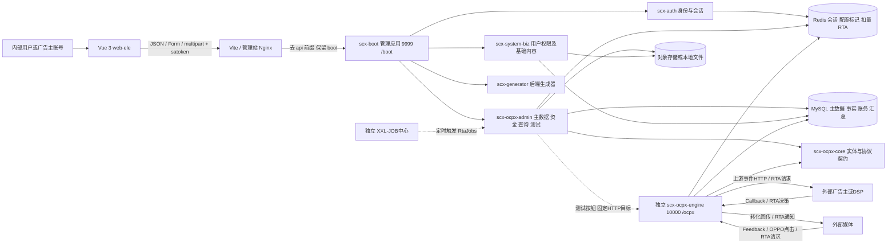

源码装配：[scx-backend/scx-boot/pom.xml:24](../../../../scx-backend/scx-boot/pom.xml#L24)，[scx-backend/scx-ocpx-engine/pom.xml:14](../../../../scx-backend/scx-ocpx-engine/pom.xml#L14)；公共域依赖见 `source-inventory.json.maven`。没有把 RocketMQ 画为广告路径必经节点，因为当前主源码未检出 producer/listener。

## 2. 用户登录、动态菜单与业务 CRUD

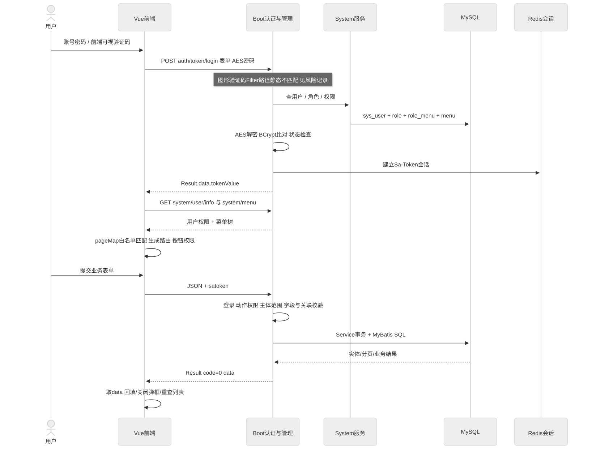

展开可维护的 Mermaid 图源

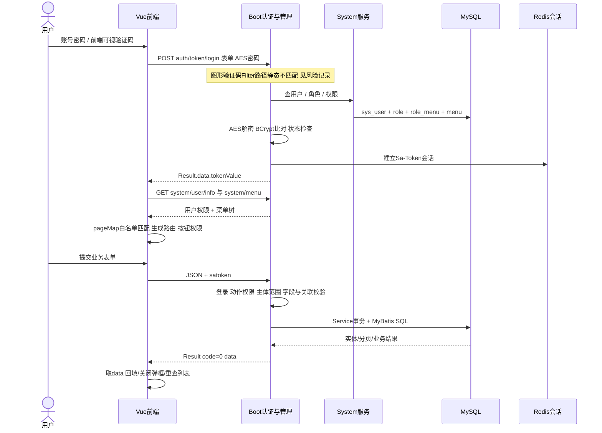

表单动作会触发何种 SQL 与系统服务，按 [功能清单](01-功能清单.md) 与 [逐方法索引](05-源码接口索引.md) 查询。字典缓存、菜单缓存、登录日志不是所有业务请求都必经的步骤。

## 3. 管理配置保存到 Engine 生效

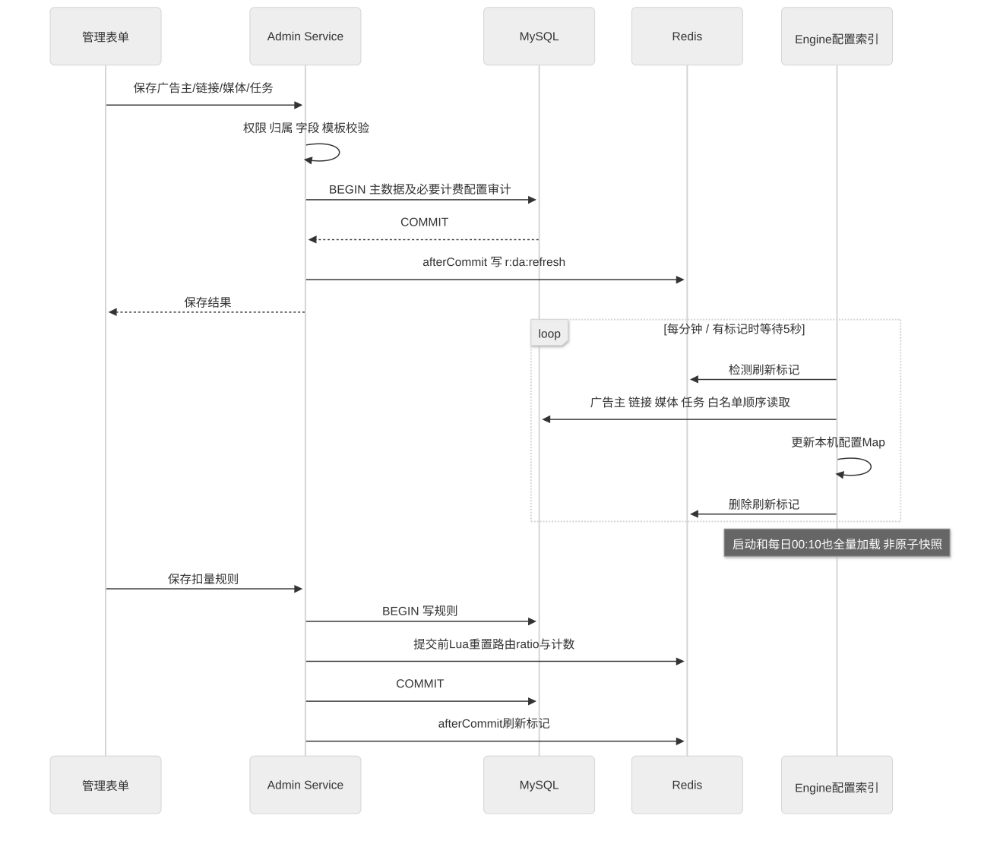

展开可维护的 Mermaid 图源

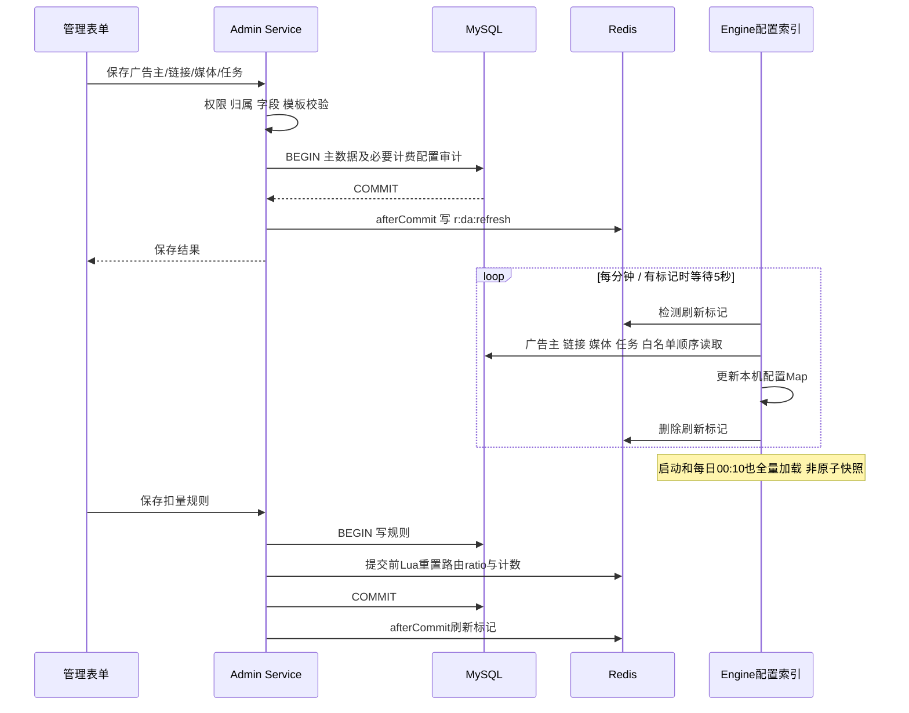

扣量规则不是“事务提交后才同步 Redis”。普通配置保存到真实流量生效有延迟，多个 Engine 共享单标记存在丢通知窗口。来源：[scx-backend/scx-ocpx-admin/src/main/java/com/yzytech/scx/ocpx/admin/service/OcpxConfigRefreshPublisher.java:18](../../../../scx-backend/scx-ocpx-admin/src/main/java/com/yzytech/scx/ocpx/admin/service/OcpxConfigRefreshPublisher.java#L18)；[scx-backend/scx-ocpx-engine/src/main/java/com/yzytech/scx/ocpx/configuration/task/ResetRedisKeyTask.java:98](../../../../scx-backend/scx-ocpx-engine/src/main/java/com/yzytech/scx/ocpx/configuration/task/ResetRedisKeyTask.java#L98)。

## 4. 曝光/点击与广告主计费


展开可维护的 Mermaid 图源

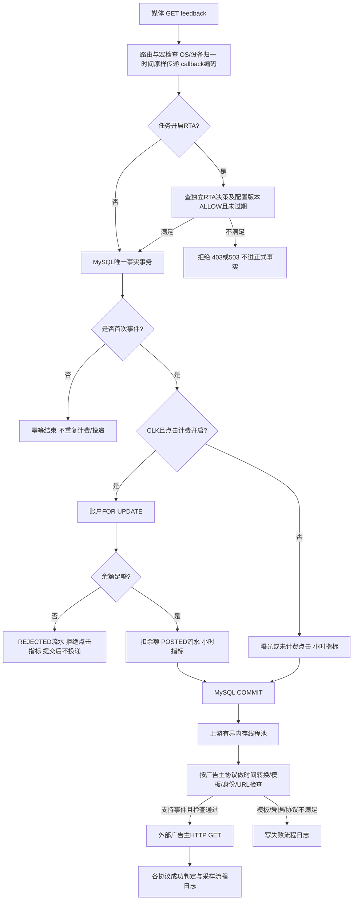

**关键顺序**：先事实/收费，后出站协议检查和 HTTP。入口正常受理不等待证明合作方入库。线程池满载时 CallerRuns 会让提交线程执行出站，不能绝对描述为“入口永不等待出站”。来源：[scx-backend/scx-ocpx-engine/src/main/java/com/yzytech/scx/ocpx/feedback/service/FeedbackServiceImpl.java:72](../../../../scx-backend/scx-ocpx-engine/src/main/java/com/yzytech/scx/ocpx/feedback/service/FeedbackServiceImpl.java#L72)、`fact/service/OcpxEventFactService.java:51`（同 Engine Java 包前缀）。

## 5. 上游 Callback、转化计费、媒体扣量与最后一跳

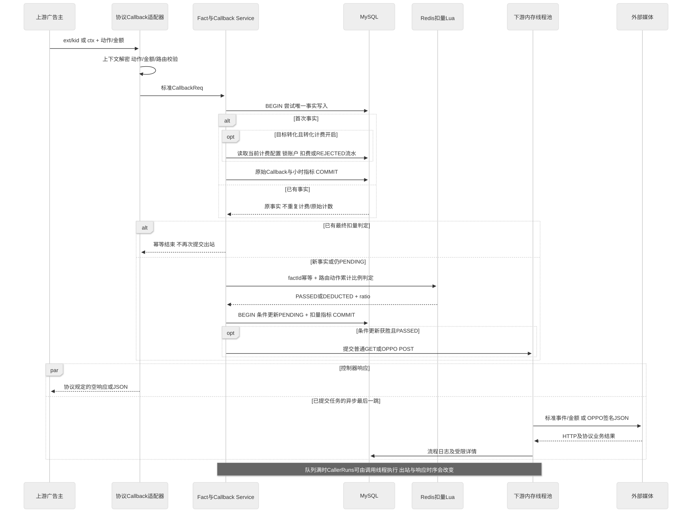

展开可维护的 Mermaid 图源

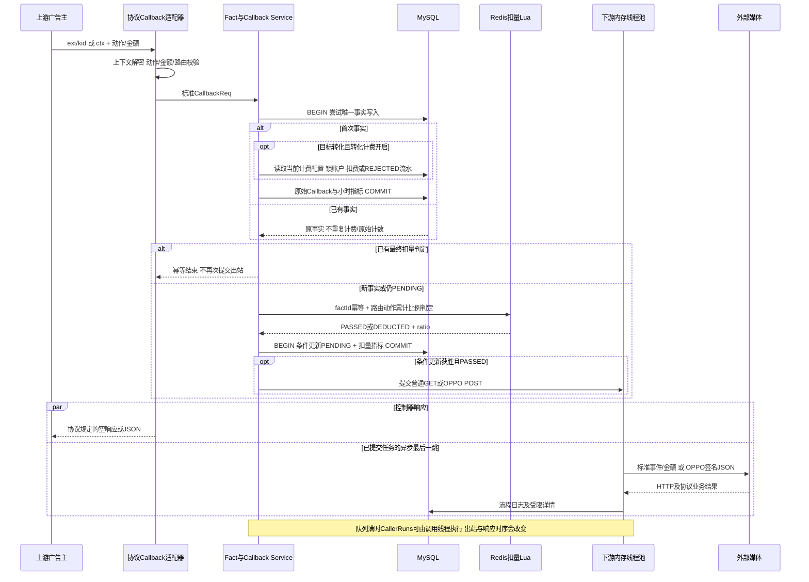

扣量失败不回滚此前已提交的事实与计费；PENDING 恢复依赖上游重试，未见后台扫描补偿。普通与 OPPO 出站均无持久化自动重试。HTTP、SCX 放行和媒体签收必须分开。来源：[scx-backend/scx-ocpx-engine/src/main/java/com/yzytech/scx/ocpx/callback/service/CallbackServiceImpl.java:77](../../../../scx-backend/scx-ocpx-engine/src/main/java/com/yzytech/scx/ocpx/callback/service/CallbackServiceImpl.java#L77)、`fact/service/OcpxEventFactService.java:96`。

## 6. 通用 RTA 异步决策与落库


展开可维护的 Mermaid 图源

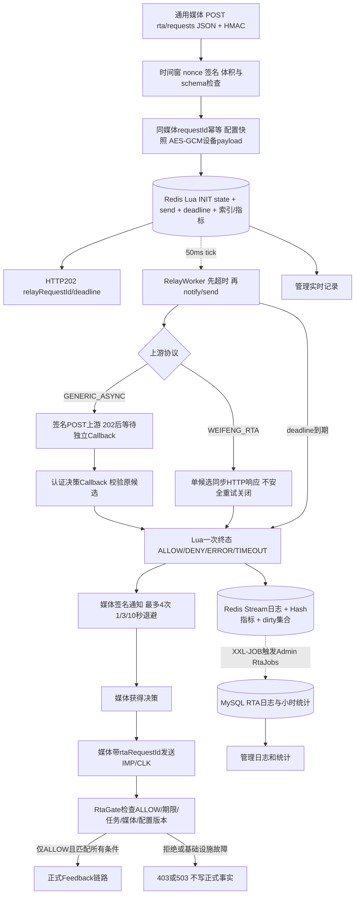

默认 relay=false；落库 handler 的存在不代表调度中心已配置计划。Redis 实时状态与 MySQL 查询水位不同。发送和媒体通知是两个独立状态，ALLOW 不等于媒体通知 DELIVERED。来源：Engine `rta/relay/RelayService.java:47`、`RelayWorker.java:55`、`src/main/resources/rta/state.lua:22`；Admin `rta/RtaJobs.java:39`，完整路径见领域附录。

## 7. OPPO 同步外观、点击与回传

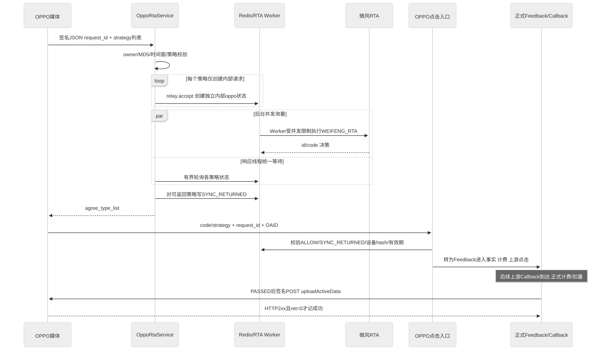

展开可维护的 Mermaid 图源

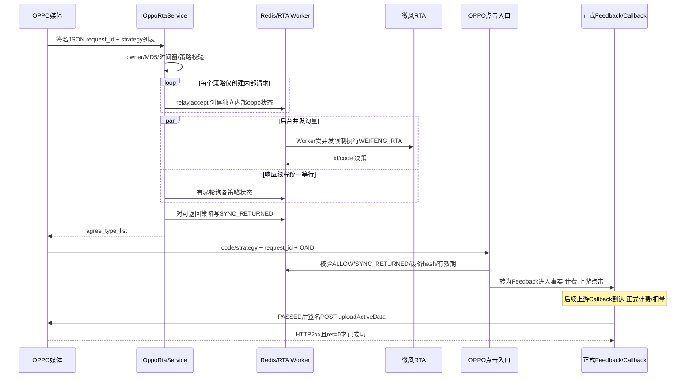

OPPO 下游只实现激活/注册/应用付费。没有画出持久化重试队列，因为当前服务未接入此能力。其同步询量依赖内部RTA状态，不能用普通 `/feedback` 冒充受准入保护的 OPPO 点击。

## 8. 上传、查询、导出与诊断支路


展开可维护的 Mermaid 图源

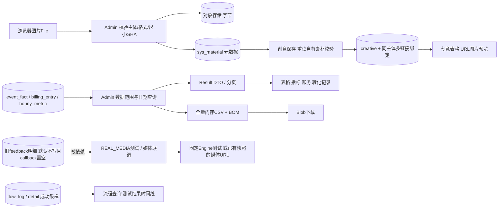

素材与创意保存、存储对象与MySQL、HTTP发送与日志分别存在边界；某些失败有尽力清理，不存在统一跨系统事务。诊断结果应和唯一事实/账务交叉核对。

## 9. 触发覆盖

- 用户触发：登录、查询、CRUD、上传、资金操作、CSV下载、三类测试/联调；均由接口索引逐个列出。
- 外部触发：Feedback、六类正式Callback、受控测试收集器、两类RTA请求及异步决策、OPPO点击。
- 启动触发：Engine配置加载、XXL执行器注册、框架自动配置。
- 周期触发：Engine 9个Scheduled方法、Admin 2个兼容合并Scheduled方法（条件启用）、3个RTA XXL handler；逐个cron/开关见领域附录及接口索引。定时表达式未指定zone时不能默认认定按中国时区运行。
- Spring事件触发：系统操作日志/拒绝审计同步监听，登录日志异步监听；与 Engine 流程日志、RTA Stream 是三条不同观测路径。
