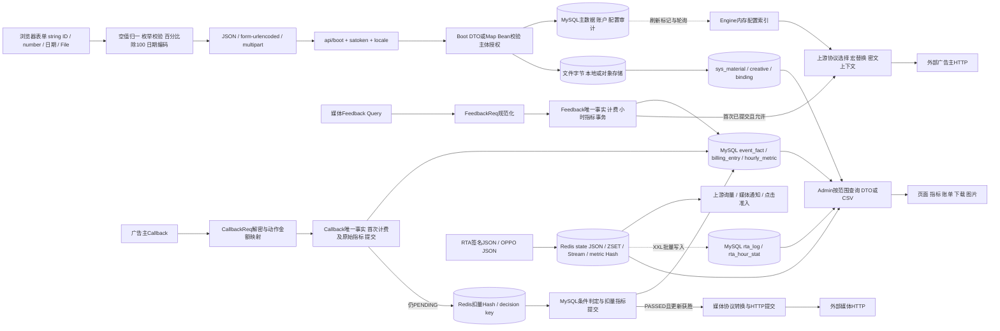
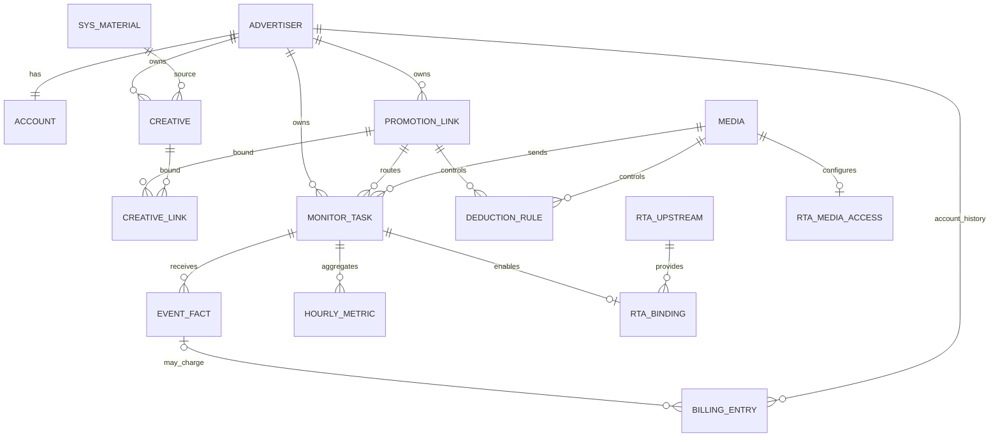

# 数据流转：从采集到最终消费

本文把管理配置、正式广告事件、RTA决策、文件、审计分开追踪。它们具有不同的数据真相、格式和一致性边界，不能用一个“前端→后端→数据库”箭头概括。

## 1. 全链路数据流图

展开可维护的 Mermaid 图源

## 2. 前端采集和接口转换规则

| 数据 | 采集格式 | 传输及转换 | 后端/数据库 | 最终消费 |
|---|---|---|---|---|
| 业务ID | TypeScript string | JSON或query；不主动转JS数字 | String、VARCHAR主键/外键 | 筛选、关联、四段路由；OPPO strategyId为独立INT例外 |
| 账号密码登录 | 输入原始字符串 | 前端AES编码，form-urlencoded username/password/code | 服务端AES解码、BCrypt比较；数据库仅哈希 | SaTokenInfo.tokenValue→accessStore；密码不是广告主投递secret |
| 广告主开户密码 | 原始字符串 | JSON一次性提交 | 服务端密码策略、BCrypt→sys_user | 返回托管用户名/ID，不返回密码 |
| 金额 | 表单字符串→Number | JSON number；UI常显示2位 | Java BigDecimal；平台账户/计费CNY，DECIMAL(20,6)；合作方currency_amount为原订单金额，不推断币种；金额规范化6位 | 余额、账务、消费；显示值不用于财务精确对账 |
| 回传比例 | UI 0%..100% | 编辑时ratio×100；保存百分比÷100 | DECIMAL(9,6) 0..1；Redis hash字符串数值 | Callback累计数量放行；不作用于金额 |
| 平台/事件 | 平台1..4、计费模式1/2、标准事件整数 | JSON/query；前后端枚举检查 | 共享Core枚举、数据库CHECK | 平台模板选择、目标转化判断 |
| 日期/时间 | 页面日期选择器 | Dashboard ISO日期；时段报表YYYYMMDD；Callback/Flow YYYY-MM-DD；RTA epoch毫秒 | LocalDate/LocalDateTime/Timestamp，事实Asia/Shanghai；小时键YYYYMMDDHH | 分组统计、查询窗口；不混用浏览器日期与业务日期 |
| 主数据表单 | camelCase字段 | API显式白名单payload；空筛选→undefined | DTO校验；MyBatis列snake_case | DTO回填列表/弹框 |
| RTA配置 | 对象ID、字符串map、version | JSON；凭据仅credentialRef | JSON protocol_config、version乐观并发 | Engine查询配置、RTA请求快照 |
| 图片 | File二进制 | multipart/FormData，浏览器生成boundary | 验证真实格式/扩展名/尺寸、SHA256；对象字节与元数据分存 | materialId用于创意保存，URL用于图片加载 |
| 分页响应 | 页面current/size | Result `{code:0,msg,data}` | IPage或领域Page；日志使用hasNext/total（下界） | rows/total、分页按钮；不可把下限总数当精确COUNT |
| CSV | 查询过滤 | 二进制原始响应→Blob | 同范围全量SQL→内存字符串→UTF-8 BOM | objectURL下载后revoke，未写持久导出任务 |

公共封装源码：[scx-fronted/apps/web-ele/src/api/request.ts:70](../../../../scx-fronted/apps/web-ele/src/api/request.ts#L70)；[scx-fronted/packages/effects/request/src/request-client/request-client.ts:55](../../../../scx-fronted/packages/effects/request/src/request-client/request-client.ts#L55)；[scx-backend/scx-common/scx-common-core/src/main/java/com/yzytech/scx/common/core/util/Result.java:24](../../../../scx-backend/scx-common/scx-common-core/src/main/java/com/yzytech/scx/common/core/util/Result.java#L24)；日期配置 [scx-backend/scx-common/scx-common-core/src/main/java/com/yzytech/scx/common/core/config/DateFormatConfig.java:33](../../../../scx-backend/scx-common/scx-common-core/src/main/java/com/yzytech/scx/common/core/config/DateFormatConfig.java#L33)。通用日期配置采用进程时区，不能把所有日志和cron都写作强制Asia/Shanghai。

## 3. MySQL数据归属与读写路径

完整58表字段、主键、外键、唯一约束见 [数据库字段索引](06-数据库字段索引.md)。下表覆盖25张OCPX表，并对应业务写入和消费路径。

| 数据组 / 表 | 生产者与转换 | 持久化及原子边界 | 消费者 |
|---|---|---|---|
| advertiser、promotion_link、media、monitor_task | Admin DTO→实体；任务生成双URL | MySQL事务；引用归属/唯一约束；link/task逻辑删除 | Engine配置索引、管理列表/选项、报表维度名称 |
| protocol_allowed_host | 管理host数组→标准化精确host行 | 唯一(protocol,host)、事务替换 | 专用上游URL策略 |
| advertiser_account | 开户零余额；充值/扣减/计费BigDecimal | advertiserId主键，FOR UPDATE保护余额，禁止负数 | 计费与资金查询；Redis不是账户真相 |
| billing_entry | 资金动作或事实计费→不可变流水 | business_key唯一；POSTED/REJECTED；与账户更新同事务 | 账务页、测试状态、历史删除保护 |
| billing_config_audit | 任务计费字段CREATE/UPDATE | before/after JSON、操作者；同任务配置事务 | 历史保护/审计；不是可回滚的资金账本 |
| event_fact | Feedback/Callback规范化→fact_key | CHAR64 SHA256唯一 + (advertiser_id,monitor_task_id,request_id,event_code)唯一；事实/计费/小时指标事务 | Callback记录、测试结果、账务关联 |
| hourly_metric | 同步事实增量聚合 | 唯一hour+advertiser+link+media+task；SQL upsert | Dashboard、时段/分组报表、CSV |
| deduction_rule | link+media+ratio | 活跃路由唯一；Redis重置不属于MySQL事务 | 规则管理；Engine运行比例直接读Redis |
| creative、creative_promotion_link | 自有material及链接集合→图片快照/关联 | 双归属复合外键；创意与绑定事务；sourceMaterial对应sys_material | 创意管理；Engine事实无创意维度 |
| flow_log、flow_log_detail | 阶段结果/规范化参数→脱敏、限长、采样 | Header/Detail分别SQL；主流程不以日志写成功为前提 | 流程列表、详情、测试诊断；不是全量事实 |
| rta_upstream、rta_media_access、rta_binding | 对象抽屉map→协议配置/版本 | 配置归属约束、version、strategy独立INT；凭据存引用 | Engine实时RTA配置查验与准入快照 |
| rta_log、rta_hour_stat | Redis Stream/metric hash→XXL批处理 | 日志幂等主键；统计只接受更高version；提交后ack | RTA历史日志/统计，可能延后于实时状态 |
| log_feedback、log_feedback_day、log_callback | 兼容队列JSON→批量旧明细 | 默认关闭；callback_url在当前反馈生产中清空 | 遗留联调/测试/详情读路径仍依赖，已确认数据来源不完整 |
| report_mat_temp、report_mat | 兼容批写与可选合并 | 默认关闭的兼容逻辑 | 历史/兼容用途；不参与当前Dashboard消费来源 |

以上表名省略 `scx_ocpx_` 前缀。MySQL当前态包含真实外键；不能把所有关系描述为仅代码校验。sys_user、sys_role、sys_menu及关联表由System维护；sys_material为通用文件元数据；内容/短信/三方配置/代码生成/XXL表逐项见基础平台附录。

### 主要数据关系

展开可维护的 Mermaid 图源

关系图为主要业务关联，省略四维重复外键及审计表以免遮蔽主线；完整数据库约束由字段索引逐条保留。账户“一对一”表示开户服务创建规则，不表示数据库强制每个广告主必有一行账户。

## 4. Redis、内存及文件的数据位置

| 位置 / 格式 | 写入/读取 | 一致性与保留 |
|---|---|---|
| Sa-Token会话、在线用户JSON；菜单/字典缓存 | 登录/权限/系统服务→Redis；页面读取 | 运行配置决定TTL；浏览器另持久化token/accessCodes，二者不同 |
| `r:da:refresh` 存在性标记 | Admin afterCommit→Engine分钟轮询→删除 | 不是递增配置版本，也不是广播队列；每日全量重载兜底 |
| `ocpx:route:deduction:{linkId:mediaId}:state` Hash | Admin重置ratio；Engine Lua写分动作original/passed | hash tag中花括号是实际key的一部分；新状态长期累计，旧每日归零不清此Hash |
| 同路由 `decision:{factId}` String | Lua判定→MySQL最终提交后清理 | PENDING跨库重试桥梁；没有后台事实补偿扫描；Redis不是最终审计判定 |
| `ocpx:route:ratio:*` / original-count / delivered-count | 兼容旧比例/数组JSON迁移种子 | 不再是唯一运行模型；Lua迁移种子下标存在静态疑点 |
| `scx:{rta-async}:state:{relayId}` JSON | INIT/worker/Callback状态机 | 路由/版本/hash/决策；设备payload AES-GCM加密后暂存，最终状态/发送处理删除payload；状态24h |
| 同前缀 `idem:*` / `nonce:*` / `oppo-request:*` | 幂等、HMAC防重放、OPPO父请求指纹 | idem/parent 24h；nonce10min；nonce为hash，不输出秘密 |
| 同前缀 send/deadline/notify ZSET | Lua写到期时间；worker租约claim | 发送/超时/通知不同队列；worker进程恢复依赖Redis状态 |
| 同前缀 records:all/media/advertiser ZSET | RTA状态索引；管理端批读state过滤 | 24h实时视图，列表读取会清旧索引 |
| 同前缀 metric Hash + metric-dirty Set | Lua计数；XXL按版本写MySQL | UTC epoch小时作为Redis指标键；成功flush后仅版本不变才清dirty，hash设置2天TTL |
| 同前缀 logs / logs:dlq Stream | 脱敏RTA事件→consumer group sql-writers | 提交MySQL后ack/delete，坏记录进DLQ；DB日志保留24h，需调度实际运行 |
| `r:da:report:*` / `r:da:report:cb:*` List | 兼容JSON批次→StorageTask→旧表 | 默认关闭；DB提交和LTRIM不原子 |
| Engine进程配置Map | 启动/定时读取MySQL | 逐表清空加载非原子，多个实例各有副本 |
| 上下游有界线程池 | 普通事件/回传提交→HTTP调用 | 默认各32/64线程、200队列；进程退出队列不恢复；满队列CallerRuns |
| 本地文件或OSS/S3对象 | 通用上传/创意上传→文件内容 | DB只存引用和元数据；通用删除素材记录不等于删除对象 |
| Logback滚动文件、WebSocket会话Map | Engine日志及System会话工具 | 本机观测/连接状态，不是经营事实，不保证跨实例可靠消费 |

Redis确切拼接与Lua字段依据见 [引擎附录 §4](09-投递引擎领域详解.md)，不得将表格里的占位ID当成线上真实key或泄露其值。

## 5. 关键转换与业务幂等

1. **事件身份**：`fact_key = SHA256(advertiserId|taskId|requestId|eventCode)`；数据库唯一性为事实/计费最终防重。重复请求不产生第二次出站保证；同点击同标准事件的多次支付也会折叠，不能假定每笔订单都有独立身份。
2. **Callback上下文**：按协议使用 ext/kid 或 ctx；解密还原SCX路由与所需上下文，外置动作/金额转换为标准事件与六位金额。密文保护不等于所有协议都校验合作方对事件/金额的独立签名。
3. **计费时点**：点击读取当时任务；Callback读取到达时当前任务配置并快照，不能推断转化沿用原点击价格。人工扣减不进入广告spend；媒体扣量不会冲减账务。
4. **时间归集**：经营事实按接收时间、Asia/Shanghai生成小时；合作方event_time不是所有报表统一分组依据。业务日、设备时间、请求接收时间、扣量判定时间、日志时间、RTA截止时间分别保存/使用。
5. **协议出站**：媒体Query→Feedback→模板/协议字段，含秒毫秒、明文/MD5设备、URL编码、枚举映射；各协议完整转换列于引擎附录，不能通用替换。普通callback_url只解码一次后附标准事件；OPPO输出签名JSON。
6. **RTA身份**：媒体requestId→relayRequestId；canonical payload hash检测同ID变参，通用HMAC RTA的nonce检测重放；OPPO以时间窗和父请求指纹约束重放，按策略派生内部requestId，strategyId与SCX主键分开。
7. **查询消费**：报表显示名称多为当前主数据名称，金额/事件为历史事实；当前配置ratio与历史实际判定ratio不能混算。流程日志使用eventId查询源requestId；六阶段trace另由四维+requestId稳定hash关联。

## 6. 事务和最终消费保证

| 边界 | 已实现保证 | 未由当前实现保证 |
|---|---|---|
| MySQL账户/流水/事实/小时指标 | 同一事实事务、唯一键、账户行锁 | 外部HTTP接受、跨系统恰好一次 |
| MySQL扣量最终判定 | PENDING条件更新仅一方胜出，指标与判定事务 | Redis状态与SQL原子提交、无人重试时自动恢复 |
| 主数据与刷新通知 | 主数据提交后标记 | 标记发布失败回滚MySQL、多实例可靠广播 |
| 扣量规则MySQL与Redis | 各自局部原子写入 | 跨库回滚一致；提交失败后Redis自动恢复 |
| RTA Stream落库 | 主键幂等、事务提交后ack；指标version防旧值覆盖 | Redis故障/TTL/消费者长期停机下永久保存所有数据 |
| 文件与元数据 | 创意上传记录失败有尽力删除对象补偿 | 所有失败均无孤立文件、与创意表单取消原子回滚 |
| HTTP与日志 | 有受限日志及失败结果 | 日志必达、成功全量、HTTP2xx等于对方业务签收 |

正式链路完整性应联合事实、账务、对方响应与业务对账验证；仅看界面“成功”或单行流程日志不足以证明最终消费。
