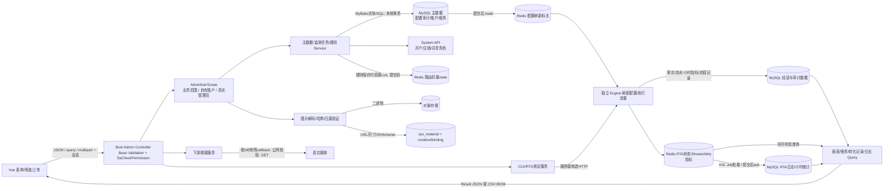
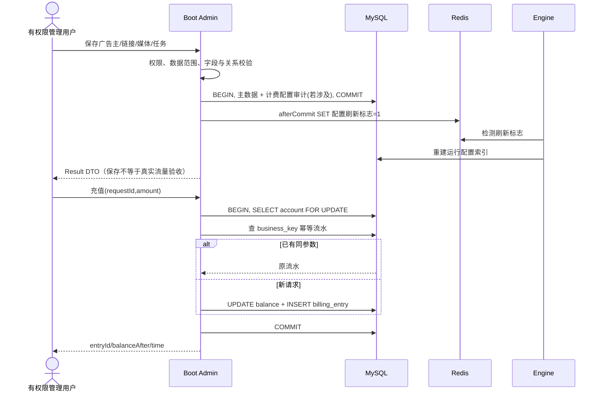

# SCX Admin 与当前态数据库架构审计（2026-10-20）

本文件是当前工作树静态审计子报告。已读根 AGENTS.md、广告平台设计 README 与 MVP 开发规划的当前基线/增补。未启动服务、连接 MySQL/Redis/合作方、执行 SQL 或运行测试。所有“实现”均指仓库代码存在，不能推出目标环境已迁移、已发布或第三方已签收。引用行号以本次工作树为准。

路径简写：`A=` scx-backend/scx-ocpx-admin/src/main/java/com/yzytech/scx/ocpx/admin/；`X=` scx-backend/scx-ocpx-admin/src/main/resources/mapper/；`S=` scx-backend/scx-boot/src/main/resources/db/schema/scx_current_schema.sql；`C=` scx-backend/scx-ocpx-core/src/main/java/com/yzytech/scx/ocpx/。下文源码引用已展开为仓库相对路径。

## 1. 实际边界与文档漂移

- 当前 Admin 包含 14 个 REST Controller：12 个管理/报表/审计控制器与 2 个 RTA 控制器；实际类名与完整端点见附录。POM 仍称“四实体、流程日志与报表”，根 AGENTS 仍称“五实体、Redis 单值余额、无流水、不含 CPC”，这些是旧描述。当前源码已实现图片创意、多对多关联、MySQL 资金账户/不可变流水、点击和转化计费配置、RTA 配置/查询/测试、完整 CLK 测试与真实下游联调。README 开头（docs/广告平台设计/README.md:3 起）比根 AGENTS 更新，但仍应逐项以代码校核。
- Admin 是 Boot 内模块，依赖 Core、System API、Security、MyBatis、Redis、Job、Log、Web、Validation、WebP 解码；不依赖 Engine JAR。它通过共享 MySQL/Redis 与独立 Engine 协作，测试时才由 Boot HTTP 请求 Engine。证据：scx-backend/scx-ocpx-admin/pom.xml:8–21。
- 所有正常管理接口使用 `Result<T>`；分页分为 MyBatis `IPage/Page` 与自定义 Page。Controller 路径不含 Servlet `/boot`，表中 API 均需加 Boot context-path。CSV 导出是直接 `text/csv;charset=UTF-8` 响应，带 UTF-8 BOM（scx-backend/scx-ocpx-admin/src/main/java/com/yzytech/scx/ocpx/admin/controller/OcpxReportController.java:72–87）。
- `scx_ocpx_report_mat[_temp]` 和旧合并逻辑仍在仓库，但当前 Dashboard/报表读 `scx_ocpx_hourly_metric`；旧任务仅在 `ocpx.compatibility-report.enabled=true` 时注册，不能画成当前经营报表必经路径（scx-backend/scx-ocpx-admin/src/main/java/com/yzytech/scx/ocpx/admin/task/OcpxDataMergeTask.java:19–23；scx-backend/scx-ocpx-admin/src/main/resources/mapper/OcpxUnifiedReportSqlMapper.xml:23–98,541–608）。

## 2. 功能清单：业务域、输入、输出、逻辑、权限和存储

### 2.1 广告主、托管登录账号与共享授权

**列表/下拉/详情**：输入分页、keyword、advertiserId；输出广告主 ID/名称/协议/托管用户名/凭据引用/bidUrl/macros/可见余额/创建更新时间，并回填链接数、任务数。普通受限广告主被强制为会话 shopId；有全量业务范围权限的广告主可查全量业务，但余额仍仅可见本人。余额批量读取 MySQL，绝非 Redis。[scx-backend/scx-ocpx-admin/src/main/java/com/yzytech/scx/ocpx/admin/service/OcpxAdvertiserService.java:50–97](../../../../scx-backend/scx-ocpx-admin/src/main/java/com/yzytech/scx/ocpx/admin/service/OcpxAdvertiserService.java#L50)、[scx-backend/scx-ocpx-admin/src/main/java/com/yzytech/scx/ocpx/admin/service/AdvertiserScope.java:17–27,85–111](../../../../scx-backend/scx-ocpx-admin/src/main/java/com/yzytech/scx/ocpx/admin/service/AdvertiserScope.java#L17)。

**开户**：输入 `name,upstreamProtocol,credentialConfigKey,bidUrl,macroParams,username,password` JSON；密码长度 6–32，日志字符串排除密码，服务端通过 `AdvertiserAccountProvisioner.provision` 创建托管系统账户，再回写 account_user_id。事务内顺序：名称唯一检查 → advertiser insert → CNY/0 账户 insert → 系统开户 → 绑定用户 → 注册提交后配置刷新 → 返回详情。系统侧 provisioner 负责 BCrypt、角色及主体关系，其具体实现由系统域报告覆盖。[scx-backend/scx-ocpx-admin/src/main/java/com/yzytech/scx/ocpx/admin/dto/AdvertiserRequests.java:25–50](../../../../scx-backend/scx-ocpx-admin/src/main/java/com/yzytech/scx/ocpx/admin/dto/AdvertiserRequests.java#L25)；[scx-backend/scx-ocpx-admin/src/main/java/com/yzytech/scx/ocpx/admin/service/OcpxAdvertiserService.java:99–129](../../../../scx-backend/scx-ocpx-admin/src/main/java/com/yzytech/scx/ocpx/admin/service/OcpxAdvertiserService.java#L99)；[scx-backend/scx-ocpx-admin/src/main/resources/mapper/OcpxAdvertiserAccountSqlMapper.xml:4–10](../../../../scx-backend/scx-ocpx-admin/src/main/resources/mapper/OcpxAdvertiserAccountSqlMapper.xml#L4)。

**编辑/协议选择**：输入新名称、协议与配置引用等；写 advertiser；TEMPLATE_GET 要求 bidUrl，GRAVITY/RENREN_VIDEO/PHOENIX 强制清空 credentialConfigKey、bidUrl、macroParams，因为其完整模板在推广链接；其他协议按提交值保存。无任意 URL 网络预检。[scx-backend/scx-ocpx-admin/src/main/java/com/yzytech/scx/ocpx/admin/service/OcpxAdvertiserService.java:131–142,228–248](../../../../scx-backend/scx-ocpx-admin/src/main/java/com/yzytech/scx/ocpx/admin/service/OcpxAdvertiserService.java#L131)。

**删除**：事务内锁 advertiser；存在非零余额、任意 event_fact、billing_entry 或 billing_config_audit 即拒绝，避免财务历史被物理删。无上述记录时依次清兼容报表/旧日志/flow log/RTA binding 与 upstream/creative binding 与 creative/deduction rule/task/link/空账户/advertiser，调用系统 deprovision，并删除相关 Redis route state、提交后触发刷新。共享 media 不删除。创建监测任务必写计费配置审计，因此实际删除保护比早期 V104“清全部业务历史”强。[scx-backend/scx-ocpx-admin/src/main/java/com/yzytech/scx/ocpx/admin/service/OcpxAdvertiserService.java:145–188](../../../../scx-backend/scx-ocpx-admin/src/main/java/com/yzytech/scx/ocpx/admin/service/OcpxAdvertiserService.java#L145)；[scx-backend/scx-ocpx-admin/src/main/java/com/yzytech/scx/ocpx/admin/service/OcpxAdvertiserAccountService.java:119–133](../../../../scx-backend/scx-ocpx-admin/src/main/java/com/yzytech/scx/ocpx/admin/service/OcpxAdvertiserAccountService.java#L119)。

**共享广告主角色权限**：GET/PUT `/ocpx/advertisers/account-role/permissions` 委托系统 `AdvertiserRolePermissionManager`；输入 menuIds 和 allDataScope，输出 Configuration。对应专用权限常量；不能描述成“逐广告主独立角色”，实际是共享角色全局配置（scx-backend/scx-ocpx-admin/src/main/java/com/yzytech/scx/ocpx/admin/controller/OcpxAdvertiserController.java:50–63；scx-backend/scx-ocpx-admin/src/main/java/com/yzytech/scx/ocpx/admin/dto/AdvertiserRequests.java:116–127）。

**资金操作权限与一般管理员语义不同**：`requireAdministrator` 实际只拒绝 `currentAdvertiserId()!=null`，而 currentAdvertiserId 对拥有全量数据权限的广告主返回 null。因此媒体、规则等“管理员”路径并不等同真实 ROLE_ADMIN。充值/人工扣减、联调测试、日志敏感详情、RTA 上游/媒体配置调用 `requireSystemAdministrator`，要求非广告主类型 + ROLE_ADMIN。计费配置允许有专用权限的内部运营用户，永久排除广告主类型。详见 scx-backend/scx-ocpx-admin/src/main/java/com/yzytech/scx/ocpx/admin/service/AdvertiserScope.java:30–111。最终文档必须保留这三个权限层级。

### 2.2 广告主账户、充值、人工扣减与账务查询

**充值**：输入 advertiserId、requestId(8–64)、amount(正数，14 位整数/6 位小数)、可选 remark；输出 entryId/advertiserId/amount/balanceAfter/occurredAt。MySQL 事务内 `SELECT account FOR UPDATE` → 用 `RECHARGE:{advertiserId}:{requestId}` 查既有流水 → 同金额重放返回原结果，金额不符拒绝 → 更新余额 → insert POSTED/RECHARGE 流水。金额使用 BigDecimal scale=6，时间 Asia/Shanghai。[scx-backend/scx-ocpx-admin/src/main/java/com/yzytech/scx/ocpx/admin/service/OcpxAdvertiserAccountService.java:69–89,136–160](../../../../scx-backend/scx-ocpx-admin/src/main/java/com/yzytech/scx/ocpx/admin/service/OcpxAdvertiserAccountService.java#L69)。

**人工扣减**：同上但 remark 必填，businessKey=`MANUAL_DEBIT:{advertiserId}:{requestId}`，重放必须金额和原因都相同；余额不足拒绝并回滚；流水类型 MANUAL_DEBIT，不计入广告 spend_amount。充值和扣减均二次检查真实管理员。[scx-backend/scx-ocpx-admin/src/main/java/com/yzytech/scx/ocpx/admin/service/OcpxAdvertiserAccountService.java:92–116,163–183](../../../../scx-backend/scx-ocpx-admin/src/main/java/com/yzytech/scx/ocpx/admin/service/OcpxAdvertiserAccountService.java#L92)。

**账务查询**：输入分页(每页≤100)、advertiserId/monitorTaskId/entryType/status/businessKey/起止 LocalDateTime；类型为 RECHARGE/MANUAL_DEBIT/CLICK_CHARGE/CONVERSION_CHARGE，状态 POSTED/REJECTED；输出账户与任务名称、factId、金额前后值、reason/operator/remark/time。受限和全量广告主均只能查自己账户；内部用户可按参数查。[scx-backend/scx-ocpx-admin/src/main/java/com/yzytech/scx/ocpx/admin/service/OcpxBillingEntryService.java:21–51](../../../../scx-backend/scx-ocpx-admin/src/main/java/com/yzytech/scx/ocpx/admin/service/OcpxBillingEntryService.java#L21)；`scx-backend/scx-ocpx-admin/src/main/resources/mapper/OcpxBillingEntrySqlMapper.xml`。不存在退款、冲正、自动补扣、支付网关或多币种实现。

### 2.3 推广链接

**列表/选项/详情/新增/修改/删除**：输入 `advertiserId,linkName,platform(1..4),linkChannel,linkUrl,deeplink,linkExt,remark`；输出上述字段及广告主名称、更新时间。读写由 advertiser scope 限定；新增确认广告主存在；编辑若已有活跃任务或创意绑定则禁止更换广告主；删除有活跃任务或扣量规则则拒绝，否则移除创意绑定并逻辑删除。每次变更提交后标记配置刷新。[scx-backend/scx-ocpx-admin/src/main/java/com/yzytech/scx/ocpx/admin/service/OcpxPromotionLinkService.java:57–153](../../../../scx-backend/scx-ocpx-admin/src/main/java/com/yzytech/scx/ocpx/admin/service/OcpxPromotionLinkService.java#L57)；Core 实体 @TableLogic [scx-backend/scx-ocpx-core/src/main/java/com/yzytech/scx/ocpx/entity/OcpxPromotionLink.java:36–38](../../../../scx-backend/scx-ocpx-core/src/main/java/com/yzytech/scx/ocpx/entity/OcpxPromotionLink.java#L36)。

**协议模板校验**：PHOENIX、RENREN_VIDEO 调用 Core 模板契约；GRAVITY 必须 Android+IOS、标准 HTTPS、无设备/IP/UA/callback 动态参数/宏、无 userInfo/fragment/端口；普通模板按提交值保存并允许自定义 scheme。此管理保存校验不能替代 Engine 出站网络校验。[scx-backend/scx-ocpx-admin/src/main/java/com/yzytech/scx/ocpx/admin/service/OcpxPromotionLinkService.java:155–227](../../../../scx-backend/scx-ocpx-admin/src/main/java/com/yzytech/scx/ocpx/admin/service/OcpxPromotionLinkService.java#L155)。

### 2.4 媒体与快捷宏

**媒体列表/详情/新增/修改/删除**：输入 mediaName/credentialConfigKey/uri/macroParams；输出同字段/ID/time。名称唯一；macroParams 校验参数键、重复键、保留路由键和支持宏（兼容既有未变更片段）；保存后提交刷新。删除前检查任务、规则和兼容报表/日志的历史引用（包含逻辑已删记录），有引用拒绝；无引用时删 RTA access 后删 media。[scx-backend/scx-ocpx-admin/src/main/java/com/yzytech/scx/ocpx/admin/service/OcpxMediaService.java:34–118,130–210,260–281](../../../../scx-backend/scx-ocpx-admin/src/main/java/com/yzytech/scx/ocpx/admin/service/OcpxMediaService.java#L34)；[scx-backend/scx-ocpx-admin/src/main/resources/mapper/OcpxMediaMapper.xml:4–26](../../../../scx-backend/scx-ocpx-admin/src/main/resources/mapper/OcpxMediaMapper.xml#L4)。

**媒体选项**：受限广告主仅看到自己活跃任务引用媒体；全量范围/内部账号看到所有媒体，且 Controller options 权限支持多种业务权限 OR。[scx-backend/scx-ocpx-admin/src/main/java/com/yzytech/scx/ocpx/admin/service/OcpxMediaService.java:47–58](../../../../scx-backend/scx-ocpx-admin/src/main/java/com/yzytech/scx/ocpx/admin/service/OcpxMediaService.java#L47)。

**宏目录**：GET `/ocpx/media-macros` 返回服务端唯一 Macro 目录（key/label/placeholder/group 等）；前端快捷插入使用目录，不需要自行维护重复枚举。[scx-backend/scx-ocpx-admin/src/main/java/com/yzytech/scx/ocpx/admin/controller/OcpxMediaMacroController.java:15–23](../../../../scx-backend/scx-ocpx-admin/src/main/java/com/yzytech/scx/ocpx/admin/controller/OcpxMediaMacroController.java#L15)、[scx-backend/scx-ocpx-admin/src/main/java/com/yzytech/scx/ocpx/admin/service/MediaMacroCatalog.java:11–129](../../../../scx-backend/scx-ocpx-admin/src/main/java/com/yzytech/scx/ocpx/admin/service/MediaMacroCatalog.java#L11)。

### 2.5 监测任务与计费配置

**列表/选项/详情**：输入 advertiserId/linkId/mediaId/taskId/keyword、分页；输出任务、四实体名称、计费开关/模式/单价/目标事件、业务 ID、双监测 URL、RTA 状态等；关联名称批量查询，避免逐行查三实体。[scx-backend/scx-ocpx-admin/src/main/java/com/yzytech/scx/ocpx/admin/service/OcpxMonitorTaskService.java:65–100,289–339](../../../../scx-backend/scx-ocpx-admin/src/main/java/com/yzytech/scx/ocpx/admin/service/OcpxMonitorTaskService.java#L65)。

**新增**：必须 `ocpx:monitor-task:add` 和内部计费配置权限；校验 advertiser/link 同归属、media 存在；计费形式 1=点击、2=转化，开关为 false 表示关闭；单价≥0，启用时>0；目标转化须 Core 支持。事务 insert 任务获得 ID → 按 Engine base + media.uri + 媒体宏 + event=IMP/CLK + mId/tId/aId/lId 生成 showUrl/clkUrl → update URL → 写 before/after JSON 计费配置审计 → afterCommit 刷新。request_id 固定是唯一首项 `__REQUEST_ID__`，移除媒体宏中重复 request_id。[scx-backend/scx-ocpx-admin/src/main/java/com/yzytech/scx/ocpx/admin/service/OcpxMonitorTaskService.java:103–124,167–207,217–275](../../../../scx-backend/scx-ocpx-admin/src/main/java/com/yzytech/scx/ocpx/admin/service/OcpxMonitorTaskService.java#L103)。

**编辑**：校验旧/新广告主归属与四实体关系，允许改任务绑定；仅当计费开关/类型/价格/目标转化变化才要求内部专用权限并写审计。URL 重新生成。**删除**：删 RTA binding 后逻辑删 task，历史事实和账务保留。[scx-backend/scx-ocpx-admin/src/main/java/com/yzytech/scx/ocpx/admin/service/OcpxMonitorTaskService.java:127–164](../../../../scx-backend/scx-ocpx-admin/src/main/java/com/yzytech/scx/ocpx/admin/service/OcpxMonitorTaskService.java#L127)。

**完整 CLK 测试**：generate 接收 OS、参数选择或值、`REAL_MEDIA/SIMULATED_MEDIA` 和可选 feedbackLogId，输出随机 `SCX-UAT-{时间}-{随机}` requestId、callbackToken、链接、参数、blockers/warnings、预期费用/余额；execute 复核同一配置及请求 ID/参数，若已有事实返回 ALREADY_EXECUTED，否则仅向服务端固定 Engine URL 发 GET。REAL_MEDIA 从当前 task 且四维归属一致的历史 feedback snapshot 找 callback_url；SIMULATED_MEDIA 只模拟媒体最后一跳，点击、上游和计费仍可发生真实副作用。result 用 task+advertiser+requestId 查 fact 与 flow，组合 WAITING/REJECTED/UPSTREAM_PENDING/UPSTREAM_FAILED/UPSTREAM_RESPONDED/CALLBACK_FAILED/CALLBACK_DEDUCTED/CALLBACK_PROCESSING/DOWNSTREAM_PENDING/DOWNSTREAM_FAILED/COMPLETED 时间线。全部要求真实管理员 + 专用测试权限。[scx-backend/scx-ocpx-admin/src/main/java/com/yzytech/scx/ocpx/admin/service/OcpxMonitorTaskTestService.java:135–263,318–390,555–752](../../../../scx-backend/scx-ocpx-admin/src/main/java/com/yzytech/scx/ocpx/admin/service/OcpxMonitorTaskTestService.java#L135)；HTTP client [scx-backend/scx-ocpx-admin/src/main/java/com/yzytech/scx/ocpx/admin/service/DefaultOcpxMonitorTaskTestHttpClient.java:25–74](../../../../scx-backend/scx-ocpx-admin/src/main/java/com/yzytech/scx/ocpx/admin/service/DefaultOcpxMonitorTaskTestHttpClient.java#L25)：连接 3 秒、请求 5 秒、不跟重定向、读取最多 4096 bytes。

**下游媒体联调**：GET 请求快照接受 taskId/date/requestId/pagination，默认当天，最多 31 天；返回 `scx_ocpx_log_feedback` 规范化快照及 callback 可用性。POST 回传接收 feedbackLogId/eventCode/currencyAmount；验证快照与当前四维关系、拒绝内部 test-callback，校验公网 HTTP(S) URL，附标准事件编号和订单金额后直接 GET 真媒体；HTTP 2xx 判 SUCCESS，写独立流程日志 attemptId `SCX-CB-UAT-*`。不创建正式 Callback fact、不扣广告主费、不执行正式扣量。发送后审计失败以 `_AUDIT_FAILED` 返回；不能承诺发送与审计原子一致。[scx-backend/scx-ocpx-admin/src/main/java/com/yzytech/scx/ocpx/admin/service/OcpxMonitorTaskIntegrationService.java:63–179](../../../../scx-backend/scx-ocpx-admin/src/main/java/com/yzytech/scx/ocpx/admin/service/OcpxMonitorTaskIntegrationService.java#L63)。

### 2.6 图片创意、素材与多对多绑定

**素材查询/上传**：广告主严格自有范围，即使有业务全量权限也不能跨主体；multipart 图片先读 bytes、ImageIO 检查 JPEG/PNG/WebP 真格式与扩展名、0–20MB、边≤8192、像素≤4000 万，计算 SHA-256 → `StorageUploadService.uploadManaged` 对象存储 → insert sys_material(type=1,shopId=advertiserId,del_flag=0)。insert 失败尝试删除刚上传的对象；返回 materialId/url/格式/尺寸/sha 与已有相同 sha 的创意 ID 提示。[scx-backend/scx-ocpx-admin/src/main/java/com/yzytech/scx/ocpx/admin/service/OcpxCreativeService.java:94–149,252–315](../../../../scx-backend/scx-ocpx-admin/src/main/java/com/yzytech/scx/ocpx/admin/service/OcpxCreativeService.java#L94)。

**新增/编辑**：输入 advertiserId/creativeName/sourceMaterialId/status(0/1)/remark/promotionLinkIds；忽略客户端自报元数据，由服务端从自有素材对象存储重新读取并校验；名称同广告主活跃记录唯一；绑定链接必须同广告主，去重 ID；事务写 creative 和 binding。编辑锁 creative，禁止换广告主；删除移除 bindings+逻辑删 creative，不删除素材/对象。输出图片快照字段与关联链接列表。[scx-backend/scx-ocpx-admin/src/main/java/com/yzytech/scx/ocpx/admin/service/OcpxCreativeService.java:152–249,317–401](../../../../scx-backend/scx-ocpx-admin/src/main/java/com/yzytech/scx/ocpx/admin/service/OcpxCreativeService.java#L152)。

**运行边界**：此域是管理与图片素材组织，不加入 Engine 路由 cId、不创建创意事件/报表维度；schema 事实与小时表只有 advertiser/link/media/task（scx-backend/scx-boot/src/main/resources/db/schema/scx_current_schema.sql:316–459）。外部 `creative_id` 仍是媒体传入外部标识（scx-backend/scx-boot/src/main/resources/db/schema/scx_current_schema.sql:529）。

### 2.7 媒体回传比例（扣量）

**CRUD**：输入 promotionLinkId/mediaId/ratio(0..1，前端显示0..100%)；输出媒体/链接名称与比例、ID/time。查询/修改都 requireAdministrator（注意上述范围语义），验证媒体和链接存在、活跃路由唯一。MySQL 规则更新后立刻 Redis Lua 删除并重建 `ocpx:route:deduction:{lId:mId}:state`，只设置 ratio、计数重置；删兼容 ratio/original/delivered key。改路由先恢复旧路由比率1，新路由写新比率；删规则恢复1。然后提交后配置刷新。比例只控制 Callback 末跳提交，不改变账务/广告主消费。[scx-backend/scx-ocpx-admin/src/main/java/com/yzytech/scx/ocpx/admin/service/OcpxDeductionRuleService.java:56–164](../../../../scx-backend/scx-ocpx-admin/src/main/java/com/yzytech/scx/ocpx/admin/service/OcpxDeductionRuleService.java#L56)；scx-backend/scx-boot/src/main/resources/db/schema/scx_current_schema.sql:300–314。

### 2.8 Dashboard、时段报表与 CSV

**Dashboard**：输入 ISO 日期与可选四维筛选，默认当天，Asia/Shanghai，最长 end-start≤366天；从 hourly_metric 聚合，输出 SPEND/IMPRESSION/CLICK/CONVERSION/CTR/CVR/CPM/CPC/CPA、时间窗、asOf水位、EMPTY/READY；比率零分母返回 value=null/ ZERO_DENOMINATOR；账号卡片固定今日消费和真实可用余额，广告主仅本人。[scx-backend/scx-ocpx-admin/src/main/java/com/yzytech/scx/ocpx/admin/service/OcpxUnifiedReportService.java:182–234,269–297,331–366](../../../../scx-backend/scx-ocpx-admin/src/main/java/com/yzytech/scx/ocpx/admin/service/OcpxUnifiedReportService.java#L182)。

**hourly 通用分组**：groupBy=TIME/ADVERTISER/PROMOTION_LINK/MEDIA/MONITOR_TASK；聚合全部符合条件数据，在 Java 分组和内存分页（size≤100）；返回计数、金额、summary及生成时间。指标含16标准转化、回调原始/放行/拦截、拒绝点击。[scx-backend/scx-ocpx-admin/src/main/java/com/yzytech/scx/ocpx/admin/service/OcpxUnifiedReportService.java:39–65,287–324](../../../../scx-backend/scx-ocpx-admin/src/main/java/com/yzytech/scx/ocpx/admin/service/OcpxUnifiedReportService.java#L39)。

**summary 时段报表**：输入 dateType=0小时/1日/2月/3年、startTime/endTime `yyyyMMdd`、四维、白名单 sort/current/size；SQL按时段+四维聚合后数据库分页；展示当前名称、当前配置回传比例、历史真实去重曝光/点击、CTR、消费、各转化与订单金额、Callback数/放行/拦截/待判定（max(0,callback-pass-deduct)）以及最早扣量判定时间和 NONE/PARTIAL/FULL覆盖标签。当前配置比例绝非历史实际通过率，也不反算历史放行。[scx-backend/scx-ocpx-admin/src/main/java/com/yzytech/scx/ocpx/admin/service/OcpxUnifiedReportService.java:68–175](../../../../scx-backend/scx-ocpx-admin/src/main/java/com/yzytech/scx/ocpx/admin/service/OcpxUnifiedReportService.java#L68)；[scx-backend/scx-ocpx-admin/src/main/resources/mapper/OcpxUnifiedReportSqlMapper.xml:4–104,143–159,320–336](../../../../scx-backend/scx-ocpx-admin/src/main/resources/mapper/OcpxUnifiedReportSqlMapper.xml#L4)。

**CSV**：同 scope/filter 与统计逻辑、无分页，一次性读全部结果→内存构建字符串→BOM下载；无数据返回空CSV正文（仅BOM），不是异步导出任务。[scx-backend/scx-ocpx-admin/src/main/java/com/yzytech/scx/ocpx/admin/service/OcpxUnifiedReportService.java:96–132](../../../../scx-backend/scx-ocpx-admin/src/main/java/com/yzytech/scx/ocpx/admin/service/OcpxUnifiedReportService.java#L96)；scx-backend/scx-ocpx-admin/src/main/java/com/yzytech/scx/ocpx/admin/controller/OcpxReportController.java:72–87。

### 2.9 Callback 唯一转化记录

只读 GET `/ocpx/callback-records`；输入日期、四维、eventCode/targetConversion/deductionDecision/requestId、分页≤100；默认近7天、最大367个自然日覆盖；读取 `event_fact.flow_type=CALLBACK` 唯一事实，输出目标事件、广告主计费状态/原因/消费、订单金额、SCX扣量决策/比率快照/判定时间、receivedAt。重复上游请求不会新增多条唯一事实；未知历史 decision 映射 UNAVAILABLE。不是媒体签收记录。SQL 固定 callback 时间索引并 count+offset。[scx-backend/scx-ocpx-admin/src/main/java/com/yzytech/scx/ocpx/admin/service/OcpxCallbackRecordService.java:22–62](../../../../scx-backend/scx-ocpx-admin/src/main/java/com/yzytech/scx/ocpx/admin/service/OcpxCallbackRecordService.java#L22)；[scx-backend/scx-ocpx-admin/src/main/resources/mapper/OcpxCallbackRecordSqlMapper.xml:4–40,65–97](../../../../scx-backend/scx-ocpx-admin/src/main/resources/mapper/OcpxCallbackRecordSqlMapper.xml#L4)。

### 2.10 流程日志与敏感详情

**列表**：输入日期、FEEDBACK/CALLBACK、SUCCESS/FAILED、四维、eventId、stageCode、分页；stage 允许 LEGACY/MEDIA_INGRESS/ADVERTISER_DELIVERY/ADVERTISER_CALLBACK/CALLBACK_ACCOUNTING/MEDIA_DEDUCTION/MEDIA_DELIVERY/RTA_GATE/RTA_DECISION。每页≤100、只允许前10000条，limit+1判断hasNext，无全量COUNT，返回total（服务局部变量totalLowerBound，语义为下界）而非精确总数；默认时间轴使用指定索引。[scx-backend/scx-ocpx-admin/src/main/java/com/yzytech/scx/ocpx/admin/service/OcpxFlowLogService.java:30–101](../../../../scx-backend/scx-ocpx-admin/src/main/java/com/yzytech/scx/ocpx/admin/service/OcpxFlowLogService.java#L30)；[scx-backend/scx-ocpx-admin/src/main/resources/mapper/OcpxFlowLogSqlMapper.xml:73–129](../../../../scx-backend/scx-ocpx-admin/src/main/resources/mapper/OcpxFlowLogSqlMapper.xml#L73)。

**详情**：要求真实管理员+detail专用权限，按 flowId 读取结果摘要，source_event_id优先与四维精确关联最近7天feedback快照；由 traceId 聚合阶段，读 detail.request_params JSON、macro_audit JSON、responsePreview、requestEndpoint/HTTP/duration；callbackUrl decode后脱敏敏感 query。历史无trace为HISTORICAL_INCOMPLETE、有trace且详情存在TRACE_AVAILABLE、否则DETAIL_EXPIRED，写查看审计info。查询阶段 SQL 不按expires_at主动过滤，详情过期删除依赖清理Job；因此“7天”是快照查询强制条件+运行清理约定，不可笼统说所有 detail 查询硬性过滤7天。[scx-backend/scx-ocpx-admin/src/main/java/com/yzytech/scx/ocpx/admin/service/OcpxFlowLogService.java:104–209](../../../../scx-backend/scx-ocpx-admin/src/main/java/com/yzytech/scx/ocpx/admin/service/OcpxFlowLogService.java#L104)；[scx-backend/scx-ocpx-admin/src/main/resources/mapper/OcpxFlowLogSqlMapper.xml:188–305](../../../../scx-backend/scx-ocpx-admin/src/main/resources/mapper/OcpxFlowLogSqlMapper.xml#L188)。

### 2.11 上游协议域名

GET全部/PUT按protocol替换 allowedHosts；支持 AERIM/WEIFENG/GRAVITY/RENREN_VIDEO/PHOENIX，输入域名经 Core normalize去重，事务删原列表插新列表，提交后刷新；TEMPLATE_GET不走此维护表。权限 `ocpx:protocol-config:manage` + requireAdministrator；存 `protocol_allowed_host` 唯一(protocol,host)。[scx-backend/scx-ocpx-admin/src/main/java/com/yzytech/scx/ocpx/admin/service/OcpxProtocolConfigService.java:26–76](../../../../scx-backend/scx-ocpx-admin/src/main/java/com/yzytech/scx/ocpx/admin/service/OcpxProtocolConfigService.java#L26)。

### 2.12 RTA 配置、记录、日志报表和测试

**配置列表/协议定义/选项**：`/ocpx/rta/protocols` 返回 Core RtaProtocols 定义；upstreams/media/bindings分页，读MySQL并camelCase，补 `decisionMode`、异步callbackUrl、媒体requestUrl；OPPO binding生成strategyId对应clickUrl。options支持advertisers/media/tasks/upstreams。读 scope跟普通业务advertiser scope；Map输入受白名单防止任意字段写入。[scx-backend/scx-ocpx-admin/src/main/java/com/yzytech/scx/ocpx/admin/rta/RtaManagement.java:42–110](../../../../scx-backend/scx-ocpx-admin/src/main/java/com/yzytech/scx/ocpx/admin/rta/RtaManagement.java#L42)。

**上游写入**：真实管理员；广告主必须存在；protocol不可改、归属不可改、accessCode不可改；protocolConfig须字符串map且符合协议定义；固定endpoint协议不可覆盖；HTTPS endpoint不得含query/凭据/fragment且host须配置白名单；credentialRef只是服务器引用，必须匹配协议所需；timeout100–30000ms，准入TTL1–86400s；SQL乐观version更新，冲突409。[scx-backend/scx-ocpx-admin/src/main/java/com/yzytech/scx/ocpx/admin/rta/RtaManagement.java:117–165,320–370](../../../../scx-backend/scx-ocpx-admin/src/main/java/com/yzytech/scx/ocpx/admin/rta/RtaManagement.java#L117)。

**媒体写入**：真实管理员；GENERIC_ASYNC需HTTPS notifyUrl+credentialRef，protocolConfig为空；OPPO用OppoMediaConfig字符串配置、notifyUrl清空、凭据引用独特；新建或version更新后写protocol/config。[scx-backend/scx-ocpx-admin/src/main/java/com/yzytech/scx/ocpx/admin/rta/RtaManagement.java:166–196](../../../../scx-backend/scx-ocpx-admin/src/main/java/com/yzytech/scx/ocpx/admin/rta/RtaManagement.java#L166)。

**任务绑定**：锁task，scope验证owner；上游必须同广告主、媒体/上游启用关系满足；按协议检查productId/externalTaskId或链接计划映射；启用时避免同媒体映射歧义；写binding、oppoPkg、task.rta_enabled，使用version；strategyId为数据库独立AUTO_INCREMENT唯一整数，不是taskId。[scx-backend/scx-ocpx-admin/src/main/java/com/yzytech/scx/ocpx/admin/rta/RtaManagement.java:197–240](../../../../scx-backend/scx-ocpx-admin/src/main/java/com/yzytech/scx/ocpx/admin/rta/RtaManagement.java#L197)；scx-backend/scx-boot/src/main/resources/db/schema/scx_current_schema.sql:224–238。

**实时records**：直接读 Redis ZSET `scx:{rta-async}:records:{advertiser:<id>|media:<id>|all}`（scx-backend/scx-ocpx-core/src/main/java/com/yzytech/scx/ocpx/rta/contract/RtaContract.java:12），先清旧索引score，然后每500条扫描所有剩余ID，多get state JSON，再按request/relay/status/delivery/task过滤和内存分页、精确匹配数；返回安全元数据与批量媒体名称，不输出设备/凭据/完整state。[scx-backend/scx-ocpx-admin/src/main/java/com/yzytech/scx/ocpx/admin/rta/RtaManagement.java:245–317](../../../../scx-backend/scx-ocpx-admin/src/main/java/com/yzytech/scx/ocpx/admin/rta/RtaManagement.java#L245)。其读取API包含过期索引清理写操作。

**历史logs/reports**：MySQL rta_log/rta_hour_stat；默认最近24h、最多31天，分页≤100，附dataAsOf；reports计算pending=max(0,requests-allow-deny-error-timeout)、allowRate=allow/requests。不是与实时Redis状态同步强一致。[scx-backend/scx-ocpx-admin/src/main/java/com/yzytech/scx/ocpx/admin/rta/RtaManagement.java:42–90](../../../../scx-backend/scx-ocpx-admin/src/main/java/com/yzytech/scx/ocpx/admin/rta/RtaManagement.java#L42)。

**RTA测试**：GET preview/POST execute/GET result，仅真实管理员+监测任务测试权限；当前首版仅 OPPO媒体 → WEIFENG_RTA，上游/媒体/binding/task须启用、strategyId存在、Boot同名签名key配置。输入 requestId=`SCX-RTA-{32hex}`和OAID；服务端签名请求发送固定Engine `/rta/oppo/{credentialRef}`，不将密钥给浏览器；先Redis SETNX24h安全元数据及task/OAID fingerprint，重复同ID不同参数拒绝、未知网络结果不自动重发；只存状态/HTTP/耗时等，不存OAID/sign/伙伴body；结果从相关relay state验证绑定后返回决策。[scx-backend/scx-ocpx-admin/src/main/java/com/yzytech/scx/ocpx/admin/rta/RtaTestService.java:49–166,188–242](../../../../scx-backend/scx-ocpx-admin/src/main/java/com/yzytech/scx/ocpx/admin/rta/RtaTestService.java#L49)。

**RTA异步落库XXL Jobs**：仅XXL触发，无@Scheduled。ocpxRtaLogFlushJob：Redis Stream logs/sql-writers，优先claim≥30s pending，每次最多4×500；无效记录写dlq并ack；有效且24h内在MySQL事务batch insert ON DUPLICATE id=id，提交后ack+delete。ocpxRtaMetricFlushJob：SCAN metric-dirty最多2000，取hash snapshot，MySQL只在新version更大时upsert；Lua核对version不变才移除dirty并设置hash2天TTL。ocpxRtaLogCleanupJob：每次最多10×1000删超过24hSQL日志，trim DLQ10000。[scx-backend/scx-ocpx-admin/src/main/java/com/yzytech/scx/ocpx/admin/rta/RtaJobs.java:18–144](../../../../scx-backend/scx-ocpx-admin/src/main/java/com/yzytech/scx/ocpx/admin/rta/RtaJobs.java#L18)；[scx-backend/scx-ocpx-admin/src/main/resources/mapper/RtaJobsSqlMapper.xml:4–94](../../../../scx-backend/scx-ocpx-admin/src/main/resources/mapper/RtaJobsSqlMapper.xml#L4)。

## 3. 管理面调用链和数据流

前端到后端的格式转换：JSON camelCase DTO → Java enum/String/Boolean/BigDecimal/LocalDate/LocalDateTime → MyBatis snake_case列；ID始终作为String防止JS大整数精度丢失；主数据使用MyBatis ASSIGN_ID，账务/审计使用去横线UUID（32字符）；金额CNY六位小数、比例0..1六位、时间DB DATETIME(3)；报表小时键`yyyyMMddHH` INT；RTA wire使用epoch毫秒并转Timestamp/JSON map。展示账务名称/维度名称来自查询时当前主数据，金额/事件来自历史事实，不应混淆。

## 4. 当前态数据模型（全部25张OCPX表）

以下均为源码schema，尚未验证目标库是否实际一致。主数据/账务事实有真实InnoDB外键；旧兼容日志/报表与RTA运行日志/小时统计无主数据外键。

| 表 | 主要数据/唯一性 | 写入者 → 消费者 | 源码 |
|---|---|---|---|
| scx_ocpx_advertiser | VARCHAR32 ID，名称唯一，account_user_id唯一且FK sys_user；protocol enum | Admin → Engine/管理读 | scx-backend/scx-boot/src/main/resources/db/schema/scx_current_schema.sql:10–28 |
| scx_ocpx_protocol_allowed_host | protocol+host唯一，精确小写host不含协议/端口/通配符 | Admin → Engine出站白名单 | scx-backend/scx-boot/src/main/resources/db/schema/scx_current_schema.sql:30–45 |
| scx_ocpx_advertiser_account | advertiser_id PK/FK，currency=CNY，DECIMAL(20,6)余额≥0 | Admin充值/扣减、Engine计费 → 资金UI | scx-backend/scx-boot/src/main/resources/db/schema/scx_current_schema.sql:56–67 |
| scx_ocpx_promotion_link | advertiser FK、(advertiser,id) unique、is_delete、平台1..4 | Admin → Engine/创意/报表 | scx-backend/scx-boot/src/main/resources/db/schema/scx_current_schema.sql:69–87 |
| scx_ocpx_creative | advertiser FK、material FK、活跃(advertiser,name)表达式唯一；图片快照SHA/尺寸 | Admin → 创意管理 | scx-backend/scx-boot/src/main/resources/db/schema/scx_current_schema.sql:89–124 |
| scx_ocpx_creative_promotion_link | (creative,link) PK；双(advertiser,object)复合FK强制同主体 | Admin → 创意/链接管理 | scx-backend/scx-boot/src/main/resources/db/schema/scx_current_schema.sql:126–139 |
| scx_ocpx_media | media_name unique，URI/macros/credential reference | Admin → Engine/管理 | scx-backend/scx-boot/src/main/resources/db/schema/scx_current_schema.sql:141–151 |
| scx_ocpx_monitor_task | advertiser FK、(advertiser,link)复合FK、media FK；price/mode/target/rta/logical delete | Admin → Engine/报表 | scx-backend/scx-boot/src/main/resources/db/schema/scx_current_schema.sql:153–186 |
| scx_ocpx_rta_upstream | access_code ascii_bin unique；advertiser FK；JSON protocol_config、version | Admin → RTA Engine | scx-backend/scx-boot/src/main/resources/db/schema/scx_current_schema.sql:188–208 |
| scx_ocpx_rta_media_access | media PK/FK、credential_ref ascii_bin unique；protocol JSON/version | Admin → RTA Engine | scx-backend/scx-boot/src/main/resources/db/schema/scx_current_schema.sql:210–222 |
| scx_ocpx_rta_binding | task PK/FK、upstream FK、strategy_id INT auto unique，pkg/product/external/version | Admin → RTA/OPPO Engine | scx-backend/scx-boot/src/main/resources/db/schema/scx_current_schema.sql:224–238 |
| scx_ocpx_rta_log | CHAR32 id PK，relay/request/media/ad/task/stage/status/reason/duration/time；无FK | XXL从Stream → RTA日志 | scx-backend/scx-boot/src/main/resources/db/schema/scx_current_schema.sql:240–257 |
| scx_ocpx_rta_hour_stat | PK(hour,media,task,upstream)，version单调；计数非负且结束计数≤请求 | XXL从dirty hash → RTA报表 | scx-backend/scx-boot/src/main/resources/db/schema/scx_current_schema.sql:259–280 |
| scx_ocpx_billing_config_audit | task/ad FK，before/after JSON，CREATE/UPDATE/operator/time | Admin事务 → 删除保护/审计 | scx-backend/scx-boot/src/main/resources/db/schema/scx_current_schema.sql:282–298 |
| scx_ocpx_deduction_rule | route活跃唯一(media,link,IF notDeleted)，ratio DECIMAL(9,6)，两FK | Admin → Redis+Engine | scx-backend/scx-boot/src/main/resources/db/schema/scx_current_schema.sql:300–314 |
| scx_ocpx_event_fact | fact_key CHAR64 unique；(ad,task,request,event) unique；四维FK；计费与目标快照、扣量快照 | Engine事务 → Callback记录/测试/报表覆盖 | scx-backend/scx-boot/src/main/resources/db/schema/scx_current_schema.sql:316–376 |
| scx_ocpx_billing_entry | business_key unique；ad/task/fact FK；type/status/amount/balances/reason/operator | Admin/Engine事务 → 账务页 | scx-backend/scx-boot/src/main/resources/db/schema/scx_current_schema.sql:378–406 |
| scx_ocpx_hourly_metric | unique(hour,ad,link,media,task)；四FK；曝光/点击/目标/转化/扣量/拒绝/金额 | Engine事务 → Dashboard/summary/hourly/CSV | scx-backend/scx-boot/src/main/resources/db/schema/scx_current_schema.sql:408–459 |
| scx_ocpx_flow_log | id PK, trace/payloadHash,阶段/结果/http/耗时/endpoint/macros，四FK | Engine/联调 → 日志/测试时间线 | scx-backend/scx-boot/src/main/resources/db/schema/scx_current_schema.sql:461–500 |
| scx_ocpx_flow_log_detail | flow_log_id unique FK ON DELETE CASCADE，request_params JSON/preview/expires | Engine → 管理员敏感详情 | scx-backend/scx-boot/src/main/resources/db/schema/scx_current_schema.sql:502–517 |
| scx_ocpx_log_feedback | BIGINT PK，规范化设备/路由/外部维度/编码callback，无FK | Engine异步 → 联调/测试/受限7天日志详情 | scx-backend/scx-boot/src/main/resources/db/schema/scx_current_schema.sql:519–548 |
| scx_ocpx_log_feedback_day | LIKE feedback，日清理索引time_hour_res，无FK | Engine兼容路径 → 清理/兼容用途 | scx-backend/scx-boot/src/main/resources/db/schema/scx_current_schema.sql:550–554 |
| scx_ocpx_log_callback | BIGINT PK，合作方动作+标准动作、订单金额、设备/路由，无FK | Engine兼容路径 → 兼容审计 | scx-backend/scx-boot/src/main/resources/db/schema/scx_current_schema.sql:556–582 |
| scx_ocpx_report_mat_temp | 小时/路由/兼容指标临时，旧base_price BIGINT | 兼容路径 → 可选合并任务 | scx-backend/scx-boot/src/main/resources/db/schema/scx_current_schema.sql:584–611 |
| scx_ocpx_report_mat | 小时/路由/兼容指标 | 可选合并任务 → 旧兼容数据；不是当前经营报表源 | scx-backend/scx-boot/src/main/resources/db/schema/scx_current_schema.sql:613–640 |

共25张：其中 `CREATE TABLE ... LIKE` 的feedback_day也是独立表，不能因为未重复定义字段遗漏。Core为7个实体（六业务实体+protocol host），另有报表模型OcpxReportMat；event/account/ledger使用SQL mapper record，不要求每表都存在实体类。

## 5. 关键节点、性能与一致性风险（代码推导，非线上测量）

1. **同广告主资金行串行瓶颈（高）**：充值、扣减和计费共用资金行FOR UPDATE，是防负余额必要锁；同广告主高并发计费会串行，吞吐受MySQL锁持有/事务写入耗时约束。证据 scx-backend/scx-ocpx-admin/src/main/java/com/yzytech/scx/ocpx/admin/service/OcpxAdvertiserAccountService.java:69–116、scx-backend/scx-ocpx-admin/src/main/resources/mapper/OcpxAdvertiserAccountSqlMapper.xml:105–109；Engine计费持锁段请合并Engine报告。
2. **规则MySQL–Redis无原子提交（高）**：@Transactional方法先update规则，再直接重置Redis Lua，然后afterCommit marker。后续DB提交失败时Redis已变更；Redis reset成功之后delete旧key失败亦可能导致DB回滚但Redis保留新ratio/计数。改路由重置两个state也非同一Lua事务。scx-backend/scx-ocpx-admin/src/main/java/com/yzytech/scx/ocpx/admin/service/OcpxDeductionRuleService.java:72–127。
3. **提交后刷新标志失败（中）**：afterCommit Redis.set失败不能撤销已提交MySQL，可能对调用方呈异常而配置已保存；Engine何时补偿取决于刷新轮询机制。单值标志不是持久化事件/版本队列，不能写“配置即刻强一致”。scx-backend/scx-ocpx-admin/src/main/java/com/yzytech/scx/ocpx/admin/service/OcpxConfigRefreshPublisher.java:18–34。
4. **导出无上限与全量内存（中/高随量增长）**：summary只校验8位日期和先后，未限制跨度；CSV读全结果并多次构建List/String；hourly也先取全部聚合组再Java分页。可能大范围SQL、heap/HTTP超时；无本次压测数字。scx-backend/scx-ocpx-admin/src/main/java/com/yzytech/scx/ocpx/admin/service/OcpxUnifiedReportService.java:56–65,96–121,160–179,287–324。
5. **逐行补充查询（中）**：creative列表每行查advertiser和bindings，deduction列表每行查media/link，形成N+1；task列表已批量读三维不属于此问题。scx-backend/scx-ocpx-admin/src/main/java/com/yzytech/scx/ocpx/admin/service/OcpxCreativeService.java:358–365；scx-backend/scx-ocpx-admin/src/main/java/com/yzytech/scx/ocpx/admin/service/OcpxDeductionRuleService.java:159–164。
6. **RTA实时查询扫描全保留索引（中/高）**：records为计算total每次500批扫描全部候选与JSON state，即便只需首页；范围大时Redis往返/CPU/网络消耗高。scx-backend/scx-ocpx-admin/src/main/java/com/yzytech/scx/ocpx/admin/rta/RtaManagement.java:245–317。
7. **RTA持久化依赖XXL调度/Redis持久性（高）**：实时状态/待落库Stream/dirty计数先在Redis；Jobs未触发则日志/报表延后。日志超24h消费被有意跳过但仍ack；所以调度停机超过留存期可能永久缺历史日志。DB提交后ACK保证重复可重放，insert日志idempotent防重复；并非Redis丢失恢复方案。scx-backend/scx-ocpx-admin/src/main/java/com/yzytech/scx/ocpx/admin/rta/RtaJobs.java:39–106,109–144；scx-backend/scx-ocpx-admin/src/main/resources/mapper/RtaJobsSqlMapper.xml:11–94。
8. **素材跨存储事务与事务内I/O（中）**：upload对象→DB，有补偿删除但补偿失败可孤儿对象；create/update在MySQL事务内从对象存储取图和ImageIO，update已先lockCreative，慢对象I/O延长锁/连接占用。scx-backend/scx-ocpx-admin/src/main/java/com/yzytech/scx/ocpx/admin/service/OcpxCreativeService.java:103–149,152–185,231–249。
9. **媒体修改不会重算已有任务持久化URL（中）**：media update只写自身+mark，而showUrl/clkUrl只在task create/update重建；改media.uri/macros后已有复制链接和task页面storedURL可能仍旧。需明确人工更新任务/重新分发链接，不应宣称全量实时同步。scx-backend/scx-ocpx-admin/src/main/java/com/yzytech/scx/ocpx/admin/service/OcpxMediaService.java:78–89；scx-backend/scx-ocpx-admin/src/main/java/com/yzytech/scx/ocpx/admin/service/OcpxMonitorTaskService.java:239–250。
10. **权限命名易误读（高认知风险）**：requireAdministrator与真实ROLE_ADMIN不同，全量业务权限广告主可通过前者；是否符合产品授权需按共享角色策略判断，不应不加核实报漏洞，也不可写所有CRUD仅系统管理员。scx-backend/scx-ocpx-admin/src/main/java/com/yzytech/scx/ocpx/admin/service/AdvertiserScope.java:51–63,99–111。
11. **历史维度 vs 当前配置混用（中解释风险）**：报表JOIN当前名称与当前dr.ratio；历史扣量事实有独立ratio_snapshot，时段表配置比例不是历史snapshot；任务可换关系，历史fact维度保留原值。scx-backend/scx-ocpx-admin/src/main/java/com/yzytech/scx/ocpx/admin/service/OcpxMonitorTaskService.java:127–151；scx-backend/scx-ocpx-admin/src/main/resources/mapper/OcpxUnifiedReportSqlMapper.xml:143–159。
12. **时间源未完全统一（中）**：资金/Dashboard/联调显式Asia/Shanghai，flow/callback默认LocalDate.now、billing audit LocalDateTime.now、SQL NOW依赖JVM/DB会话时区；跨时区部署存在日期窗口/留存边界偏差，需部署事实验证。scx-backend/scx-ocpx-admin/src/main/java/com/yzytech/scx/ocpx/admin/service/OcpxFlowLogService.java:65–68；scx-backend/scx-ocpx-admin/src/main/java/com/yzytech/scx/ocpx/admin/service/OcpxCallbackRecordService.java:34–37；scx-backend/scx-ocpx-admin/src/main/java/com/yzytech/scx/ocpx/admin/service/OcpxMonitorTaskService.java:217–224。
13. **日志详情过期依赖清理（中）**：selectDetail限定feedback快照7天，但selectStages未用expires_at过滤detail；若清理调度停机，超期限request_params仍可能读出。当前这里只记录实现差异；Engine清理是否严格运行由Engine审计覆盖。scx-backend/scx-ocpx-admin/src/main/resources/mapper/OcpxFlowLogSqlMapper.xml:244–248,272–304。
14. **联调结果不能当第三方业务签收（高认知风险）**：HTTP2xx只传输响应成功；sendCallback发送后独立写审计，审计失败不会撤回发送；CLK result中COMPLETED文字比真实证据更强，静态判断来自SUCCESS流程日志而非第三方查询。scx-backend/scx-ocpx-admin/src/main/java/com/yzytech/scx/ocpx/admin/service/OcpxMonitorTaskIntegrationService.java:121–144；scx-backend/scx-ocpx-admin/src/main/java/com/yzytech/scx/ocpx/admin/service/OcpxMonitorTaskTestService.java:234–248。
15. **查询索引/深分页（中）**：flow已有10000上限、limit+1、时间轴索引；callback仍COUNT+OFFSET且FORCE固定flow/time/id索引，特定广告主/任务长时间窗可能额外扫描。此为潜在瓶颈，需目标数据EXPLAIN/慢日志验证。scx-backend/scx-ocpx-admin/src/main/resources/mapper/OcpxCallbackRecordSqlMapper.xml:36–40,86–97。

## 6. 测试源码证据边界

Admin有33个src/test Java文件（包含support类），覆盖scope、CRUD/Controller契约、开户级联、资金幂等并发/拒绝透支、creative格式归属与绑定、扣量、报表、CSV、流程日志、Callback记录、CLK测试、联调、RTA测试/持久化、XML mapper契约/真实MySQL查询。测试代码存在不等于本次运行通过。真实MySQL账户测试使用 `@EnabledIfSystemProperty(named="ocpx.mysql.url",matches="jdbc:mysql:.+")`（测试文件:28），无属性时会跳过，因此不能仅凭普通mvn test成功宣称行锁/唯一键已实库验收。

## 7. 重要交叉复核：新流量快照与联调读取路径已经脱节

当前配置下，媒体联调、REAL_MEDIA CLK测试、日志详情中的旧Feedback设备快照必须标为“有接口实现，但新流量所依赖的快照来源默认关闭/Callback已去除”，不能呈现为无条件可用闭环。

- Engine [scx-backend/scx-ocpx-engine/src/main/resources/application.yml:35–36](../../../../scx-backend/scx-ocpx-engine/src/main/resources/application.yml#L35) 明确 `ocpx.compatibility-report.enabled: false`。Spring注入构造器 [scx-backend/scx-ocpx-engine/src/main/java/com/yzytech/scx/ocpx/feedback/service/FeedbackServiceImpl.java:59–68](../../../../scx-backend/scx-ocpx-engine/src/main/java/com/yzytech/scx/ocpx/feedback/service/FeedbackServiceImpl.java#L59) 默认也是false；另有测试兼容构造器默认true，不应误用该构造器推断运行态。
- `FeedbackServiceImpl.java:105–107` 仅在首次事件且compatibilityReportEnabled时调用saveFeedback；其 `:118–128` 将request转LogData，且 `:121–122` 明确 `logData.setCallbackUrl("")` 后才放入Redis兼容队列。RTA保护流量还会擦除设备原值（:135–148）。
- 全仓搜索此表写入口只见 [scx-backend/scx-ocpx-engine/src/main/java/com/yzytech/scx/ocpx/report/service/ReportServiceImpl.java:29–35](../../../../scx-backend/scx-ocpx-engine/src/main/java/com/yzytech/scx/ocpx/report/service/ReportServiceImpl.java#L29) 调 `FeedbackMapper.addLogFeedback/addLogFeedbackDay/addReport`；对应消费者 [scx-backend/scx-ocpx-engine/src/main/java/com/yzytech/scx/ocpx/report/task/StorageTask.java:39](../../../../scx-backend/scx-ocpx-engine/src/main/java/com/yzytech/scx/ocpx/report/task/StorageTask.java#L39) 同样需要compatibility-report=true，`:113–116`为定时入口。
- Admin真实媒体Callback快照选择仍直接从 `scx_ocpx_log_feedback` 查询，最新请求必须callback_url非空：[scx-backend/scx-ocpx-admin/src/main/resources/mapper/OcpxMonitorTaskTestSqlMapper.xml:99–110](../../../../scx-backend/scx-ocpx-admin/src/main/resources/mapper/OcpxMonitorTaskTestSqlMapper.xml#L99)；联调列表及sendCallback来源同表：[scx-backend/scx-ocpx-admin/src/main/resources/mapper/OcpxMonitorTaskIntegrationSqlMapper.xml:14–22,98–128](../../../../scx-backend/scx-ocpx-admin/src/main/resources/mapper/OcpxMonitorTaskIntegrationSqlMapper.xml#L14)；服务端缺callback直接拒绝：[scx-backend/scx-ocpx-admin/src/main/java/com/yzytech/scx/ocpx/admin/service/OcpxMonitorTaskIntegrationService.java:104–105](../../../../scx-backend/scx-ocpx-admin/src/main/java/com/yzytech/scx/ocpx/admin/service/OcpxMonitorTaskIntegrationService.java#L104)。因此即使主动开启兼容写入，新记录callback仍为空；只可能利用保留的历史非空callback快照（且仍通过任务关系校验）。
- 流程日志V119独立 `scx_ocpx_flow_log_detail` 不依赖这张旧表，阶段日志与规范化参数详情可由该新路径提供；但 `OcpxFlowLogService` 的反馈设备专用字段来自旧表LEFT JOIN，新记录可能空。不要据此说“没有日志”或“外部Callback链路本身失效”：事实/账务/小时汇总与Engine实际流量走独立路径。
- CLK模拟媒体模式不需要旧表真实callback快照，但仍要求Engine受控测试收集器配置，且可能产生真实上游和计费；必须与真实媒体测试区分。

这个交叉结论比README的历史V112/V114功能叙述更接近当前源码；应列为最优先架构/业务一致性发现之一。

## 8. 完整 Controller 端点与 Service 公共入口附录

下节由本轮源码声明自动提取，作为覆盖核对索引；权限常量以 SystemAccountConstants 和具体控制器解析，Controller内还存在service层二次校验，不能仅看注解推断最终范围。

### 8.1 Controller 端点（按声明逐一列出）

#### OcpxAdvertiserController

- `GET /ocpx/advertisers` → `list(Page<OcpxAdvertiser> page, String keyword, String advertiserId)` → `Result<IPage<AdvertiserViews.Item>>`；权限 `"ocpx:advertiser:view"`；证据 [scx-backend/scx-ocpx-admin/src/main/java/com/yzytech/scx/ocpx/admin/controller/OcpxAdvertiserController.java:38](../../../../scx-backend/scx-ocpx-admin/src/main/java/com/yzytech/scx/ocpx/admin/controller/OcpxAdvertiserController.java#L38)。
- `GET /ocpx/advertisers/options` → `options()` → `Result<List<AdvertiserViews.Option>>`；权限 `"ocpx:advertiser:view"`；证据 [scx-backend/scx-ocpx-admin/src/main/java/com/yzytech/scx/ocpx/admin/controller/OcpxAdvertiserController.java:44](../../../../scx-backend/scx-ocpx-admin/src/main/java/com/yzytech/scx/ocpx/admin/controller/OcpxAdvertiserController.java#L44)。
- `GET /ocpx/advertisers/account-role/permissions` → `accountRolePermissions()` → `Result<AdvertiserRolePermissionManager.Configuration>`；权限 `SystemAccountConstants.ADVERTISER_ROLE_MANAGE_PERMISSION`；证据 [scx-backend/scx-ocpx-admin/src/main/java/com/yzytech/scx/ocpx/admin/controller/OcpxAdvertiserController.java:50](../../../../scx-backend/scx-ocpx-admin/src/main/java/com/yzytech/scx/ocpx/admin/controller/OcpxAdvertiserController.java#L50)。
- `PUT /ocpx/advertisers/account-role/permissions` → `updateAccountRolePermissions(@Valid @RequestBody AdvertiserRequests.RolePermissionsUpdate request)` → `Result<AdvertiserRolePermissionManager.Configuration>`；权限 `SystemAccountConstants.ADVERTISER_ROLE_MANAGE_PERMISSION`；证据 [scx-backend/scx-ocpx-admin/src/main/java/com/yzytech/scx/ocpx/admin/controller/OcpxAdvertiserController.java:56](../../../../scx-backend/scx-ocpx-admin/src/main/java/com/yzytech/scx/ocpx/admin/controller/OcpxAdvertiserController.java#L56)。
- `GET /ocpx/advertisers/{id}` → `detail(@PathVariable String id)` → `Result<AdvertiserViews.Item>`；权限 `"ocpx:advertiser:view"`；证据 [scx-backend/scx-ocpx-admin/src/main/java/com/yzytech/scx/ocpx/admin/controller/OcpxAdvertiserController.java:65](../../../../scx-backend/scx-ocpx-admin/src/main/java/com/yzytech/scx/ocpx/admin/controller/OcpxAdvertiserController.java#L65)。
- `POST /ocpx/advertisers` → `create(@Valid @RequestBody AdvertiserRequests.Create request)` → `Result<AdvertiserViews.Item>`；权限 `"ocpx:advertiser:add"`；证据 [scx-backend/scx-ocpx-admin/src/main/java/com/yzytech/scx/ocpx/admin/controller/OcpxAdvertiserController.java:71](../../../../scx-backend/scx-ocpx-admin/src/main/java/com/yzytech/scx/ocpx/admin/controller/OcpxAdvertiserController.java#L71)。
- `PUT /ocpx/advertisers/{id}` → `update(@PathVariable String id, @Valid @RequestBody AdvertiserRequests.Update request)` → `Result<AdvertiserViews.Item>`；权限 `"ocpx:advertiser:edit"`；证据 [scx-backend/scx-ocpx-admin/src/main/java/com/yzytech/scx/ocpx/admin/controller/OcpxAdvertiserController.java:78](../../../../scx-backend/scx-ocpx-admin/src/main/java/com/yzytech/scx/ocpx/admin/controller/OcpxAdvertiserController.java#L78)。
- `DELETE /ocpx/advertisers/{id}` → `delete(@PathVariable String id)` → `Result<Void>`；权限 `"ocpx:advertiser:delete"`；证据 [scx-backend/scx-ocpx-admin/src/main/java/com/yzytech/scx/ocpx/admin/controller/OcpxAdvertiserController.java:86](../../../../scx-backend/scx-ocpx-admin/src/main/java/com/yzytech/scx/ocpx/admin/controller/OcpxAdvertiserController.java#L86)。
- `POST /ocpx/advertisers/{id}/recharge` → `recharge(@PathVariable String id, @Valid @RequestBody AdvertiserRequests.Recharge request)` → `Result<AdvertiserViews.RechargeResult>`；权限 `"ocpx:advertiser:recharge"`；证据 [scx-backend/scx-ocpx-admin/src/main/java/com/yzytech/scx/ocpx/admin/controller/OcpxAdvertiserController.java:94](../../../../scx-backend/scx-ocpx-admin/src/main/java/com/yzytech/scx/ocpx/admin/controller/OcpxAdvertiserController.java#L94)。
- `POST /ocpx/advertisers/{id}/deduct` → `deduct(@PathVariable String id, @Valid @RequestBody AdvertiserRequests.Deduction request)` → `Result<AdvertiserViews.DeductionResult>`；权限 `SystemAccountConstants.ADVERTISER_DEDUCT_PERMISSION`；证据 [scx-backend/scx-ocpx-admin/src/main/java/com/yzytech/scx/ocpx/admin/controller/OcpxAdvertiserController.java:102](../../../../scx-backend/scx-ocpx-admin/src/main/java/com/yzytech/scx/ocpx/admin/controller/OcpxAdvertiserController.java#L102)。

#### OcpxBillingEntryController

- `GET /ocpx/billing-entries` → `list(Long current, Long size, String advertiserId, String monitorTaskId, String entryType, String status, String businessKey, @DateTimeFormat(iso = DateTimeFormat.ISO.DATE_TIME) LocalDateTime startTime, @DateTimeFormat(iso = DateTimeFormat.ISO.DATE_TIME) LocalDateTime endTime)` → `Result<Page<BillingEntryViews.Item>>`；权限 `"ocpx:billing-entry:view"`；证据 [scx-backend/scx-ocpx-admin/src/main/java/com/yzytech/scx/ocpx/admin/controller/OcpxBillingEntryController.java:23](../../../../scx-backend/scx-ocpx-admin/src/main/java/com/yzytech/scx/ocpx/admin/controller/OcpxBillingEntryController.java#L23)。

#### OcpxCallbackRecordController

- `GET /ocpx/callback-records` → `page(@DateTimeFormat(iso = DateTimeFormat.ISO.DATE) LocalDate startDate, @DateTimeFormat(iso = DateTimeFormat.ISO.DATE) LocalDate endDate, String advertiserId, String promotionLinkId, String mediaId, String monitorTaskId, String eventCode, Boolean targetConversion, String deductionDecision, String requestId, Long current, Long size)` → `Result<CallbackRecordViews.Page>`；权限 `"ocpx:callback-record:view"`；证据 [scx-backend/scx-ocpx-admin/src/main/java/com/yzytech/scx/ocpx/admin/controller/OcpxCallbackRecordController.java:22](../../../../scx-backend/scx-ocpx-admin/src/main/java/com/yzytech/scx/ocpx/admin/controller/OcpxCallbackRecordController.java#L22)。

#### OcpxCreativeController

- `GET /ocpx/creatives` → `list(Page<OcpxCreative> page, String keyword, String advertiserId, Integer status, String promotionLinkId)` → `Result<IPage<CreativeViews.Item>>`；权限 `"ocpx:creative:view"`；证据 [scx-backend/scx-ocpx-admin/src/main/java/com/yzytech/scx/ocpx/admin/controller/OcpxCreativeController.java:35](../../../../scx-backend/scx-ocpx-admin/src/main/java/com/yzytech/scx/ocpx/admin/controller/OcpxCreativeController.java#L35)。
- `GET /ocpx/creatives/{id}` → `detail(@PathVariable String id)` → `Result<CreativeViews.Item>`；权限 `"ocpx:creative:view"`；证据 [scx-backend/scx-ocpx-admin/src/main/java/com/yzytech/scx/ocpx/admin/controller/OcpxCreativeController.java:42](../../../../scx-backend/scx-ocpx-admin/src/main/java/com/yzytech/scx/ocpx/admin/controller/OcpxCreativeController.java#L42)。
- `GET /ocpx/creatives/assets` → `assets(String advertiserId, String keyword)` → `Result<List<CreativeViews.Asset>>`；权限 `"ocpx:creative:view"`；证据 [scx-backend/scx-ocpx-admin/src/main/java/com/yzytech/scx/ocpx/admin/controller/OcpxCreativeController.java:48](../../../../scx-backend/scx-ocpx-admin/src/main/java/com/yzytech/scx/ocpx/admin/controller/OcpxCreativeController.java#L48)。
- `POST /ocpx/creatives/assets` → `upload(@RequestParam String advertiserId, @RequestPart("file") MultipartFile file)` → `Result<CreativeViews.UploadedAsset>`；权限 `"ocpx:creative:add"`；证据 [scx-backend/scx-ocpx-admin/src/main/java/com/yzytech/scx/ocpx/admin/controller/OcpxCreativeController.java:54](../../../../scx-backend/scx-ocpx-admin/src/main/java/com/yzytech/scx/ocpx/admin/controller/OcpxCreativeController.java#L54)。
- `POST /ocpx/creatives` → `create(@Valid @RequestBody CreativeRequests.Save request)` → `Result<CreativeViews.Item>`；权限 `{ "ocpx:creative:add", "ocpx:creative:bind" }`；证据 [scx-backend/scx-ocpx-admin/src/main/java/com/yzytech/scx/ocpx/admin/controller/OcpxCreativeController.java:62](../../../../scx-backend/scx-ocpx-admin/src/main/java/com/yzytech/scx/ocpx/admin/controller/OcpxCreativeController.java#L62)。
- `PUT /ocpx/creatives/{id}` → `update(@PathVariable String id, @Valid @RequestBody CreativeRequests.Save request)` → `Result<CreativeViews.Item>`；权限 `{ "ocpx:creative:edit", "ocpx:creative:bind" }`；证据 [scx-backend/scx-ocpx-admin/src/main/java/com/yzytech/scx/ocpx/admin/controller/OcpxCreativeController.java:69](../../../../scx-backend/scx-ocpx-admin/src/main/java/com/yzytech/scx/ocpx/admin/controller/OcpxCreativeController.java#L69)。
- `GET /ocpx/creatives/{id}/promotion-links` → `bindings(@PathVariable String id)` → `Result<List<CreativeViews.LinkOption>>`；权限 `"ocpx:creative:view"`；证据 [scx-backend/scx-ocpx-admin/src/main/java/com/yzytech/scx/ocpx/admin/controller/OcpxCreativeController.java:77](../../../../scx-backend/scx-ocpx-admin/src/main/java/com/yzytech/scx/ocpx/admin/controller/OcpxCreativeController.java#L77)。
- `PUT /ocpx/creatives/{id}/promotion-links` → `replaceBindings(@PathVariable String id, @Valid @RequestBody CreativeRequests.Bindings request)` → `Result<List<CreativeViews.LinkOption>>`；权限 `"ocpx:creative:bind"`；证据 [scx-backend/scx-ocpx-admin/src/main/java/com/yzytech/scx/ocpx/admin/controller/OcpxCreativeController.java:83](../../../../scx-backend/scx-ocpx-admin/src/main/java/com/yzytech/scx/ocpx/admin/controller/OcpxCreativeController.java#L83)。
- `DELETE /ocpx/creatives/{id}` → `delete(@PathVariable String id)` → `Result<Void>`；权限 `"ocpx:creative:delete"`；证据 [scx-backend/scx-ocpx-admin/src/main/java/com/yzytech/scx/ocpx/admin/controller/OcpxCreativeController.java:91](../../../../scx-backend/scx-ocpx-admin/src/main/java/com/yzytech/scx/ocpx/admin/controller/OcpxCreativeController.java#L91)。

#### OcpxDeductionRuleController

- `GET /ocpx/deduction-rules` → `list(Page<OcpxDeductionRule> page, String promotionLinkId)` → `Result<IPage<DeductionRuleViews.Item>>`；权限 `"ocpx:deduction-rule:list"`；证据 [scx-backend/scx-ocpx-admin/src/main/java/com/yzytech/scx/ocpx/admin/controller/OcpxDeductionRuleController.java:32](../../../../scx-backend/scx-ocpx-admin/src/main/java/com/yzytech/scx/ocpx/admin/controller/OcpxDeductionRuleController.java#L32)。
- `GET /ocpx/deduction-rules/{id}` → `detail(@PathVariable String id)` → `Result<DeductionRuleViews.Item>`；权限 `"ocpx:deduction-rule:list"`；证据 [scx-backend/scx-ocpx-admin/src/main/java/com/yzytech/scx/ocpx/admin/controller/OcpxDeductionRuleController.java:38](../../../../scx-backend/scx-ocpx-admin/src/main/java/com/yzytech/scx/ocpx/admin/controller/OcpxDeductionRuleController.java#L38)。
- `POST /ocpx/deduction-rules` → `create(@Valid @RequestBody DeductionRuleRequests.Create request)` → `Result<DeductionRuleViews.Item>`；权限 `"ocpx:deduction-rule:create"`；证据 [scx-backend/scx-ocpx-admin/src/main/java/com/yzytech/scx/ocpx/admin/controller/OcpxDeductionRuleController.java:44](../../../../scx-backend/scx-ocpx-admin/src/main/java/com/yzytech/scx/ocpx/admin/controller/OcpxDeductionRuleController.java#L44)。
- `PUT /ocpx/deduction-rules/{id}` → `update(@PathVariable String id, @Valid @RequestBody DeductionRuleRequests.Update request)` → `Result<DeductionRuleViews.Item>`；权限 `"ocpx:deduction-rule:update"`；证据 [scx-backend/scx-ocpx-admin/src/main/java/com/yzytech/scx/ocpx/admin/controller/OcpxDeductionRuleController.java:51](../../../../scx-backend/scx-ocpx-admin/src/main/java/com/yzytech/scx/ocpx/admin/controller/OcpxDeductionRuleController.java#L51)。
- `DELETE /ocpx/deduction-rules/{id}` → `delete(@PathVariable String id)` → `Result<Void>`；权限 `"ocpx:deduction-rule:delete"`；证据 [scx-backend/scx-ocpx-admin/src/main/java/com/yzytech/scx/ocpx/admin/controller/OcpxDeductionRuleController.java:59](../../../../scx-backend/scx-ocpx-admin/src/main/java/com/yzytech/scx/ocpx/admin/controller/OcpxDeductionRuleController.java#L59)。

#### OcpxFlowLogController

- `GET /ocpx/flow-logs/options` → `options(String advertiserId, String mediaId)` → `Result<FlowLogViews.Options>`；权限 `"ocpx:flow-log:view"`；证据 [scx-backend/scx-ocpx-admin/src/main/java/com/yzytech/scx/ocpx/admin/controller/OcpxFlowLogController.java:26](../../../../scx-backend/scx-ocpx-admin/src/main/java/com/yzytech/scx/ocpx/admin/controller/OcpxFlowLogController.java#L26)。
- `GET /ocpx/flow-logs` → `page(@DateTimeFormat(iso = DateTimeFormat.ISO.DATE) LocalDate startDate, @DateTimeFormat(iso = DateTimeFormat.ISO.DATE) LocalDate endDate, String flowType, String resultStatus, String advertiserId, String promotionLinkId, String mediaId, String monitorTaskId, String eventId, String stageCode, Long current, Long size)` → `Result<FlowLogViews.Page>`；权限 `"ocpx:flow-log:view"`；证据 [scx-backend/scx-ocpx-admin/src/main/java/com/yzytech/scx/ocpx/admin/controller/OcpxFlowLogController.java:32](../../../../scx-backend/scx-ocpx-admin/src/main/java/com/yzytech/scx/ocpx/admin/controller/OcpxFlowLogController.java#L32)。
- `GET /ocpx/flow-logs/{id}/request-detail` → `requestDetail(@PathVariable String id)` → `ResponseEntity<Result<FlowLogViews.RequestDetail>>`；权限 `SystemAccountConstants.FLOW_LOG_DETAIL_PERMISSION`；证据 [scx-backend/scx-ocpx-admin/src/main/java/com/yzytech/scx/ocpx/admin/controller/OcpxFlowLogController.java:42](../../../../scx-backend/scx-ocpx-admin/src/main/java/com/yzytech/scx/ocpx/admin/controller/OcpxFlowLogController.java#L42)。

#### OcpxMediaController

- `GET /ocpx/media` → `list(Page<OcpxMedia> page, String keyword, String mediaId)` → `Result<IPage<MediaViews.Item>>`；权限 `"ocpx:media:view"`；证据 [scx-backend/scx-ocpx-admin/src/main/java/com/yzytech/scx/ocpx/admin/controller/OcpxMediaController.java:35](../../../../scx-backend/scx-ocpx-admin/src/main/java/com/yzytech/scx/ocpx/admin/controller/OcpxMediaController.java#L35)。
- `GET /ocpx/media/options` → `options()` → `Result<List<MediaViews.Option>>`；权限 `value = { "ocpx:media:view", "ocpx:monitor-task:view", "ocpx:deduction-rule:list", "ocpx:report:view", "ocpx:dashboard:view" }, mode = SaMode.OR`；证据 [scx-backend/scx-ocpx-admin/src/main/java/com/yzytech/scx/ocpx/admin/controller/OcpxMediaController.java:41](../../../../scx-backend/scx-ocpx-admin/src/main/java/com/yzytech/scx/ocpx/admin/controller/OcpxMediaController.java#L41)。
- `GET /ocpx/media/{id}` → `detail(@PathVariable String id)` → `Result<MediaViews.Item>`；权限 `"ocpx:media:view"`；证据 [scx-backend/scx-ocpx-admin/src/main/java/com/yzytech/scx/ocpx/admin/controller/OcpxMediaController.java:50](../../../../scx-backend/scx-ocpx-admin/src/main/java/com/yzytech/scx/ocpx/admin/controller/OcpxMediaController.java#L50)。
- `POST /ocpx/media` → `create(@Valid @RequestBody MediaRequests.Create request)` → `Result<MediaViews.Item>`；权限 `"ocpx:media:add"`；证据 [scx-backend/scx-ocpx-admin/src/main/java/com/yzytech/scx/ocpx/admin/controller/OcpxMediaController.java:56](../../../../scx-backend/scx-ocpx-admin/src/main/java/com/yzytech/scx/ocpx/admin/controller/OcpxMediaController.java#L56)。
- `PUT /ocpx/media/{id}` → `update(@PathVariable String id, @Valid @RequestBody MediaRequests.Update request)` → `Result<MediaViews.Item>`；权限 `"ocpx:media:edit"`；证据 [scx-backend/scx-ocpx-admin/src/main/java/com/yzytech/scx/ocpx/admin/controller/OcpxMediaController.java:63](../../../../scx-backend/scx-ocpx-admin/src/main/java/com/yzytech/scx/ocpx/admin/controller/OcpxMediaController.java#L63)。
- `DELETE /ocpx/media/{id}` → `delete(@PathVariable String id)` → `Result<Void>`；权限 `"ocpx:media:delete"`；证据 [scx-backend/scx-ocpx-admin/src/main/java/com/yzytech/scx/ocpx/admin/controller/OcpxMediaController.java:70](../../../../scx-backend/scx-ocpx-admin/src/main/java/com/yzytech/scx/ocpx/admin/controller/OcpxMediaController.java#L70)。

#### OcpxMediaMacroController

- `GET /ocpx/media-macros` → `list()` → `Result<List<MediaMacroCatalog.Macro>>`；权限 `"ocpx:media:view"`；证据 [scx-backend/scx-ocpx-admin/src/main/java/com/yzytech/scx/ocpx/admin/controller/OcpxMediaMacroController.java:20](../../../../scx-backend/scx-ocpx-admin/src/main/java/com/yzytech/scx/ocpx/admin/controller/OcpxMediaMacroController.java#L20)。

#### OcpxMonitorTaskController

- `GET /ocpx/monitor-tasks` → `list(Page<OcpxMonitorTask> page, String keyword, String advertiserId, String promotionLinkId, String mediaId, String monitorTaskId)` → `Result<IPage<MonitorTaskViews.Item>>`；权限 `"ocpx:monitor-task:view"`；证据 [scx-backend/scx-ocpx-admin/src/main/java/com/yzytech/scx/ocpx/admin/controller/OcpxMonitorTaskController.java:48](../../../../scx-backend/scx-ocpx-admin/src/main/java/com/yzytech/scx/ocpx/admin/controller/OcpxMonitorTaskController.java#L48)。
- `GET /ocpx/monitor-tasks/options` → `options(String mediaId)` → `Result<List<MonitorTaskViews.Option>>`；权限 `value = { "ocpx:monitor-task:view", "ocpx:report:view" }, mode = SaMode.OR`；证据 [scx-backend/scx-ocpx-admin/src/main/java/com/yzytech/scx/ocpx/admin/controller/OcpxMonitorTaskController.java:55](../../../../scx-backend/scx-ocpx-admin/src/main/java/com/yzytech/scx/ocpx/admin/controller/OcpxMonitorTaskController.java#L55)。
- `GET /ocpx/monitor-tasks/{id}` → `detail(@PathVariable String id)` → `Result<MonitorTaskViews.Item>`；权限 `"ocpx:monitor-task:view"`；证据 [scx-backend/scx-ocpx-admin/src/main/java/com/yzytech/scx/ocpx/admin/controller/OcpxMonitorTaskController.java:61](../../../../scx-backend/scx-ocpx-admin/src/main/java/com/yzytech/scx/ocpx/admin/controller/OcpxMonitorTaskController.java#L61)。
- `POST /ocpx/monitor-tasks` → `create(@Valid @RequestBody MonitorTaskRequests.Create request)` → `Result<MonitorTaskViews.Item>`；权限 `value = { "ocpx:monitor-task:add", SystemAccountConstants.MONITOR_TASK_BILLING_PERMISSION }`；证据 [scx-backend/scx-ocpx-admin/src/main/java/com/yzytech/scx/ocpx/admin/controller/OcpxMonitorTaskController.java:67](../../../../scx-backend/scx-ocpx-admin/src/main/java/com/yzytech/scx/ocpx/admin/controller/OcpxMonitorTaskController.java#L67)。
- `PUT /ocpx/monitor-tasks/{id}` → `update(@PathVariable String id, @Valid @RequestBody MonitorTaskRequests.Update request)` → `Result<MonitorTaskViews.Item>`；权限 `"ocpx:monitor-task:edit"`；证据 [scx-backend/scx-ocpx-admin/src/main/java/com/yzytech/scx/ocpx/admin/controller/OcpxMonitorTaskController.java:74](../../../../scx-backend/scx-ocpx-admin/src/main/java/com/yzytech/scx/ocpx/admin/controller/OcpxMonitorTaskController.java#L74)。
- `DELETE /ocpx/monitor-tasks/{id}` → `delete(@PathVariable String id)` → `Result<Void>`；权限 `"ocpx:monitor-task:delete"`；证据 [scx-backend/scx-ocpx-admin/src/main/java/com/yzytech/scx/ocpx/admin/controller/OcpxMonitorTaskController.java:82](../../../../scx-backend/scx-ocpx-admin/src/main/java/com/yzytech/scx/ocpx/admin/controller/OcpxMonitorTaskController.java#L82)。
- `POST /ocpx/monitor-tasks/{id}/test-links:generate` → `generateTestLink(@PathVariable String id, @Valid @RequestBody MonitorTaskTestRequests.Generate request)` → `Result<MonitorTaskTestViews.Preview>`；权限 `SystemAccountConstants.MONITOR_TASK_TEST_PERMISSION`；证据 [scx-backend/scx-ocpx-admin/src/main/java/com/yzytech/scx/ocpx/admin/controller/OcpxMonitorTaskController.java:90](../../../../scx-backend/scx-ocpx-admin/src/main/java/com/yzytech/scx/ocpx/admin/controller/OcpxMonitorTaskController.java#L90)。
- `POST /ocpx/monitor-tasks/{id}/test-links:execute` → `executeTestLink(@PathVariable String id, @Valid @RequestBody MonitorTaskTestRequests.Execute request)` → `Result<MonitorTaskTestViews.Execution>`；权限 `SystemAccountConstants.MONITOR_TASK_TEST_PERMISSION`；证据 [scx-backend/scx-ocpx-admin/src/main/java/com/yzytech/scx/ocpx/admin/controller/OcpxMonitorTaskController.java:97](../../../../scx-backend/scx-ocpx-admin/src/main/java/com/yzytech/scx/ocpx/admin/controller/OcpxMonitorTaskController.java#L97)。
- `GET /ocpx/monitor-tasks/{id}/test-results/{requestId}` → `testResult(@PathVariable String id, @PathVariable String requestId)` → `Result<MonitorTaskTestViews.Result>`；权限 `SystemAccountConstants.MONITOR_TASK_TEST_PERMISSION`；证据 [scx-backend/scx-ocpx-admin/src/main/java/com/yzytech/scx/ocpx/admin/controller/OcpxMonitorTaskController.java:105](../../../../scx-backend/scx-ocpx-admin/src/main/java/com/yzytech/scx/ocpx/admin/controller/OcpxMonitorTaskController.java#L105)。
- `GET /ocpx/monitor-tasks/{id}/integration/feedback-requests` → `integrationFeedbackRequests(@PathVariable String id, @DateTimeFormat(iso = DateTimeFormat.ISO.DATE) LocalDate startDate, @DateTimeFormat(iso = DateTimeFormat.ISO.DATE) LocalDate endDate, String requestId, Long current, Long size)` → `ResponseEntity<Result<MonitorTaskIntegrationViews.Page>>`；权限 `SystemAccountConstants.MONITOR_TASK_INTEGRATION_PERMISSION`；证据 [scx-backend/scx-ocpx-admin/src/main/java/com/yzytech/scx/ocpx/admin/controller/OcpxMonitorTaskController.java:111](../../../../scx-backend/scx-ocpx-admin/src/main/java/com/yzytech/scx/ocpx/admin/controller/OcpxMonitorTaskController.java#L111)。
- `POST /ocpx/monitor-tasks/{id}/integration/callbacks:send` → `sendIntegrationCallback(@PathVariable String id, @Valid @RequestBody MonitorTaskIntegrationRequests.Callback request)` → `ResponseEntity<Result<MonitorTaskIntegrationViews.CallbackResult>>`；权限 `SystemAccountConstants.MONITOR_TASK_INTEGRATION_PERMISSION`；证据 [scx-backend/scx-ocpx-admin/src/main/java/com/yzytech/scx/ocpx/admin/controller/OcpxMonitorTaskController.java:121](../../../../scx-backend/scx-ocpx-admin/src/main/java/com/yzytech/scx/ocpx/admin/controller/OcpxMonitorTaskController.java#L121)。

#### OcpxPromotionLinkController

- `GET /ocpx/promotion-links` → `list(Page<OcpxPromotionLink> page, String keyword, String advertiserId, String promotionLinkId, Integer platform)` → `Result<IPage<PromotionLinkViews.Item>>`；权限 `"ocpx:promotion-link:view"`；证据 [scx-backend/scx-ocpx-admin/src/main/java/com/yzytech/scx/ocpx/admin/controller/OcpxPromotionLinkController.java:35](../../../../scx-backend/scx-ocpx-admin/src/main/java/com/yzytech/scx/ocpx/admin/controller/OcpxPromotionLinkController.java#L35)。
- `GET /ocpx/promotion-links/advertiser-options` → `advertiserOptions(String keyword)` → `Result<List<PromotionLinkViews.AdvertiserOption>>`；权限 `value = { "ocpx:promotion-link:view", "ocpx:monitor-task:view" }, mode = SaMode.OR`；证据 [scx-backend/scx-ocpx-admin/src/main/java/com/yzytech/scx/ocpx/admin/controller/OcpxPromotionLinkController.java:42](../../../../scx-backend/scx-ocpx-admin/src/main/java/com/yzytech/scx/ocpx/admin/controller/OcpxPromotionLinkController.java#L42)。
- `GET /ocpx/promotion-links/options` → `options(String advertiserId)` → `Result<List<PromotionLinkViews.Option>>`；权限 `value = { "ocpx:promotion-link:view", "ocpx:monitor-task:view", "ocpx:deduction-rule:list", "ocpx:report:view" }, mode = SaMode.OR`；证据 [scx-backend/scx-ocpx-admin/src/main/java/com/yzytech/scx/ocpx/admin/controller/OcpxPromotionLinkController.java:48](../../../../scx-backend/scx-ocpx-admin/src/main/java/com/yzytech/scx/ocpx/admin/controller/OcpxPromotionLinkController.java#L48)。
- `GET /ocpx/promotion-links/{id}` → `detail(@PathVariable String id)` → `Result<PromotionLinkViews.Item>`；权限 `"ocpx:promotion-link:view"`；证据 [scx-backend/scx-ocpx-admin/src/main/java/com/yzytech/scx/ocpx/admin/controller/OcpxPromotionLinkController.java:57](../../../../scx-backend/scx-ocpx-admin/src/main/java/com/yzytech/scx/ocpx/admin/controller/OcpxPromotionLinkController.java#L57)。
- `POST /ocpx/promotion-links` → `create(@Valid @RequestBody PromotionLinkRequests.Create request)` → `Result<PromotionLinkViews.Item>`；权限 `"ocpx:promotion-link:add"`；证据 [scx-backend/scx-ocpx-admin/src/main/java/com/yzytech/scx/ocpx/admin/controller/OcpxPromotionLinkController.java:63](../../../../scx-backend/scx-ocpx-admin/src/main/java/com/yzytech/scx/ocpx/admin/controller/OcpxPromotionLinkController.java#L63)。
- `PUT /ocpx/promotion-links/{id}` → `update(@PathVariable String id, @Valid @RequestBody PromotionLinkRequests.Update request)` → `Result<PromotionLinkViews.Item>`；权限 `"ocpx:promotion-link:edit"`；证据 [scx-backend/scx-ocpx-admin/src/main/java/com/yzytech/scx/ocpx/admin/controller/OcpxPromotionLinkController.java:70](../../../../scx-backend/scx-ocpx-admin/src/main/java/com/yzytech/scx/ocpx/admin/controller/OcpxPromotionLinkController.java#L70)。
- `DELETE /ocpx/promotion-links/{id}` → `delete(@PathVariable String id)` → `Result<Void>`；权限 `"ocpx:promotion-link:delete"`；证据 [scx-backend/scx-ocpx-admin/src/main/java/com/yzytech/scx/ocpx/admin/controller/OcpxPromotionLinkController.java:78](../../../../scx-backend/scx-ocpx-admin/src/main/java/com/yzytech/scx/ocpx/admin/controller/OcpxPromotionLinkController.java#L78)。

#### OcpxProtocolConfigController

- `GET /ocpx/protocol-configs` → `list()` → `Result<List<ProtocolConfigViews.Item>>`；权限 `MANAGE_PERMISSION`；证据 [scx-backend/scx-ocpx-admin/src/main/java/com/yzytech/scx/ocpx/admin/controller/OcpxProtocolConfigController.java:32](../../../../scx-backend/scx-ocpx-admin/src/main/java/com/yzytech/scx/ocpx/admin/controller/OcpxProtocolConfigController.java#L32)。
- `PUT /ocpx/protocol-configs/{protocol}/allowed-hosts` → `updateAllowedHosts(@PathVariable OcpxUpstreamProtocol protocol, @Valid @RequestBody ProtocolConfigRequests.UpdateAllowedHosts request)` → `Result<ProtocolConfigViews.Item>`；权限 `MANAGE_PERMISSION`；证据 [scx-backend/scx-ocpx-admin/src/main/java/com/yzytech/scx/ocpx/admin/controller/OcpxProtocolConfigController.java:38](../../../../scx-backend/scx-ocpx-admin/src/main/java/com/yzytech/scx/ocpx/admin/controller/OcpxProtocolConfigController.java#L38)。

#### OcpxReportController

- `GET /ocpx/dashboard/summary` → `dashboard(@DateTimeFormat(iso = DateTimeFormat.ISO.DATE) LocalDate startDate, @DateTimeFormat(iso = DateTimeFormat.ISO.DATE) LocalDate endDate, String advertiserId, String promotionLinkId, String mediaId, String monitorTaskId)` → `Result<UnifiedReportViews.Dashboard>`；权限 `"ocpx:dashboard:view"`；证据 [scx-backend/scx-ocpx-admin/src/main/java/com/yzytech/scx/ocpx/admin/controller/OcpxReportController.java:31](../../../../scx-backend/scx-ocpx-admin/src/main/java/com/yzytech/scx/ocpx/admin/controller/OcpxReportController.java#L31)。
- `GET /ocpx/dashboard/options` → `dashboardOptions()` → `Result<UnifiedReportViews.Options>`；权限 `"ocpx:dashboard:view"`；证据 [scx-backend/scx-ocpx-admin/src/main/java/com/yzytech/scx/ocpx/admin/controller/OcpxReportController.java:41](../../../../scx-backend/scx-ocpx-admin/src/main/java/com/yzytech/scx/ocpx/admin/controller/OcpxReportController.java#L41)。
- `GET /ocpx/reports/options` → `reportOptions()` → `Result<UnifiedReportViews.Options>`；权限 `"ocpx:report:view"`；证据 [scx-backend/scx-ocpx-admin/src/main/java/com/yzytech/scx/ocpx/admin/controller/OcpxReportController.java:47](../../../../scx-backend/scx-ocpx-admin/src/main/java/com/yzytech/scx/ocpx/admin/controller/OcpxReportController.java#L47)。
- `GET /ocpx/reports/hourly` → `report(@DateTimeFormat(iso = DateTimeFormat.ISO.DATE) LocalDate startDate, @DateTimeFormat(iso = DateTimeFormat.ISO.DATE) LocalDate endDate, String groupBy, String advertiserId, String promotionLinkId, String mediaId, String monitorTaskId, Long current, Long size)` → `Result<UnifiedReportViews.Page>`；权限 `"ocpx:report:view"`；证据 [scx-backend/scx-ocpx-admin/src/main/java/com/yzytech/scx/ocpx/admin/controller/OcpxReportController.java:53](../../../../scx-backend/scx-ocpx-admin/src/main/java/com/yzytech/scx/ocpx/admin/controller/OcpxReportController.java#L53)。
- `GET /ocpx/reports/summary` → `summary(Integer dateType, String mediaId, String monitorTaskId, String advertiserId, String promotionLinkId, String startTime, String endTime, String asc, String desc, Long current, Long size)` → `Result<SummaryReportViews.Page>`；权限 `"ocpx:report:view"`；证据 [scx-backend/scx-ocpx-admin/src/main/java/com/yzytech/scx/ocpx/admin/controller/OcpxReportController.java:63](../../../../scx-backend/scx-ocpx-admin/src/main/java/com/yzytech/scx/ocpx/admin/controller/OcpxReportController.java#L63)。
- `GET /ocpx/reports/summary:export` → `exportSummary(Integer dateType, String mediaId, String monitorTaskId, String advertiserId, String promotionLinkId, String startTime, String endTime, HttpServletResponse response)` → `void`；权限 `"ocpx:report:export"`；证据 [scx-backend/scx-ocpx-admin/src/main/java/com/yzytech/scx/ocpx/admin/controller/OcpxReportController.java:72](../../../../scx-backend/scx-ocpx-admin/src/main/java/com/yzytech/scx/ocpx/admin/controller/OcpxReportController.java#L72)。

#### RtaManagementController

- `GET /ocpx/rta/protocols` → `protocols()` → `Result<java.util.List<com.yzytech.scx.ocpx.rta.contract.RtaProtocols.Definition>>`；权限 `value = { "ocpx:rta:upstreams:view", "ocpx:rta:bindings:view" }, mode = cn.dev33.satoken.annotation.SaMode.OR`；证据 [scx-backend/scx-ocpx-admin/src/main/java/com/yzytech/scx/ocpx/admin/rta/RtaManagementController.java:18](../../../../scx-backend/scx-ocpx-admin/src/main/java/com/yzytech/scx/ocpx/admin/rta/RtaManagementController.java#L18)。
- `GET /ocpx/rta/options/{kind}` → `options(@PathVariable String kind, @RequestParam Map<String, String> query)` → `Result<java.util.List<Map<String, Object>>>`；权限 `value = { "ocpx:rta:upstreams:view", "ocpx:rta:media:view", "ocpx:rta:bindings:view", "ocpx:rta:records:view", "ocpx:rta:logs:view", "ocpx:rta:reports:view" }, mode = cn.dev33.satoken.annotation.SaMode.OR`；证据 [scx-backend/scx-ocpx-admin/src/main/java/com/yzytech/scx/ocpx/admin/rta/RtaManagementController.java:25](../../../../scx-backend/scx-ocpx-admin/src/main/java/com/yzytech/scx/ocpx/admin/rta/RtaManagementController.java#L25)。
- `GET /ocpx/rta/upstreams` → `upstreams(@RequestParam Map<String, String> query)` → `Result<RtaManagement.Page>`；权限 `"ocpx:rta:upstreams:view"`；证据 [scx-backend/scx-ocpx-admin/src/main/java/com/yzytech/scx/ocpx/admin/rta/RtaManagementController.java:35](../../../../scx-backend/scx-ocpx-admin/src/main/java/com/yzytech/scx/ocpx/admin/rta/RtaManagementController.java#L35)。
- `GET /ocpx/rta/media` → `media(@RequestParam Map<String, String> query)` → `Result<RtaManagement.Page>`；权限 `"ocpx:rta:media:view"`；证据 [scx-backend/scx-ocpx-admin/src/main/java/com/yzytech/scx/ocpx/admin/rta/RtaManagementController.java:41](../../../../scx-backend/scx-ocpx-admin/src/main/java/com/yzytech/scx/ocpx/admin/rta/RtaManagementController.java#L41)。
- `GET /ocpx/rta/bindings` → `bindings(@RequestParam Map<String, String> query)` → `Result<RtaManagement.Page>`；权限 `"ocpx:rta:bindings:view"`；证据 [scx-backend/scx-ocpx-admin/src/main/java/com/yzytech/scx/ocpx/admin/rta/RtaManagementController.java:47](../../../../scx-backend/scx-ocpx-admin/src/main/java/com/yzytech/scx/ocpx/admin/rta/RtaManagementController.java#L47)。
- `GET /ocpx/rta/records` → `records(@RequestParam Map<String, String> query)` → `Result<RtaManagement.Page>`；权限 `"ocpx:rta:records:view"`；证据 [scx-backend/scx-ocpx-admin/src/main/java/com/yzytech/scx/ocpx/admin/rta/RtaManagementController.java:53](../../../../scx-backend/scx-ocpx-admin/src/main/java/com/yzytech/scx/ocpx/admin/rta/RtaManagementController.java#L53)。
- `GET /ocpx/rta/logs` → `logs(@RequestParam Map<String, String> query)` → `Result<RtaManagement.Page>`；权限 `"ocpx:rta:logs:view"`；证据 [scx-backend/scx-ocpx-admin/src/main/java/com/yzytech/scx/ocpx/admin/rta/RtaManagementController.java:59](../../../../scx-backend/scx-ocpx-admin/src/main/java/com/yzytech/scx/ocpx/admin/rta/RtaManagementController.java#L59)。
- `GET /ocpx/rta/reports` → `reports(@RequestParam Map<String, String> query)` → `Result<RtaManagement.Page>`；权限 `"ocpx:rta:reports:view"`；证据 [scx-backend/scx-ocpx-admin/src/main/java/com/yzytech/scx/ocpx/admin/rta/RtaManagementController.java:65](../../../../scx-backend/scx-ocpx-admin/src/main/java/com/yzytech/scx/ocpx/admin/rta/RtaManagementController.java#L65)。
- `POST /ocpx/rta/upstreams` → `saveUpstreams(@RequestBody Map<String, Object> body)` → `Result<Boolean>`；权限 `"ocpx:rta:upstreams:edit"`；证据 [scx-backend/scx-ocpx-admin/src/main/java/com/yzytech/scx/ocpx/admin/rta/RtaManagementController.java:71](../../../../scx-backend/scx-ocpx-admin/src/main/java/com/yzytech/scx/ocpx/admin/rta/RtaManagementController.java#L71)。
- `POST /ocpx/rta/media` → `saveMedia(@RequestBody Map<String, Object> body)` → `Result<Boolean>`；权限 `"ocpx:rta:media:edit"`；证据 [scx-backend/scx-ocpx-admin/src/main/java/com/yzytech/scx/ocpx/admin/rta/RtaManagementController.java:78](../../../../scx-backend/scx-ocpx-admin/src/main/java/com/yzytech/scx/ocpx/admin/rta/RtaManagementController.java#L78)。
- `POST /ocpx/rta/bindings` → `saveBindings(@RequestBody Map<String, Object> body)` → `Result<Boolean>`；权限 `"ocpx:rta:bindings:edit"`；证据 [scx-backend/scx-ocpx-admin/src/main/java/com/yzytech/scx/ocpx/admin/rta/RtaManagementController.java:85](../../../../scx-backend/scx-ocpx-admin/src/main/java/com/yzytech/scx/ocpx/admin/rta/RtaManagementController.java#L85)。

#### RtaTestController

- `GET /ocpx/monitor-tasks/{taskId}/rta-test` → `preview(@PathVariable String taskId)` → `ResponseEntity<Result<RtaTestService.Preview>>`；权限 `SystemAccountConstants.MONITOR_TASK_TEST_PERMISSION`；证据 [scx-backend/scx-ocpx-admin/src/main/java/com/yzytech/scx/ocpx/admin/rta/RtaTestController.java:20](../../../../scx-backend/scx-ocpx-admin/src/main/java/com/yzytech/scx/ocpx/admin/rta/RtaTestController.java#L20)。
- `POST /ocpx/monitor-tasks/{taskId}/rta-test` → `execute(@PathVariable String taskId, @RequestBody RtaTestService.Input input)` → `ResponseEntity<Result<Map<String, Object>>>`；权限 `SystemAccountConstants.MONITOR_TASK_TEST_PERMISSION`；证据 [scx-backend/scx-ocpx-admin/src/main/java/com/yzytech/scx/ocpx/admin/rta/RtaTestController.java:25](../../../../scx-backend/scx-ocpx-admin/src/main/java/com/yzytech/scx/ocpx/admin/rta/RtaTestController.java#L25)。
- `GET /ocpx/monitor-tasks/{taskId}/rta-test/{requestId}` → `result(@PathVariable String taskId, @PathVariable String requestId)` → `ResponseEntity<Result<Map<String, Object>>>`；权限 `SystemAccountConstants.MONITOR_TASK_TEST_PERMISSION`；证据 [scx-backend/scx-ocpx-admin/src/main/java/com/yzytech/scx/ocpx/admin/rta/RtaTestController.java:33](../../../../scx-backend/scx-ocpx-admin/src/main/java/com/yzytech/scx/ocpx/admin/rta/RtaTestController.java#L33)。

统计：14 个 Controller，共 76 个请求映射方法。

### 8.2 Service / RTA / task 入口覆盖

- `scx-backend/scx-ocpx-admin/src/main/java/com/yzytech/scx/ocpx/admin/rta/RtaJobs.java`：`RtaJobs(StringRedisTemplate redis, RtaJobsSqlMapper sqlMapper,`（31）；`synchronized void flushLogs()`（40）；`synchronized void flushMetrics()`（110）；`void cleanupLogs()`（139）。
- `scx-backend/scx-ocpx-admin/src/main/java/com/yzytech/scx/ocpx/admin/rta/RtaManagement.java`：`RtaManagement(RtaManagementSqlMapper sqlMapper, AdvertiserScope scope, StringRedisTemplate redis)`（32）；`Page list(String kind, Map<String, String> query)`（41）；`List<Map<String, Object>> options(String kind, Map<String, String> query)`（92）；`void save(String kind, Map<String, Object> body)`（102）；`Page records(Map<String, String> query)`（244）。
- `scx-backend/scx-ocpx-admin/src/main/java/com/yzytech/scx/ocpx/admin/rta/RtaTestHttpClient.java`：`List<Proxy> select(URI uri)`（24）；`void connectFailed(URI uri, SocketAddress address, java.io.IOException error)`（27）；`Response post(URI endpoint, String body)`（35）；`CompletionStage<String> getBody()`（73）；`void onSubscribe(Flow.Subscription s)`（77）；`void onNext(List<ByteBuffer> chunks)`（82）；`void onError(Throwable error)`（96）；`void onComplete()`（100）。
- `scx-backend/scx-ocpx-admin/src/main/java/com/yzytech/scx/ocpx/admin/rta/RtaTestService.java`：`Preview preview(String taskId)`（48）；`Map<String, Object> execute(String taskId, Input input)`（72）；`Map<String, Object> result(String taskId, String requestId)`（137）。
- `scx-backend/scx-ocpx-admin/src/main/java/com/yzytech/scx/ocpx/admin/service/AdvertiserScope.java`：`String constrain(String requestedAdvertiserId)`（17）；`void requireOwner(String advertiserId)`（23）；`String constrainSelfOwned(String requestedAdvertiserId)`（33）；`void requireSelfOwnedAdvertiser(String advertiserId)`（45）；`void requireAdministrator()`（51）；`void requireSystemAdministrator()`（58）；`void requireSystemAdministratorPermission(String permission)`（67）；`void requireInternalPermission(String permission)`（76）；`String accountAdvertiserId(String requestedAdvertiserId)`（87）；`String currentAdvertiserId()`（99）。
- `scx-backend/scx-ocpx-admin/src/main/java/com/yzytech/scx/ocpx/admin/service/DefaultOcpxIntegrationCallbackHttpClient.java`：`DefaultOcpxIntegrationCallbackHttpClient()`（24）；`Response get(URI uri)`（45）。
- `scx-backend/scx-ocpx-admin/src/main/java/com/yzytech/scx/ocpx/admin/service/DefaultOcpxMonitorTaskTestHttpClient.java`：`DefaultOcpxMonitorTaskTestHttpClient()`（24）；`Response get(URI uri)`（45）。
- `scx-backend/scx-ocpx-admin/src/main/java/com/yzytech/scx/ocpx/admin/service/MediaMacroCatalog.java`：`List<Macro> list()`（79）；`static boolean isCanonicalKey(String key)`（83）；`static boolean isLegacyKey(String key)`（87）；`static boolean isAdvancedLegacyKey(String key)`（94）；`static boolean isReservedKey(String key)`（97）；`static boolean isRetiredKey(String key)`（101）；`static boolean isKnownKey(String key)`（105）；`static boolean isKnownMacro(String macro)`（109）；`static String expectedMacro(String key)`（113）。
- `scx-backend/scx-ocpx-admin/src/main/java/com/yzytech/scx/ocpx/admin/service/OcpxAdvertiserAccountService.java`：`OcpxAdvertiserAccountService(OcpxAdvertiserAccountSqlMapper sqlMapper, AdvertiserScope advertiserScope)`（32）；`void create(String advertiserId)`（37）；`BigDecimal balance(String advertiserId)`（43）；`Map<String, BigDecimal> balancesByIds(List<String> advertiserIds)`（54）；`AdvertiserViews.RechargeResult recharge(String advertiserId, AdvertiserRequests.Recharge request)`（70）；`AdvertiserViews.DeductionResult deduct(String advertiserId, AdvertiserRequests.Deduction request)`（93）；`void assertDeletable(String advertiserId)`（118）；`void deleteEmptyAccount(String advertiserId)`（129）。
- `scx-backend/scx-ocpx-admin/src/main/java/com/yzytech/scx/ocpx/admin/service/OcpxAdvertiserService.java`：`IPage<AdvertiserViews.Item> list(Page<OcpxAdvertiser> page, String keyword, String advertiserId)`（49）；`List<AdvertiserViews.Option> options()`（79）；`AdvertiserViews.Item detail(String id)`（89）；`AdvertiserViews.Item create(AdvertiserRequests.Create request)`（100）；`AdvertiserViews.Item update(String id, AdvertiserRequests.Update request)`（132）；`void delete(String id)`（146）；`AdvertiserViews.RechargeResult recharge(String id, AdvertiserRequests.Recharge request)`（191）；`AdvertiserViews.DeductionResult deduct(String id, AdvertiserRequests.Deduction request)`（198）；`Map<String, BigDecimal> balancesByIds(List<String> advertiserIds)`（203）。
- `scx-backend/scx-ocpx-admin/src/main/java/com/yzytech/scx/ocpx/admin/service/OcpxBillingEntryService.java`：`Page<BillingEntryViews.Item> list(long current, long size, String advertiserId, String monitorTaskId,`（27）。
- `scx-backend/scx-ocpx-admin/src/main/java/com/yzytech/scx/ocpx/admin/service/OcpxCallbackRecordService.java`：`CallbackRecordViews.Page query(LocalDate startDate, LocalDate endDate, String advertiserId,`（30）。
- `scx-backend/scx-ocpx-admin/src/main/java/com/yzytech/scx/ocpx/admin/service/OcpxConfigRefreshPublisher.java`：`OcpxConfigRefreshPublisher(StringRedisTemplate redis)`（13）；`void mark()`（17）；`void afterCommit()`（23）。
- `scx-backend/scx-ocpx-admin/src/main/java/com/yzytech/scx/ocpx/admin/service/OcpxCreativeService.java`：`IPage<CreativeViews.Item> list(Page<OcpxCreative> page, String keyword, String advertiserId, Integer status,`（71）；`CreativeViews.Item detail(String id)`（87）；`List<CreativeViews.Asset> assets(String advertiserId, String keyword)`（93）；`CreativeViews.UploadedAsset upload(String requestedAdvertiserId, MultipartFile file)`（102）；`CreativeViews.Item create(CreativeRequests.Save request)`（153）；`CreativeViews.Item update(String id, CreativeRequests.Save request)`（168）；`List<CreativeViews.LinkOption> bindings(String id)`（187）；`List<CreativeViews.LinkOption> replaceBindings(String id, CreativeRequests.Bindings request)`（195）；`void delete(String id)`（206）。
- `scx-backend/scx-ocpx-admin/src/main/java/com/yzytech/scx/ocpx/admin/service/OcpxDeductionRuleService.java`：`IPage<DeductionRuleViews.Item> list(Page<OcpxDeductionRule> page, String promotionLinkId)`（55）；`DeductionRuleViews.Item detail(String id)`（66）；`DeductionRuleViews.Item create(DeductionRuleRequests.Create request)`（73）；`DeductionRuleViews.Item update(String id, DeductionRuleRequests.Update request)`（90）；`void delete(String id)`（112）。
- `scx-backend/scx-ocpx-admin/src/main/java/com/yzytech/scx/ocpx/admin/service/OcpxFlowLogService.java`：`FlowLogViews.Options options(String advertiserId, String mediaId)`（44）；`FlowLogViews.Page query(LocalDate startDate, LocalDate endDate, String flowType, String resultStatus,`（54）；`FlowLogViews.Page query(LocalDate startDate, LocalDate endDate, String flowType, String resultStatus,`（61）；`FlowLogViews.RequestDetail requestDetail(String flowLogId)`（103）。
- `scx-backend/scx-ocpx-admin/src/main/java/com/yzytech/scx/ocpx/admin/service/OcpxMediaService.java`：`IPage<MediaViews.Item> list(Page<OcpxMedia> page, String keyword, String mediaId)`（33）；`List<MediaViews.Option> options()`（47）；`MediaViews.Item detail(String id)`（60）；`MediaViews.Item create(MediaRequests.Create request)`（67）；`MediaViews.Item update(String id, MediaRequests.Update request)`（79）；`void delete(String id)`（93）。
- `scx-backend/scx-ocpx-admin/src/main/java/com/yzytech/scx/ocpx/admin/service/OcpxMonitorTaskIntegrationService.java`：`MonitorTaskIntegrationViews.Page feedbackRequests(String taskId, LocalDate startDate, LocalDate endDate,`（62）；`MonitorTaskIntegrationViews.CallbackResult sendCallback(String taskId,`（93）。
- `scx-backend/scx-ocpx-admin/src/main/java/com/yzytech/scx/ocpx/admin/service/OcpxMonitorTaskService.java`：`IPage<MonitorTaskViews.Item> list(Page<OcpxMonitorTask> page, String keyword, String advertiserId,`（64）；`List<MonitorTaskViews.Option> options(String mediaId)`（84）；`MonitorTaskViews.Item detail(String id)`（95）；`MonitorTaskViews.Item create(MonitorTaskRequests.Create request)`（104）；`MonitorTaskViews.Item update(String id, MonitorTaskRequests.Update request)`（128）；`void delete(String id)`（159）。
- `scx-backend/scx-ocpx-admin/src/main/java/com/yzytech/scx/ocpx/admin/service/OcpxMonitorTaskTestService.java`：`MonitorTaskTestViews.Preview generate(String taskId, MonitorTaskTestRequests.Generate request)`（134）；`MonitorTaskTestViews.Execution execute(String taskId, MonitorTaskTestRequests.Execute request)`（160）；`MonitorTaskTestViews.Result result(String taskId, String requestId)`（186）。
- `scx-backend/scx-ocpx-admin/src/main/java/com/yzytech/scx/ocpx/admin/service/OcpxPromotionLinkService.java`：`IPage<PromotionLinkViews.Item> list(Page<OcpxPromotionLink> page, String keyword, String advertiserId,`（56）；`List<PromotionLinkViews.AdvertiserOption> advertiserOptions(String keyword)`（70）；`List<PromotionLinkViews.Option> options(String advertiserId)`（84）；`PromotionLinkViews.Item detail(String id)`（94）；`PromotionLinkViews.Item create(PromotionLinkRequests.Create request)`（102）；`PromotionLinkViews.Item update(String id, PromotionLinkRequests.Update request)`（117）；`void delete(String id)`（139）。
- `scx-backend/scx-ocpx-admin/src/main/java/com/yzytech/scx/ocpx/admin/service/OcpxProtocolConfigService.java`：`List<ProtocolConfigViews.Item> list()`（35）；`ProtocolConfigViews.Item updateAllowedHosts(OcpxUpstreamProtocol protocol,`（53）。
- `scx-backend/scx-ocpx-admin/src/main/java/com/yzytech/scx/ocpx/admin/service/OcpxReportMergeService.java`：`void groupReportMinute(String groupTime, Integer mark)`（19）；`void groupReport(String groupTime, int mark)`（30）。
- `scx-backend/scx-ocpx-admin/src/main/java/com/yzytech/scx/ocpx/admin/service/OcpxUnifiedReportService.java`：`static final ZoneId BUSINESS_ZONE = ZoneId.of("Asia/Shanghai")`（36）；`UnifiedReportViews.Page query(UnifiedReportQuery input)`（55）；`SummaryReportViews.Page summary(SummaryReportQuery input)`（67）；`String summaryCsv(SummaryReportQuery input)`（95）；`UnifiedReportViews.Dashboard dashboard(UnifiedReportQuery input)`（181）；`UnifiedReportViews.Options options()`（195）。
- `scx-backend/scx-ocpx-admin/src/main/java/com/yzytech/scx/ocpx/admin/task/OcpxDataMergeTask.java`：`OcpxDataMergeTask(StringRedisTemplate redis, OcpxReportMergeService reportService,`（32）；`void groupReportMinute()`（41）；`void groupReport()`（64）。

### 8.3 DTO 可追溯索引

- `scx-backend/scx-ocpx-admin/src/main/java/com/yzytech/scx/ocpx/admin/dto/AdvertiserRequests.java`：Create:25, Update:57, Recharge:80, Deduction:99, RolePermissionsUpdate:119。
- `scx-backend/scx-ocpx-admin/src/main/java/com/yzytech/scx/ocpx/admin/dto/AdvertiserViews.java`：Item:19, Option:50, RechargeResult:61, DeductionResult:78。
- `scx-backend/scx-ocpx-admin/src/main/java/com/yzytech/scx/ocpx/admin/dto/BillingEntryViews.java`：Item:18。
- `scx-backend/scx-ocpx-admin/src/main/java/com/yzytech/scx/ocpx/admin/dto/CallbackRecordViews.java`：Row:19, Page:66。
- `scx-backend/scx-ocpx-admin/src/main/java/com/yzytech/scx/ocpx/admin/dto/CreativeRequests.java`：Save:23, Bindings:51。
- `scx-backend/scx-ocpx-admin/src/main/java/com/yzytech/scx/ocpx/admin/dto/CreativeViews.java`：Item:18, LinkOption:44, Asset:52, UploadedAsset:63。
- `scx-backend/scx-ocpx-admin/src/main/java/com/yzytech/scx/ocpx/admin/dto/DeductionRuleRequests.java`：Create:20, Update:40。
- `scx-backend/scx-ocpx-admin/src/main/java/com/yzytech/scx/ocpx/admin/dto/DeductionRuleViews.java`：Item:17。
- `scx-backend/scx-ocpx-admin/src/main/java/com/yzytech/scx/ocpx/admin/dto/FlowLogViews.java`：Item:19, Page:68, Option:85, Options:96, RequestDetail:111, Stage:228。
- `scx-backend/scx-ocpx-admin/src/main/java/com/yzytech/scx/ocpx/admin/dto/ManagementRows.java`：AdvertiserUsername:11, NamedOption:20, RouteKey:29。
- `scx-backend/scx-ocpx-admin/src/main/java/com/yzytech/scx/ocpx/admin/dto/MediaRequests.java`：Create:17, Update:38。
- `scx-backend/scx-ocpx-admin/src/main/java/com/yzytech/scx/ocpx/admin/dto/MediaViews.java`：Item:17, Option:38。
- `scx-backend/scx-ocpx-admin/src/main/java/com/yzytech/scx/ocpx/admin/dto/MonitorTaskIntegrationRequests.java`：Callback:23。
- `scx-backend/scx-ocpx-admin/src/main/java/com/yzytech/scx/ocpx/admin/dto/MonitorTaskIntegrationViews.java`：FeedbackItem:19, Page:84, CallbackResult:99。
- `scx-backend/scx-ocpx-admin/src/main/java/com/yzytech/scx/ocpx/admin/dto/MonitorTaskRequests.java`：Create:25, Update:74。
- `scx-backend/scx-ocpx-admin/src/main/java/com/yzytech/scx/ocpx/admin/dto/MonitorTaskTestRequests.java`：Generate:22, Execute:65。
- `scx-backend/scx-ocpx-admin/src/main/java/com/yzytech/scx/ocpx/admin/dto/MonitorTaskTestViews.java`：Parameter:19, Preview:46, Execution:95, Fact:118, CallbackFact:135, Flow:160, TimelineItem:177, Result:194。
- `scx-backend/scx-ocpx-admin/src/main/java/com/yzytech/scx/ocpx/admin/dto/MonitorTaskViews.java`：Item:18, Option:65。
- `scx-backend/scx-ocpx-admin/src/main/java/com/yzytech/scx/ocpx/admin/dto/PromotionLinkRequests.java`：Create:20, Update:55。
- `scx-backend/scx-ocpx-admin/src/main/java/com/yzytech/scx/ocpx/admin/dto/PromotionLinkViews.java`：Item:18, AdvertiserOption:48, Option:72。
- `scx-backend/scx-ocpx-admin/src/main/java/com/yzytech/scx/ocpx/admin/dto/ProtocolConfigRequests.java`：UpdateAllowedHosts:20。
- `scx-backend/scx-ocpx-admin/src/main/java/com/yzytech/scx/ocpx/admin/dto/ProtocolConfigViews.java`：Item:19。
- `scx-backend/scx-ocpx-admin/src/main/java/com/yzytech/scx/ocpx/admin/dto/SummaryReportQuery.java`：SummaryReportQuery:10。
- `scx-backend/scx-ocpx-admin/src/main/java/com/yzytech/scx/ocpx/admin/dto/SummaryReportViews.java`：Row:19, Page:96。
- `scx-backend/scx-ocpx-admin/src/main/java/com/yzytech/scx/ocpx/admin/dto/UnifiedReportQuery.java`：UnifiedReportQuery:12。
- `scx-backend/scx-ocpx-admin/src/main/java/com/yzytech/scx/ocpx/admin/dto/UnifiedReportViews.java`：MetricValue:21, Row:32, Page:47, Option:65, Options:81, Dashboard:96, Account:119, DashboardMetric:136。
