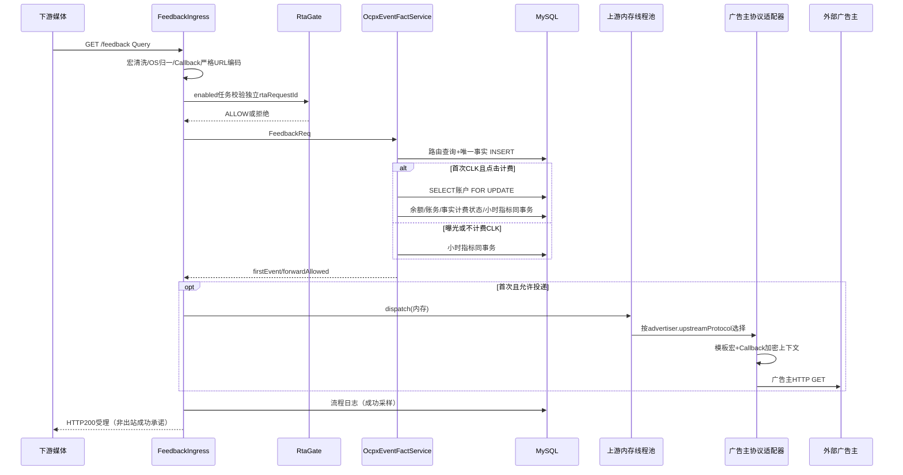
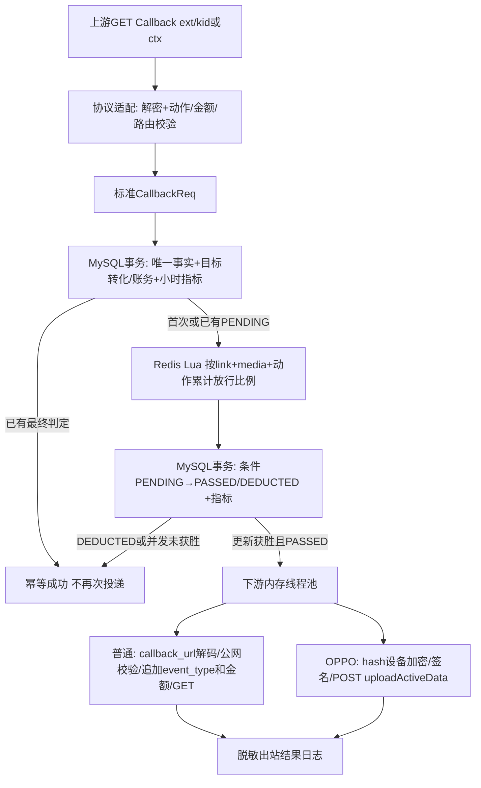

# SCX Engine / Core 只读架构与业务审计附录

审计日期：2026-10-20；对象：当前工作树 `scx-backend/scx-ocpx-engine` 与 `scx-backend/scx-ocpx-core`。本附录依据源代码、Mapper XML、默认配置和测试源码，不连接外部服务、不运行服务、不执行数据库变更，不将源码实现等同于 UAT/生产可用。根工作树原有前端媒体页修改未触碰。

路径缩写（后续证据均为仓库相对路径 + 一基行号）：
- **E** = `scx-backend/scx-ocpx-engine/src/main/java/com/yzytech/scx/ocpx/`
- **ER** = `scx-backend/scx-ocpx-engine/src/main/resources/`
- **C** = `scx-backend/scx-ocpx-core/src/main/java/com/yzytech/scx/ocpx/`

## 1. 实际边界与文档差异

1. Engine 是独立 Spring Boot 应用，启动类 [scx-backend/scx-ocpx-engine/src/main/java/com/yzytech/scx/ocpx/ScxOcpxEngineApplication.java:16](../../../../scx-backend/scx-ocpx-engine/src/main/java/com/yzytech/scx/ocpx/ScxOcpxEngineApplication.java#L16) 启用 MapperScan、异步与调度；默认 `10000/ocpx`（[scx-backend/scx-ocpx-engine/src/main/resources/application.yml:1](../../../../scx-backend/scx-ocpx-engine/src/main/resources/application.yml#L1)）。它不承载管理端登录/权限页面。
2. 当前事实、余额、账务和统计真相是 MySQL 的事件事实 + 广告主账户 + 不可变账务流水 + 小时指标；不再是“Redis 单值余额、无 CPC、无流水”的旧 AGENTS 描述（[scx-backend/scx-ocpx-engine/src/main/java/com/yzytech/scx/ocpx/fact/service/OcpxEventFactService.java:51](../../../../scx-backend/scx-ocpx-engine/src/main/java/com/yzytech/scx/ocpx/fact/service/OcpxEventFactService.java#L51)、`:96`）。
3. 有 6 种上游事件协议：`TEMPLATE_GET/AERIM/WEIFENG/GRAVITY/RENREN_VIDEO/PHOENIX`，以及独立的 `GENERIC_ASYNC/WEIFENG_RTA` 决策协议，媒体含通用回调和 OPPO（[scx-backend/scx-ocpx-engine/src/main/java/com/yzytech/scx/ocpx/feedback/delivery/UpstreamDeliveryDispatcher.java:143](../../../../scx-backend/scx-ocpx-engine/src/main/java/com/yzytech/scx/ocpx/feedback/delivery/UpstreamDeliveryDispatcher.java#L143)；[scx-backend/scx-ocpx-core/src/main/java/com/yzytech/scx/ocpx/rta/contract/RtaProtocols.java:34](../../../../scx-backend/scx-ocpx-core/src/main/java/com/yzytech/scx/ocpx/rta/contract/RtaProtocols.java#L34)）。
4. Core 实际有 7 个 `@TableName` 实体（广告主、媒体、链接、任务、扣量、创意、协议白名单），不是旧说明中的 5 个。Core 还包含宏/模板/公网 URL 规则、共享刷新 key、密钥环、RTA 契约/状态；不提供 Spring 运行服务。
5. 默认 `ocpx.compatibility-report.enabled=false`，旧 Redis 报表/明细生产消费均关闭；`ocpx.flow-log.success-sample-rate=0.1`；RTA 在公共配置与 dev/prod 均 `enabled=false`。只有实现存在，不能写作当前环境已启用（[scx-backend/scx-ocpx-engine/src/main/resources/application.yml:35](../../../../scx-backend/scx-ocpx-engine/src/main/resources/application.yml#L35)、`:38`、`:50`；[scx-backend/scx-ocpx-engine/src/main/resources/application-dev.yml:21](../../../../scx-backend/scx-ocpx-engine/src/main/resources/application-dev.yml#L21)、[scx-backend/scx-ocpx-engine/src/main/resources/application-prod.yml:26](../../../../scx-backend/scx-ocpx-engine/src/main/resources/application-prod.yml#L26)）。
6. 当前流程日志 `OcpxFlowLogWriter` 是直接同步调用 SQL Mapper，并非异步快照写入（[scx-backend/scx-ocpx-engine/src/main/java/com/yzytech/scx/ocpx/report/service/OcpxFlowLogWriter.java:109](../../../../scx-backend/scx-ocpx-engine/src/main/java/com/yzytech/scx/ocpx/report/service/OcpxFlowLogWriter.java#L109)）。成功日志按稳定 hash 采样，失败保留；详细参数存储 7 天，元数据 90 天。
7. 普通上游请求和媒体回传（含 OPPO）仅提交有界内存线程池，无持久化投递任务和自动补偿；RTA 才有 Redis 状态机/投递队列/限时重试。`OppoUploadActiveDataDeliverySqlMapper` 虽在目录中存在，但只查询广告主/链接，当前服务无引用，不能据文件名推断 OPPO 有出站持久化队列。

## 2. 对外 HTTP 入口清单（所有路径加 `/ocpx`）

- **GET `/feedback`** — `FeedbackIngressController.handleFeedback`：Query `mId/tId/aId/lId/event` + `request_id/callback_url`、设备标识及 hash、IP/UA/OS、时间、媒体广告层级 ID、可选 `rtaRequestId`。拒绝旧 `chid/mid/dspid/linkid`；CLK 的 request_id 必填、≤128、无控制字符或未替换宏。转换为 `FeedbackReq` → RTA gate → 事实事务 → 首次允许时上游 dispatch → 流程日志；正常 HTTP200 `{ret:0,code:200,msg:"提交成功",data:{}}`，显式参数拒绝400、RTA拒绝403、RTA基础设施503、其他处理错误500。成功响应并不等于广告主接受请求（[scx-backend/scx-ocpx-engine/src/main/java/com/yzytech/scx/ocpx/feedback/web/FeedbackIngressController.java:66](../../../../scx-backend/scx-ocpx-engine/src/main/java/com/yzytech/scx/ocpx/feedback/web/FeedbackIngressController.java#L66)、[scx-backend/scx-ocpx-engine/src/main/java/com/yzytech/scx/ocpx/feedback/web/FeedbackIngressResponse.java:6](../../../../scx-backend/scx-ocpx-engine/src/main/java/com/yzytech/scx/ocpx/feedback/web/FeedbackIngressResponse.java#L6)）。
- **GET `/callback`** — `UpstreamCallbackController`：`ext/kid/s/event_type/event_time`；密钥环解密原 Feedback，上游整数事件映射 ActionType；公共 CallbackService；未知整数动作会得到NOT_APPLICABLE并200、不会写转化事实；成功空200，异常500（[scx-backend/scx-ocpx-engine/src/main/java/com/yzytech/scx/ocpx/callback/web/UpstreamCallbackController.java:32](../../../../scx-backend/scx-ocpx-engine/src/main/java/com/yzytech/scx/ocpx/callback/web/UpstreamCallbackController.java#L32)；[scx-backend/scx-ocpx-engine/src/main/java/com/yzytech/scx/ocpx/protocol/template/TemplateGetProtocolAdapter.java:85](../../../../scx-backend/scx-ocpx-engine/src/main/java/com/yzytech/scx/ocpx/protocol/template/TemplateGetProtocolAdapter.java#L85)）。
- **GET `/aerim/callback`** — `ext/kid/s/action_type/currency_amount`；AERIM 字符串转标准事件；金额仅 PAYMENT 可有，非负且≤6位小数；成功/重复/扣量均空200，参数400、运行时500（[scx-backend/scx-ocpx-engine/src/main/java/com/yzytech/scx/ocpx/callback/web/aerim/AerimCallbackController.java:29](../../../../scx-backend/scx-ocpx-engine/src/main/java/com/yzytech/scx/ocpx/callback/web/aerim/AerimCallbackController.java#L29)、[scx-backend/scx-ocpx-engine/src/main/java/com/yzytech/scx/ocpx/callback/web/aerim/AerimCallbackAdapter.java:35](../../../../scx-backend/scx-ocpx-engine/src/main/java/com/yzytech/scx/ocpx/callback/web/aerim/AerimCallbackAdapter.java#L35)）。
- **GET `/weifeng/callback`** — `ext/kid/s/event/amount/days`；event trim/大写后映射；amount 支付/首购，days 限留存0..3650；未替换 `__AMOUNT__/__DAYS__` 按缺失；成功空200、参数400、错误500（[scx-backend/scx-ocpx-engine/src/main/java/com/yzytech/scx/ocpx/callback/web/weifeng/WeifengCallbackController.java:29](../../../../scx-backend/scx-ocpx-engine/src/main/java/com/yzytech/scx/ocpx/callback/web/weifeng/WeifengCallbackController.java#L29)、[scx-backend/scx-ocpx-engine/src/main/java/com/yzytech/scx/ocpx/callback/web/weifeng/WeifengCallbackAdapter.java:33](../../../../scx-backend/scx-ocpx-engine/src/main/java/com/yzytech/scx/ocpx/callback/web/weifeng/WeifengCallbackAdapter.java#L33)）。
- **GET `/gravity/callback`** — `ctx/kid`；认证加密路由上下文恢复，仅 ACTIVATE；成功200 `{code:200,result:"success"}`，参数及运行错误都400 `{code:400,result:"failed"}`（[scx-backend/scx-ocpx-engine/src/main/java/com/yzytech/scx/ocpx/callback/web/gravity/GravityCallbackController.java:30](../../../../scx-backend/scx-ocpx-engine/src/main/java/com/yzytech/scx/ocpx/callback/web/gravity/GravityCallbackController.java#L30)、[scx-backend/scx-ocpx-engine/src/main/java/com/yzytech/scx/ocpx/callback/web/gravity/GravityCallbackAdapter.java:28](../../../../scx-backend/scx-ocpx-engine/src/main/java/com/yzytech/scx/ocpx/callback/web/gravity/GravityCallbackAdapter.java#L28)）。
- **GET `/renren-video/callback`** — `ext/kid/event`；事件映射并恢复路由；成功空200、参数400、错误500（[scx-backend/scx-ocpx-engine/src/main/java/com/yzytech/scx/ocpx/callback/web/renrenvideo/RenrenVideoCallbackController.java:29](../../../../scx-backend/scx-ocpx-engine/src/main/java/com/yzytech/scx/ocpx/callback/web/renrenvideo/RenrenVideoCallbackController.java#L29)、[scx-backend/scx-ocpx-engine/src/main/java/com/yzytech/scx/ocpx/callback/web/renrenvideo/RenrenVideoCallbackAdapter.java:26](../../../../scx-backend/scx-ocpx-engine/src/main/java/com/yzytech/scx/ocpx/callback/web/renrenvideo/RenrenVideoCallbackAdapter.java#L26)）。
- **GET `/phoenix/callback`** — `ext/kid/event_type`；事件映射并严格校验解密上下文是 CLICK、当前广告主协议/链接/媒体/任务归属；成功200 `{code:0,msg:"success",data:""}`、参数400、错误500（[scx-backend/scx-ocpx-engine/src/main/java/com/yzytech/scx/ocpx/callback/web/phoenix/PhoenixCallbackController.java:30](../../../../scx-backend/scx-ocpx-engine/src/main/java/com/yzytech/scx/ocpx/callback/web/phoenix/PhoenixCallbackController.java#L30)、[scx-backend/scx-ocpx-engine/src/main/java/com/yzytech/scx/ocpx/callback/web/phoenix/PhoenixCallbackAdapter.java:49](../../../../scx-backend/scx-ocpx-engine/src/main/java/com/yzytech/scx/ocpx/callback/web/phoenix/PhoenixCallbackAdapter.java#L49)）。
- **GET `/test-callback`** — 固定测试接收器；`request_id/token/四路由/event_type/[currency_amount]/delivery_signature`；校验受控测试ID、token指纹、HMAC、此前已 armed 且已有同路由 PASSED Callback 事实；只写测试结果流程日志，不创建计费事实。首次/重复204、未ready409、参数400、错误500（[scx-backend/scx-ocpx-engine/src/main/java/com/yzytech/scx/ocpx/callback/web/testing/TestCallbackCollectorController.java:23](../../../../scx-backend/scx-ocpx-engine/src/main/java/com/yzytech/scx/ocpx/callback/web/testing/TestCallbackCollectorController.java#L23)、[scx-backend/scx-ocpx-engine/src/main/java/com/yzytech/scx/ocpx/callback/service/TestCallbackCollectorService.java:129](../../../../scx-backend/scx-ocpx-engine/src/main/java/com/yzytech/scx/ocpx/callback/service/TestCallbackCollectorService.java#L129)）。
- **POST `/rta/requests`** — UTF-8 JSON `{requestId,taskIds[],device:{},context:{}}` + `X-Rta-Key/Timestamp/Nonce/Sign`；请求无 query、≤64KiB；凭据引用定位启用的通用媒体，HMAC验签防重放，生成异步决策请求；202 `{requestId,relayRequestId,deadline}`（[scx-backend/scx-ocpx-engine/src/main/java/com/yzytech/scx/ocpx/rta/relay/RelayController.java:30](../../../../scx-backend/scx-ocpx-engine/src/main/java/com/yzytech/scx/ocpx/rta/relay/RelayController.java#L30)）。
- **POST `/rta/callbacks/{accessCode}`** — UTF-8 JSON `{relayRequestId,status,matched:[{productId,taskId}]}` + HMAC headers；按 upstream accessCode 适配并结束 Redis 决策；200 `{relayRequestId,status}`，业务错误按400/401/404/409/410等，兜底503（[scx-backend/scx-ocpx-engine/src/main/java/com/yzytech/scx/ocpx/rta/relay/RelayController.java:44](../../../../scx-backend/scx-ocpx-engine/src/main/java/com/yzytech/scx/ocpx/rta/relay/RelayController.java#L44)）。
- **POST `/rta/oppo/{code}`** — OPPO JSON（request_id、request_time、channel_name、owner_id、sign、oaid、client_ip、ad_type_list等）；验证 MD5、时间窗、owner、字段白名单后异步等待内部 RTA 结果，同一次HTTP返回 `{ret,msg,data:{id,agree_type_list}}`；线程池繁忙503、DeferredResult上限6000ms（[scx-backend/scx-ocpx-engine/src/main/java/com/yzytech/scx/ocpx/oppo/OppoRtaController.java:29](../../../../scx-backend/scx-ocpx-engine/src/main/java/com/yzytech/scx/ocpx/oppo/OppoRtaController.java#L29)、[scx-backend/scx-ocpx-engine/src/main/java/com/yzytech/scx/ocpx/oppo/OppoRtaService.java:52](../../../../scx-backend/scx-ocpx-engine/src/main/java/com/yzytech/scx/ocpx/oppo/OppoRtaService.java#L52)）。
- **GET `/oppo/click/{code}/{strategy}`** — `request_id/[rta_request_id]/oaid/ad_id/ts/model/[ip/ua/osv]`；只接收字段白名单、单值；要求对应 OPPO RTA 已 ALLOW、已同步返回、未过期、OAID hash一致且匹配任务；构造 Feedback 后复用正式事实/计费/转发；200 `{ret:0,msg:""}`，拒绝400/403、错误503（[scx-backend/scx-ocpx-engine/src/main/java/com/yzytech/scx/ocpx/oppo/OppoClickController.java:40](../../../../scx-backend/scx-ocpx-engine/src/main/java/com/yzytech/scx/ocpx/oppo/OppoClickController.java#L40)）。

## 3. 核心处理链与数据流

### 3.1 普通曝光/点击

实际顺序证据：[scx-backend/scx-ocpx-engine/src/main/java/com/yzytech/scx/ocpx/feedback/web/FeedbackIngressAdapter.java:25](../../../../scx-backend/scx-ocpx-engine/src/main/java/com/yzytech/scx/ocpx/feedback/web/FeedbackIngressAdapter.java#L25)、[scx-backend/scx-ocpx-engine/src/main/java/com/yzytech/scx/ocpx/feedback/service/FeedbackServiceImpl.java:72](../../../../scx-backend/scx-ocpx-engine/src/main/java/com/yzytech/scx/ocpx/feedback/service/FeedbackServiceImpl.java#L72)、[scx-backend/scx-ocpx-engine/src/main/java/com/yzytech/scx/ocpx/fact/service/OcpxEventFactService.java:51](../../../../scx-backend/scx-ocpx-engine/src/main/java/com/yzytech/scx/ocpx/fact/service/OcpxEventFactService.java#L51)、[scx-backend/scx-ocpx-engine/src/main/java/com/yzytech/scx/ocpx/feedback/delivery/UpstreamDeliveryDispatcher.java:116](../../../../scx-backend/scx-ocpx-engine/src/main/java/com/yzytech/scx/ocpx/feedback/delivery/UpstreamDeliveryDispatcher.java#L116)。

- Query 的 `event` 转为 `EventTypeEnum`，`CLK` 内部为 `CLICK`。OS `0/ANDROID→ANDROID`、`1/IOS→IOS`，其他UNKNOWN。CAID按 `caid→caid_list→caid1` 补齐兼容槽位；非CLK缺 request_id 时用原请求序列化JSON的MD5回退。`callback_url`在入口严格URL编码，出站媒体回传时只解码一次（[scx-backend/scx-ocpx-engine/src/main/java/com/yzytech/scx/ocpx/feedback/web/FeedbackIngressAdapter.java:25](../../../../scx-backend/scx-ocpx-engine/src/main/java/com/yzytech/scx/ocpx/feedback/web/FeedbackIngressAdapter.java#L25)）。
- 事实 ID 是无连字符 UUID；`fact_key=SHA256(aId|tId|reqId|eventCode)`，唯一键最终去重，不依赖Redis；业务时间固定 Asia/Shanghai，货币 `BigDecimal scale=6 HALF_UP`。小时键 `yyyyMMddHH`，按收到时间归属。事实保留当时任务计费开关、类型、单价、目标事件快照（[scx-backend/scx-ocpx-engine/src/main/java/com/yzytech/scx/ocpx/fact/service/OcpxEventFactService.java:39](../../../../scx-backend/scx-ocpx-engine/src/main/java/com/yzytech/scx/ocpx/fact/service/OcpxEventFactService.java#L39)、`:189`、`:272`）。
- 事务校验 taskId、advertiserId、linkId、mediaId 四维匹配且任务非删除；普通路径SQL只读任务，不连查广告主/媒体/链接的可用状态（[scx-backend/scx-ocpx-engine/src/main/resources/mapper/OcpxEventFactSqlMapper.xml:111](../../../../scx-backend/scx-ocpx-engine/src/main/resources/mapper/OcpxEventFactSqlMapper.xml#L111)）。
- 点击计费 `billingEnabled && billingType=1`：锁广告主账户；不足余额依然写唯一点击事实、REJECTED流水、拒绝点击计数，但不转发；余额足够扣款、POSTED流水并转发。重复点击不再扣费或投递（[scx-backend/scx-ocpx-engine/src/main/java/com/yzytech/scx/ocpx/fact/service/OcpxEventFactService.java:72](../../../../scx-backend/scx-ocpx-engine/src/main/java/com/yzytech/scx/ocpx/fact/service/OcpxEventFactService.java#L72)）。
- 事实提交在出站协议校验和HTTP之前；因此上游模板无效、缺凭据、白名单错误、HTTP失败均可能发生在已计费之后。这是代码顺序，不能把“计费成功”表述为“广告主接受点击”。

### 3.2 上游协议适配（功能输入→逻辑→输出）

- **TEMPLATE_GET**：advertiser.bidUrl + macroParams + 服务端 credentialConfigKey；仅CLICK。必须替换Callback宏及至少一个归因身份组合，空可选宏删整个Query对，未知/路径宏拒绝。把完整Feedback以 `ext/kid` 加密并拼至 SCX `/callback`；对最终URL+服务端secret取MD5追加signature；HTTP200/204标成功。此实现未调用五种专用协议的 host allowlist/DNS policy（[scx-backend/scx-ocpx-engine/src/main/java/com/yzytech/scx/ocpx/protocol/template/TemplateGetProtocolAdapter.java:112](../../../../scx-backend/scx-ocpx-engine/src/main/java/com/yzytech/scx/ocpx/protocol/template/TemplateGetProtocolAdapter.java#L112)、[scx-backend/scx-ocpx-engine/src/main/java/com/yzytech/scx/ocpx/feedback/delivery/MacroResolutionService.java:41](../../../../scx-backend/scx-ocpx-engine/src/main/java/com/yzytech/scx/ocpx/feedback/delivery/MacroResolutionService.java#L41)、[scx-backend/scx-ocpx-engine/src/main/java/com/yzytech/scx/ocpx/feedback/delivery/TemplateGetUpstreamDeliveryService.java:35](../../../../scx-backend/scx-ocpx-engine/src/main/java/com/yzytech/scx/ocpx/feedback/delivery/TemplateGetUpstreamDeliveryService.java#L35)）。
- **AERIM**：promotionLink.linkUrl完整模板 + 当前链接归属；仅CLICK；设备/媒体宏展开、移除缺失参数、确认实际出站归因身份及callback；时间10位秒转13位毫秒；数据库精确域名白名单+所有DNS答案公网；callback=`/aerim/callback?ext&kid&s`；HTTP200且响应不是业务code402日限额才成功（[scx-backend/scx-ocpx-engine/src/main/java/com/yzytech/scx/ocpx/feedback/delivery/aerim/AerimUpstreamDeliveryService.java:72](../../../../scx-backend/scx-ocpx-engine/src/main/java/com/yzytech/scx/ocpx/feedback/delivery/aerim/AerimUpstreamDeliveryService.java#L72)、`:116`；[scx-backend/scx-ocpx-engine/src/main/java/com/yzytech/scx/ocpx/feedback/delivery/aerim/AerimEndpointPolicy.java:27](../../../../scx-backend/scx-ocpx-engine/src/main/java/com/yzytech/scx/ocpx/feedback/delivery/aerim/AerimEndpointPolicy.java#L27)）。
- **WEIFENG**：仅CLICK；要求链接归属、OS、model、有效时间及归因身份；aid/did保持链接字面量，动态参数必须宏；RTA时对齐aid/did并写provider requestId；OPPO通道仅在受控适配器解密点击OAID；callback含 `event=__EVENT__&amount=__AMOUNT__&days=__DAYS__`；精确白名单/公网DNS；HTTP200成功（[scx-backend/scx-ocpx-engine/src/main/java/com/yzytech/scx/ocpx/feedback/delivery/weifeng/WeifengUpstreamDeliveryService.java:75](../../../../scx-backend/scx-ocpx-engine/src/main/java/com/yzytech/scx/ocpx/feedback/delivery/weifeng/WeifengUpstreamDeliveryService.java#L75)、`:116`、`:299`）。
- **GRAVITY**：仅CLICK；按iOS/Android构建idfa或oaid/android_id/imei，要求IPv4/UA；固定参数保留，动态参数替换；仅最小路由信息进入认证 `ctx`，回调固定ACTIVATE；HTTP任何2xx表示点击HTTP接受，不证明激活（[scx-backend/scx-ocpx-engine/src/main/java/com/yzytech/scx/ocpx/feedback/delivery/gravity/GravityUpstreamDeliveryService.java:62](../../../../scx-backend/scx-ocpx-engine/src/main/java/com/yzytech/scx/ocpx/feedback/delivery/gravity/GravityUpstreamDeliveryService.java#L62)、`:86`、`:144`）。
- **RENREN_VIDEO**：仅CLICK；promotionLink完整 `/ad-action/click` 模板，保留固定userId，Android/iOS平台严格匹配；输出秒/毫秒双时间、MD5设备字段、clickId回退、passThrough、callback；不保存或发送Bearer Token；callback的event映射标准动作；仅HTTP200且JSON业务code=200成功（[scx-backend/scx-ocpx-engine/src/main/java/com/yzytech/scx/ocpx/feedback/delivery/renrenvideo/RenrenVideoUpstreamDeliveryService.java:59](../../../../scx-backend/scx-ocpx-engine/src/main/java/com/yzytech/scx/ocpx/feedback/delivery/renrenvideo/RenrenVideoUpstreamDeliveryService.java#L59)、`:87`、`:149`；`scx-backend/scx-ocpx-core/src/main/java/com/yzytech/scx/ocpx/protocol/RenrenVideoTemplateContract.java`）。
- **PHOENIX**：支持IMP与CLICK；点击沿模板路径，曝光强制`/d/imp`且不带callback；支持Android/iOS/混合平台；required reqid/os/ts，按协议清洗hash与IDFA；kid/ext均严格编码；HTTP200且code=0成功；IMP额外容许code缺失（含无JSON业务code的响应）（[scx-backend/scx-ocpx-engine/src/main/java/com/yzytech/scx/ocpx/feedback/delivery/phoenix/PhoenixUpstreamDeliveryService.java:65](../../../../scx-backend/scx-ocpx-engine/src/main/java/com/yzytech/scx/ocpx/feedback/delivery/phoenix/PhoenixUpstreamDeliveryService.java#L65)、`:95`、`:163`；`scx-backend/scx-ocpx-core/src/main/java/com/yzytech/scx/ocpx/protocol/PhoenixTemplateContract.java`）。

所有专用协议均在适配器内做链接归属和目标URL策略校验；不可把 TEMPLATE_GET 的安全边界写成完全相同。六个协议共享标准 Feedback，但合作方字段和成功语义不同。

### 3.3 Callback、账务、扣量、媒体回传

证据：[scx-backend/scx-ocpx-engine/src/main/java/com/yzytech/scx/ocpx/callback/service/CallbackServiceImpl.java:77](../../../../scx-backend/scx-ocpx-engine/src/main/java/com/yzytech/scx/ocpx/callback/service/CallbackServiceImpl.java#L77)、`:107`、[scx-backend/scx-ocpx-engine/src/main/java/com/yzytech/scx/ocpx/fact/service/OcpxEventFactService.java:96](../../../../scx-backend/scx-ocpx-engine/src/main/java/com/yzytech/scx/ocpx/fact/service/OcpxEventFactService.java#L96)、`:155`、[scx-backend/scx-ocpx-engine/src/main/java/com/yzytech/scx/ocpx/callback/delivery/DownstreamDeliveryDispatcher.java:74](../../../../scx-backend/scx-ocpx-engine/src/main/java/com/yzytech/scx/ocpx/callback/delivery/DownstreamDeliveryDispatcher.java#L74)。

- 转化事实去重仍按 aId/task/requestId/标准event。只要首次有效Callback就计原始数量；目标转化按**收到Callback时当前任务配置**计算并快照，并非读取原点击的任务计费配置。目标转化且 `billingType=2` 才扣款；余额不足写拒绝流水，但仍进入媒体扣量，与广告主计费解耦。
- Lua按 `linkId:mediaId` 路由、标准动作下标分别累计；比例0..1；判定 `(passed+1)/(original+1) <= ratio` 才放行，ratio=1全放；缺失/非法比例默认1（fail-open），不是随机独立抽样。每个fact decision key先保留保证MySQL失败重试得到同一判定，最终写库后删除decision key（[scx-backend/scx-ocpx-engine/src/main/java/com/yzytech/scx/ocpx/callback/service/DeductionDecisionService.java:20](../../../../scx-backend/scx-ocpx-engine/src/main/java/com/yzytech/scx/ocpx/callback/service/DeductionDecisionService.java#L20)）。
- MySQL `WHERE deduction_decision='PENDING'` 的条件更新是判定最终幂等边界；只有获胜者增加扣量指标/提交下游。`PASSED/FORWARDED`表示放行/提交内存投递，并非媒体签收。
- 普通下游：还原callback URL，校验HTTP(S)/公网DNS，追加标准整数event_type和可选十进制currency_amount。仅200/204被视为投递成功；失败写日志，无普通媒体重试任务（[scx-backend/scx-ocpx-engine/src/main/java/com/yzytech/scx/ocpx/callback/delivery/CallbackUrlDownstreamDeliveryService.java:29](../../../../scx-backend/scx-ocpx-engine/src/main/java/com/yzytech/scx/ocpx/callback/delivery/CallbackUrlDownstreamDeliveryService.java#L29)）。
- OPPO下游：只支持ACTIVATE→1、REGISTER→2、PAYMENT→7；发送固定 `https://api.ads.heytapmobi.com/api/uploadActiveData`。ouId为OAID_MD5小写后AES/ECB/PKCS5Padding加密再Base64；JSON携requestId/事件毫秒时间/pkg/adId等；header timestamp+MD5(body+timestamp+salt)，可选ownerToken为Base64(ownerId,apiId,秒时间,SHA1(apiId+apiKey+秒时间))；HTTP2xx且ret为整数0才成功。只记录稳定结果，不存响应正文。当前无自动重试（[scx-backend/scx-ocpx-engine/src/main/java/com/yzytech/scx/ocpx/oppo/callback/OppoUploadActiveDataDeliveryService.java:45](../../../../scx-backend/scx-ocpx-engine/src/main/java/com/yzytech/scx/ocpx/oppo/callback/OppoUploadActiveDataDeliveryService.java#L45)、`:68`；[scx-backend/scx-ocpx-engine/src/main/java/com/yzytech/scx/ocpx/rta/relay/RelayHttpTransport.java:44](../../../../scx-backend/scx-ocpx-engine/src/main/java/com/yzytech/scx/ocpx/rta/relay/RelayHttpTransport.java#L44)）。

### 3.4 RTA独立决策及事件准入

1. 通用媒体POST受理：HMAC-SHA256签名文本为 `POST\npath\nkey\ntimestamp\nnonce\nSHA256(body)`；13位毫秒，±5min；nonce16..128位，Redis10min防重放。secret由服务端map按ref取，最短32字符（[scx-backend/scx-ocpx-engine/src/main/java/com/yzytech/scx/ocpx/rta/relay/RelaySecurity.java:48](../../../../scx-backend/scx-ocpx-engine/src/main/java/com/yzytech/scx/ocpx/rta/relay/RelaySecurity.java#L48)）。
2. requestId限制1..128、tasks1..100无重复、device/context白名单。同媒体+requestId幂等且canonical payload hash一致；任务排序，必须同一个upstream/advertiser，候选product/task tuple不可歧义；路由/配置版本保存快照（[scx-backend/scx-ocpx-engine/src/main/java/com/yzytech/scx/ocpx/rta/relay/RelayService.java:47](../../../../scx-backend/scx-ocpx-engine/src/main/java/com/yzytech/scx/ocpx/rta/relay/RelayService.java#L47)）。
3. 原设备请求JSON以AES-256-GCM加密，AAD=relayRequestId，进入Redis状态，状态/幂等保留24h；不会把原设备JSON写MySQL。发送完成或最终决策后删除encryptedPayload。
4. Redis Lua原子INIT创建state/idem/send/deadline/记录索引/指标。50ms tick先处理超时，再notify/send，有16个工作线程、32队列；claim把ZSET分值租赁到5s后（[scx-backend/scx-ocpx-engine/src/main/java/com/yzytech/scx/ocpx/rta/relay/RelayWorker.java:34](../../../../scx-backend/scx-ocpx-engine/src/main/java/com/yzytech/scx/ocpx/rta/relay/RelayWorker.java#L34)、`:55`；`scx-backend/scx-ocpx-engine/src/main/resources/rta/state.lua:22`）。
5. GENERIC_ASYNC：最多100候选、可重试、HMAC POST至upstream.endpoint；只接受202后等待认证Callback，失败250ms后在deadline内重试。WEIFENG_RTA：最多1候选、固定endpoint、aid/did必须与点击链接一致、设备raw按需转MD5；同步返回严格{id,code}，0→ALLOW其他→DENY；非retrySafe，出站前DISPATCH_ONCE，失败ERROR，不再重投（[scx-backend/scx-ocpx-core/src/main/java/com/yzytech/scx/ocpx/rta/contract/RtaProtocols.java:34](../../../../scx-backend/scx-ocpx-core/src/main/java/com/yzytech/scx/ocpx/rta/contract/RtaProtocols.java#L34)；[scx-backend/scx-ocpx-engine/src/main/java/com/yzytech/scx/ocpx/rta/relay/GenericAsyncRtaAdapter.java:16](../../../../scx-backend/scx-ocpx-engine/src/main/java/com/yzytech/scx/ocpx/rta/relay/GenericAsyncRtaAdapter.java#L16)；[scx-backend/scx-ocpx-engine/src/main/java/com/yzytech/scx/ocpx/rta/relay/WeifengRtaAdapter.java:25](../../../../scx-backend/scx-ocpx-engine/src/main/java/com/yzytech/scx/ocpx/rta/relay/WeifengRtaAdapter.java#L25)）。
6. 最终ALLOW/DENY/ERROR/TIMEOUT通过Lua只结束一次；冲突409、过期410；ALLOW必须非空匹配列表；只可匹配原候选。最终决策去除原payload，生成admission expiry。
7. 通用媒体通知：签名JSON Notification；2xx成功；最多4次，1s/3s/10s退避，总窗口30s；记录DELIVERED/FAILED。OPPO不走notify，终态写SYNC_READY；仅有效ALLOW在组装同步响应时、HTTP真正返回前写SYNC_RETURNED，该标记不是对方签收证明（`scx-backend/scx-ocpx-engine/src/main/resources/rta/state.lua:50`、`:101`；[scx-backend/scx-ocpx-engine/src/main/java/com/yzytech/scx/ocpx/rta/relay/RelayWorker.java:148](../../../../scx-backend/scx-ocpx-engine/src/main/java/com/yzytech/scx/ocpx/rta/relay/RelayWorker.java#L148)）。
8. 普通 `/feedback` 中RTA开启的IMP/CLICK要求独立32hex rtaRequestId、媒体相等、ALLOW、未过期、匹配task、四维相等，且数据库现配置与RTA快照完全相等；OPPO必须走专用点击入口。通过后仅允许规定设备字段进入后续协议（[scx-backend/scx-ocpx-engine/src/main/java/com/yzytech/scx/ocpx/rta/admission/RtaGate.java:24](../../../../scx-backend/scx-ocpx-engine/src/main/java/com/yzytech/scx/ocpx/rta/admission/RtaGate.java#L24)）。
9. RTA脱敏日志按relayRequestId稳定采样10%成功、失败全记，写Redis Stream；小时计数写Hash+dirty集合，由Admin的XXL-JOB持久化，Engine本地调度不写RTA SQL日志/汇总（[scx-backend/scx-ocpx-engine/src/main/java/com/yzytech/scx/ocpx/rta/relay/RelayAudit.java:20](../../../../scx-backend/scx-ocpx-engine/src/main/java/com/yzytech/scx/ocpx/rta/relay/RelayAudit.java#L20)；`scx-backend/scx-ocpx-engine/src/main/resources/rta/state.lua:10`；跨模块消费者 [scx-backend/scx-ocpx-admin/src/main/java/com/yzytech/scx/ocpx/admin/rta/RtaJobs.java:39/:109/:138](../../../../scx-backend/scx-ocpx-admin/src/main/java/com/yzytech/scx/ocpx/admin/rta/RtaJobs.java#L39)，具体消费门禁见管理面附录）。

### 3.5 OPPO同步外观封装

- OPPO请求签名 `MD5(request_id + owner + "OPPO" + request_time + secret)`；按配置ownerMode核对owner；允许±5min，策略列表≤100、不重复、正整数。设备OAID可缺失，缺失时当前微风适配器不命中（[scx-backend/scx-ocpx-engine/src/main/java/com/yzytech/scx/ocpx/oppo/OppoRtaService.java:85](../../../../scx-backend/scx-ocpx-engine/src/main/java/com/yzytech/scx/ocpx/oppo/OppoRtaService.java#L85)）。
- parent fingerprint保存同媒体requestId对应的策略集/设备/IP/owner hash，变更重试409。每个strategy拆成一个内部RTA请求，内部ID=`oppo.`+SHA256(originalId+":"+strategy)，只允许WEIFENG_RTA（`:127`）。
- 同步响应线程以≤10ms间隔轮询Redis状态到配置deadline，返回成功策略；部分失败且有成功可ret0但msg=PARTIAL_OR_UNAVAILABLE，全失败ret1。消费的不只是HTTP接口线程，还包括OPPO等待线程与RTA出站线程。
- 点击必须匹配之前OAID hash、strategy和SYNC_RETURNED；OAID加密暂存Feedback的受控字段、OAID_MD5用于后续OPPO回传；pkg取任务RTA绑定，uploadCredentialRef取媒体协议配置（[scx-backend/scx-ocpx-engine/src/main/java/com/yzytech/scx/ocpx/oppo/OppoClickController.java:60](../../../../scx-backend/scx-ocpx-engine/src/main/java/com/yzytech/scx/ocpx/oppo/OppoClickController.java#L60)）。

## 4. 存储、格式、最终消费者

### 4.1 MySQL

- 配置事实表：`scx_ocpx_advertiser/promotion_link/media/monitor_task/protocol_allowed_host` → Engine启动/定时加载内存Map；扣量比例不从Engine Mapper加载而由Admin同步Redis。
- `scx_ocpx_event_fact`：去重唯一fact、路由、事件、计费快照、花费、原订单金额、扣量判定/比例/判定时间；来源Feedback/Callback同步事务；消费管理端转化记录、测试结果、账务关联。事实不保存设备全量payload。
- `scx_ocpx_advertiser_account`：advertiser主键和available_balance；SELECT FOR UPDATE后更新；消费者为计费/充值/人工扣减/余额页。
- `scx_ocpx_billing_entry`：fact关联、entryType/status/金额/前后余额/businessKey/原因/时间；点击、转化扣费产生POSTED或REJECTED，消费者账务流水/对账。
- `scx_ocpx_hourly_metric`：收到时间小时+四维，曝光/点击/标准转化/目标转化/花费/金额/拒绝计费/原始Callback/放行/扣量等；与事实同事务upsert，管理端Dashboard/报表直接消费（SQL：[scx-backend/scx-ocpx-engine/src/main/resources/mapper/OcpxEventFactSqlMapper.xml:4/:58/:129/:135/:167](../../../../scx-backend/scx-ocpx-engine/src/main/resources/mapper/OcpxEventFactSqlMapper.xml#L4)）。
- `scx_ocpx_flow_log`：trace=SHA256(mId|tId|aId|lId|requestId)，6阶段（MEDIA_INGRESS、ADVERTISER_DELIVERY、ADVERTISER_CALLBACK、CALLBACK_ACCOUNTING、MEDIA_DEDUCTION、MEDIA_DELIVERY），路由/事件/状态/httpStatus/结论/duration/脱敏endpoint/宏状态/响应预览；端点只保存scheme+host+path；凭据正则遮盖，预览≤4096字（[scx-backend/scx-ocpx-engine/src/main/java/com/yzytech/scx/ocpx/report/service/OcpxFlowLogWriter.java:51/:109/:224](../../../../scx-backend/scx-ocpx-engine/src/main/java/com/yzytech/scx/ocpx/report/service/OcpxFlowLogWriter.java#L51)）。
- `scx_ocpx_flow_log_detail`：采样命中的规范化参数JSON、响应预览、expires_at=7d；参数超16KiB存`{"_truncated":true}`；RTA不存raw设备，只存传入hash，其余普通请求可以保存raw设备；无callback_url/sign/token/ext（`:156/:169`）。
- **兼容/默认关闭**：`scx_ocpx_log_feedback`、`scx_ocpx_log_feedback_day`、`scx_ocpx_log_callback`、`scx_ocpx_report_mat_temp`；Redis LogData批量写库。callbackUrl被主动置空，RTA设备raw被去除。管理端部分联调仍读这些老表，不能假设新流量有可回放快照（[scx-backend/scx-ocpx-engine/src/main/java/com/yzytech/scx/ocpx/feedback/service/FeedbackServiceImpl.java:118](../../../../scx-backend/scx-ocpx-engine/src/main/java/com/yzytech/scx/ocpx/feedback/service/FeedbackServiceImpl.java#L118)；[scx-backend/scx-ocpx-engine/src/main/java/com/yzytech/scx/ocpx/callback/service/CallbackServiceImpl.java:91](../../../../scx-backend/scx-ocpx-engine/src/main/java/com/yzytech/scx/ocpx/callback/service/CallbackServiceImpl.java#L91)；[scx-backend/scx-ocpx-engine/src/main/java/com/yzytech/scx/ocpx/report/service/ReportServiceImpl.java:30](../../../../scx-backend/scx-ocpx-engine/src/main/java/com/yzytech/scx/ocpx/report/service/ReportServiceImpl.java#L30)）。
- RTA配置：`scx_ocpx_rta_media_access/rta_upstream/rta_binding`联查媒体、广告主、任务、链接；状态/凭据引用版本均作为准入快照。对应SQL [scx-backend/scx-ocpx-engine/src/main/resources/mapper/RelaySqlMapper.xml:4/:21/:60](../../../../scx-backend/scx-ocpx-engine/src/main/resources/mapper/RelaySqlMapper.xml#L4)。

### 4.2 Redis

- `r:da:refresh`：管理变更触发的存在性标记，Engine每分钟轮询、等待5秒、重载后UNLINK（[scx-backend/scx-ocpx-core/src/main/java/com/yzytech/scx/ocpx/core/OcpxRefreshContract.java:6](../../../../scx-backend/scx-ocpx-core/src/main/java/com/yzytech/scx/ocpx/core/OcpxRefreshContract.java#L6)）。
- `ocpx:route:ratio:{linkId}:{mediaId}`：兼容比例字符串；`ocpx:route:original-count:...`、`ocpx:route:delivered-count:...`：旧动作计数数组JSON（花括号表示占位参数而非key中的字面量；格式拼接见 [scx-backend/scx-ocpx-engine/src/main/java/com/yzytech/scx/ocpx/shared/redis/RedisHelper.java:119](../../../../scx-backend/scx-ocpx-engine/src/main/java/com/yzytech/scx/ocpx/shared/redis/RedisHelper.java#L119)）。
- `ocpx:route:deduction:{linkId:mediaId}:state`：Hash ratio、original:index、passed:index；`...:decision:{factId}`：String `PASSED|ratio`或`DEDUCTED|ratio`。pending期间无TTL，完成后删除decision；state累计长期保留（[scx-backend/scx-ocpx-engine/src/main/java/com/yzytech/scx/ocpx/callback/service/DeductionDecisionService.java:67](../../../../scx-backend/scx-ocpx-engine/src/main/java/com/yzytech/scx/ocpx/callback/service/DeductionDecisionService.java#L67)）。
- `r:da:report:{bucket}` 与 `r:da:report:cb:{bucket}`：兼容LogData JSON List，默认关闭；生产RPUSH，消费LRANGE+MySQL事务+LTRIM；不是核心事实真相。
- `r:u:rpe:{0..99}` / `r:cl:rpe:*`：历史常量；主链已以MySQL事实去重，仅遗留清理/工具方法，不应描述为新链路去重主方案。
- `scx:{rta-async}:state:{relayId}`：JSON RtaState（路由配置版本/状态/decision hash/加密payload）；`idem:{mediaId}:{requestId}`→relayId，24h。
- 同前缀 `send/deadline/notify` 为到期ZSET；`records:all/media:{id}/advertiser:{id}` 为最近24h查询索引；`nonce:{sha256(ref:nonce)}` TTL10m；`oppo-request:{sha256(mediaId:requestId)}` TTL24h。
- 同前缀 `metric:{UTC epoch-hour}:{mediaId}:{taskId}:{upstreamId}` Hash、`metric-dirty` Set；`logs`/`logs:dlq` Stream，Admin XXL消费者 `sql-writers` 组。所有RTA key都使用同一Redis hash tag，跨key原子但集中在同一槽。

### 4.3 文件/内存

- 事件配置有4个ConcurrentHashMap索引，协议白名单单独不可变快照；依赖定期刷新，有非原子清空/重载窗口（[scx-backend/scx-ocpx-engine/src/main/java/com/yzytech/scx/ocpx/configuration/index/IndexDataLoader.java:74](../../../../scx-backend/scx-ocpx-engine/src/main/java/com/yzytech/scx/ocpx/configuration/index/IndexDataLoader.java#L74)）。
- 上下游各默认core32/max64/queue200/CallerRunsPolicy；排满反压至请求线程，异常在worker内记录并吞掉；队列不跨重启恢复。
- logback区分fb/cb/imp/error等滚动文件；这些日志是运维观测，不是业务事实/财务账本。

## 5. 全部 Engine 定时任务与启动触发

- 启动：`SystemMemory.run→IndexDataLoader.init` 加载广告主→链接→媒体→任务→白名单（[scx-backend/scx-ocpx-engine/src/main/java/com/yzytech/scx/ocpx/configuration/bootstrap/SystemMemory.java:23](../../../../scx-backend/scx-ocpx-engine/src/main/java/com/yzytech/scx/ocpx/configuration/bootstrap/SystemMemory.java#L23)）。
- `ResetRedisKeyTask.clearKey` 每日00:00:30：清100个旧Feedback去重Hash，15min Redis锁；只受`app.jobs.reset-enabled`控制，默认true（`:70`）。
- `refreshMemoryData` 每分钟整分：检测刷新标记，sleep5s、重载、删标记；每个实例本地执行但共享同一可删除标记（`:98`）。
- `initData` 每日00:10：无标记兜底全量重载（`:115`）。
- `deleteFeedbackDay` 默认每小时05/15/25/35/45/55分：清今日边界以前旧反馈日明细；每批1000、最多2批、间隔100ms；15min Redis锁未主动释放（`:126`）。
- `resetRouteCounters` 每日00:00：Redis KEYS扫描删除旧original-count/delivered-count前缀；**不清新deduction state Hash**（`:170`）。
- `StorageTask.consumeFeedback/consumeCallback` 默认每分钟：只在compatibility-report=true注册；每次抢一个分桶10min租约；批500，上限20批/30秒、批间100ms；失败最多3次重试、指数1s起；写成功后裁剪；owner token Lua释放锁（[scx-backend/scx-ocpx-engine/src/main/java/com/yzytech/scx/ocpx/report/task/StorageTask.java:39/:81/:114/:126](../../../../scx-backend/scx-ocpx-engine/src/main/java/com/yzytech/scx/ocpx/report/task/StorageTask.java#L39)）。
- `FlowLogRetentionTask.clean` 默认每10min：30min owner锁；5目标各最多2批、每批1000、间隔100ms。清过期detail、7d旧feedback/callback、7d响应预览、90d元数据；预览清理需特定索引存在，否则跳过（[scx-backend/scx-ocpx-engine/src/main/java/com/yzytech/scx/ocpx/report/task/FlowLogRetentionTask.java:45](../../../../scx-backend/scx-ocpx-engine/src/main/java/com/yzytech/scx/ocpx/report/task/FlowLogRetentionTask.java#L45)；[scx-backend/scx-ocpx-engine/src/main/resources/mapper/FlowLogRetentionSqlMapper.xml:12](../../../../scx-backend/scx-ocpx-engine/src/main/resources/mapper/FlowLogRetentionSqlMapper.xml#L12)）。
- `RelayWorker.tick` 独立rtaScheduler每次完成50ms后再触发；app.rta-relay.enabled=false时直接返回；deadline批100，16并发，notify优先send；非XXL。`RelayScheduling`提供独立调度器，避免普通cron阻塞RTA（[scx-backend/scx-ocpx-engine/src/main/java/com/yzytech/scx/ocpx/rta/relay/RelayWorker.java:55](../../../../scx-backend/scx-ocpx-engine/src/main/java/com/yzytech/scx/ocpx/rta/relay/RelayWorker.java#L55)）。
- Admin侧3个RTA XXL handlers并非Engine `@Scheduled`，需要真实调度中心配置触发；未验收调度中心不能声称日志/汇总必然已刷库。

定时cron未指定zone，按应用进程调度时区；事实的业务时间明确Asia/Shanghai，兼容路径及流程日志多用LocalDateTime.now()。部署时区不同可能产生跨路径时间口径差异。

## 6. 风险与瓶颈（静态事实、推断分开）

### 高优先级

1. **确认的架构窗口，未故障复现：事实已提交但外发可丢失。** Feedback先提交MySQL再入内存池，重复事实forwardAllowed=false；Callback先PASSED终态再dispatch，重复终态不会再次dispatch。进程退出/HTTP失败之后没有持久化待投递/重试。OPPO亦一样。用户看到已计费/PASSED并不证明最终消费成功。证据 [scx-backend/scx-ocpx-engine/src/main/java/com/yzytech/scx/ocpx/fact/service/OcpxEventFactService.java:51/:310](../../../../scx-backend/scx-ocpx-engine/src/main/java/com/yzytech/scx/ocpx/fact/service/OcpxEventFactService.java#L51)、[scx-backend/scx-ocpx-engine/src/main/java/com/yzytech/scx/ocpx/callback/service/CallbackServiceImpl.java:107](../../../../scx-backend/scx-ocpx-engine/src/main/java/com/yzytech/scx/ocpx/callback/service/CallbackServiceImpl.java#L107)、[scx-backend/scx-ocpx-engine/src/main/java/com/yzytech/scx/ocpx/feedback/delivery/UpstreamDeliveryDispatcher.java:116](../../../../scx-backend/scx-ocpx-engine/src/main/java/com/yzytech/scx/ocpx/feedback/delivery/UpstreamDeliveryDispatcher.java#L116)、[scx-backend/scx-ocpx-engine/src/main/java/com/yzytech/scx/ocpx/oppo/callback/OppoUploadActiveDataDeliveryService.java:45](../../../../scx-backend/scx-ocpx-engine/src/main/java/com/yzytech/scx/ocpx/oppo/callback/OppoUploadActiveDataDeliveryService.java#L45)。
2. **确认默认链路断层：老快照不再持续写入且Callback URL强制空。** 默认compatibility=false；即使打开兼容，Feedback saveFeedback把callbackUrl置空。若管理面联调/REAL_MEDIA测试只查scx_ocpx_log_feedback.callback_url，新请求无法提供真实回传URL。需与管理附录交叉确认，不能把“存在联调按钮”等同“具备可用真实样本”。
3. **确认源码不一致、未用Redis复现：扣量Lua参数下标疑点。** Lua `original = ... or ARGV[4]`、`passed=... or ARGV[5]`（[scx-backend/scx-ocpx-engine/src/main/java/com/yzytech/scx/ocpx/callback/service/DeductionDecisionService.java:42](../../../../scx-backend/scx-ocpx-engine/src/main/java/com/yzytech/scx/ocpx/callback/service/DeductionDecisionService.java#L42)）；Java仅传4项 `actionIndex,legacyRatio,originalSeed,passedSeed`（`:88`）。对应实际ARG3=originalSeed、ARG4=passedSeed、ARG5=nil。缺少Hash字段时original将从passedSeed初始化、passed将nil→0（guard），与意图的旧原始量/放行量迁移不一致；全新零种子通常落为0/0，所以不一定暴露。影响推演：旧original=100、passed=50、ratio=.5若首次新Hash缺字段，初始将50/0而非100/50，后续比例会过度放行直到追平。这是静态推演，不是已复现运行错误；应加入带非零迁移种子的真实Lua测试后再定论。
4. **确认安全边界差异：普通Feedback的sign未验签。** Request有sign字段（[scx-backend/scx-ocpx-engine/src/main/java/com/yzytech/scx/ocpx/feedback/web/FeedbackIngressRequest.java:94](../../../../scx-backend/scx-ocpx-engine/src/main/java/com/yzytech/scx/ocpx/feedback/web/FeedbackIngressRequest.java#L94)），Adapter/Service无消费；请求者知道有效四维与新requestId即可进入事实和可能计费，是否公网防护另有部署层限制本次未核验。RTA是独立HMAC边界，不覆盖所有普通流量。
5. **确认安全边界差异：TEMPLATE_GET未走出站白名单/DNS公网策略。** 模板适配只校验宏/归因字段并追加签名，NetUtil直接URI HTTP GET；不同于5个专用协议。配置由谁可写、是否能保存内网URL由管理面检查；不能宣称所有广告主协议都有同一SSRF保障。

### 一致性与可观测性

6. MySQL扣量事实与Redis判定跨存储无分布式事务；decision key用于pending恢复，但无后台扫描PENDING事实，依赖上游重试。Redis丢失后计数/ratio可漂移，invalid ratio默认1扩大放行；完成key清理失败留垃圾而不会重复计费。
7. Admin刷新标记是存在性key，Engine成功后删除；多实例可能由一个实例抢先删掉而其他实例错过；刷新期间再次写入也可能被旧刷新清掉。四Map逐个clear/add，短期空/混合版本可导致出站拒绝；已完成事实/计费不回滚。代码自注释已承认非原子。`:IndexDataLoader.java:74`、`ResetRedisKeyTask.java:102`。
8. 流程日志默认10%成功采样、写入失败吞掉，六阶段可能缺行；普通Callback重复也有采样处理。因此日志不是全量事实，查不到不证明未接收。流程日志detail和header两次SQL无显式共同事务，可能头有详情无。
9. Callback使用当前任务计费配置而不是点击时快照；任务在点击至回调期间调整价格/目标事件后，转化计费按新规则。是否符合业务需要需负责人决定；本次仅描述实现。
10. 同aId/task/requestId/event唯一事实会把同点击同事件的多次PAYMENT折叠为第一次；后续金额变化不改首事实。若合作方允许多次购买，此幂等粒度需另行明确。
11. 普通Callback ext使用认证加密保护原反馈上下文，但event/amount本身不在该密文中；并无独立合作方签名验证。一个合法ext可由持有者携不同标准动作触发不同事实，信任边界是上游对callback URL的保密/调用约定。
12. 普通URL policy先DNS检查、NetUtil再自行DNS连接，存在检查与连接间地址变动窗口；RTA transport已将检查后的DNS答案绑定到实际socket、禁redirect/proxy/retry，两者强度不同。
13. 兼容StorageTask的MySQL提交与Redis LTRIM之间非原子，成功提交后裁剪失败会再次写旧明细/临时报表；旧表插入不使用事件唯一键。默认关闭减少现网影响，但开启后不能宣称exactly-once。
14. 日归零仅清legacy两个counter前缀，新V113 state累计不清零；若产品要求“按自然日放行率”，当前实现是累计路由/动作比例。旧注释“每日计数重置”不能直接套到新扣量。

### 性能

15. 单广告主账户FOR UPDATE使所有同广告主可计费事件串行争锁；每事件需task查、事实写、账户锁/更新、账务写、小时upsert，热门小时维度也可能热点。没有本轮QPS/锁等待数据，不能给容量承诺。
16. 上下游线程池32/64/200，HTTP最高5秒；满载CallerRuns把外网延迟带进入口响应；普通NetUtil一次完整读取response body，只有日志预览随后截断，合作方大响应仍可能增加内存压力。
17. RTA所有状态/指标/队列共一个hash tag，方便Lua原子但Redis Cluster无法分摊该域写热点；每RTA发送/准入重复SQL验证配置，100候选场景有多轮逐条查询，吞吐受DB和共享槽限制。
18. OPPO16个同步等待线程、32队列，每≤10ms逐策略Redis轮询；策略越多越增加Redis读和占用，忙时503；RTA transport每次建OkHttpClient并零连接池、重新DNS/TLS，安全隔离有延迟/CPU代价。
19. ResetRedisKeyTask使用KEYS扫描旧counter键；大Redis库可能阻塞。保留任务有批量上限、无吞吐保障，持续产生量超过清理速率时可超保留期积压。15min清理锁未主动释放但job每10min执行，实际可能跳过隔次运行。
20. 日志请求细节非RTA可保存raw设备且保留7天；已有限制权限/脱敏模型但本轮未验证生产权限与清理运行状态。密钥环兼容无kid的旧AES-ECB读取，只能说明兼容存在，不能声称所有历史上下文均为认证加密。

## 7. 安全格式与测试边界

- 新Callback：root按用途HKDF式HMAC派生256位AES key；12字节随机IV、GCM128位tag、AAD=`callback|kid`；token=Base64URL(IV+ciphertext+tag)无padding；kid明确密钥版本。无kid尝试legacy AES-ECB/PKCS5Padding。引力旧无kid另支持version byte+IV+GCM历史格式（[scx-backend/scx-ocpx-core/src/main/java/com/yzytech/scx/ocpx/audit/OcpxKeyRingCrypto.java:63/:99/:109/:147/:176](../../../../scx-backend/scx-ocpx-core/src/main/java/com/yzytech/scx/ocpx/audit/OcpxKeyRingCrypto.java#L63)）。
- 测试接收器：SCX-UAT-14位时间-12hex ID、32hex token；只存token指纹；调用方还需Engine的用途隔离HMAC签名；因此浏览器直开接收器不能制造成功测试结论（[scx-backend/scx-ocpx-engine/src/main/java/com/yzytech/scx/ocpx/callback/service/TestCallbackCollectorService.java:80/:129/:217](../../../../scx-backend/scx-ocpx-engine/src/main/java/com/yzytech/scx/ocpx/callback/service/TestCallbackCollectorService.java#L80)）。
- 本轮只读取60个测试源文件清单，含MySQL事实事务、Redis Lua扣量、RTA/OPPO、协议模板/SSRF/密钥环、队列/保留任务等测试；**未运行任何测试**。文件存在不等于通过；需特别区分IntegrationTest默认前置条件和实际基础设施。

## 8. 扫描覆盖与可追溯库存

Engine主Java文件 138；Core主Java文件 23；Engine RestController类 11（12条HTTP入口）；Engine直接@Service类 11；@Scheduled方法 9；Engine Mapper XML 8份。所有入口和调度均已逐个归类；以下为精确路径，组件类/协议适配器虽然常用@Component，也参与业务服务，已在前文展开。

### 全部Controller

- [scx-backend/scx-ocpx-engine/src/main/java/com/yzytech/scx/ocpx/rta/relay/RelayController.java:10](../../../../scx-backend/scx-ocpx-engine/src/main/java/com/yzytech/scx/ocpx/rta/relay/RelayController.java#L10)
- [scx-backend/scx-ocpx-engine/src/main/java/com/yzytech/scx/ocpx/feedback/web/FeedbackIngressController.java:25](../../../../scx-backend/scx-ocpx-engine/src/main/java/com/yzytech/scx/ocpx/feedback/web/FeedbackIngressController.java#L25)
- [scx-backend/scx-ocpx-engine/src/main/java/com/yzytech/scx/ocpx/oppo/OppoClickController.java:15](../../../../scx-backend/scx-ocpx-engine/src/main/java/com/yzytech/scx/ocpx/oppo/OppoClickController.java#L15)
- [scx-backend/scx-ocpx-engine/src/main/java/com/yzytech/scx/ocpx/oppo/OppoRtaController.java:13](../../../../scx-backend/scx-ocpx-engine/src/main/java/com/yzytech/scx/ocpx/oppo/OppoRtaController.java#L13)
- [scx-backend/scx-ocpx-engine/src/main/java/com/yzytech/scx/ocpx/callback/web/UpstreamCallbackController.java:15](../../../../scx-backend/scx-ocpx-engine/src/main/java/com/yzytech/scx/ocpx/callback/web/UpstreamCallbackController.java#L15)
- [scx-backend/scx-ocpx-engine/src/main/java/com/yzytech/scx/ocpx/callback/web/gravity/GravityCallbackController.java:17](../../../../scx-backend/scx-ocpx-engine/src/main/java/com/yzytech/scx/ocpx/callback/web/gravity/GravityCallbackController.java#L17)
- [scx-backend/scx-ocpx-engine/src/main/java/com/yzytech/scx/ocpx/callback/web/renrenvideo/RenrenVideoCallbackController.java:16](../../../../scx-backend/scx-ocpx-engine/src/main/java/com/yzytech/scx/ocpx/callback/web/renrenvideo/RenrenVideoCallbackController.java#L16)
- [scx-backend/scx-ocpx-engine/src/main/java/com/yzytech/scx/ocpx/callback/web/phoenix/PhoenixCallbackController.java:17](../../../../scx-backend/scx-ocpx-engine/src/main/java/com/yzytech/scx/ocpx/callback/web/phoenix/PhoenixCallbackController.java#L17)
- [scx-backend/scx-ocpx-engine/src/main/java/com/yzytech/scx/ocpx/callback/web/testing/TestCallbackCollectorController.java:15](../../../../scx-backend/scx-ocpx-engine/src/main/java/com/yzytech/scx/ocpx/callback/web/testing/TestCallbackCollectorController.java#L15)
- [scx-backend/scx-ocpx-engine/src/main/java/com/yzytech/scx/ocpx/callback/web/aerim/AerimCallbackController.java:16](../../../../scx-backend/scx-ocpx-engine/src/main/java/com/yzytech/scx/ocpx/callback/web/aerim/AerimCallbackController.java#L16)
- [scx-backend/scx-ocpx-engine/src/main/java/com/yzytech/scx/ocpx/callback/web/weifeng/WeifengCallbackController.java:16](../../../../scx-backend/scx-ocpx-engine/src/main/java/com/yzytech/scx/ocpx/callback/web/weifeng/WeifengCallbackController.java#L16)

### 全部@Service类

- [scx-backend/scx-ocpx-engine/src/main/java/com/yzytech/scx/ocpx/rta/relay/RelayService.java:8](../../../../scx-backend/scx-ocpx-engine/src/main/java/com/yzytech/scx/ocpx/rta/relay/RelayService.java#L8)
- [scx-backend/scx-ocpx-engine/src/main/java/com/yzytech/scx/ocpx/shared/redis/RedisHelper.java:21](../../../../scx-backend/scx-ocpx-engine/src/main/java/com/yzytech/scx/ocpx/shared/redis/RedisHelper.java#L21)
- [scx-backend/scx-ocpx-engine/src/main/java/com/yzytech/scx/ocpx/feedback/service/FeedbackServiceImpl.java:28](../../../../scx-backend/scx-ocpx-engine/src/main/java/com/yzytech/scx/ocpx/feedback/service/FeedbackServiceImpl.java#L28)
- [scx-backend/scx-ocpx-engine/src/main/java/com/yzytech/scx/ocpx/oppo/OppoRtaService.java:13](../../../../scx-backend/scx-ocpx-engine/src/main/java/com/yzytech/scx/ocpx/oppo/OppoRtaService.java#L13)
- [scx-backend/scx-ocpx-engine/src/main/java/com/yzytech/scx/ocpx/oppo/callback/OppoUploadActiveDataDeliveryService.java:20](../../../../scx-backend/scx-ocpx-engine/src/main/java/com/yzytech/scx/ocpx/oppo/callback/OppoUploadActiveDataDeliveryService.java#L20)
- [scx-backend/scx-ocpx-engine/src/main/java/com/yzytech/scx/ocpx/fact/service/OcpxEventFactService.java:35](../../../../scx-backend/scx-ocpx-engine/src/main/java/com/yzytech/scx/ocpx/fact/service/OcpxEventFactService.java#L35)
- [scx-backend/scx-ocpx-engine/src/main/java/com/yzytech/scx/ocpx/report/service/ReportServiceImpl.java:17](../../../../scx-backend/scx-ocpx-engine/src/main/java/com/yzytech/scx/ocpx/report/service/ReportServiceImpl.java#L17)
- [scx-backend/scx-ocpx-engine/src/main/java/com/yzytech/scx/ocpx/callback/delivery/CallbackUrlDownstreamDeliveryService.java:14](../../../../scx-backend/scx-ocpx-engine/src/main/java/com/yzytech/scx/ocpx/callback/delivery/CallbackUrlDownstreamDeliveryService.java#L14)
- [scx-backend/scx-ocpx-engine/src/main/java/com/yzytech/scx/ocpx/callback/service/CallbackServiceImpl.java:27](../../../../scx-backend/scx-ocpx-engine/src/main/java/com/yzytech/scx/ocpx/callback/service/CallbackServiceImpl.java#L27)
- [scx-backend/scx-ocpx-engine/src/main/java/com/yzytech/scx/ocpx/callback/service/TestCallbackCollectorService.java:29](../../../../scx-backend/scx-ocpx-engine/src/main/java/com/yzytech/scx/ocpx/callback/service/TestCallbackCollectorService.java#L29)
- [scx-backend/scx-ocpx-engine/src/main/java/com/yzytech/scx/ocpx/callback/service/DeductionDecisionService.java:17](../../../../scx-backend/scx-ocpx-engine/src/main/java/com/yzytech/scx/ocpx/callback/service/DeductionDecisionService.java#L17)

### 全部调度方法证据

- [scx-backend/scx-ocpx-engine/src/main/java/com/yzytech/scx/ocpx/configuration/task/ResetRedisKeyTask.java:70](../../../../scx-backend/scx-ocpx-engine/src/main/java/com/yzytech/scx/ocpx/configuration/task/ResetRedisKeyTask.java#L70) — `@Scheduled(cron = "30 0 0 * * ?")`
- [scx-backend/scx-ocpx-engine/src/main/java/com/yzytech/scx/ocpx/configuration/task/ResetRedisKeyTask.java:98](../../../../scx-backend/scx-ocpx-engine/src/main/java/com/yzytech/scx/ocpx/configuration/task/ResetRedisKeyTask.java#L98) — `@Scheduled(cron = "0 0/1 * * * ?")`
- [scx-backend/scx-ocpx-engine/src/main/java/com/yzytech/scx/ocpx/configuration/task/ResetRedisKeyTask.java:115](../../../../scx-backend/scx-ocpx-engine/src/main/java/com/yzytech/scx/ocpx/configuration/task/ResetRedisKeyTask.java#L115) — `@Scheduled(cron = "0 10 0 * * ?")`
- [scx-backend/scx-ocpx-engine/src/main/java/com/yzytech/scx/ocpx/configuration/task/ResetRedisKeyTask.java:126](../../../../scx-backend/scx-ocpx-engine/src/main/java/com/yzytech/scx/ocpx/configuration/task/ResetRedisKeyTask.java#L126) — `@Scheduled(cron = "${app.jobs.feedback-day-retention-cron:0 5/10 * * * ?}")`
- [scx-backend/scx-ocpx-engine/src/main/java/com/yzytech/scx/ocpx/configuration/task/ResetRedisKeyTask.java:170](../../../../scx-backend/scx-ocpx-engine/src/main/java/com/yzytech/scx/ocpx/configuration/task/ResetRedisKeyTask.java#L170) — `@Scheduled(cron = "0 0 0 * * ?")`
- [scx-backend/scx-ocpx-engine/src/main/java/com/yzytech/scx/ocpx/rta/relay/RelayWorker.java:55](../../../../scx-backend/scx-ocpx-engine/src/main/java/com/yzytech/scx/ocpx/rta/relay/RelayWorker.java#L55) — `@Scheduled(fixedDelay = 50, scheduler = "rtaScheduler")`
- [scx-backend/scx-ocpx-engine/src/main/java/com/yzytech/scx/ocpx/report/task/FlowLogRetentionTask.java:45](../../../../scx-backend/scx-ocpx-engine/src/main/java/com/yzytech/scx/ocpx/report/task/FlowLogRetentionTask.java#L45) — `@Scheduled(cron = "${app.jobs.retention-cron:0 0/10 * * * ?}")`
- [scx-backend/scx-ocpx-engine/src/main/java/com/yzytech/scx/ocpx/report/task/StorageTask.java:114](../../../../scx-backend/scx-ocpx-engine/src/main/java/com/yzytech/scx/ocpx/report/task/StorageTask.java#L114) — `@Scheduled(cron = "${app.jobs.storage-cron:0 0/1 * * * ?}")`
- [scx-backend/scx-ocpx-engine/src/main/java/com/yzytech/scx/ocpx/report/task/StorageTask.java:120](../../../../scx-backend/scx-ocpx-engine/src/main/java/com/yzytech/scx/ocpx/report/task/StorageTask.java#L120) — `@Scheduled(cron = "${app.jobs.storage-cron:0 0/1 * * * ?}")`

### Core七实体及关键字段

- `scx_ocpx_advertiser` → [scx-backend/scx-ocpx-core/src/main/java/com/yzytech/scx/ocpx/entity/OcpxAdvertiser.java:14](../../../../scx-backend/scx-ocpx-core/src/main/java/com/yzytech/scx/ocpx/entity/OcpxAdvertiser.java#L14)；字段：id, advertiserName, upstreamProtocol, bidUrl, credentialConfigKey, macroParams, accountUserId, createTime, updateTime。
- `scx_ocpx_creative` → [scx-backend/scx-ocpx-core/src/main/java/com/yzytech/scx/ocpx/entity/OcpxCreative.java:14](../../../../scx-backend/scx-ocpx-core/src/main/java/com/yzytech/scx/ocpx/entity/OcpxCreative.java#L14)；字段：id, advertiserId, creativeName, creativeType, assetUrl, sourceMaterialId, fileName, mimeType, fileSize, width, height, checksumSha256, status, remark, deleted, createBy, createTime, updateTime。
- `scx_ocpx_deduction_rule` → [scx-backend/scx-ocpx-core/src/main/java/com/yzytech/scx/ocpx/entity/OcpxDeductionRule.java:14](../../../../scx-backend/scx-ocpx-core/src/main/java/com/yzytech/scx/ocpx/entity/OcpxDeductionRule.java#L14)；字段：id, promotionLinkId, mediaId, ratio, deleted, createTime, updateTime。
- `scx_ocpx_media` → [scx-backend/scx-ocpx-core/src/main/java/com/yzytech/scx/ocpx/entity/OcpxMedia.java:13](../../../../scx-backend/scx-ocpx-core/src/main/java/com/yzytech/scx/ocpx/entity/OcpxMedia.java#L13)；字段：id, mediaName, credentialConfigKey, uri, macroParams, createTime, updateTime。
- `scx_ocpx_monitor_task` → [scx-backend/scx-ocpx-core/src/main/java/com/yzytech/scx/ocpx/entity/OcpxMonitorTask.java:15](../../../../scx-backend/scx-ocpx-core/src/main/java/com/yzytech/scx/ocpx/entity/OcpxMonitorTask.java#L15)；字段：id, monitorName, advertiserId, promotionLinkId, mediaId, rtaEnabled, billingEnabled, billingType, unitPrice, conversionEvent, bizId, showUrl, clkUrl, remark, deleted, createTime, updateTime。
- `scx_ocpx_promotion_link` → [scx-backend/scx-ocpx-core/src/main/java/com/yzytech/scx/ocpx/entity/OcpxPromotionLink.java:14](../../../../scx-backend/scx-ocpx-core/src/main/java/com/yzytech/scx/ocpx/entity/OcpxPromotionLink.java#L14)；字段：id, advertiserId, linkName, platform, linkChannel, linkUrl, deeplink, linkExt, remark, deleted, createTime, updateTime。
- `scx_ocpx_protocol_allowed_host` → [scx-backend/scx-ocpx-core/src/main/java/com/yzytech/scx/ocpx/entity/OcpxProtocolAllowedHost.java:15](../../../../scx-backend/scx-ocpx-core/src/main/java/com/yzytech/scx/ocpx/entity/OcpxProtocolAllowedHost.java#L15)；字段：id, protocolType, host, createTime, updateTime。

## 9. 最终复核补充

- 上游回调事件映射：AERIM activate→ACTIVATE、reactivation→EVOKE、register→REGISTER、purchase→PAYMENT、new→CUSTOMER_ACQUISITION、day1retention→NEXT_STAY、completeorder→FINISH_THE_ORDER、firstreactivation→FIRST_ACTIVATION、firstorder→FIRST_ORDER（[scx-backend/scx-ocpx-engine/src/main/java/com/yzytech/scx/ocpx/callback/web/aerim/AerimCallbackAdapter.java:21](../../../../scx-backend/scx-ocpx-engine/src/main/java/com/yzytech/scx/ocpx/callback/web/aerim/AerimCallbackAdapter.java#L21)）。微风 ACTIVATED/REGISTERED/PAID/RETAINED/FIRST_DAY_PAID/APP_OPEN → ACTIVATE/REGISTER/PAYMENT/NEXT_STAY/FIRST_ORDER/EVOKE（[scx-backend/scx-ocpx-engine/src/main/java/com/yzytech/scx/ocpx/callback/web/weifeng/WeifengCallbackAdapter.java:22](../../../../scx-backend/scx-ocpx-engine/src/main/java/com/yzytech/scx/ocpx/callback/web/weifeng/WeifengCallbackAdapter.java#L22)）。人人视频 activate/register/leave/pay/first_activate → ACTIVATE/REGISTER/NEXT_STAY/PAYMENT/FIRST_ACTIVATION（[scx-backend/scx-ocpx-engine/src/main/java/com/yzytech/scx/ocpx/callback/web/renrenvideo/RenrenVideoCallbackAdapter.java:20](../../../../scx-backend/scx-ocpx-engine/src/main/java/com/yzytech/scx/ocpx/callback/web/renrenvideo/RenrenVideoCallbackAdapter.java#L20)）。凤凰 active/recall/register/pay/pay_amount/next_day/first_order/download/activity/addiction映射标准动作；event_type缺省为active，但空字符串拒绝；pay_amount当前仍不读取金额（[scx-backend/scx-ocpx-engine/src/main/java/com/yzytech/scx/ocpx/callback/web/phoenix/PhoenixCallbackAdapter.java:32/:56/:76](../../../../scx-backend/scx-ocpx-engine/src/main/java/com/yzytech/scx/ocpx/callback/web/phoenix/PhoenixCallbackAdapter.java#L32)）。
- 标准事件编号1..22全部保留：ACTIVATE1、EVOKE2、LOGIN3、REGISTER4、PAYMENT5、CUSTOMER_ACQUISITION6、NEXT_STAY7、VISITS8、AUTHENTICATION9、ORDER10、FINISH_THE_ORDER11、EVOKE_C12、EVOKE_FIRST13、EVOKE_C_VALID14、LAHUO15、LAHUI16、HUIFANG17、FIRST_ACTIVATION18、FIRST_ORDER19、DOWNLOAD20、ACTIVITY21、ADDICTION22（[scx-backend/scx-ocpx-engine/src/main/java/com/yzytech/scx/ocpx/shared/enums/ActionTypeEnum.java:14](../../../../scx-backend/scx-ocpx-engine/src/main/java/com/yzytech/scx/ocpx/shared/enums/ActionTypeEnum.java#L14)）。小时指标只为明确列举的标准事件保存专项计数，12..17仍可贡献Callback原始数量。
- 准确性提醒：`CallbackServiceImpl.handleCallback`任何运行时异常都记录CALLBACK_ACCOUNTING_FAILED，即便异常发生在已提交账务之后的Redis扣量阶段（[scx-backend/scx-ocpx-engine/src/main/java/com/yzytech/scx/ocpx/callback/service/CallbackServiceImpl.java:65](../../../../scx-backend/scx-ocpx-engine/src/main/java/com/yzytech/scx/ocpx/callback/service/CallbackServiceImpl.java#L65)）。运维不得仅凭此日志把已提交账务判成失败，须以事实/流水核对。
- 关键Lua风险测试边界：现有mock单测以22位全零种子为输入；现有Redis集成测试覆盖空状态比例/并发判定，未在本轮检索到非零legacy迁移种子断言。本轮没有运行Redis，仍保留“静态下标不一致与影响推演”标签。
