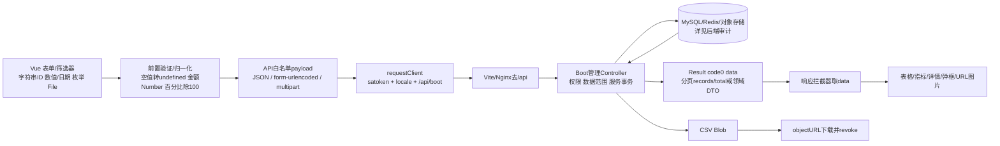

# SCX 前端架构与业务审计（2026-10-20，当前工作树静态事实）

范围：`scx-fronted`；只读检查代码、SQL 菜单种子与请求实现；未启动应用、未访问外部服务、未执行浏览器验收。本文件为主报告附录，不代表运行验收。所有引用为仓库相对路径与本轮行号。已读根 AGENTS、设计 README、MVP 规划；根 AGENTS 中“三前端/Redis 单值余额/无 CPC”等描述与现源码不一致，应以已定位代码说明当前实现。

## 1. 可执行边界、文件清单与菜单边界

- 当前 `scx-fronted/apps/` 实际仅有 `web-ele`。`web-antd`、`web-naive` 目录不存在，根 `package.json:25,28,39,42` 的命令为残留脚本，不能说三套业务前端均已实现。
- `src/views` 共 **145 个 Vue 文件**（含页面、表单、子组件），其中 **67 个 index.vue**。按目录：`_core 10 / demos 2 / gen 4 / miniapp 16 / mp 6 / ocpx 17 / open 11 / order 9 / site 3 / system 46 / user 21`。
- 动态菜单仅解析 `_core/**/*.vue`、`ocpx/**/*.vue`、`system/**/*.vue`，合计 73 个 Vue 文件；其余 72 个不在现行动态菜单 pageMap 中。证据：`apps/web-ele/src/router/access.ts:17-45`。可解析不等于已有菜单，也不等于当前用户获授权。
- OCPX 有 **13 个独立 index 页面**：经营总览、广告主、推广链接、创意、媒体、监测任务、扣量、报表、Callback 记录、流程日志、RTA 请求记录/RTA 流程日志/RTA 报表。另 `rta/workspace.vue`、`rta/configuration-drawer.vue`、`rta/test-dialog.vue` 与 `long-text.vue` 是复用组件。
- 空库当前 schema 的 OCPX 10 个主菜单见 [scx-backend/scx-boot/src/main/resources/db/schema/scx_current_schema.sql:777-789](../../../../scx-backend/scx-boot/src/main/resources/db/schema/scx_current_schema.sql#L777)；RTA 查询菜单见 `:867-869`。RTA upstream/media/bindings 的旧独立菜单最终被 `:873-879` 转为对应广告主/媒体/任务下的按钮权限，因此不应画成六个独立 RTA 页面。
- 当前 schema 明确恢复并授权管理员的系统页面为 **8 个**：用户、角色、菜单、部门、字典、存储配置、操作日志、登录日志（同 schema `:664-745`）。字典值为字典抽屉内嵌页面，不额外计独立导航。
- 当前 schema 默认广告主角色获得 10 个 OCPX 主菜单及特定动作，包含 `ocpx:advertiser:scope:all`，不包含充值、扣余额、任务计费配置、联调测试、原值日志或 RTA 权限（`:839-853`）；实际线上角色可由管理界面改动，不能据此断言当前用户权限。
- 空库入口先加载 `10smart_converge_x_core.sql` 再加载当前 schema（`db/smart-converge-x/smart_converge_x_baseline.sql:5-8`）。旧 core 种子仍有 dashboard/pay/generator 页面（`10smart_converge_x_core.sql:493-512`）；当前前端不解析这些目录，其中 dashboard/pay 组件甚至不在 views 清单。这是种子与前端收敛边界的不一致，当前线上菜单状态未查。
- 已有未提交变更仅见 `apps/web-ele/src/views/ocpx/media/index.vue`。本轮保留；diff 是对话框 1000→920px、基础配置分区、已选宏高亮、三列宏布局及响应式样式。业务函数/API 无变化；本报告引用当前工作树行号。

## 2. 页面到后端的公共调用链

### 2.1 初始化、登录与菜单

1. `bootstrap.ts:20-76` 初始化组件适配器、Element Plus、i18n、Pinia、权限指令、Router；默认首页 `/ocpx/dashboard`（`preferences.ts:11`）。
2. 账号密码页收集 `username/password`，生产先调用可视验证码，开发 `import.meta.env.DEV` 跳过前端验证码弹框（`views/_core/authentication/login.vue:21-69`）。验证码请求为 GET `/auth/code/get`、POST `/auth/code/check`（`components/verifition/api/index.ts:22-36`）。
3. `store/auth.ts:38-70` 使用前端 AES 变换 password 后调用 `loginApi`；接口 POST `/auth/token/login` 使用 `application/x-www-form-urlencoded`，字段含 `username/password/code/randomStr`（`api/core/auth.ts:5-10,59-65`）。该 AES 使用浏览器构建配置，不可视为浏览器持有服务端秘密，也不替代 TLS。
4. 返回 `Result.data.tokenValue` → `accessStore.accessToken`；GET `/system/user/info` → `UserInfo`、roles、permissions → userStore / accessCodes（`store/auth.ts:55-62,200-206`，`api/core/user.ts:8-15`，恢复会话请求 10 秒超时）。
5. 守卫无 token 跳登录；有 token 且未初始化时恢复用户并调用 `generateAccess`（`router/guard.ts:65-153`）。`@boot/preferences` 默认改为 backend 模式（`packages/preferences/src/index.ts:13`）。GET `/system/menu` 获取树，空 RTA 分组被过滤、有子项时重定向第一项（`api/core/menu.ts:6-16`）；后端菜单 component 与前端白名单 pageMap 配对生成 routes/menus，然后写入 accessStore。
6. `v-access:code` 对照 accessCodes，多个 code 为 OR；无权 DOM 在 mounted 时移除（`packages/effects/access/src/use-access.ts:29-33`、`directive.ts:11-38`）。这里只负责界面可见性，真实权限仍由后端校验。
7. Token/accessCodes 持久化到浏览器存储（`packages/stores/src/modules/access.ts:102-110`）；开发 localStorage，生产 SecureLS AES 序列化仍写浏览器本地存储（`packages/stores/src/setup.ts:20-47`），不属于 HttpOnly Cookie。
8. 业务 `code=401` 触发重新登录或过期弹框，默认关闭 refresh token（`packages/@core/preferences/src/config.ts:23`、`packages/effects/request/src/request-client/preset-interceptors.ts:61-74`）。`/auth/refresh` wrapper 存在，不应写成现行启用的令牌刷新能力。
9. 退出 DELETE `/auth/token/logout` → resetAllStores → 登录页（`store/auth.ts:180-197`）。

### 2.2 URL、序列化、响应还原

- 普通业务 API 以 `/ocpx/...` 或 `/system/...` 调用 `requestClient`。
- `.env:8` `VITE_OPEN_BOOT=true`，开发/生产 `.env.*` 的 `VITE_GLOB_API_URL=/api`。请求拦截器添加 `/boot`、`satoken`、`Accept-Language`（`api/request.ts:70-92`），浏览器最终请求如 `/api/boot/ocpx/advertisers`。
- Vite 去掉 `/api`，转向默认本机 9999（`vite.config.mts:4-18`）；宝塔同样 `/api/` → 9999/，保留 `/boot`（[scripts/bt-deploy/templates/nginx-scx-baota-rewrite.conf:10-23](../../../../scripts/bt-deploy/templates/nginx-scx-baota-rewrite.conf#L10)）。管理站点 `/ocpx/` 直接 404，机器流量走独立 Engine 域名（同文件 `:26-29`），浏览器不会凭普通管理 API 直接操作 Engine。
- 共享 Axios 默认 JSON UTF-8、30 秒超时；GET 参数通过 params 序列化；FormData 删除预设 Content-Type 让浏览器添加 multipart boundary，保留文件 bytes（`packages/effects/request/src/request-client/request-client.ts:55-80`）。
- 普通响应要求 HTTP 2xx/3xx 且 `code===0`，取 `data` 给业务；错误使用 `msg` 弹框（`api/request.ts:85-114`；`preset-interceptors.ts:21-42`）。分页常见 `{records,total,current,size}`，OCPX 流程日志另有 `hasNext`。
- ID 在 OCPX TypeScript 契约中是 string，避免前端主动转数字；金额/比例是 number；可选筛选用 `'' → undefined`；列表响应回填 rows/total，不在前端重新计算财务账本。
- CSV 用 `.download(...,{responseReturn:'raw'})` 收到 Blob，创建 object URL、点击下载、回收 URL（`utils/util.ts:122-145`），不是异步导出任务系统。

## 3. OCPX 已实现功能：输入—逻辑—输出

| 业务功能 | 输入 / 转换 | 调用与输出 | 源码证据 |
|---|---|---|---|
| 经营总览 | 广告主/链接/媒体/任务 + 日期；首请求不传日期，采用服务端 businessDate/startDate/endDate；过去 7/30 天排除今天 | GET `/ocpx/dashboard/options`、`summary`；消费/展示/点击/转化/CTR/CVR/CPM/CPC/CPA，分母为0显示横线；返回 account 时显示余额和今日消费 | `views/ocpx/dashboard/index.vue:29-44,96-145,196-234`；`api/ocpx.ts:239-248` |
| 广告主开户 | name、username、原始 password、upstreamProtocol、bidUrl、macroParams、credentialConfigKey | POST `/ocpx/advertisers`；编辑 PUT `/{id}`刻意不含 username/password；分页/options/受引用约束删除；返回 advertiserName、username、balance、RTA 配置数量 | `api/ocpx/four-entity.ts:10-47,222-251`；`views/ocpx/advertiser/index.vue:483-520,666-689` |
| 广告主充值 | amount 文本经校验→Number，remark trim，打开弹框生成 requestId；同一次弹框重试保持该ID | POST `/{id}/recharge` 返回 entryId、amount、balanceAfter、occurredAt；成功刷新列表 | `advertiser/index.vue:540-568`；`four-entity.ts:253-260` |
| 广告主人工作余额扣减 | amount+必填remark+requestId；确认不可变流水 | POST `/{id}/deduct`；显示账后余额，刷新列表 | `advertiser/index.vue:574-617`；`four-entity.ts:262-269` |
| 账务流水 | 当前广告主 + businessKey/entryType/status/startTime/endTime/current/size | GET `/ocpx/billing-entries`；分页记录流水类型、金额、账后余额等 | `advertiser/index.vue:621-653`；`api/ocpx/billing.ts:5-30` |
| 广告主共享角色配置 | 菜单树勾选、allDataScope；前端禁用不满足全量范围的节点；修改前确认影响账户数量 | GET/PUT `/ocpx/advertisers/account-role/permissions`；提交 `{allDataScope,menuIds}`，返回当前角色与受影响账户数 | `advertiser/index.vue:355-456`；`four-entity.ts:271-283` |
| 上游协议域名配置 | 5种专用上游协议允许域名数组；trim/去空，清空时确认会阻断转发 | GET `/ocpx/protocol-configs`、PUT `/{protocol}/allowed-hosts`；只保存 allowedHosts | `advertiser/index.vue:193-271`；`four-entity.ts:286-297` |
| 推广链接 | advertiserId、linkName/linkUrl/platform、deeplink/linkChannel/linkExt/remark；广告主下拉含协议 | GET/POST `/ocpx/promotion-links`、PUT/DELETE `/{id}`、options 与 advertiser-options；平台1 Android/2 iOS/3混合/4快应用 | `views/ocpx/promotion-link/index.vue:73-205,218-329`；`four-entity.ts:300-346` |
| 凤凰新闻推广链接前置校验 | HTTPS、固定域名、无用户名密码/端口/fragment、参数去重与白名单；固定业务参数不得留宏，公共和平台设备宏必须精确 | 校验通过才提交；真正最终安全检查仍在后端 | `promotion-link/index.vue:96-164,171-205` |
| 图片创意和多链接绑定 | advertiserId、creativeName、sourceMaterialId、status0/1、promotionLinkIds[]、remark；选广告主同步拉其素材/链接 | GET/POST `/ocpx/creatives`，PUT/DELETE `/{id}`；创意列表输出图片URL/尺寸/大小/绑定链接；保存创意表单同时提交完整链接集合 | `views/ocpx/creative/index.vue:77-95,138-156,163-228`；`api/ocpx/creative.ts:44-99` |
| 创意素材上传/复用 | FormData `advertiserId` + File；返回 duplicateCreativeIds 非空时提示可复用 | POST `/ocpx/creatives/assets` 返回 sourceMaterialId、URL、图片元数据及重复创意ID；接着用于创意保存 | `creative/index.vue:178-205`；`api/ocpx/creative.ts:57-70` |
| 媒体配置及宏目录 | mediaName、uri、credentialConfigKey、宏勾选+历史宏+自定义宏；默认uri `/feedback`；request_id自动展示，后端提供规范目录 | GET `/ocpx/media-macros`、media/options、media分页；serialize为query式字符串macroParams；POST/PUT只传4个允许字段，受引用约束DELETE | `views/ocpx/media/index.vue:74-104,126-153,163-264`；`four-entity.ts:349-370` |
| 监测任务及计费 | 绑定广告主/推广链接/媒体，monitorName、bizId、remark；billingEnabled、billingType1点击/2目标转化、conversionEvent、Number(unitPrice)；开启或切换计费时确认 | GET/POST `/ocpx/monitor-tasks`、GET/PUT/DELETE `/{id}`；响应由服务端生成 clkUrl/showUrl，前端展示复制；推广链接按广告主联动 | `monitor-task/index.vue:220-377,928-940`；`four-entity.ts:153-214,373-415` |
| 媒体回传比例 | promotionLinkId + mediaId + UI百分比；编辑ratio×100，保存百分比÷100（四舍五入工具见 deduction-ratio.ts） | GET/POST `/ocpx/deduction-rules`、GET/PUT/DELETE `/{id}`；输出放行和拦截比例展示；不以该比例计算广告主账务 | `views/ocpx/deduction/index.vue:112-174,204-217`；`api/ocpx/deduction.ts:10-42` |
| 完整 CLK 测试 | 任务ID、ANDROID/IOS、REAL_MEDIA/SIMULATED_MEDIA、参数勾选/随机/编辑；默认SIMULATED_MEDIA；后端生成预览requestId/callbackToken/参数有效快照 | POST `/{task}/test-links:generate` → 确认真实流量/计费 → POST `test-links:execute` → GET `test-results/{requestId}`；1秒间隔最多30次轮询、可手动刷新，终态停止；可跳流程日志 | `monitor-task/index.vue:459-651`；`api/ocpx/monitor-task-test.ts:121-157` |
| 下游媒体联调 | 任务+日期+requestId查询规范化 Feedback；选择feedbackLogId、eventCode、可选订单金额≤6位小数 | GET `/{task}/integration/feedback-requests`；POST `integration/callbacks:send`仅提交快照ID和事件金额，无任意URL；页面明确真实发媒体但不生成广告主转化/扣费/正式扣量，结果含HTTP、耗时、响应预览和attemptId | `monitor-task/index.vue:654-759`；`api/ocpx/monitor-task-integration.ts:58-85` |
| 时段报表及CSV | YYYYMMDD起止日期、dateType小时0/日1/月2/年3、广告主/链接/媒体/任务、分页和3种列排序；camelCase排序列→snake_case | GET `/ocpx/reports/summary` 返回展示/点击/16种事件、消费、订单额、上游回传与放行/拦截/待判定及覆盖起点；GET `/summary:export` Blob；导出不带分页/排序 | `views/ocpx/report/index.vue:198-281,293-328,362-368`；`api/ocpx/report.ts:4-78` |
| 上游 Callback 记录 | 日期、四对象ID、requestId trim、eventCode、targetConversion布尔、deductionDecision、分页 | GET `/ocpx/callback-records`；输出唯一事实的计费状态/消费/扣量快照/订单额；PASSED呈现“下游回传提交”；跳 `/ocpx/flow-log?eventId=requestId` | `views/ocpx/callback-record/index.vue:93-153,199-237`；`api/ocpx/callback-record.ts:27-75` |
| 六阶段流程日志及安全复制 | YYYY-MM-DD日期、四对象ID、eventId、FEEDBACK/CALLBACK、stageCode、结果、分页；广告主和媒体联动options | GET `/ocpx/flow-logs` + `/options`，返回hasNext；专用权限GET `/{id}/request-detail`，详情显示阶段、请求参数/宏审计/HTTP/响应预览和原值快照可用状态；复制时再次隐藏敏感字段 | `views/ocpx/flow-log/index.vue:38-214,472-751`；`safe-log.ts:13-178`；`api/ocpx.ts:251-271` |
| RTA广告主接入抽屉 | 从广告主 query.rtaAdvertiserId触发；name/protocol/protocolConfig/endpoint/credentialRef/timeoutMs/admissionSeconds/enabled/version；加载协议目录验证字段 | GET/POST `/ocpx/rta/upstreams`，GET `/protocols`和options；同一广告主可多接入，credentials只传引用 | `views/ocpx/rta/configuration-drawer.vue:16-83`；`workspace.vue:48-87,156-229`；`api/ocpx/rta.ts:91-138` |
| RTA媒体接入抽屉 | query.rtaMediaId；mediaId、notifyUrl、credentialRef、enabled、version、protocol、protocolConfig；OPPO无需通用notifyUrl | GET/POST `/ocpx/rta/media`；复制接入地址/策略ID/点击地址，明确密钥另行交付 | `rta/workspace.vue:58-74,179-229`；`api/ocpx/rta.ts:108-116` |
| RTA任务绑定抽屉 | query.rtaTaskId；monitorTaskId/upstreamId/productId/externalTaskId/oppoPkg/enabled/version；协议目录决定必填映射字段 | GET/POST `/ocpx/rta/bindings`；显示binding version、strategyId；切上游清productId/externalTaskId | `rta/workspace.vue:81-87,179-229,231-245`；`api/ocpx/rta.ts:99-107` |
| RTA记录/日志/报表 | 共用workspace，日期转换Unix毫秒，媒体/任务/广告主/requestId/status/grain等筛选，默认最近24小时 | GET `/ocpx/rta/{records|logs|reports}`；记录实时状态/命中任务/通知状态；日志脱敏阶段；报表展示受理/待定/允许/拒绝/错误/超时/通知结果及dataAsOf；前端允许率×100 | `rta/workspace.vue:89-130,248-268`；`rta/catalog.ts:1-128` |
| RTA真询量测试 | 任务ID→preview；手工或crypto.randomUUID生成OAID；一次requestId只能提交一次，错误后查结果不重发 | GET `/ocpx/monitor-tasks/{id}/rta-test`，POST同一路径，GET `/ocpx/monitor-tasks/{id}/rta-test/{requestId}`；最多15次1秒轮询；不发点击/转化但计入RTA统计，支持跳RTA日志 | `rta/test-dialog.vue:35-119,132-135`；`api/ocpx/rta-test.ts:32-51` |

补充：`api/ocpx.ts:229-236` 仍有 `/ocpx/reports/hourly` 聚合 API wrapper，当前时段报表页面使用 `/summary`；不可把 wrapper 存在当作另一个正在导航中的页面。`api/ocpx/creative.ts:86-99` 的独立 get/replace bindings wrapper存在，当前创意页使用创建/编辑payload里的promotionLinkIds。

## 4. 系统基础能力及非主业务页面

系统类列表普遍输入 `current/size + queryParams`，响应 `records/total`；新增/编辑表单经 Element validate 后 JSON POST/PUT，成功关闭并重查；详情GET、删除DELETE、删除前确认。该通用模式并非所有字段都有强类型约束，许多 system wrapper 参数为 `any`。

| 页面/功能 | 输入、核心逻辑、输出 | API路径与证据 | 默认导航边界 |
|---|---|---|---|
| 用户管理 | 部门树/username/phone筛选；姓名、手机、账号、创建密码、角色ID数组、部门、状态、头像；新增强制type0；编辑/删除/密码重置/登录日志 | `/system/user/{page,list,id}`、POST/PUT/DELETE `/system/user`；`views/system/user/index.vue:93-176`、`form.vue:38-73,192-235`、`api/system/user.ts:6-112` | 8个种子页之一 |
| 用户头像选择 | 5个静态SVG或素材库选择，存URL字符串；图库按type1分页读取后只保留有url项 | `views/system/user/components/avatar-picker.vue:19-34,64-68`；`views/system/material/image-tab/index.vue:64-95` | 用户表单内嵌 |
| 角色/菜单授权 | roleName/roleCode/roleDesc/type/shopId；菜单树勾选合并完整选中与半选ID，POST roleId+menuIds | `/system/sysrole/{page,list,id}`、POST/PUT/DELETE `/system/sysrole`、POST `/role/menu`；`views/system/role/rolemenu.vue:28-62` | 8个种子页之一 |
| 菜单管理 | 树；name/parentId/type/path/component/permission/icon/applicationKey/sort；按钮类型与菜单类型切换字段；编辑带ID | `/system/menu/tree`及POST/PUT/DELETE；`views/system/menu/modules/form.vue:40-172,212-240` | 8个种子页之一 |
| 部门管理 | 树，deptName/parentId/leader/leaderPhone/sort/status；新增/编辑/删除后刷新树 | `/system/sysdept/tree/list`、GET/POST/PUT/DELETE；`api/system/dept.ts:6-35`；`views/system/dept/form.vue:184-220` | 8个种子页之一 |
| 字典/字典值 | 字典type/description/remarks/status；字典值dictLabel/dictValue/remarks/sort/showClass/status；刷新缓存；按type加载缓存到Pinia供表单标签消费 | `/dict/{page,id,refresh}`、`/dictvalue/{page,id,type/{type}}`；`views/system/dict/index.vue:58-118`；`dict-value/form.vue:182-230`；`store/dict.ts:8-50` | 字典种子页，值为抽屉 |
| 存储配置 | type、accessKey/accessSecret、endpoint/bucket/dir/domain/styleAccessEnabled/status；列表类型筛选、配置CRUD | `/system/storage-config`；`views/system/storage-config/form.vue:206-311`；`api/system/storage-config.ts:6-35` | 8个种子页之一；与OCPX凭据引用不同，此基础页会收集真实存储凭据 |
| 操作/登录日志 | IP、状态等筛选；操作日志可查看详情；用户页可按用户看登录日志 | `/system/syslog/page`、`/{id}`；`/system/sysloginlog/page`、`/statistics` wrapper；`views/system/log/index.vue:43-79`、`login-log/index.vue:43-67` | 两个种子页；日志来源是否持续落库须结合后端装配 |
| 配置参数 | configKey查询；configKey/configValue/remark CRUD | `/system/config`；`views/system/config/form.vue:134-152`；`api/system/config.ts:6-46` | 可解析，当前种子未提供该页面路由 |
| 地区 | level筛选，name/code/parentId/level/sort/status CRUD和树选上级 | `/system/region/{page,tree,id}`；`views/system/region/form.vue:181-224`；`api/system/region.ts:6-51` | 可解析，无默认页面路由 |
| 文章分类/文章 | 分类name/sort/status；文章title/coverUrl/categoryId/author/sort/status/content；富文本HTML与纯文本双向事件，图片URL来自素材选择器 | `/system/article-category`、`/system/article`；`views/system/article/form.vue:187-229`；`components/editor/index.vue:78-125` | 可解析，无默认页面路由 |
| 协议内容 | type/title/content富文本 CRUD | `/system/agreement`；`views/system/agreement/form.vue:150-181`；`api/system/agreement.ts:6-35` | 可解析，无默认页面路由 |
| 素材库/分组 | 当前主素材页只包含图片选项卡；图片type1分页/URL预览；可复用于头像选择；分组编辑name和删除，列表添加本地“未分组”虚拟行id=-1 | `/system/material/page`；`/system/materialgroup/page`/PUT/DELETE；`views/system/material/image-tab/index.vue:64-95`、`material-group/index.vue:30-82` | 可解析，无默认素材导航；头像内嵌可触发 |
| 短信配置/发送记录 | supplier/name/smsCode/accessKeyId/accessKeySecret/signature/templateId/extraParams/status；extraParams键值数组↔JSON字符串；发送记录按phone分页 | `/system/sms-config`、`/system/sms-send-record/page`；`views/system/sms-config/form.vue:103-155,202-283` | 可解析，无默认页面路由；短信登录发送wrapper存在，但对应后端发送入口缺失 |
| 第三方账号配置 | type/appId/appSecret/redirectUrl CRUD；登录或绑定时按type查询 | `/system/social-account`、`/type/{type}`；`views/system/social-account/form.vue:147-176` | 可解析，无默认配置路由；登录微信按钮调用type接口 |
| 在线用户 | 查询会话、强制下线token | GET `/system/onlineuser/list`、DELETE `/{token}`；`views/system/online-user/index.vue:23-47` | 可解析，无默认页面路由 |
| 服务器信息 | GET后展示服务器指标 | `/system/sysserver`；`views/system/sboot-server/index.vue:68-79` | 可解析，无默认页面路由 |
| 个人资料/改密码/微信绑定 | profile从store取用户；编辑昵称邮箱头像提交用户PUT并更新本地store；自助密码POST含原/新/确认密码，reset另接口；OAuth弹窗/回调/解绑 | `views/system/user/info/profile.vue:105-225`；`api/system/user.ts:64-112`；`views/system/user/info/third-party-success.vue:125-166` | profile组件可解析但 `/user/profile` 无静态/当前空库路由种子；第三方回调为core公开路由 |
| 账号/短信/微信登录 | 手机11位、4位验证码；发送短信→手机号登录；微信取appId→弹窗→接收code→社交登录 | `views/_core/authentication/code-login.vue:17-88`；`api/core/auth.ts:25-53` | core登录路由；外部实际配置和通道未验收 |
| 忘记密码/二维码页 | 忘记密码只console.log邮箱；二维码页只有login_container占位和返回按钮 | `views/_core/authentication/forget-password.vue:31-34`；`packages/effects/common-ui/src/ui/authentication/qrcode-login.vue:50-83` | core路由可打开，但未接真实找回/扫码流程；不能误称可用能力 |
| 广告位配置 | 仅空状态，没有页面API请求 | `views/system/ad-launch/index.vue:1-11`（api wrapper另有GET/PUT） | 可解析占位页，无默认页面路由 |

`SelectShop` 当前是 disabled 空选择器（`components/select-shop/index.vue:7-12`），用户/角色页面保留的 shopId/type 标签不能据此宣称有完整多店铺业务。

## 5. 数据格式与最终消费路径

- **管理配置链**：广告主/链接/媒体→任务→后端生成CLK/SHOW URL→前端复制给媒体使用；管理页并不生产真实点击，只有显式测试会委托后端执行数据面请求。
- **资产链**：浏览器File→multipart `/ocpx/creatives/assets`→后端素材记录/对象存储→URL+sourceMaterialId→创意JSON→列表以URL消费；绑定是promotionLinkIds集合。通用头像另用原生ElUpload直连`/api/boot/file/upload?type=1&groupId=-1`并附satoken，response.data写头像（profile.vue:45-53,224-225,434-441），与requestClient上传不可混为一路。
- **充值/扣减链**：用户输入→Number→一次弹框requestId→管理API→后端幂等流水/余额→前端刷新balance；前端不保存本地“余额真相”。关闭后重新打开生成新requestId，不覆盖业务幂等作用域。
- **数据查询链**：真实事件事实/汇总/链路日志由Engine或后端产生→管理API按权限查询→OCPX页面显示；页面不从Redis构造虚假事件，不把HTTP2xx解释为最终媒体签收。
- **RTA配置链**：所在对象ID在router.query→抽屉先按options确认可访问对象→workspace→协议目录约束表单→字段白名单+version提交。RTA查询时间是Unix毫秒；普通报表是YYYYMMDD，Callback/流程是YYYY-MM-DD，不能互换。
- **缓存/本地状态**：token/accessCodes/UI偏好存在浏览器，列表/下拉/表单主要在组件ref/reactive；字典在Pinia缓存。`createLatestRequestGuard`仅阻止过时响应回写，不取消已发出的HTTP请求（`views/ocpx/table.ts:18-28`）。

## 6. 关键节点、瓶颈与一致性/集成风险（静态定位，未实测复现）

1. **报表“合计”是当前页合计**：`report/index.vue:305-328` 对 Element table传入的当前页data求和；不是查询范围全量汇总，点击率合计同样用当前页展示/点击重算。下载不带分页但页面合计与全量CSV不可直接对账。应在主报告明确实际口径。
2. **日期口径混用**：Dashboard从server businessDate选日期；报表/Callback/Flow默认dayjs()依浏览器时区（report:203；callback-record:96-99；flow-log:73-75），RTA显示`toLocaleString`也依本机时区（rta/catalog.ts:116-119）。跨时区操作可能选到与业务日不同的边界。
3. **并发只保护部分读取**：多数OCPX列表与options使用request sequence，防止旧响应回写；system旧页面普遍无此门闩。监测联调 `loadIntegration:654-672`、广告主账单 `loadLedger:621-639`和日志详情 `openRequestDetail:180-191`亦无请求代次检查，快速切换目标/日期时存在旧响应覆盖风险。前端loading不是服务端幂等。
4. **查询请求体积与重复获取**：每次进入列表常先抓全量options；RTA和过滤联动可快速连续请求，无网络取消。大量媒体/广告主/任务下拉及频繁筛选时额外后端负载需压测；完整CLK测试每秒查询最多30次，RTA最多15次，多个管理员并发应纳入查询容量估算。
5. **充值失败结果的不确定性**：同弹框重试保持requestId，正面降低超时重发风险；若响应丢失后关弹框重新打开，会生成新ID，应通过流水查明再重试。证据 advertiser:540-579 / request-id.ts:12-42。这是业务操作风险，不是确认发生重复扣费。
6. **CSV异常观测有限**：`downloadBlobFile`采用raw绕过code解包；末端catch只console.error并吞掉错误（util:122-145）。若后端返回HTTP200 JSON错误体，可能被当文件；网络失败不向调用方reject。需结合服务端导出失败响应复测。
7. **菜单/组件漂移**：base种子仍有pay/dashboard/gen，pageMap不解析；个人中心下拉`/user/profile`（layouts/basic.vue:25）无当前静态或空库种子路由。三前端脚本残留但目录不存在。是明确静态集成缺口，不能以源文件存在抵消。
8. **权限按钮配置错误候选**：`views/system/agreement/index.vue` 和 `social-account/index.vue` 操作按钮沿用 `system:article:add/edit/del`，而对应API/种子使用 agreement/social-account权限；会出现前后端按钮授权不一致。`v-access`只mounted检查，角色变更后当前页面不会自动重挂授权；accessCodes会话状态需刷新/重新登录。
9. **微信跨窗消息校验缺失**：`authentication/login.vue:93-103`只检查消息type，不检查origin/source，并消费code；profile:192-201也只检查type。外部微信通道未验收，但应列输入来源校验风险。
10. **个人中心权限链可能不通**：profile编辑调用管理员通用PUT `/system/user`（profile:141），不是现有`/system/user/update-info` wrapper；普通用户是否可保存要结合Controller权限核对；默认/profile路由缺失已另述。
11. **非安全上下文兼容差异**：一般requestId工具有crypto fallback，复制有legacy fallback；RTA测试随机OAID直接 `crypto.randomUUID()`（rta/test-dialog.vue:35-37），非HTTPS环境可能失败。仅局部能力，不影响手工OAID输入路径。
12. **素材上传与业务保存分两步**：上传成功先产生素材、随后创意保存，用户取消或保存失败可能留下未绑定素材；前端重复素材确认后继续复用，不会自动删除上传素材。需看后端是否有孤立素材治理。
13. **财务精度消费**：前端金额用JS Number、展示通常toFixed(2)，不得用UI显示值代替数据库精度账本对账。后端计费精度及事务由后端审计确认。
14. **安全日志复制的边界**：复制器对结构化参数按key白名单/敏感词过滤，设备标识遮蔽；非JSON响应预览只有文本敏感键正则（safe-log.ts:161-178），不能声称对任意第三方正文具有完整DLP保证。设备原值/留存权限应由后端保证。

## 7. 已排除业务与证据限度

- `gen`：数据源与表代码生成前端源仍存在，当前动态路由不可解析；后端生成器是否装配由主报告基础能力部分确认。不能说整个后端生成器退役。
- `miniapp/mp/open`：微信小程序、公众号、开放平台/审核/认证/模板等源码残留，页面不在当前白名单；真实外部对接、订单、支付不据此宣称已接通。
- `order/site/user`：订单/退款/充值、站点装修、会员积分/签到/等级/任务等源码残留，当前业务不可达。`demos`是示例，不计业务交付。
- 没有运行线上页面、没有读取线上数据库菜单，因此“默认种子”“可解析”“有后端实现”“生产可用”必须分开。
- 未重跑类型检查、单测、构建或E2E；存在 `.test.ts`只能证明有测试源码。主报告若运行测试，请以主报告本轮结果覆盖本条。

### 追加交叉核验（认证/报表/路由）

- 图形验证码服务端保护存在路径不匹配：[scx-backend/scx-auth/src/main/java/com/yzytech/scx/auth/filter/ValidateCodeFilter.java:34-36](../../../../scx-backend/scx-auth/src/main/java/com/yzytech/scx/auth/filter/ValidateCodeFilter.java#L34) 用 equals 比较 servletPath 与 `SecurityConstants.OAUTH_TOKEN`；常量实际为 `/token/login`（[scx-backend/scx-common/scx-common-core/src/main/java/com/yzytech/scx/common/core/constant/SecurityConstants.java:15](../../../../scx-backend/scx-common/scx-common-core/src/main/java/com/yzytech/scx/common/core/constant/SecurityConstants.java#L15)），当前 [scx-backend/scx-auth/src/main/java/com/yzytech/scx/auth/controller/TobTokenController.java:27,37-39](../../../../scx-backend/scx-auth/src/main/java/com/yzytech/scx/auth/controller/TobTokenController.java#L27) 接收 `/auth/token/login`。普通 Boot servletPath 下该 filter 会直接放行，故只能确认页面交互与验证码服务存在，不可确认当前密码登录有图形码强制门禁。本轮未发送绕过请求。
- 短信登录前端发送验证码为 GET `/system/sms/{type}/{phone}/tob`（`api/system/sms.ts:6-7`），登录页面传 type=login（`views/_core/authentication/code-login.vue:60`）；对当前非 target Java 全仓查找，未找到发送路由 Controller，只有短信配置和发送记录 Controller，以及 `/auth/token/sms/login`。所以短信登录完整“发送→收码→登录”链未闭合。
- 不应把图形码路径问题扩大为短信登录免验证：[scx-backend/scx-auth/src/main/java/com/yzytech/scx/auth/filter/SmsValidateCodeFilter.java:37-38](../../../../scx-backend/scx-auth/src/main/java/com/yzytech/scx/auth/filter/SmsValidateCodeFilter.java#L37) 用 containsAnyIgnoreCase，旧常量 `/token/sms/login` 仍匹配 `/auth/token/sms/login` 子串；`:42-57` 确实验证 code/phone 对应 Redis 验证码并删除。
- 报表粒度完整包括小时 0、日 1、月 2、年 3，见 `views/ocpx/report/index.vue:381-385`。
- 动态页面缺失时，不是自动恢复历史业务，而是替换为 404 组件：`packages/utils/src/helpers/generate-routes-backend.ts:57-66`；所以旧菜单可能仍可见但点开 404，取决于实际数据库角色菜单。

## 8. 完整前端 Vue 源清单（见机器可读 inventory）

`frontend-inventory.json` 包含所有145文件、白名单判断、默认菜单分类、API import定位、v-model字段定位、动作函数定位与权限码；以下为路径全量索引，路径均相对于 `scx-fronted/apps/web-ele/src/views/`。

### _core

- `_core/about/index.vue` — resolvable-no-default-page-menu-or-child-component
- `_core/authentication/code-login.vue` — static-core-route
- `_core/authentication/forget-password.vue` — static-core-route
- `_core/authentication/login.vue` — static-core-route
- `_core/authentication/qrcode-login.vue` — static-core-route
- `_core/fallback/coming-soon.vue` — resolvable-no-default-page-menu-or-child-component
- `_core/fallback/forbidden.vue` — resolvable-no-default-page-menu-or-child-component
- `_core/fallback/internal-error.vue` — resolvable-no-default-page-menu-or-child-component
- `_core/fallback/not-found.vue` — static-core-route
- `_core/fallback/offline.vue` — resolvable-no-default-page-menu-or-child-component

### demos

- `demos/element/index.vue` — outside-current-page-map
- `demos/form/basic.vue` — outside-current-page-map

### gen

- `gen/datasource/form.vue` — outside-current-page-map
- `gen/datasource/index.vue` — outside-current-page-map
- `gen/gen-table/generate.vue` — outside-current-page-map
- `gen/gen-table/index.vue` — outside-current-page-map

### miniapp

- `miniapp/wxapp/components/AuthTab.vue` — outside-current-page-map
- `miniapp/wxapp/components/BasicInfoTab.vue` — outside-current-page-map
- `miniapp/wxapp/components/DetailInfoTab.vue` — outside-current-page-map
- `miniapp/wxapp/components/DomainTab.vue` — outside-current-page-map
- `miniapp/wxapp/components/IcpTab.vue` — outside-current-page-map
- `miniapp/wxapp/components/ViewModeToggle.vue` — outside-current-page-map
- `miniapp/wxapp/components/WxappCardList.vue` — outside-current-page-map
- `miniapp/wxapp/components/WxappTable.vue` — outside-current-page-map
- `miniapp/wxapp/components/icp/AppletsInfo.vue` — outside-current-page-map
- `miniapp/wxapp/components/icp/FaceVerify.vue` — outside-current-page-map
- `miniapp/wxapp/components/icp/Materials.vue` — outside-current-page-map
- `miniapp/wxapp/components/icp/PrincipalInfo.vue` — outside-current-page-map
- `miniapp/wxapp/components/icp/SubjectInfo.vue` — outside-current-page-map
- `miniapp/wxapp/components/icp/Upload.vue` — outside-current-page-map
- `miniapp/wxapp/form.vue` — outside-current-page-map
- `miniapp/wxapp/index.vue` — outside-current-page-map

### mp

- `mp/mp-app/components/MpAppCardList.vue` — outside-current-page-map
- `mp/mp-app/components/MpAppQr.vue` — outside-current-page-map
- `mp/mp-app/components/MpAppTable.vue` — outside-current-page-map
- `mp/mp-app/components/ViewModeToggle.vue` — outside-current-page-map
- `mp/mp-app/form.vue` — outside-current-page-map
- `mp/mp-app/index.vue` — outside-current-page-map

### ocpx

- `ocpx/advertiser/index.vue` — current-schema-page
- `ocpx/callback-record/index.vue` — current-schema-page
- `ocpx/creative/index.vue` — current-schema-page
- `ocpx/dashboard/index.vue` — current-schema-page
- `ocpx/deduction/index.vue` — current-schema-page
- `ocpx/flow-log/index.vue` — current-schema-page
- `ocpx/long-text.vue` — resolvable-no-default-page-menu-or-child-component
- `ocpx/media/index.vue` — current-schema-page
- `ocpx/monitor-task/index.vue` — current-schema-page
- `ocpx/promotion-link/index.vue` — current-schema-page
- `ocpx/report/index.vue` — current-schema-page
- `ocpx/rta/configuration-drawer.vue` — resolvable-no-default-page-menu-or-child-component
- `ocpx/rta/logs/index.vue` — current-schema-page
- `ocpx/rta/records/index.vue` — current-schema-page
- `ocpx/rta/reports/index.vue` — current-schema-page
- `ocpx/rta/test-dialog.vue` — resolvable-no-default-page-menu-or-child-component
- `ocpx/rta/workspace.vue` — resolvable-no-default-page-menu-or-child-component

### open

- `open/code-audit/components/QrCodeDialog.vue` — outside-current-page-map
- `open/code-audit/index.vue` — outside-current-page-map
- `open/companent-info/form.vue` — outside-current-page-map
- `open/companent-info/index.vue` — outside-current-page-map
- `open/mini-auth/components/upload.vue` — outside-current-page-map
- `open/mini-auth/detail.vue` — outside-current-page-map
- `open/mini-auth/index.vue` — outside-current-page-map
- `open/miniapp-register/form.vue` — outside-current-page-map
- `open/miniapp-register/index.vue` — outside-current-page-map
- `open/template-draft/index.vue` — outside-current-page-map
- `open/template-info/index.vue` — outside-current-page-map

### order

- `order/config/form.vue` — outside-current-page-map
- `order/config/index.vue` — outside-current-page-map
- `order/order-info/index.vue` — outside-current-page-map
- `order/order-info/info/index.vue` — outside-current-page-map
- `order/order-refund/index.vue` — outside-current-page-map
- `order/recharge/index.vue` — outside-current-page-map
- `order/refund-reason/form.vue` — outside-current-page-map
- `order/refund-reason/index.vue` — outside-current-page-map
- `order/self-order/index.vue` — outside-current-page-map

### site

- `site/navigation/index.vue` — outside-current-page-map
- `site/page-design/index.vue` — outside-current-page-map
- `site/theme/index.vue` — outside-current-page-map

### system

- `system/ad-launch/index.vue` — resolvable-no-default-page-menu-or-child-component
- `system/agreement/form.vue` — resolvable-no-default-page-menu-or-child-component
- `system/agreement/index.vue` — resolvable-no-default-page-menu-or-child-component
- `system/article/form.vue` — resolvable-no-default-page-menu-or-child-component
- `system/article/index.vue` — resolvable-no-default-page-menu-or-child-component
- `system/article-category/form.vue` — resolvable-no-default-page-menu-or-child-component
- `system/article-category/index.vue` — resolvable-no-default-page-menu-or-child-component
- `system/config/form.vue` — resolvable-no-default-page-menu-or-child-component
- `system/config/index.vue` — resolvable-no-default-page-menu-or-child-component
- `system/dept/form.vue` — resolvable-no-default-page-menu-or-child-component
- `system/dept/index.vue` — current-schema-page
- `system/dict/form.vue` — resolvable-no-default-page-menu-or-child-component
- `system/dict/index.vue` — current-schema-page
- `system/dict-value/form.vue` — resolvable-no-default-page-menu-or-child-component
- `system/dict-value/index.vue` — resolvable-no-default-page-menu-or-child-component
- `system/log/detail.vue` — resolvable-no-default-page-menu-or-child-component
- `system/log/index.vue` — current-schema-page
- `system/login-log/index.vue` — current-schema-page
- `system/material/image-tab/index.vue` — resolvable-no-default-page-menu-or-child-component
- `system/material/index.vue` — resolvable-no-default-page-menu-or-child-component
- `system/material-group/index.vue` — resolvable-no-default-page-menu-or-child-component
- `system/menu/index.vue` — current-schema-page
- `system/menu/modules/form.vue` — resolvable-no-default-page-menu-or-child-component
- `system/online-user/index.vue` — resolvable-no-default-page-menu-or-child-component
- `system/region/form.vue` — resolvable-no-default-page-menu-or-child-component
- `system/region/index.vue` — resolvable-no-default-page-menu-or-child-component
- `system/role/form.vue` — resolvable-no-default-page-menu-or-child-component
- `system/role/index.vue` — current-schema-page
- `system/role/rolemenu.vue` — resolvable-no-default-page-menu-or-child-component
- `system/sboot-server/index.vue` — resolvable-no-default-page-menu-or-child-component
- `system/sms-config/form.vue` — resolvable-no-default-page-menu-or-child-component
- `system/sms-config/index.vue` — resolvable-no-default-page-menu-or-child-component
- `system/sms-send-record/index.vue` — resolvable-no-default-page-menu-or-child-component
- `system/social-account/form.vue` — resolvable-no-default-page-menu-or-child-component
- `system/social-account/index.vue` — resolvable-no-default-page-menu-or-child-component
- `system/storage-config/form.vue` — resolvable-no-default-page-menu-or-child-component
- `system/storage-config/index.vue` — current-schema-page
- `system/user/components/avatar-picker.vue` — resolvable-no-default-page-menu-or-child-component
- `system/user/form.vue` — resolvable-no-default-page-menu-or-child-component
- `system/user/index.vue` — current-schema-page
- `system/user/info/loginlog.vue` — resolvable-no-default-page-menu-or-child-component
- `system/user/info/operatelog.vue` — resolvable-no-default-page-menu-or-child-component
- `system/user/info/profile.vue` — resolvable-no-default-page-menu-or-child-component
- `system/user/info/reset-password.vue` — resolvable-no-default-page-menu-or-child-component
- `system/user/info/third-party-success.vue` — static-core-route
- `system/user/info/update-password.vue` — resolvable-no-default-page-menu-or-child-component

### user

- `user/balance-config/form.vue` — outside-current-page-map
- `user/balance-config/index.vue` — outside-current-page-map
- `user/point-config/index.vue` — outside-current-page-map
- `user/point-record/index.vue` — outside-current-page-map
- `user/signin-config/index.vue` — outside-current-page-map
- `user/signin-record/index.vue` — outside-current-page-map
- `user/signin-streak-reward/form.vue` — outside-current-page-map
- `user/signin-streak-reward/index.vue` — outside-current-page-map
- `user/user-info/components/balance-record.vue` — outside-current-page-map
- `user/user-info/components/growth-record.vue` — outside-current-page-map
- `user/user-info/components/order-record.vue` — outside-current-page-map
- `user/user-info/components/point-record.vue` — outside-current-page-map
- `user/user-info/components/recharge-order-record.vue` — outside-current-page-map
- `user/user-info/components/signin-record.vue` — outside-current-page-map
- `user/user-info/detail.vue` — outside-current-page-map
- `user/user-info/form.vue` — outside-current-page-map
- `user/user-info/index.vue` — outside-current-page-map
- `user/user-level/form.vue` — outside-current-page-map
- `user/user-level/index.vue` — outside-current-page-map
- `user/user-mission/form.vue` — outside-current-page-map
- `user/user-mission/index.vue` — outside-current-page-map
