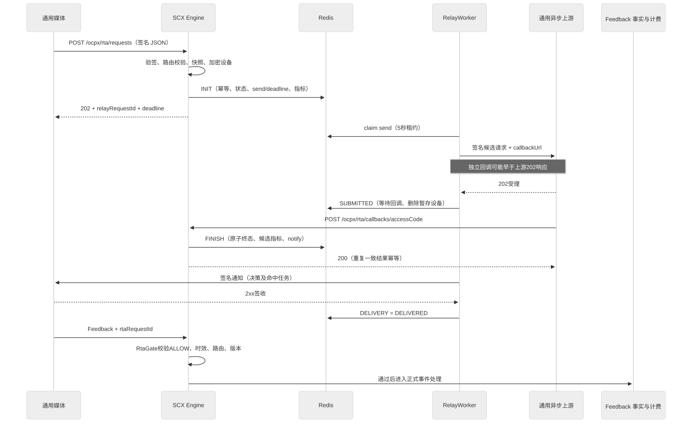
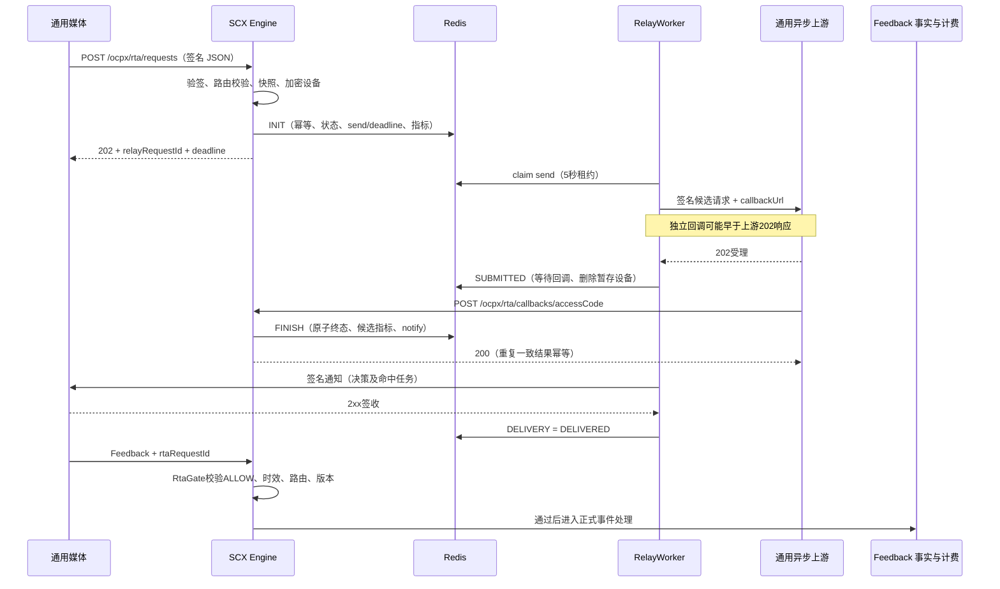
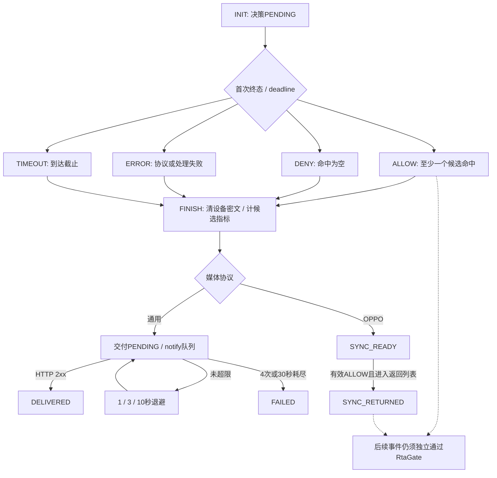

# RTA 实现详解：从询量到点击准入

源码基准：`6d4088d6c5a4bf3e0d0cb80d4792616c09662d7c` 加当前工作树，2026-10-20 复核。本篇解释当前实现，不表示真实合作方或生产环境已经验收；所有示例均为讲解用虚构数据，不会发送请求。

## 1. RTA 在项目里解决什么问题

媒体准备向某个设备展示或投放广告时，先向 SCX 提交设备、上下文和候选监测任务。SCX 将候选映射成上游认识的产品/任务标识，向广告主侧询量，再将 `ALLOW / DENY / ERROR / TIMEOUT` 结果交给媒体。真正的曝光/点击随后携带 RTA 关联标识进入 `Feedback`，通过准入检查后才进入事件事实、计费和上游点击投递。

因此这里的 RTA 是**投放前询量、协议适配与准入状态管理**。人群是否命中由接入的上游返回；代码没有自建人群模型、竞价排序或预算优化器。RTA 请求本身不制造点击/转化事实，也不扣广告主余额。`ALLOW` 表示本次询量命中候选；是否真正发生点击、是否应计费、上游是否收到点击、是否发生转化，是后面的独立阶段。

源码主线：

- Core：共享报文、路由快照、协议定义和状态，入口 [RtaContract](../../../../scx-backend/scx-ocpx-core/src/main/java/com/yzytech/scx/ocpx/rta/contract/RtaContract.java#L6)。
- Engine：`RelayController → RelayService → RelayStore/state.lua → RelayWorker → RtaUpstreamAdapter`；正式事件通过 `RtaGate`。
- Admin/Boot：对象配置、实时查询、日志/报表、测试控制台，XXL-JOB 将 Redis 日志和指标写入 MySQL。
- Vue：广告主、媒体、监测任务的 RTA 配置抽屉，以及请求记录、流程日志、统计报表三个页面。

## 2. 先分清媒体协议与上游协议

它们是两个维度，不能把“同步 RTA”当成整个系统只有一条同步调用。

| 位置 | 协议 | 对方如何得到结果 | 主要限制 |
|---|---|---|---|
| 媒体接入 | `GENERIC_ASYNC` | POST 请求返回 202；SCX 后续 POST 通知媒体 | HMAC；请求含 1～100 个候选，最终还受上游候选限制 |
| 媒体接入 | `OPPO` | 同一次 HTTP 请求返回命中的策略列表 | OPPO 签名；内部拆策略，当前仅接微风 RTA |
| 上游询量 | `GENERIC_ASYNC` | 上游先返回 202，之后独立回调 SCX | 最多 100 个候选；可在截止前重试提交 |
| 上游询量 | `WEIFENG_RTA` | 上游本次 HTTP 响应直接返回决策 | 只允许 1 个候选；不自动重发 |

通用异步媒体可以接通用异步或微风同步上游。OPPO 媒体当前只允许微风 RTA。普通点击投递的 `WEIFENG` 与询量的 `WEIFENG_RTA` 是不同协议；六种普通点击协议不等于六种 RTA 询量协议。

证据：[RtaProtocols](../../../../scx-backend/scx-ocpx-core/src/main/java/com/yzytech/scx/ocpx/rta/contract/RtaProtocols.java#L34)、[OppoRtaService](../../../../scx-backend/scx-ocpx-engine/src/main/java/com/yzytech/scx/ocpx/oppo/OppoRtaService.java#L140)。

## 3. 三处配置如何拼成一条路由

### 广告主：向谁询量

`scx_ocpx_rta_upstream` 保存广告主、协议、endpoint、accessCode、credentialRef、协议配置、超时、准入有效期和版本。

- 通用协议需要上游产品 ID/任务 ID 映射，服务端凭据及可回调的 HTTPS 地址。
- 微风固定 endpoint 为 `https://rta.adapi.cn/rtaCommon/sendRta`，配置 `aid/did`，不使用通用 HMAC 凭据。
- 数据库默认 `timeout_ms=5000`、`admission_seconds=300`；合法范围分别为 100～30000 ms 和 1～86400 s。实际使用已保存配置。

### 媒体：谁发请求、结果给谁

`scx_ocpx_rta_media_access` 每个现有 mediaId 一份配置，凭据引用唯一。通用媒体配置通知地址；OPPO 配置 owner 模式、等待时间和转化上传凭据引用等。凭据引用是服务端配置的索引，不是密钥本身。

### 监测任务：本地任务对应哪个上游候选

`scx_ocpx_rta_binding` 以 monitorTaskId 为主键，关联 upstreamId；通用协议保存 productId/externalTaskId，OPPO 还用 strategyId/oppoPkg。现有监测任务上的 `rta_enabled` 决定是否要求 RTA 准入；可用的 RTA 路由另外要求绑定、媒体、上游均启用。管理绑定保存会在同一事务同步任务开关，但两者仍是不同字段。

请求内 taskIds 是 **SCX 监测任务 ID**。发给上游的 candidate.taskId 则是 **externalTaskId**。上游回调的 `(productId, taskId)` 必须唯一映射回本次快照的本地任务。

同一批通用请求必须属于认证媒体、同一上游接入和同一广告主；不能在一个请求中随意跨广告主询量。OPPO 的多个策略会拆成多个内部请求，因此可以分别选择其有效绑定。

配置更新要求匹配提交的 version，再增加 version；旧版本保存会失败。Engine 在受理时保存完整快照，在实际出站和后续点击时重新读取数据库比较；它并非仅依赖普通广告配置的内存热刷新。配置变化会使旧的放行快照失效，避免拿旧决策使用新路由。

目前绑定保存检查存在、启用和归属，但未完整阻止 OPPO 媒体选择通用异步上游；运行时 OPPO 服务才会拒绝不支持的组合。因此“配置保存成功”不等于“协议组合可运行”。

证据：[DDL](../../../../scx-backend/scx-boot/src/main/resources/db/schema/scx_current_schema.sql#L188)、[路由 SQL](../../../../scx-backend/scx-ocpx-engine/src/main/resources/mapper/RelaySqlMapper.xml#L15)、[RelayRepository.current](../../../../scx-backend/scx-ocpx-engine/src/main/java/com/yzytech/scx/ocpx/rta/relay/RelayRepository.java#L96)。

## 4. 通用异步完整链路



<details><summary>可维护的 Mermaid 源码</summary>



</details>

### 4.1 媒体请求

入口为 `POST /ocpx/rta/requests`，没有 query string，UTF-8 JSON 最大 64 KiB：

```json
{
  "requestId": "media_req_001",
  "taskIds": ["1001", "1002"],
  "device": {"oaid": "demo-device"},
  "context": {"os": "android", "ip": "203.0.113.10", "model": "demo-model"}
}
```

示例假设两个任务已正确配置且属于同一通用上游。媒体身份来自 `X-Rta-Key`，请求体不接受自行指定 mediaId。

严格 JSON 解析拒绝重复键、未知字段、尾随内容和数字/布尔到字符串的隐式转换。requestId 允许 `[A-Za-z0-9._-]{1,128}`；taskIds 须为 1～100 个不重复 ID，重复直接拒绝；device 非空，字段有白名单，单值最多 256 字符；context 单值最多 1024 字符，不能有空白值或控制字符。

设备白名单包含 OAID/IMEI/IDFA/AndroidId 原值及 MD5、MAC MD5、当前和历史 CAID 等；context 允许 `os/osv/ip/ipv6/ua/model`。通用入口只执行通用校验，微风适配器会继续校验 OS、MD5 格式和可用设备标识。

### 4.2 验签与防重放

四个请求头：`X-Rta-Key / X-Rta-Timestamp / X-Rta-Nonce / X-Rta-Sign`。

```text
待签名文本 =
POST + "\n" +
完整请求路径 + "\n" +
凭据引用 + "\n" +
13位毫秒时间戳 + "\n" +
nonce + "\n" +
SHA256(原始UTF-8请求体)

签名 = HMAC-SHA256(服务端密钥, 待签名文本)，小写十六进制
```

路径包含 `/ocpx`；JSON 空格变化会改变原始 body hash。时间窗为 ±5 分钟。nonce 在同一凭据下通过 Redis SET NX 保留 10 分钟。**业务重试沿用 requestId，但必须换 nonce 并重新签名**，原请求原封不动重放会被拒绝。

签名验证与业务幂等分别解决“认证/重放”和“重复受理”两个问题。

### 4.3 幂等与返回

`RelayService.accept` 对 taskIds 排序，`RelayJson` 对 Map 键排序后计算 requestHash。因此仅改变候选顺序或 JSON 字段排列不会产生业务冲突；改变设备、上下文或候选内容会改变指纹。

`mediaId + requestId` 是 24 小时幂等键：

- 相同内容返回原 requestId、relayRequestId、deadline，不增加受理计数。
- 不同内容返回 409。
- Java 先查已有状态，Lua INIT 再做一次原子判断，防止并发首次请求都创建成功。

新 relayRequestId 为去掉短横线的 UUID，即 32 位小写十六进制。202 仅表示 Redis 已受理，没有表示 ALLOW。

证据：[RelayController](../../../../scx-backend/scx-ocpx-engine/src/main/java/com/yzytech/scx/ocpx/rta/relay/RelayController.java#L31)、[RelayService.accept](../../../../scx-backend/scx-ocpx-engine/src/main/java/com/yzytech/scx/ocpx/rta/relay/RelayService.java#L47)、[RelayJson](../../../../scx-backend/scx-ocpx-engine/src/main/java/com/yzytech/scx/ocpx/rta/relay/RelayJson.java#L11)、[RelaySecurity](../../../../scx-backend/scx-ocpx-engine/src/main/java/com/yzytech/scx/ocpx/rta/relay/RelaySecurity.java#L47)。

## 5. Redis 状态机：三组状态不能混用

`RtaState` 同时保存三类状态：

| 字段 | 典型值 | 回答的问题 |
|---|---|---|
| status | PENDING / ALLOW / DENY / ERROR / TIMEOUT | 上游决策是否产生、是什么 |
| dispatchStatus | QUEUED / AWAITING_CALLBACK / SENT | 询量请求向上游提交到了哪一步 |
| deliveryStatus | PENDING / DELIVERED / FAILED / SYNC_READY / SYNC_RETURNED | 决策如何交给媒体 |

例如 `status=ALLOW, deliveryStatus=FAILED` 表示上游允许，但通知媒体失败；不是“上游拒绝”。微风的 SENT 在 HTTP 出站**之前**写入，表示本次发送权已经占用；不是对方已接收。OPPO 的 SYNC_RETURNED 在 HTTP 响应真正送达前写入，不能等同对方签收。



<details><summary>可维护的 Mermaid 源码</summary>



</details>

Lua 中的关键操作：

- `INIT`：一次写入 state、idem、send、deadline、查询索引和 requestCount。
- `FINISH`：只允许 PENDING 首次终态；相同 decisionHash 幂等，decisionHash 不同即冲突，包括同为 ALLOW 但命中集合不同；已 TIMEOUT 返回过期。即使传入 ALLOW，只要执行时已到 deadline，也会落为 TIMEOUT。如果首次迟到回调到达时仍是 PENDING，可以返回 HTTP 200、结果 TIMEOUT；已经是 TIMEOUT 后再回调则返回 410，均不会恢复 ALLOW。
- `SUBMITTED`：通用上游 202 后移除 send，置 AWAITING_CALLBACK，并清除 encryptedPayload。
- `DISPATCH_ONCE`：微风发送前置 SENT、增加计数并移除 send，阻止再次出站。
- `SEND_RETRY`：通用提交异常时安排 `min(deadline, now+250ms)`。
- `DELIVERY`：记录通知成功，或执行通知失败退避/终止。
- `SYNC_RESPONSE`：供 OPPO 标记同步响应状态；当前业务调用仅对将要返回的有效 ALLOW 执行。

终态、计数和入通知队列在同一 Lua 操作中完成，但外部 HTTP 不可能与 Redis 一起成为一个原子事务。代码支持 Redis 层的幂等终态，不意味着外部消息严格只投递一次。

证据：[RtaState](../../../../scx-backend/scx-ocpx-core/src/main/java/com/yzytech/scx/ocpx/rta/contract/RtaState.java#L8)、[state.lua](../../../../scx-backend/scx-ocpx-engine/src/main/resources/rta/state.lua#L22)、[RelayStore](../../../../scx-backend/scx-ocpx-engine/src/main/java/com/yzytech/scx/ocpx/rta/relay/RelayStore.java#L22)。

## 6. Worker 的调度、超时与重试

`RelayWorker.tick` 使用独立 `rtaScheduler`，**上一轮执行完再等待 50ms**。顺序为：

1. 处理 deadline 队列的到期请求，每轮最多 100 个。
2. 计算本实例可用容量：`max(0, 16-activeCount-queueSize)`。
3. 优先 claim notify，再 claim send，提交 16 线程、32 队列的工作池。

claim 是 Lua：读取到期 ZSET 成员，把 score 推到 `now+5000ms`。它是租约，不是删队列；进程崩溃后其他实例可以在租约到期后重新拿到任务。5 秒租约可能覆盖或超过一次短请求的整个决策预算，因此“可恢复”不等于恢复后一定还能得到有效决策；deadline 到期会转 TIMEOUT。

**通用上游提交**：单次 HTTP 最多 `min(1000ms, 剩余决策时间)`。必须收到 202，200 也不算契约受理。异常会在决策窗口内以 250ms 间隔重新排队；没有单独的固定重试次数上限。对方必须按 relayRequestId 幂等，才能应对“对方已收到但响应丢失”。

**微风上游提交**：先 DISPATCH_ONCE，再 HTTP；单次最多 `min(30000ms, 剩余时间)`。失败转 ERROR，若已过 deadline 则为 TIMEOUT。进程若在占用发送权之后退出，可能没有真正发出，也不会重发；这是“不重复提交”选择带来的可用性代价。

**媒体决策通知**：最多四次，失败后的间隔为 1/3/10 秒，终态完成后的总窗口 30 秒。HTTP 2xx 视为交付成功，不解析业务签收内容。通知和上游提交使用不同预算，通知失败不会把 ALLOW 改成 DENY。

注意计数：`upstreamAttempts` 在 DISPATCH_ONCE/SEND_RETRY 时增加；通用首次成功的提交并不增加它，不能直接当作真实 HTTP 请求总次数。`deliveryAttempts` 也可能包含截止后未真正发 HTTP 的交付处理。

证据：[RelayWorker](../../../../scx-backend/scx-ocpx-engine/src/main/java/com/yzytech/scx/ocpx/rta/relay/RelayWorker.java#L55)、[租约](../../../../scx-backend/scx-ocpx-engine/src/main/java/com/yzytech/scx/ocpx/rta/relay/RelayStore.java#L22)、[交付变更](../../../../scx-backend/scx-ocpx-engine/src/main/resources/rta/state.lua#L101)。

## 7. 上游适配：候选如何翻译、结果如何还原

### GENERIC_ASYNC

发送内容包括原 requestId、relayRequestId、`candidates:[{productId,taskId}]`、device、context、callbackUrl。candidate.taskId 从绑定 externalTaskId 而来。

上游后续回调例子：

```json
{
  "relayRequestId": "0123456789abcdef0123456789abcdef",
  "status": "ALLOW",
  "matched": [{"productId": "product_demo", "taskId": "external_task_a"}]
}
```

`RelayService.decide` 用请求时的 bindings 快照反查本地监测任务；拒绝重复候选，ALLOW 至少命中一个，DENY/ERROR 必须为空。未知候选组合可能将尚待定请求结束为 ERROR，并返回 400。不能把上游给出的未知 ID 自动套用为本地任务。

最终给媒体的是 matchedTaskIds，例如 `["1001"]`，而不是上游 externalTaskId。决策 hash 来自状态及排序后的本地命中任务，保证相同结果重复回调稳定。

### WEIFENG_RTA

固定地址带 `?aid=...&did=...`，body 为 `{id: providerRequestId, device: ...}`。providerRequestId 当前初始化为 relayRequestId。设备转换包括：

- os 转小写，只允许 ios/android。
- 优先使用传入 MD5；否则对 raw 标识做 MD5；hash 输出小写。
- OAID/IMEI/IDFA/AndroidId 等转换为微风字段名，例如 `oaid_md5sum`。
- `preCaid/preCaidVersion/preCaidMd5` 映射旧 CAID 字段；当前 CAID 映射 `caid_new` 等字段。
- ip/ipv6/ua/model 放入上游 device；不是把 context 全字段原样透传。

响应必须是 2xx，JSON 恰好包含字符串 id 和整型 code；id 必须匹配本次 providerRequestId。code=0→ALLOW，否则→DENY。格式错误或 HTTP 异常→ERROR/TIMEOUT。

为了防止“询量属于计划 A，点击却发给计划 B”，绑定、出站、点击准入都会校验推广链接中的字面量 aid/did 与 RTA 协议配置相同，且不能重复这两个 query 参数。

证据：[通用适配器](../../../../scx-backend/scx-ocpx-engine/src/main/java/com/yzytech/scx/ocpx/rta/relay/GenericAsyncRtaAdapter.java#L16)、[decide](../../../../scx-backend/scx-ocpx-engine/src/main/java/com/yzytech/scx/ocpx/rta/relay/RelayService.java#L112)、[微风适配器](../../../../scx-backend/scx-ocpx-engine/src/main/java/com/yzytech/scx/ocpx/rta/relay/WeifengRtaAdapter.java#L25)。

## 8. OPPO 为什么对外同步、内部仍走异步状态机

```mermaid
flowchart LR
  A[OPPO POST /rta/oppo/code] --> B[验签 / owner / 时间窗 / 父请求指纹]
  B --> C[逐策略找到监测任务]
  C --> D[每策略创建一条内部RTA状态]
  D --> E[Worker并发向微风询量]
  D --> F[等待线程轮询Redis终态]
  E --> F
  F --> G[有效ALLOW加入agree_type_list]
  G --> H[先写SYNC_RETURNED再返回HTTP]
  H --> I[OPPO后续专用点击请求]
  I --> J[核对策略 / OAID hash / 时效 / ALLOW]
  J --> K[构造Feedback并再次经过RtaGate]
  K --> L[正式点击事实 / 计费 / 上游投递]
```


<details><summary>可维护的 Mermaid 源码</summary>



</details>

入口 `POST /ocpx/rta/oppo/{code}`，code 用于找到 OPPO 媒体配置。验签算法为：

```text
MD5(request_id + owner值或空串 + "OPPO" + request_time + 服务端密钥)
```

request_time 为毫秒，允许 ±5 分钟。ownerMode 决定必须匹配数字 owner_id，还是只能缺省/null。ad_type_list 要求 1～100 个不重复正整数。与通用 HMAC 不同，签名公式没有覆盖整个 JSON；父请求指纹用于限制同一 request_id 重试时更改策略集、OAID、IP、owner，不能将它描述为全报文签名。

每个 strategy 找到一个本地任务，并要求上游是 WEIFENG_RTA。内部 requestId 为 `oppo.` 加 `SHA256(原requestId + ":" + strategy)`。创建各条状态后，由 Worker 处理出站；等待线程每次最多睡 10ms 轮询 Redis。OPPO 媒体等待默认 1000ms，允许 100～5000ms，从 Controller 接收时计时，包含排队时间。每条 deadline 不超过 OPPO 总等待截止，也不超过对应上游 timeoutMs。

返回 `{ret,msg,data:{id,agree_type_list}}`：

- 全部正常拒绝时，可以 ret=0 且列表为空，表示正常完成但没有命中。
- 部分异常但仍有命中时，可以 ret=0、msg=`PARTIAL_OR_UNAVAILABLE`。
- 存在异常且无命中时 ret=1。
- OAID 缺省是入口允许的，但当前微风路径不会创建有效设备询量候选。

OPPO Controller 用 DeferredResult 与独立等待线程池，释放 Servlet 请求线程继续处理其他请求，但仍消耗等待线程及 Redis 轮询；不是零成本异步。Controller 的总响应兜底为 6000ms。

后续入口 `GET /ocpx/oppo/click/{code}/{strategy}` 要求已 ALLOW、未过期、SYNC_RETURNED、命中任务以及 OAID SHA-256 与 RTA 时一致。`request_id` 是点击事件 ID；可用 `rta_request_id` 指定原 OPPO 询量 ID，不传时默认等于 request_id。这与通用 Feedback 必须显式传内部 relayRequestId 的规则不同。

管理端复制的 OPPO 点击模板当前不含 `rta_request_id`，默认依赖点击 ID 与原询量 ID 相同；若合作方使用不同 ID，需要显式补入该参数。OPPO 人口、兴趣、应用列表等字段虽经过入口类型校验，但没有完整转发给微风；实际询量主要提取 OAID、Android OS 与 IP。

证据：[OppoRtaController](../../../../scx-backend/scx-ocpx-engine/src/main/java/com/yzytech/scx/ocpx/oppo/OppoRtaController.java#L29)、[OppoRtaService](../../../../scx-backend/scx-ocpx-engine/src/main/java/com/yzytech/scx/ocpx/oppo/OppoRtaService.java#L127)、[OppoClickController](../../../../scx-backend/scx-ocpx-engine/src/main/java/com/yzytech/scx/ocpx/oppo/OppoClickController.java#L40)。

## 9. ALLOW 之后，点击究竟怎么过门

普通媒体 Feedback 同时有：

- `request_id`：本次正式事件的幂等身份。
- `rtaRequestId`：前面 RTA 受理返回的 relayRequestId。

二者用途不同，通用路径不会自动从 request_id 推断 RTA 身份。

`RtaGate.requireAllowed` 在 IMP/CLICK 上检查任务当前是否启用 RTA；若启用，则要求：

1. rtaRequestId 是 32 位小写十六进制且 Redis 状态存在。
2. status=ALLOW、当前时间小于 expiresAt、本次任务在 matchedTaskIds 内。
3. mediaId 一致，任务对应的广告主/媒体/推广链接与本次 Feedback 四维一致。
4. 数据库当前 Media、Upstream、Binding 与受理时快照相等，微风计划参数仍一致。
5. OPPO 状态只能通过专用点击入口的内部协议标记进入。

通过后才进入原有事实与计费流程。RTA 开启并不覆盖所有 Callback，更不会替代账务幂等。

**代码的具体边界**：通用 RtaGate 没有比较本次事件设备与询量设备，也没有消费一次性准入凭证；同一个有效 ALLOW 可以用于其命中任务的后续事件，直至失效。普通媒体 gate 不要求 deliveryStatus=DELIVERED。OPPO 专用点击额外执行 OAID hash 与 SYNC_RETURNED 检查。不能把两条路径笼统描述为“每次点击均绑定原设备且只能使用一次”。

一个边界示例：任务 1001/1002 一起询量，只命中 1001。后续 1001 点击可以继续校验；1002 点击被拒绝。1001 在决策后改了绑定版本，即便决策仍是 ALLOW，也会因快照不一致被拒绝。

证据：[RtaGate](../../../../scx-backend/scx-ocpx-engine/src/main/java/com/yzytech/scx/ocpx/rta/admission/RtaGate.java#L24)、[FeedbackServiceImpl](../../../../scx-backend/scx-ocpx-engine/src/main/java/com/yzytech/scx/ocpx/feedback/service/FeedbackServiceImpl.java#L66)。

## 10. 数据存在哪里、什么时候删除

所有实时键使用 `scx:{rta-async}:` 前缀。共同 hash tag 使多键 Lua 位于同一 Redis Cluster 槽，换取原子操作，也意味着此业务域不能靠 Cluster 自动分摊到多个槽。

| 数据 | 结构/位置 | 生命周期与用途 |
|---|---|---|
| 配置 | MySQL upstream/media_access/binding 三表 | 长期配置与 version；凭据只存引用 |
| 请求状态 | `state:{relayRequestId}`，JSON String | receivedAt 起 24h，后续变更不续期 |
| 业务幂等 | `idem:{mediaId}:{requestId}`，String | INIT 起 24h，值为 relayRequestId |
| OPPO 父指纹 | `oppo-request:{hash}`，String | 24h，阻止父请求内容冲突 |
| 防重放 | `nonce:{hash(ref:nonce)}`，String | 10min |
| 调度 | send/deadline/notify，ZSET | score 为到期/租约时间，终态按操作移除 |
| 查询索引 | records:all/media/advertiser，ZSET | 24h 窗口与索引过期；不是完整历史库 |
| 设备报文 | state.encryptedPayload | AES-256-GCM；通用上游返回202并执行SUBMITTED，或FINISH终态时删除 |
| 流程摘要 | logs，Redis Stream → MySQL rta_log | 失败全记，成功稳定采样10%；过期24h摘要清理 |
| 候选指标 | metric Hash + metric-dirty Set → rta_hour_stat | 未刷库的Hash无TTL；确认刷库且版本未变后TTL48h |

设备加密使用 Base64 编码的 32 字节服务端 key、随机 12 字节 IV、128-bit GCM tag，以 relayRequestId 作 AAD。state 中有配置快照与 credentialRef，但不存解析后的 HMAC 密钥。当前只有一个 payload-key，没有多 key 解密轮换逻辑；修改 key 会影响仍在途的旧密文。

`expiresAt` 的准入有效期与 Redis 状态保留期不同：它从完成决策时开始计算，但 state 从受理起仅保留 24h。因此即使配置最长 86400 秒准入期，实际可用仍受状态留存上界约束。

证据：[加密](../../../../scx-backend/scx-ocpx-engine/src/main/java/com/yzytech/scx/ocpx/rta/relay/RelaySecurity.java#L103)、[state 留存](../../../../scx-backend/scx-ocpx-engine/src/main/resources/rta/state.lua#L7)、[指标刷新](../../../../scx-backend/scx-ocpx-admin/src/main/java/com/yzytech/scx/ocpx/admin/rta/RtaJobs.java#L109)。

## 11. 日志和报表为什么可能比实时记录慢

实时记录直接查询 Redis 状态；流程日志和统计报表查询 MySQL。Engine 不在询量关键路径同步写这些 RTA SQL 表。

records 按查询索引每批 500 个读取状态，再过滤和计算 total；翻到第一页也可能扫描整个匹配范围。records.protocol 展示上游协议，所以 OPPO 媒体请求可显示 WEIFENG_RTA。logs 即使选择更长日期区间，SQL 仍强制最近 24h；logs/reports 的 `dataAsOf` 只是匹配行的最大 update_time，并非“所有队列已消费完成”的水位。

### 日志链

`RelayAudit` 写入阶段摘要，不含设备报文、签名或密钥。成功阶段按 relayRequestId.hashCode 稳定采样约 10%，失败阶段全量尝试入队。若 Redis 入队失败，只增加失败指标，不回退同步写库。没有日志不证明没有请求。

`ocpxRtaLogFlushJob` 读取 logs Stream，消费者组 `sql-writers`，每批最多 500、每次最多 4 批。先接管闲置 30 秒的 Pending，再读新消息。MySQL 事务提交后 ACK 并删除 Stream 消息；固定日志 ID 使重放可幂等。坏消息写入 DLQ 后 ACK；超过 24h 的旧摘要不再入库。

### 指标链

Lua 在受理/终态/通知时更新累计值并增加 version，同时把 key 标成 dirty。`ocpxRtaMetricFlushJob` 每次最多处理 2000 个 dirty key，读取快照后写 MySQL；SQL 只接受更高版本。随后 Lua 再检查 Redis version，只有未变化才去掉 dirty 并设置 48h TTL。

若写库期间又产生新计数，version 变大，dirty 不被清除，下轮继续刷新。这避免旧快照覆盖新值，并避免误清待刷状态。

### 统计口径

- 时间桶按请求 receivedAt 的 epoch-hour，结果晚一点返回仍记入受理小时。
- requestCount 按**候选任务**累计，而非只按 HTTP 请求累计。
- 一次含三个候选的请求，若只命中一个，则各候选各有一次受理，最终一个 allow、两个 deny。
- `allowCount/requestCount` 是询量命中率，不是点击率、转化率或计费成功率。
- OPPO 同步返回不走通用 DELIVERY 操作，因此不能拿 deliverySuccessCount 当作 OPPO 同步响应成功数。

三个 XXL handler 必须由调度中心真实触发；源码上的注解并未自行创建生产计划。`ocpxRtaLogCleanupJob` 每次最多删 10×1000 行过期摘要，并裁剪 DLQ。SQL 小时统计当前没有对应的同类自动删除逻辑，不能套用日志24h留存口径。

证据：[RelayAudit](../../../../scx-backend/scx-ocpx-engine/src/main/java/com/yzytech/scx/ocpx/rta/relay/RelayAudit.java#L23)、[RtaJobs](../../../../scx-backend/scx-ocpx-admin/src/main/java/com/yzytech/scx/ocpx/admin/rta/RtaJobs.java#L39)、[落库SQL](../../../../scx-backend/scx-ocpx-admin/src/main/resources/mapper/RtaJobsSqlMapper.xml#L4)。

## 12. 管理页面和测试入口的含义

配置入口在广告主、媒体、监测任务各自的 RTA 抽屉；独立 RTA 目录保留请求记录、流程日志、统计报表。上游/媒体配置编辑要求真实系统管理员；任务绑定还受按钮权限与广告主数据范围控制。

测试入口是 Boot 的：

```text
GET  /boot/ocpx/monitor-tasks/{taskId}/rta-test
POST /boot/ocpx/monitor-tasks/{taskId}/rta-test
GET  /boot/ocpx/monitor-tasks/{taskId}/rta-test/{requestId}
```

首个 GET 预览可用配置和测试条件，POST 由后台发起询量，最后一个 GET 查询结果。**当前测试入口只支持 OPPO 媒体 → WEIFENG_RTA**，并非覆盖全部协议的通用测试器。它要求真实系统管理员，且 Boot 保存的同名媒体测试密钥必须与 Engine 一致；前端不读取密钥、不自行对外签名。

POST 在 Redis 先以测试 requestId 占位，记录 taskId 与 OAID 的指纹，再向固定配置的实际 Engine 发送签名请求。同一测试 ID 内容不能更改；未知传输结果不自动重发，页面应继续查状态或显式创建新测试。记录保存安全元数据，避免保存原始 OAID/签名/合作方完整报文。它测试 RTA 受理/询量/决策路径，并非自动完成点击、归因、扣费和媒体转化回传；如果后端连接真实上游，就会产生真实询量。

preview 仅核对 Boot 可见的数据库与本进程配置，不读取 Engine 运行开关、健康状态或实际密钥来验证一致性，因此 blockers 为空也不能保证真正跑通。前端提交后最多每秒查询一次、共 15 次；未知结果继续查询而不自动再次提交。

证据：[RtaTestController](../../../../scx-backend/scx-ocpx-admin/src/main/java/com/yzytech/scx/ocpx/admin/rta/RtaTestController.java#L20)、[RtaTestService](../../../../scx-backend/scx-ocpx-admin/src/main/java/com/yzytech/scx/ocpx/admin/rta/RtaTestService.java#L73)。

## 13. 失败时如何定位

| 现象 | 先检查的实现节点 |
|---|---|
| 401 / RTA_REPLAY | 凭据引用、原始body签名、完整路径、时间戳、是否复用nonce |
| 409 / RTA_REQUEST_CONFLICT | 同媒体requestId是否改过设备/候选；是否给同一relay返回冲突终态 |
| 202 后长期 PENDING | Worker开关、send/deadline积压、上游是否只受理而未回调；请求查询是否处于窗口内 |
| TIMEOUT | 排队+SQL校验+DNS+HTTP+回调是否超过deadline；不是仅看上游HTTP耗时 |
| ALLOW 但媒体未收到 | deliveryStatus、notify积压、通知URL白名单、媒体配置是否变化、2xx是否返回 |
| ALLOW 但点击403 | rtaRequestId、任务命中、四维、expiresAt、配置version；OPPO再查OAID/SYNC_RETURNED |
| 实时有记录但日志/报表无数据 | 成功采样、Stream/Pending、metric-dirty、XXL计划及MySQL刷库水位 |
| 修改配置后旧流量被拒 | `RelayRepository.current`快照比较；并非所有旧ALLOW都能继续使用 |

常见决策错误与基础设施错误需分别分析；例如 RtaGate 捕获的 RelayException 会包装成准入拒绝，其他 RuntimeException 包装为基础设施不可用。应结合具体 reason 与阶段，而非只看一个 HTTP 状态。

## 14. 实现边界、瓶颈和启用条件

已确认的实现边界：

1. 默认 `app.rta-relay.enabled=false`，公共/dev/prod 都如此；仅看到代码不能认定运行环境启用。此开关拦截新受理并停止 Worker，但回调处理与已有 ALLOW 的 RtaGate 不直接读取它；关闭后不会自动撤销已有准入，且待定请求/通知会停止由 Worker 推进。
2. Redis 保存实时决策与待处理任务，但恢复能力取决于 Redis 数据保留和持久化策略，不能推断为外部 HTTP exactly-once。
3. 通用通知失败有独立交付状态；OPPO 的响应是否送达无法从返回前写入的 SYNC_RETURNED 证明，当前没有对应的网络签收确认；ALLOW 不保证媒体实际获知。
4. 通用事件准入没有设备绑定/一次性消费；OPPO 有更严格的设备与返回状态条件。
5. 配置快照比较增强一致性，也增加同步 SQL 查询；不能把此链描述为“全 Redis、无数据库访问”。
6. 一个 Redis hash slot、每批候选多次配置读取、OPPO 高频轮询、每次隔离 HTTP client/DNS/TLS 建立均可能成为瓶颈；未测得 QPS 或延迟承诺。
7. 出站只接受允许域名内 HTTPS/443，校验全部 DNS 结果并绑定到实际连接，关闭重定向、代理、自动连接重试；每次响应上限64 KiB。这与普通部分投递路径的实现不同。

启用时需分别具备 Engine 开关/密钥/AES key/允许域名/回调基础地址、数据库三处有效配置、Boot 查询与服务端测试配置、XXL 三个计划以及合作方协议验证。应用配置遵守本项目直写 yml/properties 的规则，修改后重新打包重启。这里列出依赖关系，本次没有修改配置或启用流量。

证据：[默认配置](../../../../scx-backend/scx-ocpx-engine/src/main/resources/application.yml#L50)、[RelayHttpTransport](../../../../scx-backend/scx-ocpx-engine/src/main/java/com/yzytech/scx/ocpx/rta/relay/RelayHttpTransport.java#L50)。

## 15. 推荐的源码阅读顺序与本轮验证

沿以下顺序可以完整跟完一次询量：

1. RtaContract / RtaState / RtaProtocols：先理解报文、三组状态和协议能力。
2. RelayController / RelaySecurity / RelayService：从入口到受理、幂等和候选映射。
3. RelayStore / state.lua：看哪些变更真正原子，哪些仍有外部调用窗口。
4. RelayWorker / 两个 Adapter / RelayHttpTransport：看发送、回调、超时和重试。
5. OppoRtaService / OppoClickController：看同步外观及策略拆分。
6. RtaGate / FeedbackServiceImpl：看放行结果如何用于正式事件。
7. RelayAudit / RtaJobs / RtaManagement：看实时状态、日志、报表三种消费路径。

本轮为只读代码复核与说明补充；未启动业务服务、访问远程库、调用真实询量/点击接口或运行合作方UAT。既有 `RelayIntegrationTest / WeifengRtaAdapterTest / OppoProtocolTest / RtaPersistenceIntegrationTest` 等测试源是阅读线索，不作为本轮测试通过证据。图和文档检查结果另见本目录验证记录。
