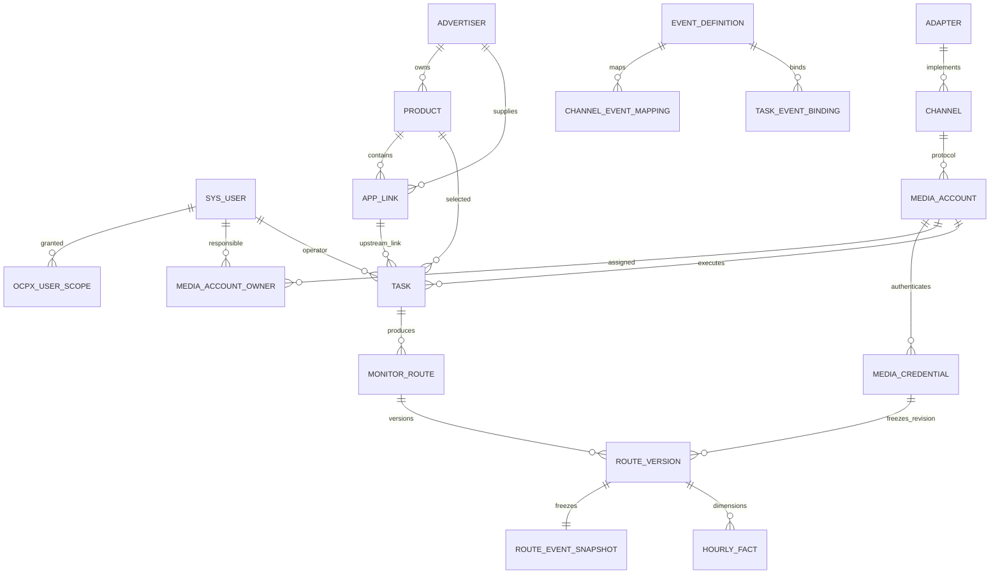
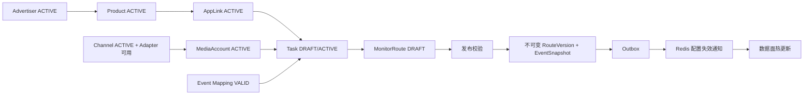
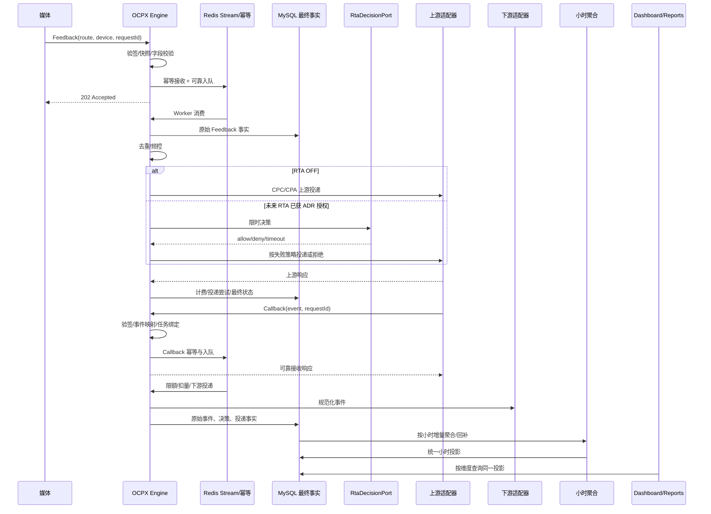

# 00 总体领域模型与跨模块数据流

> 状态：Review
> 证据：`现场实测` + `SCX仓库事实` + `SCX目标设计`
> 决策边界：目标模型需经评审；RTA 主动决策和 DP 转换保持 Blocked

## 1. 目标与非目标

本文定义各页面背后的业务对象、记录系统、依赖方向、发布快照、运行时链路和报表血缘，作为分模块接口与表结构的共同基线。它不是参考系统后端逆向结论，也不要求一个页面对应一个 Maven 模块。

## 2. 统一术语与映射状态

| 现场术语 | 可见字段/关系 | SCX 当前对象 | 候选 SCX 聚合 | 映射状态 |
|---|---|---|---|---|
| 上游客户 | 链接、任务筛选；客户文档 | `OcpxAdvertiser` | `Advertiser` | 复用并扩展接入资料引用 |
| 产品 | 名称、包名、Logo、事件限量、归档 | 无独立聚合 | `Product` | 新增；不得用 AppLink 代替 |
| 链接 | 产品/客户/文档、类型、重定向、直达/下载、必填上游链接模板、归档、编辑态事件策略 | `OcpxAppLink` | `AppLink` | 演进现表；上游模板与 MonitorRoute 生成地址严格分离 |
| 媒体渠道 | 协议渠道、媒体文档 | `OcpxChannel` | `Channel` | 保留为协议/适配器层 |
| 渠道用户 | 挂在媒体行下的账户数量/加号；新增字段为邮箱、密码、描述 | 无独立稳定对象 | `MediaCredential`（外部凭据） | 不映射为 `sys_user`；平台登录仍复用 `scx-system` |
| 任务 | 产品、上游链接、媒体、运营、策略、状态 | `OcpxMonitorLink` 混合承载 | `Task` | 新增运营聚合 |
| 监测链接/上报地址 | 任务行可复制；结构为路由码 + 设备/广告/回调占位符 | `OcpxMonitorLink` | `MonitorRoute/RouteVersion` | 服务端生成；仅 PUBLISHED 版本可承流；不与 AppLink 上游模板混用 |
| 事件 | 转化事件、上游映射、限量 | 当前工作树在研事件模型 | `EventDefinition/Mapping/Binding/Snapshot` | 先收口本地在研契约 |
| RTA | Profile 服务地址/密钥/文档/api/媒体/状态、全局域名/加密密钥、DAY/HOUR 六列统计 | `RtaDecisionPort`，当前 OFF | `RtaProfile/RtaGlobalSetting/RtaDecisionFact` | Blocked；三类地址/配置不可混同；替代 ADR 前不得启用 |
| 数据汇总 | 时间/产品/链接/任务/媒体维度 | `OcpxHourlyReport` | `HourlyFactProjection` | 扩维但保持单一口径 |
| DP 转换 | 淘宝/京东链接输入 | 无 | `DpConversionService` | Blocked；独立工具能力 |

## 3. 目标实体关系



核心约束：

- `Advertiser → Product → AppLink` 是上游主数据链；AppLink 仍保留 `advertiser_id` 便于服务端一致性校验，必须与 Product 的 advertiser 相同。
- `AppLink.linkUrlTemplate` 是运营粘贴的上游链接模板；`MonitorRoute.publicUrl` 是 Task 发布后生成的机器入口。前者可随 AppLink 新版本编辑，后者只能由新 RouteVersion 替代，二者不得共用字段。
- `Channel → MediaAccount → MediaCredential` 是协议、业务账户到外部凭据的分层；参考“渠道用户”的邮箱/密码不是 SCX 登录账号。`sys_user` 只做平台登录主体和内部负责人，不保存媒体密钥。
- 有多个 MediaCredential 时，Task 必须显式选择凭据或使用经评审的唯一默认规则；RouteVersion 冻结 `credential_id + secret_revision`，运行时不读取“当前密码”。
- `Task` 描述“谁在何时用哪个产品、链接、媒体账户和策略运营”；`MonitorRoute` 描述机器流量使用的不可变执行配置。
- 运行时只读取 `PUBLISHED` 的 `RouteVersion`，不拼装当前主数据表。
- 任务监测地址由 RouteVersion 和 Channel Adapter 的宏字典生成；真实主机、routeCode、设备值与业务 URL 不进入管理日志或文档。SCX 只允许 HTTPS，routeCode 必须不可枚举。
- Task 事件绑定保存“上游标准事件 → 渠道事件 → 回传比例 → 限额 → 超量回传”；发布快照冻结完全值，运行时不回读 Product/AppLink/Task 当前配置。
- RTA Profile 的服务地址、现场 `api` 字段和全局 `rta域名` 是三个待协议确认的概念，目标模型必须分字段/分所有权，不能相互代填；Profile/全局 Secret 只保存 credential reference/revision，任何详情响应和浏览器状态都不得含原文。
- 参考新增 RTA 状态现场默认为开启，但 SCX 目标在替代 ADR 前必须由 UI、管理 API、发布器和数据面四层锁定 `DISABLED/OFF`；界面默认值不能覆盖 Accepted ADR。

## 4. 模块所有权

| 能力 | 记录系统/模块 | 写入口 | 读消费者 |
|---|---|---|---|
| 登录、用户、角色、菜单 | `scx-auth` / `scx-system` | 系统管理接口 | 管理前端、所有服务端鉴权 |
| OCPX 对象范围 | `scx-ocpx-admin`，关联 `sys_user` | 范围授权接口 | Catalog/Report/Runtime 查询服务 |
| 广告主、产品、链接、媒体账户、媒体凭据、任务 | `scx-ocpx-admin` + MySQL/受控 Secret 引用 | 管理端 REST | 发布服务、报表维度、前端 |
| Channel/Adapter 能力 | `scx-ocpx-admin` + 适配器注册表 | 管理端 REST/代码注册 | 发布校验、运行适配 |
| 路由草稿、版本、Outbox | `scx-ocpx-admin` + MySQL | 发布服务 | 数据面配置仓库、运行中心 |
| RTA Profile/全局设置/credential revision/统计投影 | `scx-ocpx-admin` + MySQL/受控 Secret 引用 | 管理端 REST；当前仅 DISABLED | Task/发布校验、RTA 管理页；未来决策数据面 |
| 未来 RTA 决策事实 | `scx-ocpx-runtime/engine` + MySQL | 仅替代 ADR 后的数据面 | RTA 小时聚合、日报/时报、运行审计 |
| Feedback/Callback、幂等、投递 | `scx-ocpx-runtime/engine` | 机器接口 | 事实库、投递队列、运行中心 |
| 最终事件/计费/投递事实 | MySQL | 数据面事务 | 聚合作业、审计、对账 |
| 队列、短期幂等、热配置 | Redis | 数据面/发布通知 | worker 与运行实例 |
| 小时聚合与指标字典 | MySQL + 报表服务 | 聚合作业/回补 | 五类报表、Dashboard |

不得重新建立平行的用户、角色、密码或菜单表；不得把高 QPS 机器入口重新塞回管理面 `scx-boot`。

## 5. 主数据依赖与配置发布



### 5.1 发布事务

1. 服务端锁定目标 `MonitorRoute`，校验调用者权限和对象范围。
2. 检查 Advertiser/Product/AppLink/Channel/MediaAccount/Task 均未归档或禁用，且关联一致。
3. 解析适配器能力、事件映射、计费、去重、限额、RTA 模式；Secret 只生成引用或加密载荷，不写日志。
4. 以单个 MySQL 事务写入递增 `config_version`、不可变 JSON 快照、事件快照、发布记录与 Outbox。
5. 提交后异步发布 Outbox；Redis 通知只是缓存失效/热更信号，不是版本真相。
6. 数据面按 `route_id + version` 拉取并校验快照；成功后上报实例应用版本。旧版本保留用于在途请求和审计。
7. Outbox 失败自动重试；不得把路由回退为“已发布成功”。

### 5.2 状态机

```text
Task:         DRAFT → ACTIVE ↔ PAUSED → ARCHIVED
MonitorRoute: DRAFT → VALIDATING → PUBLISHED → SUPERSEDED
                        └→ VALIDATION_FAILED
主数据:       ACTIVE ↔ DISABLED → ARCHIVED
投递:         PENDING → PROCESSING → SUCCEEDED
                 └→ RETRY_WAIT → DEAD_LETTER → REPLAYED
```

归档主数据前必须检测活动 Task/Route；存在引用时返回 `409 OCPX_OBJECT_IN_USE`，提示先暂停并发布新版本。

## 6. Feedback、RTA、Callback 与报表链路



`202 Accepted` 只表示请求已通过入口校验并可靠进入队列，不表示上游投递、计费或下游回调已经完成。

任务页的点击详情读取 Feedback/投递事实；转化详情读取 Callback、点击关联、任务/链接超量决策、审减 adjustment 和媒体投递尝试；时报/日报/链接日报读取统一小时投影。三个只读面共享同一 `task_id/route_version/app_link_id` 血缘，禁止从当前主数据名称反查并覆盖历史归属。

## 7. 生产者、消费者与补偿矩阵

| 生产者 | 合同/键 | 消费者 | 幂等键 | 失败与补偿 |
|---|---|---|---|---|
| 管理发布服务 | `RoutePublished(routeId, version)` | 配置分发 worker | `routeId:version` | Outbox 指数退避；重复通知无副作用 |
| Feedback 入口 | 规范化反馈信封 | Feedback worker | 渠道 + 请求 ID；缺失时用受控指纹 | 重复直接返回已接收结果；解析失败进审计拒绝表 |
| Callback 入口 | 规范化回调信封 | Callback worker | 上游 + 事件请求 ID | 重复不再次扣量/投递；不可识别事件进入隔离队列 |
| 事件策略 worker | RouteEventSnapshot | 比例/限额/超量决策 | 原始事件 ID + 策略版本 | 确定性采样；Redis 计数故障时按契约拒绝/隔离；决策写 MySQL |
| 计费服务 | Ledger command | 账务表 | 业务类型 + 原始事实 ID | 唯一索引防重；余额不足形成明确失败事实 |
| 投递服务 | Delivery task | Adapter worker | 方向 + 事实 ID + 目标 | 超时重试；达到上限进 DLQ；人工重放需授权 |
| 小时聚合 | 原始事实增量 | 报表投影 | `hour + dimensions` | 游标/水位重跑；Upsert 不重复累加 |
| 报表导出 | Export job | 导出 worker | 用户 + 查询哈希 + 时间窗 | 异步生成、有期限下载；失败可重试且审计 |

Redis 故障时不得“接收后丢失”；若不能满足可靠接受条件，入口返回可重试的 `503`，而不是 `202`。

## 8. 统一小时事实与指标血缘

目标粒度：`stat_hour + advertiser_id + product_id + app_link_id + task_id + monitor_route_id + channel_id + media_account_id`。无适用维度使用 `NULL`，不能用 `0` 混淆未知对象。

| 指标 | 来源事实 | 聚合 | 比率口径 |
|---|---|---|---|
| 曝光 | 合法 exposure feedback | `COUNT` 或来源去重计数 | 无 |
| 点击 | 合法 click feedback | 去重前/后分别存储 | 重复点击率=`duplicate_clicks/raw_clicks` |
| 激活/注册/付费/下单 | 已映射 callback 事件 | 每个业务事件按幂等事实计数 | 事件率=`事件数/有效点击数` |
| 首活/首单 | 设备/业务主体首次事件事实 | 首次判定结果计数 | `首次事件/有效点击` |
| 次留/3留/7留 | Cohort 归属 + 对应日回访事实 | 按激活 cohort 回填 | `Dn 留存人数/D0 激活人数` |
| 拉活 | 已定义的 reengagement 事件 | 幂等计数 | `拉活/有效点击` |
| 自定义/授信 | 事件字典定义 | 按事件 code 计数或固定投影 | 口径必须写入指标字典 |
| RTA 请求/成功 | RTA 决策事实；“成功”定义必须由替代 ADR/协议锁定 | 按 profile + hour 保存请求、成功、超时、拒绝 | 成功率=`success/request`；request=0 返回 `null` |

规则：

- 五个汇总页与 Dashboard 只能调用同一个指标服务；禁止页面内或 Controller 内各自计算。
- 金额使用最小货币单位或 `DECIMAL`，计数使用 `BIGINT`；比率由服务端返回分子、分母和展示值。
- 修正/扣量不改写原始事实；以 adjustment fact 叠加得到净值，并可追溯原因、规则版本和操作者。
- `Asia/Shanghai` 的小时边界在写入和查询两端一致；存储建议 UTC 时间戳并保留业务时区。

## 9. API 与错误约定

### 9.1 管理 API

```json
{
  "code": 0,
  "message": "success",
  "data": {
    "current": 1,
    "size": 20,
    "total": 0,
    "records": []
  },
  "traceId": "..."
}
```

- 查询：`GET`，`current>=1`，`1<=size<=200`，排序字段走白名单。
- 创建：`POST`，支持 `Idempotency-Key`；同键同载荷返回原结果，同键异载荷返回 `409 OCPX_IDEMPOTENCY_CONFLICT`。
- 更新：`PUT/PATCH` 携带 `version`；版本冲突返回 `409 OCPX_VERSION_CONFLICT` 并提示刷新。
- 归档/状态：使用语义动作接口，不用通用物理 `DELETE`。
- 写操作返回对象最新版本；前端成功 Toast 后刷新当前页并保持筛选条件。

### 9.2 共同错误

| HTTP | code | 场景 | 前端行为 |
|---|---|---|---|
| 400 | `OCPX_VALIDATION_FAILED` | 字段/条件校验失败 | 定位到字段，保留输入 |
| 401 | `AUTH_SESSION_EXPIRED` | 会话过期 | 清理本地会话并回登录页 |
| 403 | `OCPX_OBJECT_FORBIDDEN` | 无权限或超出对象范围 | 不泄露对象是否存在 |
| 404 | `OCPX_OBJECT_NOT_FOUND` | 范围内对象不存在 | 返回列表并提示已变化 |
| 409 | `OCPX_OBJECT_IN_USE` | 归档/禁用对象仍被引用 | 展示阻塞引用摘要 |
| 409 | `OCPX_VERSION_CONFLICT` | 并发更新 | 提示刷新比较，不覆盖 |
| 422 | `OCPX_PUBLISH_VALIDATION_FAILED` | 发布依赖不完整 | 展示逐项检查结果 |
| 429 | `OCPX_RATE_LIMITED` | 管理或工具接口限流 | 倒计时重试 |
| 503 | `OCPX_ACCEPTANCE_UNAVAILABLE` | 机器入口无法可靠接收 | 调用方按退避重试 |

## 10. 权限与对象范围

权限由“功能权限 + 对象范围”同时决定：

```text
允许 = Sa-Token permission code
   ∧ user_scope 包含目标 Advertiser/Channel/MediaAccount
   ∧ 关联对象全部处于同一可见范围
```

建议对象范围表 `scx_ocpx_user_scope(id, user_id, scope_type, scope_id, permission_level, version, created_at, updated_at)`；唯一索引 `(user_id, scope_type, scope_id)`。管理员可使用显式 `ALL` 范围，不能通过缺少记录隐式获得全量权限。

## 11. 安全、隐私与审计

- Secret/Password/Token：使用已有加密/哈希能力；读取接口仅返回 `configured: true/false` 与尾号掩码，不返回密文或明文。
- URL：只允许 `http/https`，拒绝用户信息段、环回、链路本地、内网与保留地址；DNS 重绑定和重定向每跳复核。
- 设备标识：日志只保存哈希/截断值；原始值按合规期限存储并做字段级访问控制。
- 业务写操作记录 `actor/tenant/object/beforeVersion/afterVersion/traceId/result`，大字段存摘要，不把 Secret 写入审计 diff。
- 导出文件继承查询者对象范围，短期签名下载，过期自动清理。

## 12. 迁移、灰度与回滚边界

1. 新表/列通过新的前向 SQL 增加，同时更新当前态 schema、必需表列表、验证脚本和契约测试。
2. AppLink、MonitorRoute 新外键先可空回填，再启用写入双校验，完成存量核对后才收紧非空约束。
3. 发布快照 schema 增加 `schemaVersion`；数据面至少兼容 N/N-1，灰度实例先只读新字段。
4. 回滚应用不等于回滚数据库；已发布新版本不删除，只可重新发布一个引用旧安全配置的新版本。
5. 新报表维度先双写事实、离线核对，再切读；偏差超阈值自动回到旧投影。

## 13. 跨模块验收不变量

- 任一 AppLink 的 `advertiser_id` 必须等于其 Product 的 `advertiser_id`。
- ACTIVE Task 必须引用 ACTIVE Product/AppLink/MediaAccount；PUBLISHED Route 必须冻结这些对象的版本。
- 可复制监测地址只来自当前允许承流的 RouteVersion；客户端不能提交/覆盖 publicUrl 或 routeCode；未知、重复或缺失宏发布失败。
- 同一事件重放必须得到相同比例采样结果，且不重复消耗任务/链接限额；超量和审减以独立决策/调整事实表示。
- 归档/禁用依赖对象不会静默改变已发布快照；新流量切换只能通过新发布版本。
- 同一原始请求重放不会重复计费、扣量、投递或聚合。
- 报表任意分组的总量可与同时间范围基础事实对账；不同页面同维度同筛选结果一致。
- 普通用户通过 ID 猜测不能读取、更新或导出范围外对象；错误不泄露存在性。
- RTA 未获替代 ADR 前，所有新旧路由的有效模式都为 `OFF`。
- DP 未获 RFC/ADR 前，不存在通用网络代理或生产菜单入口。

更细的纵向切片与验收证据见 [91-SCX实施依赖与验收矩阵](91-SCX实施依赖与验收矩阵.md)。
