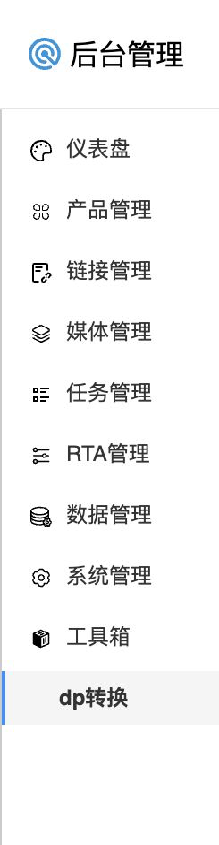

# 01 登录与全局框架

> 状态：Draft
> 现场页面：`/`（未认证登录态与认证后仪表盘）、全站壳层、账号菜单
> SCX 归属：`scx-auth`、`scx-system`、`web-ele`；不得新建平行认证体系

## 1. 页面与布局

### 1.1 登录页 `PAGE-AUTH-LOGIN`

`现场实测`：未认证页面为居中的登录卡片，包含系统标题、用户名输入、密码输入、密码可见性图标、登录按钮和页脚年份。提交后的错误、锁定、验证码和忘记密码流程未触发。

| 区域 | 控件 | 初始/校验 | 交互与结果 | 证据 |
|---|---|---|---|---|
| 标题 | 后台管理 | 只读 | 标识登录目标 | 现场实测 |
| 账号 | `CTRL-AUTH-USERNAME` | 必填；去首尾空格；长度按现有系统规则 | 输入后仍不得在日志记录 | 现场实测 |
| 密码 | `CTRL-AUTH-PASSWORD` | 必填；默认掩码；禁止浏览器明文持久化 | 可见性图标只切换本地展示 | 现场实测 |
| 操作 | `BTN-AUTH-SUBMIT` | 两字段有效且未提交时可用 | 登录成功进服务端菜单首页；失败保留账号、清空密码 | 界面文案推断，未提交复测 |

### 1.2 认证后壳层 `PAGE-SHELL-01`

`现场实测`：顶部为系统标题/面包屑/账号入口；左侧为菜单树和版本区域；主体承载筛选、表格、抽屉；侧栏含仪表盘、产品、链接、媒体、任务、RTA、数据管理、系统管理和工具箱分组。

| 元素 | 行为 |
|---|---|
| `BTN-SHELL-COLLAPSE` | 展开/收起侧栏；收起后保留图标和悬停提示；状态可按用户偏好持久化 |
| 面包屑 | 根据当前菜单元数据生成；中间节点可导航时才显示链接 |
| 版本号 | 现场显示 `V0.7.3`，仅代表采集时参考站点；SCX 应显示构建版本和提交摘要 |
| 菜单组 | 点击父节点展开/收起；选中项与 URL 同步；无权限菜单不下发 |
| 主体 | 提供 Loading、Empty、Error、NoPermission 四种共同状态 |

### 1.3 账号菜单 `POP-SHELL-ACCOUNT`

| 触发 | 展示 | 操作 | 关闭与结果 |
|---|---|---|---|
| 点击顶部账号 | 用户中心、退出登录 | 用户中心进入 `/setting`；退出登录发起会话注销 | 点击外部/Esc 关闭；退出操作本轮未执行 |

退出登录必须先让服务端失效当前会话，再清理前端 token/store 并跳转登录页；网络失败时不能只做前端“假退出”。如现有认证机制支持多端会话，当前设备退出与全部设备退出必须明确分开。

### 1.4 通用分页 `CTRL-SHELL-PAGER`

现场可见首页/末页或边界页、上一页、下一页、页码、跳页、总条数和每页条数。目标行为：

- `current` 从 1 开始；页大小取 `15/20/50/100` 的产品统一值，服务端上限 200；
- 筛选改变时回第 1 页；编辑刷新保持当前页；删除/归档导致空页时回退一页；
- 首页禁用上一页、末页禁用下一页；图标必须有 `aria-label` 和悬停提示；
- Loading 时禁止重复翻页；失败保留筛选并提供重试。

## 2. SCX 当前能力与目标设计

| 方面 | 当前事实 | 目标处理 |
|---|---|---|
| 认证 | `scx-auth` + Sa-Token | 完全复用；不新增账号/密码表 |
| 用户/角色/菜单 | `scx-system` | 复用服务端菜单、角色和按钮权限 |
| 前端路由 | 服务端菜单驱动；只解析 `_core`、`views/adx`、`views/system` | 新 ADX 页面放 `views/adx`；无意扩白名单 |
| 对象范围 | S0 已新增显式 ADX scope、整体 revision 与服务端过滤；系统 RBAC 仍只表达功能权限 | 功能权限与对象权限取交集；缺少关系不等于 ALL；目标环境另行迁移验收 |
| 用户中心 | 系统模块已有用户资料/密码能力 | 复用现有接口与审计，不在 ADX 重写 |

## 3. 前端实现

- 登录沿用现有登录页和 store；按钮提交期间显示 Loading 并禁用重复提交。
- 路由守卫依次检查会话、拉取用户/菜单、解析允许的组件路径、进入首个可访问菜单。服务端返回未知组件路径时展示受控错误，不使用任意动态 import。
- 页面壳组件统一提供 `PageState`：`loading | ready | empty | error | forbidden`，业务页面只填内容插槽。
- 所有仅图标按钮提供可读名称；抽屉有 `aria-labelledby`，焦点打开后进入标题/首字段，关闭后回到触发按钮。
- 会话过期的并发请求只触发一次刷新/跳转，避免多个登录弹窗或重复清 store。

## 4. 接口、并发与错误

本模块不新增登录接口，复用 SCX 现有认证契约。需要确保：

| 操作 | 接口边界 | 成功 | 失败 |
|---|---|---|---|
| 登录 | 现有 `scx-auth` 登录接口 | 建立 Sa-Token 会话，返回最小用户摘要 | `401` 使用统一泛化文案，不区分账号是否存在 |
| 获取菜单 | 现有菜单/权限接口 | 只返回当前角色可见节点和权限码 | `403` 进入无权限页，不回退到硬编码菜单 |
| 退出 | 现有注销接口 | 服务端会话失效后清理前端 | 网络失败显示重试；不声称已注销 |
| 修改密码 | 现有用户安全接口 | 当前会话按安全策略失效或刷新 | 旧密码错误用字段错误，不记录明文 |

登录按钮使用单航班锁；重复响应只接受最后一次提交对应的 request token。认证错误、权限错误与对象范围错误不得混为“页面不存在”。

## 5. 数据、权限与安全

- 不新增认证表；`sys_user/sys_role/sys_menu` 仍是记录系统。
- 可新增的仅是 [总体设计](00-总体领域模型与跨模块数据流.md) 中的 `scx_adx_user_scope`，它不保存密码或角色。
- 建议权限：`adx:dashboard:view` 作为 ADX 首页；各菜单使用各模块权限。全局框架不授予额外业务权限。
- 登录、注销、密码修改、角色/范围变化进入安全审计；日志记录用户 ID、IP 摘要、UA 摘要、结果和 traceId，不记用户名密码组合。
- 密码输入关闭自动回显；响应头禁止缓存认证页；前端构建产物不得包含 Secret 或签名密钥。

## 6. 异常与边界

- 菜单接口空：显示“当前账号无可访问菜单”，不得无限重定向。
- 角色刚被禁用：下一次鉴权失败立即失效会话。
- 菜单组件路径非法：隔离该节点并记录告警，不能执行任意模块路径。
- 浏览器后退到受限页：路由守卫重新鉴权，不只依赖菜单隐藏。
- 分页总数变化：服务端返回空页时客户端自动回退一次，避免循环。

## 7. 验收用例

| 层级 | 用例 |
|---|---|
| UI | 密码默认掩码；显示/隐藏不改变值；提交中按钮禁用；会话过期只跳转一次 |
| API | 错误账号与错误密码返回同类错误；注销后原 token 不能访问；菜单仅含有权节点 |
| 权限 | 手工输入无权 URL 返回 403 页面；隐藏按钮不能绕过服务端权限 |
| 数据范围 | 仅授予部分广告主的用户看不到其他对象数量、下拉项和导出 |
| 可访问性 | 侧栏图标、分页箭头、抽屉关闭均有可读名称和键盘焦点 |
| 安全 | 登录/密码日志无明文；多次失败触发限速但不泄露账号存在性 |

页面、按钮与弹层 ID 的完整索引见 [覆盖矩阵](90-页面按钮弹窗覆盖矩阵.md)。
