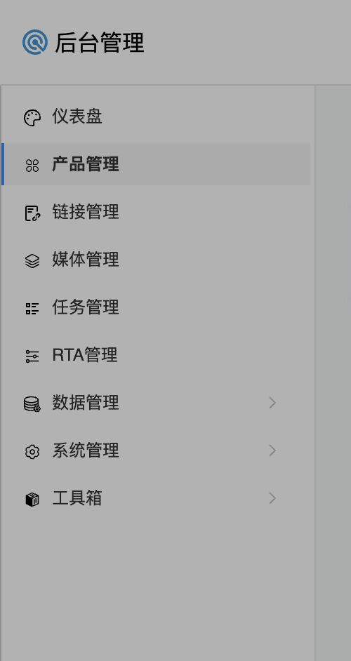
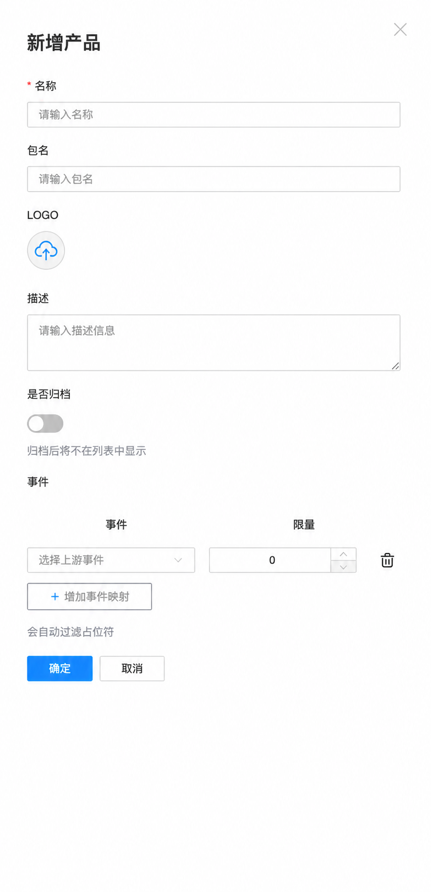
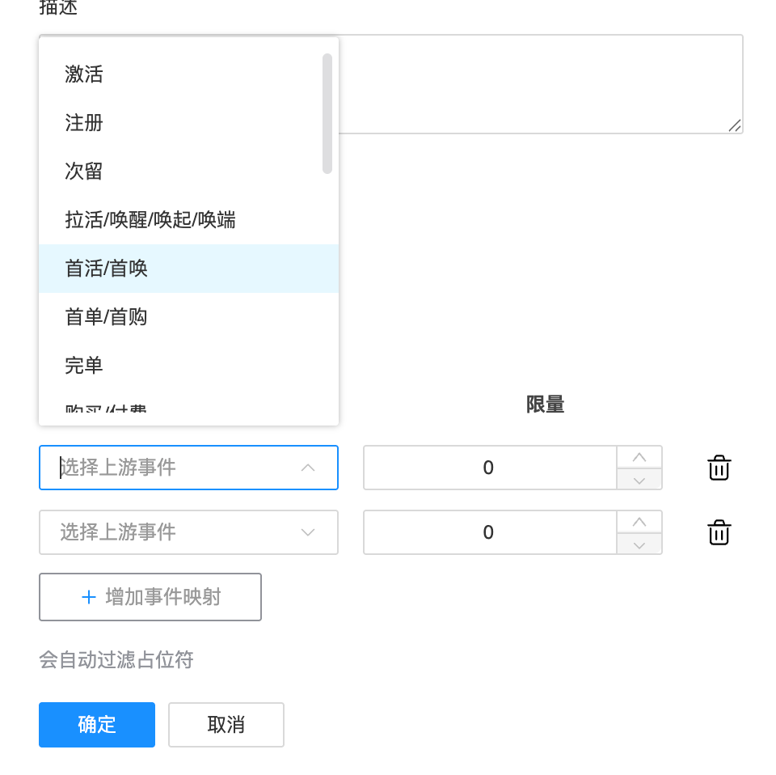

# 04 产品管理

> 状态：Draft；主数据优先级 P1
> 现场页面：`/product`
> SCX 目标：新增独立 Product 聚合，建立 `Advertiser → Product → AppLink`

## 1. 页面布局与状态

`PAGE-PRODUCT-LIST` 由面包屑、关键词筛选、搜索/新增、数据表和分页组成。关键词输入框占位文案为“名称/描述”，操作按钮依次为“搜索”“新增”。现场表列为名称、描述、创建日期、操作；名称单元格由圆形 Logo/占位图与名称文本组成，行操作为“编辑”。归档产品默认不在普通列表显示。



| 页面状态 | 表现 |
|---|---|
| 初始/加载 | 筛选可见，表格骨架，搜索与分页防重复 |
| 空数据 | “暂无产品”；有新增权限时给创建入口 |
| 筛选无结果 | “未找到匹配产品”，提供清空筛选 |
| 失败 | 保留关键词和页码，显示重试 |
| 无权限 | 403 状态，不请求数据、不泄露总数 |

SCX 目标筛选增加 Advertiser、状态、归档，表列增加产品编码、包名、上游广告主、AppLink 数、状态、版本和更新时间。

## 2. 控件、按钮与弹层

| ID | 位置 | 可见/可用条件 | 流程与结果 | 证据 |
|---|---|---|---|---|
| `CTRL-PRODUCT-KEYWORD` | 筛选栏 | 查看权限 | 名称/描述关键词；回车等同搜索 | 现场实测 |
| `BTN-PRODUCT-SEARCH` | 筛选栏 | 未加载 | 请求第 1 页；失败保留条件 | 现场实测 |
| `BTN-PRODUCT-ADD` | 工具栏 | `adx:product:add` | 打开空抽屉 | 现场实测 |
| `BTN-PRODUCT-EDIT` | 行操作 | edit + 对象范围 | 拉详情并打开编辑抽屉 | 现场实测 |
| `BTN-PRODUCT-ADD-EVENT` | 抽屉事件区 | 表单可编辑 | 新增事件/限量行；不提交 | 现场实测 |
| `BTN-PRODUCT-REMOVE-EVENT` | 每个事件行尾部 | 事件行存在 | 删除对应本地行；不提交 | 图标与多行结构实测，未点击删除 |
| `BTN-PRODUCT-SUBMIT` | 抽屉底部 | 校验通过且未提交 | 创建/更新；成功 Toast、关闭、刷新当前页 | 未实际提交 |
| `BTN-PRODUCT-CANCEL` | 抽屉底部 | 始终 | 无修改直接关；有修改二次确认 | 现场关闭实测，未保存确认未验证 |
| `BTN-PRODUCT-ARCHIVE` | 目标行操作 | archive 权限且无活动引用 | 确认后归档；冲突列出引用摘要 | SCX目标设计 |

### 2.1 新增/编辑抽屉 `POP-PRODUCT-FORM`



> `SHOT-PRODUCT-02` 由用户本轮提供的新增页截图进行 AI 辅助脱敏裁切，仅保留空抽屉；字段、顺序和控件已与原图逐项对照。原始全屏图因包含账号及真实业务名称未写入仓库。

| 字段 | 现场 | SCX 规则 |
|---|---|---|
| 上游广告主 | 参考抽屉未见 | 目标新增、必填、ACTIVE 且在对象范围 |
| 名称 | 红色星号必填；占位“请输入名称” | 必填，1–64；同 Advertiser 内唯一 |
| 产品编码 | 参考抽屉未见 | 创建必填，稳定且不可修改 |
| 包名 | 无必填星号；占位“请输入包名” | 参考行为为可选；SCX 若按平台设为必填，必须作为目标差异评审 |
| LOGO | 圆形上传图标 | 图片类型/大小/尺寸白名单；先临时上传，保存后绑定 |
| 描述 | 多行文本；占位“请输入描述信息” | 0–500；纯文本展示防 XSS |
| 是否归档 | 默认关闭；提示“归档后将不在列表中显示” | 新增默认否；有活动 Task/Route 时禁止直接归档 |
| 事件 | “事件/限量”两列动态行 | 每行事件必选且不重复；限量为非负整数 |

新增抽屉默认初始化一行空映射，事件占位为“选择上游事件”，限量默认值为 `0`，行尾有删除图标。“增加事件映射”会追加一行同结构映射；截图确认两行拥有独立选择器、数值控件和删除图标。编辑抽屉结构与新增一致，但当目标产品无映射时事件区可以是零行，仅显示“增加事件映射”。



下拉列表带滚动条，现场可见选项至少包括：激活、注册、次留、拉活/唤醒/唤起/唤端、首活/首唤、首单/首购、完单；列表下方还存在更多选项，不能把本截图当成完整事件字典。选中项以高亮行表示。数值控件提供上下步进箭头，现场默认值为 0；是否允许负值、最大值及“限量”的时间窗口未由截图证明，服务端仍须校验。

事件区下方提示“会自动过滤占位符”。该提示只能证明页面存在过滤行为说明，不能据此推断过滤算法；SCX 应在事件发布契约中明确允许的占位符集合、过滤阶段和错误结果。“限量”的目标口径建议评审为 `daily_limit`、时区 `Asia/Shanghai`、粒度 `product + event + business_date`。

关闭方式现场可见右上角 X 和底部取消；Esc 行为尚未验证。目标实现中三种退出统一执行 dirty 检查，提交中全部禁用。服务端字段错误映射到对应行；事件重复错误需定位两行。确定按钮触发保存的成功、失败、Toast 和列表刷新仍未实际执行。

## 3. 当前能力、缺口与冲突

| 方面 | 当前 | 目标 |
|---|---|---|
| 产品对象 | 无独立 Product；`AdxAppLink` 承担链接 | 新 `scx_adx_product`，不让链接冒充产品 |
| 广告主 | 已有 `AdxAdvertiser` | Product 必须归属一个 Advertiser |
| 事件 | 当前工作树有事件定义/映射在研代码 | 产品只保存策略引用；定义归事件模块 |
| Logo | 有系统存储能力 | 复用受控上传，保存对象引用 |

## 4. 前端设计

```text
views/adx/product/index.vue
├── ProductFilter
├── ProductTable
├── ProductFormDrawer
│   ├── ProductBaseFields
│   ├── ManagedImageUpload
│   └── ProductEventPolicyEditor
└── ArchiveConfirmDialog
```

API 放 `src/api/adx/product.ts`，由现有 `adx.ts` 重导出。下拉选项分页/远程搜索，不一次加载全部广告主或事件。表单以 `version` 为乐观锁；切换广告主后清空不再兼容的 AppLink/事件策略并二次确认。

## 5. API

| 方法 | 路径 | 说明 |
|---|---|---|
| GET | `/adx/products` | `keyword, advertiserId, status, archived, current, size` |
| POST | `/adx/products` | 幂等创建 |
| GET | `/adx/products/{id}` | 详情及事件策略 |
| PUT | `/adx/products/{id}` | 全量可编辑字段，携带 version |
| POST | `/adx/products/{id}/archive` | 归档并检查引用 |
| POST | `/adx/products/{id}/restore` | 恢复；广告主必须 ACTIVE |

```json
{
  "advertiserId": "...",
  "code": "product_code",
  "name": "产品名称",
  "packageName": "com.example.app",
  "logoObjectId": "...",
  "description": "...",
  "eventPolicies": [{"eventDefinitionId": "...", "dailyLimit": 100}],
  "archived": false,
  "version": 1
}
```

创建用 `Idempotency-Key`；更新冲突 `ADX_VERSION_CONFLICT`；重复 code/name `ADX_PRODUCT_DUPLICATE`；事件重复 `ADX_PRODUCT_EVENT_DUPLICATE`；有活动引用时 `ADX_OBJECT_IN_USE`。

## 6. 表结构与状态

`scx_adx_product`：

| 字段 | 约束 |
|---|---|
| `id` | 主键 |
| `advertiser_id` | 必填，索引；服务层校验 ACTIVE 与范围 |
| `code` | 必填；唯一 `(advertiser_id, code)` |
| `name` | 必填；唯一 `(advertiser_id, normalized_name)` |
| `package_name` | 可空；索引 `(advertiser_id, package_name)` |
| `logo_object_id` | 可空，指向受控存储元数据 |
| `description` | 可空 |
| `status` | `ACTIVE/DISABLED/ARCHIVED` |
| `config_version` | 乐观锁/快照冻结 |
| 审计字段 | created/updated by/at，不物理删除 |

事件策略可用 `scx_adx_product_event_policy(product_id, event_definition_id, daily_limit, status, version)`，唯一 `(product_id, event_definition_id)`。若事件模块最终决定策略归 Task，则此表仅作默认模板，发布时复制到 Task binding，不在运行时动态读取。

## 7. 数据联通与发布影响

- Product 作为 AppLink 的必选父对象；AppLink 保存冗余 advertiserId 并做一致性约束。
- Task 选择 Product 后，只能选择该 Product 下 ACTIVE AppLink。
- Product 基础/事件策略修改使关联 DRAFT 路由校验失效；已发布路由继续使用旧快照。
- 报表事实写入 productId，历史产品改名不改历史维度 ID；展示可读当前名并提供快照名。

## 8. 权限、安全、迁移与观测

权限：`adx:product:view/add/edit/archive`。服务端把 Product 的 advertiserId 纳入对象范围；Logo 下载继承范围。包名和业务名称在普通日志中只记 ID/摘要。

迁移顺序：建 Product 表 → 回填存量 AppLink 到人工确认的 Product → AppLink 双写 productId → 校验无孤儿 → 收紧约束。禁止按相同包名自动合并跨广告主产品。

指标：产品创建/冲突、孤儿 AppLink、归档阻塞、事件策略校验失败、待重发路由数、Logo 临时对象清理数。

## 9. 验收用例

| 层级 | 用例 |
|---|---|
| UI | 动态事件行增删、重复定位、限量最小值、Logo 失败、未保存退出 |
| API | 幂等创建、范围内唯一、版本冲突、归档引用阻塞、恢复父对象校验 |
| DB | 无跨广告主重复 code；无孤儿 Product；策略唯一索引生效 |
| 权限 | 只能查看授权 Advertiser 下产品；无 archive 权限不显示且接口拒绝 |
| 集成 | Product→AppLink 下拉联动；修改策略使路由待重发；旧快照不变 |
| 异常 | 上传成功保存失败清理；并发编辑不丢更新；事件被停用后发布失败 |
