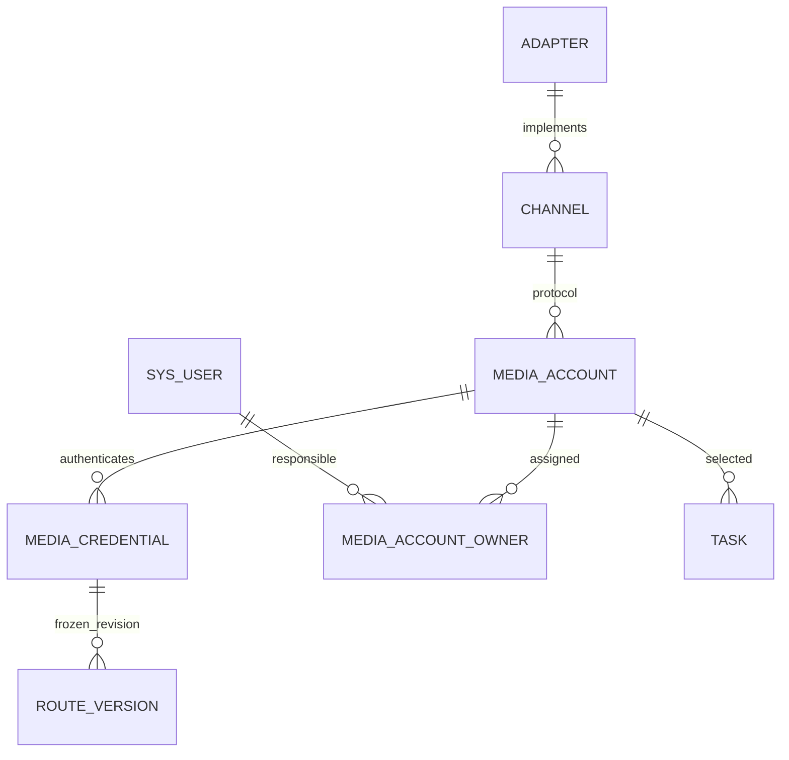

# 06 媒体渠道与媒体账户

> 实施状态（2026-08-10）：S3 源码与本地门禁完成；目标数据库、目标服务、多角色浏览器、真实媒体连通性、第三方 UAT 和生产均未验收。

## S3 实施收口

- `V84`、current schema、required tables、verifier 与 migration contract 同步建立 `MediaAccount`、`MediaCredential`、Secret revision、内部负责人和无敏感值的变更审计；历史 Monitor 不自动回填媒体账号关系，避免替业务作不可逆归属决定。
- Channel 继续只承载协议/Adapter 目录；业务账号归 `MediaAccount`。一个账号允许多个稳定 Credential，对外只返回掩码、configured 和 revision；默认 Credential 在首次启用凭据时确定，后续 Task/S5 可显式选择其他 Credential。
- 登录标识与 Secret 复用现有 `ProtocolCrypto`。登录标识使用同一密钥材料派生的域隔离 blind index 做唯一性，不新增密钥配置；Secret 创建/轮换不使用请求体系统日志，响应、审计和普通日志均不含明文、密文或 credential ref。
- 功能权限与 Channel/MEDIA_ACCOUNT 对象范围取交集；S0 的 MEDIA_ACCOUNT 类型现已在授权选项、影响摘要、缓存失效和服务端过滤中正式启用。Owner 仅表示内部责任关系，不授予 Secret 权限。
- `/ocpx/media-accounts/{id}/connectivity:check` 固定为 `CONFIG_ONLY`，返回 `networkCalled=false`，只检查 Channel、Adapter、资料、默认凭据和账号状态，不解密 Secret、不复用 API Debug 执行能力、不发真实媒体请求。真实连接检查仍是目标/第三方 UAT 未验收项。
- MediaAccount/Credential 变更只给依赖的已发布 Monitor 标记待重发；旧发布字段不被清空或热改。显式发布时冻结 account config/credential revision 与 credential secret revision；S5 再负责正式选择关系。
- Element Plus 页面覆盖 Loading、首屏空、筛选空、失败重试、403、409、未保存退出、凭据二次认证/轮换、负责人、引用保护和配置预检状态。所有密码和 Secret 在动作完成/失败后立即清空。

> 状态：Draft / Review
> 观察日期：2026-08-09（Asia/Shanghai）
> 参考页面：`/distributor`；侧栏名为“媒体管理”，面包屑为“系统管理 / 媒体渠道管理”
> SCX 依赖：Channel、Adapter、接入资料、`sys_user` 与 OCPX 对象数据范围
> 证据边界：新增/编辑/新增渠道用户均只打开到提交前；未创建账户、未保存密码、未禁用对象

本模块把参考页面中的三层概念拆开，避免把协议、业务账户和平台登录用户混成一张表：

```text
Channel（协议/适配器）
    └── MediaAccount（媒体业务主体/参考页面一行）
            ├── MediaCredential（参考“渠道用户”：外部邮箱/密码凭据）
            └── MediaAccountOwner（内部负责人：引用 sys_user）
```

`MediaCredential` 不是 SCX 登录用户；平台认证、角色、菜单和人员生命周期继续只使用 `scx-system` 的 `sys_user`。浏览器证据不能证明参考系统如何存储密码、如何调用媒体或如何授权渠道用户。

## 1. 现场页面与布局

### 1.1 列表 `PAGE-MEDIA-LIST`

内容区依次为面包屑、横向筛选条、数据表和分页。现场筛选顺序为：

1. `搜索名称/描述`；
2. `媒体渠道` 下拉；
3. `媒体文档` 下拉；
4. `搜索`；
5. `新增`。

现场表头顺序为 `名称`、`媒体渠道`、`媒体文档`、`描述`、`渠道用户`、`创建日期`、`操作`。行内观察到：

- 媒体渠道可能同时显示图标与名称；空值行也存在，具体业务含义待验证；
- `渠道用户` 列在没有账户时显示方框加号，悬停提示精确为 `点击添加用户`；
- 已有账户时显示 `已有 N 个账户` 文本入口，并仍保留旁侧加号；N 是动态计数，不是固定规则；
- 操作列现场可见 `编辑`；
- 列表中的业务名称、文档、日期和账户数量均属于动态/敏感样例，不写入规格。

安全证据：

- [SHOT-MEDIA-01：媒体管理菜单选中态](assets/2026-08-09/SHOT-MEDIA-01-nav-selected.png)
- [SHOT-MEDIA-02：列表结构与添加用户 tooltip](assets/2026-08-09/SHOT-MEDIA-02-list-sanitized.png)
- [SHOT-MEDIA-03：新增媒体渠道抽屉](assets/2026-08-09/SHOT-MEDIA-03-add-drawer-sanitized.png)
- [SHOT-MEDIA-04：编辑媒体渠道抽屉](assets/2026-08-09/SHOT-MEDIA-04-edit-drawer-sanitized.png)
- [SHOT-MEDIA-05：新增渠道用户抽屉](assets/2026-08-09/SHOT-MEDIA-05-channel-user-add-sanitized.png)

### 1.2 页面状态

| 状态 | SCX 前端表现 | 服务端约束 |
|---|---|---|
| Loading | 表格骨架，搜索/分页防重复 | 查询强制对象范围 |
| 有数据 | 账户数量、渠道和资料采用受控展示 | 不返回邮箱明文、密码或 Secret |
| 初始空 | 说明尚无媒体账户；按 add 权限显示入口 | `total=0` |
| 筛选空 | 保留条件并提供清空筛选 | 不回退到未授权全量 |
| Error | 保留旧列表，显示重试和 `traceId` | 错误正文不含凭据/第三方响应 |
| Forbidden | 403 或不下发菜单 | 不返回账户数量和下拉候选 |

## 2. 列表按钮与行级动作

| ID | 位置/初始状态 | 可见/启用条件 | 触发与执行流程 | 成功结果 | 失败/取消 | 证据 |
|---|---|---|---|---|---|---|
| `BTN-MEDIA-SEARCH` | 筛选条蓝色按钮 | `ocpx:media-account:view` 且非加载中 | 归一化筛选，页码回 1，GET 列表 | 更新表格/总数/分页 | 保留筛选和旧列表 | 现场实测 |
| `BTN-MEDIA-ADD` | 搜索右侧 | `ocpx:media-account:add` | 打开空白 `新增媒体渠道` 抽屉，不保存 | 展示四字段默认态 | X/取消关闭 | 现场实测；SHOT-MEDIA-03 |
| `BTN-MEDIA-EDIT` | 操作列 | edit + 对象范围 | GET 详情和版本后打开编辑抽屉 | 预填关系和名称 | 详情失败不开层；不存在/越权泛化 | 现场实测；SHOT-MEDIA-04 |
| `BTN-MEDIA-USER-ADD` | 渠道用户列方框加号 | credential add + 对象范围 | 打开当前 MediaAccount 的空凭据抽屉 | 标题带父对象上下文 | 不发保存请求 | tooltip 与抽屉现场实测 |
| `BTN-MEDIA-USERS` | `已有 N 个账户` | credential view | 打开该 MediaAccount 的渠道用户列表 | 展示掩码邮箱、状态和操作 | 空/失败单独呈现；N 动态 | 当前会话观察；真实值不入图 |
| `BTN-MEDIA-USER-EDIT` | 渠道用户列表行 | credential edit | 详情仅返回掩码标识和 `passwordConfigured` | 打开编辑抽屉；空密码表示不轮换 | 未实际提交 | 当前会话观察，精确保存结果未验证 |
| `BTN-MEDIA-USER-DISABLE` | 渠道用户列表行 | credential status | 展示依赖 Route/Task 影响并确认 | 状态 DISABLED，刷新列表/计数 | 活动发布依赖可返回 409 | 当前会话观察，未执行 |
| `BTN-MEDIA-SUBMIT` | 媒体抽屉 `确定` | 表单有效且非提交中 | POST/PUT，携带幂等键或 version | Toast、关闭、刷新当前页 | 字段错误定位；409 保留输入 | 可见，未提交 |
| `BTN-MEDIA-USER-SUBMIT` | 渠道用户抽屉 `确定` | 邮箱/密码有效、非提交中 | POST 或 Secret rotate；密码只在请求体短暂存在 | Toast、关闭、刷新计数/列表 | 邮箱冲突、弱密码、凭据服务失败 | 可见，未提交 |
| `BTN-MEDIA-CANCEL/CLOSE` | 两类抽屉取消/X | 非提交中 | 共用 dirty guard | 关闭且列表不变 | Esc/遮罩/未保存确认待验证 | 现场可见 |

参考页面没有可见物理删除入口。SCX 的 MediaAccount 和 MediaCredential 都使用状态/归档，不删除已被 Task、RouteVersion 或运行事实引用的记录。

## 3. 媒体账户新增/编辑抽屉 `POP-MEDIA-FORM`

抽屉标题为 `新增媒体渠道` 或 `编辑媒体渠道`，右上角 X，底部 `确定`、`取消`。现场字段顺序固定：

| 字段/控件 ID | 新增现场状态 | 编辑现场状态 | SCX 规则 | 证据 |
|---|---|---|---|---|
| `channelId` | `媒体渠道` 下拉为空；界面未显示红色必填星号 | 已预填；仍无星号 | SCX 目标必须选择 ACTIVE Channel；参考实际必填性待提交验证 | SHOT-MEDIA-03/04 |
| `documentId` | `媒体文档` 下拉，红星必填 | 已预填 | 必须是适用于该 Channel/Adapter 的 ACTIVE 资料版本 | SHOT-MEDIA-03/04 |
| `name` | `名称` 文本框，红星必填 | 已预填 | 去首尾空格，1–64；同 Channel 未归档名称唯一 | SHOT-MEDIA-03/04 |
| `description` | 描述文本域，可空 | 可空 | 0–500，纯文本 | SHOT-MEDIA-03/04 |

现场抽屉没有编码、状态、归档或凭据字段。SCX 若增加 `code/status`，必须明确标为目标设计，不能伪装成参考页面字段：稳定 `code` 可在创建成功后由服务端生成；新对象默认 `DISABLED`，完成资料、凭据和适配器校验后才能启用。

切换 Channel 时，SCX 要重新过滤文档，并在清空不兼容资料/凭据前二次确认。已被 PUBLISHED Route 引用的 MediaAccount 禁止直接更换 Channel；应新建账户或生成明确迁移流程。

## 4. 渠道用户抽屉 `POP-MEDIA-USER-FORM`

点击方框加号触发右侧抽屉。原始标题形式为 `<媒体名称> 新增用户`；脱敏证据将父对象名替换为“媒体账户”。

| 字段 | 现场状态 | SCX 校验/保存 |
|---|---|---|
| 邮箱 | 红星必填，空输入框 | 格式和长度校验；规范化后在同 MediaAccount 内唯一；响应只显示掩码 |
| 密码 | 红星必填，空输入框 | 新增必填；编辑时空值表示不修改；禁止回显、日志和浏览器持久化 |
| 描述 | 可空文本域 | 0–500，纯文本，不存 Secret |
| 确定 | 蓝色 | 单航班提交；提交中禁用 X/取消 |
| 取消 / X | 始终可见 | 共用 dirty guard；不提交不改变账户数量 |

参考文案叫“用户/账户”，但字段是邮箱与密码，且入口挂在媒体业务行下。因此 SCX 目标建模为可轮换的 `MediaCredential`（或 `MediaExternalIdentity`），而不是新建一套 `sys_user`。如果未来确认这是供外部人员登录 SCX 的真实人类账号，该需求必须回到 `scx-system` 做联合身份/租户 RFC，不能直接让本表参与 Sa-Token 登录。

目标编辑行为：详情返回 `maskedEmail`、状态、credential revision 和 `passwordConfigured=true`；绝不返回旧密码。轮换 Secret 是独立动作和权限，成功后产生新 revision，并令依赖路由进入待重发/待切换状态。

## 5. 领域模型、所有权与状态机



- `Channel` 定义协议、Adapter、能力和允许的认证类型，不代表具体客户/媒体账户。
- `MediaAccount` 对应参考列表的一行，保存显示名称、Channel 和资料版本。
- `MediaCredential` 对应参考“渠道用户”，保存外部登录标识和受控 Secret 引用；一个 MediaAccount 可以有多个。
- `MediaAccountOwner` 是 SCX 内部负责人关系，只引用 `sys_user`；参考截图没有该关系的独立维护界面。
- Task 必选 MediaAccount。若有多个 ACTIVE Credential，必须显式选择 `mediaCredentialId` 或使用经评审的唯一默认凭据；发布时冻结 ID 与 revision，禁止运行时随机取当前密码。

```text
MediaAccount:    DISABLED → ACTIVE ↔ PAUSED → ARCHIVED
MediaCredential: PENDING → ACTIVE ↔ DISABLED → REVOKED
```

启用 MediaAccount 前要求 Channel/Adapter 可用、资料有效、至少一套可用凭据（若 Adapter 需要）且连通性校验通过。撤销最后一套被已发布路由引用的凭据必须先停流或发布替代版本。

## 6. SCX 当前能力与前端拆分

`SCX仓库事实`：`OcpxChannel` 提供协议渠道、Adapter、认证配置、状态和版本；S3 已补业务 `MediaAccount`、多凭据 revision、内部负责人、对象范围、资料版本引用和 Route 发布冻结字段。Task 选择/回填仍属于 S5，目标环境与真实媒体连接仍未验收。

```text
views/ocpx/media-account/index.vue
├── MediaAccountFilter
├── MediaAccountTable
│   └── MediaCredentialCell（数量、添加入口）
├── MediaAccountFormDrawer
├── MediaCredentialListDrawer
│   └── MediaCredentialFormDrawer
├── MediaAccountOwnerDrawer（SCX 目标，不是参考证据）
└── MediaAccountStatusDialog
```

页面放在现有服务端菜单支持的 `views/ocpx/` 下。Credential 表单由 Adapter capability schema 选择允许字段，但服务端 schema 只能驱动白名单组件，不能下发脚本、HTML 或任意请求地址。

## 7. REST 接口、响应与错误

| 方法 | 路径 | 权限 | 用途 |
|---|---|---|---|
| GET | `/ocpx/channels` | `ocpx:channel:view` | Channel 目录和 Adapter capability |
| GET | `/ocpx/media-accounts` | `ocpx:media-account:view` | 名称/Channel/文档分页和远程下拉 |
| POST | `/ocpx/media-accounts` | `...:add` | 幂等创建，默认 DISABLED |
| GET | `/ocpx/media-accounts/{id}` | view + scope | 详情、版本、凭据数量摘要 |
| PUT | `/ocpx/media-accounts/{id}` | `...:edit` | version 乐观锁更新 |
| POST | `/ocpx/media-accounts/{id}/status` | `...:status` | 启停/暂停，检查引用 |
| POST | `/ocpx/media-accounts/{id}/archive` | `...:archive` | 无活动依赖后归档 |
| GET | `/ocpx/media-accounts/{id}/credentials` | `...:credential:view` | 掩码凭据列表 |
| POST | `/ocpx/media-accounts/{id}/credentials` | `...:credential:add` | 创建外部邮箱/Secret |
| PUT | `/ocpx/media-accounts/{id}/credentials/{credentialId}` | `...:credential:edit` | 更新邮箱/描述/version，不回传旧 Secret |
| POST | `/ocpx/media-accounts/{id}/credentials/{credentialId}:rotate` | `...:credential:rotate` | 独立轮换 Secret |
| POST | `/ocpx/media-accounts/{id}/credentials/{credentialId}/status` | `...:credential:status` | 禁用/启用/撤销 |
| GET/PUT | `/ocpx/media-accounts/{id}/owners` | `...:owner:*` | 内部 `sys_user` 负责人整体读取/替换 |
| POST | `/ocpx/media-accounts/{id}/connectivity:check` | `...:debug` | `CONFIG_ONLY` 配置预检，不发网络请求 |

MediaAccount 创建请求只含 `channelId, documentId, name, description`；服务端补齐 `documentVersion, code, status, configVersion`。Credential 创建请求含 `loginType=EMAIL, loginIdentifier, secretInput, description`，但响应只返回：

```json
{
  "id": "<id>",
  "loginType": "EMAIL",
  "maskedIdentifier": "m***@example.invalid",
  "secretConfigured": true,
  "secretRevision": 1,
  "status": "PENDING",
  "version": 0
}
```

错误语义：`400 OCPX_MEDIA_FIELD_INVALID`、`403 OCPX_MEDIA_FORBIDDEN`、`409 OCPX_MEDIA_VERSION_CONFLICT`、`409 OCPX_MEDIA_CREDENTIAL_DUPLICATE`、`409 OCPX_MEDIA_IN_USE`、`422 OCPX_MEDIA_CAPABILITY_MISMATCH`。范围外与不存在使用泛化响应。

## 8. 表结构、索引与 Secret 策略

### 8.1 `scx_ocpx_media_account`

| 字段 | 约束/用途 |
|---|---|
| `id/code` | 内部 ID / 稳定业务编码 |
| `channel_id` | 必填；ACTIVE Channel |
| `name/normalized_name` | 展示名/唯一比较值 |
| `document_id/document_version` | 必填；冻结资料版本 |
| `description` | 可空纯文本 |
| `default_credential_id` | 可空；若采用默认凭据模式必须同账户且 ACTIVE |
| `status/config_version` | 生命周期/乐观锁 |
| 审计字段 | 创建、更新、状态操作者与时间 |

唯一 `(channel_id, normalized_name, archived_flag)`；索引 `(channel_id,status)`、`(document_id,document_version)`、`(status,updated_at)`。

### 8.2 `scx_ocpx_media_credential`

`id, media_account_id, login_type, login_identifier_ciphertext, login_identifier_hash, masked_identifier, secret_ref, secret_revision, description, status, version, last_verified_at, audit fields`。

- 唯一 `(media_account_id, login_type, login_identifier_hash)`；
- email 规范化后计算 keyed hash 用于唯一校验，明文仅在受控解密路径使用；
- 密码若用于向第三方认证，不能只存不可逆哈希，必须进入受控加密 Secret 存储并仅在 worker 解密；业务表只存 `secret_ref/revision`；
- 任何响应、审计、异常、SQL 日志、前端状态和截图都不得出现密码；
- credential revision 只增不改，旧 revision 按在途/回滚保留策略受控封存。

### 8.3 `scx_ocpx_media_account_owner`

`id, media_account_id, user_id, responsibility, valid_from, valid_to, status, version, audit fields`；唯一 `(media_account_id,user_id,responsibility)`。它服务内部责任与对象范围，不保存外部密码，也不自动授予按钮权限。

## 9. 跨模块数据联通与失败补偿

| 生产者 | 数据/契约 | 消费者 | 方式 | 失败与补偿 |
|---|---|---|---|---|
| Channel/Adapter | capability、认证类型、状态、版本 | MediaAccount/Credential | 同步校验 | 不兼容返回 422，不落半条配置 |
| 媒体资料 | documentId/version | MediaAccount/发布服务 | 保存引用、发布冻结 | 失效则禁止新发布，旧快照可追溯 |
| MediaAccount | accountId/channelId/configVersion | Task | 管理面下拉 | 非 ACTIVE 不可创建/发布 Task |
| MediaCredential | credentialId/secretRevision/status | Task/RouteVersion | 显式选择并发布冻结 | 轮换标记依赖 Route 待重发，不热改旧快照 |
| Task 发布 | Channel/Adapter/Account/Credential 快照 | OCPX 数据面 | MySQL 版本 + Outbox + Redis 失效通知 | Outbox 重试；新版本未应用前旧版本继续服务 |
| 运行事实 | channelId/mediaAccountId | 小时聚合/媒体报表 | MySQL 最终事实 | 迟到数据幂等回补；不以邮箱作为报表维度 |
| `sys_user` | 人员状态/范围 | Owner 与服务端鉴权 | 同步鉴权 | 人员禁用使 owner 关系无效并告警，不影响 Secret 本身 |

Credential 新增/轮换事务写 metadata、Secret revision 引用、审计和 Outbox；不能从 Controller 直接调用第三方。连通性检查进入限流 worker，返回 job ID；它不得成为任意 URL/命令代理或绕过 Task/Route 的投放入口。

## 10. 权限、对象范围与隐私

权限分组：

- Channel：`ocpx:channel:view/edit`；
- MediaAccount：`ocpx:media-account:view/add/edit/status/archive`；
- Credential：`ocpx:media-account:credential:view/add/edit/rotate/status`；
- 内部负责人：`ocpx:media-account:owner:view/edit`；
- 连通性：`ocpx:media-account:debug`。

对象范围是角色权限与 Advertiser/Channel/MediaAccount scope 的交集。拥有 owner 关系不等于自动获得 Secret 权限；普通运营可选择授权 MediaAccount，但只能看到掩码凭据数量。Secret rotate/debug 必须独立高权限、二次确认、全量审计。

密码输入使用浏览器密码框与 `new-password/current-password` autocomplete 语义，提交成功、失败或取消后立即清理组件状态；含 Secret 的请求不进入请求体系统日志。邮箱属于个人/账户标识，列表默认掩码，导出禁止包含。第三方错误正文只保留稳定分类、HTTP 状态和脱敏摘要。

## 11. 迁移、灰度、回滚与可观测

前向迁移顺序：建立 MediaAccount/Credential/Owner 表 → 从现有 Channel 人工拆分协议配置与业务实例 → 凭据转入 Secret 存储并生成 revision → 回填 Task/Route 关系 → 双读核对 → 新发布版本开始冻结新维度 → 完整性通过后收紧非空/唯一约束。

无法判断是协议还是账户的存量行保持 legacy + DISABLED，禁止自动复制 Secret 或创建虚假默认账户。回滚应用时不删除新表/新 revision；如新凭据异常，停用新 RouteVersion 并重发上一份仍可用的快照。

观测指标：MediaAccount 状态数、无 Channel/资料账户、凭据创建/轮换/禁用、无可用凭据账户、Secret 加密失败、配置预检 BLOCK、待重发 Route、Outbox 延迟、实例版本分布、范围拒绝和敏感字段拦截。真实连通性任务指标须等后续第三方检查方案获批后再增加。

## 12. 验收用例与未决策项

| 层级 | 编号与必测内容 |
|---|---|
| UI | `MEDIA-UI-01` 筛选/表头；`02` plus tooltip/数量入口；`03` 新增/编辑必填标识；`04` 渠道用户邮箱/密码/描述；`05` dirty 退出；`06` Loading/Empty/Error/403 |
| API | `MEDIA-API-01` 幂等创建；`02` Channel/资料 capability；`03` email 唯一；`04` Secret 不回显；`05` 乐观锁；`06` 禁用依赖 409；`07` connectivity 限流 |
| DB | `MEDIA-DB-01` Channel/账户不混；`02` identifier hash 唯一；`03` 无明文 Secret；`04` revision 单调；`05` 无孤儿 Owner；`06` 无物理删除 |
| 权限 | `MEDIA-AUTH-01` view 不等于 credential；`02` owner 不等于授权；`03` 范围外不可枚举；`04` rotate/debug 分权；`05` 绕过前端仍拒绝 |
| 集成 | `MEDIA-INT-01` Account→Task；`02` 发布冻结 Channel/Adapter/Credential revision；`03` 轮换触发待重发；`04` 报表 channel/account 维度守恒 |
| 异常 | `MEDIA-ERR-01` Adapter 下线；`02` 资料过期；`03` Secret 服务不可用；`04` 最后凭据禁用；`05` Outbox/热更新失败；`06` sys_user 禁用 |

S3 已冻结的决策：

1. MediaAccount 必须归属 Channel；Channel 创建后不可修改，不能将协议目录与业务账户混为一层。
2. 一个 MediaAccount 可有多个 ACTIVE Credential，并保留一个可空默认凭据；S5 优先显式选择，未显式选择时才使用默认凭据。
3. S3 可选关联 Channel 所属、CLEAN/ACTIVE 的受管资料并冻结版本；不自动复制资料，不虚构 Channel 文档上传入口。
4. S3 正式支持 `EMAIL` 登录标识；appId/accessKey 等字段须由后续 Adapter capability 评审后扩展，不能塞进 description 或 Secret。
5. Secret 轮换时旧 revision 最长重叠 24 小时；紧急回退仍需后续单独权限/流程设计，S3 不提供读取或恢复明文。
6. MediaAccountOwner 在媒体账号详情标签页维护，引用 `sys_user`，与 OCPX 对象范围授权保持独立。
