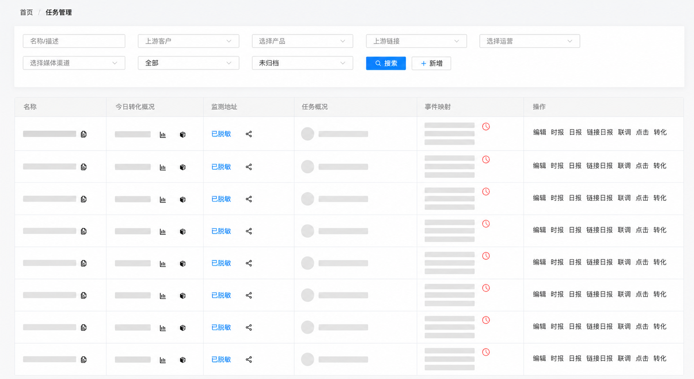
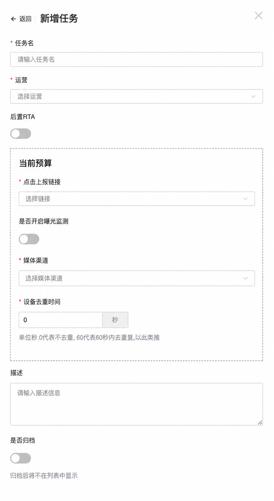
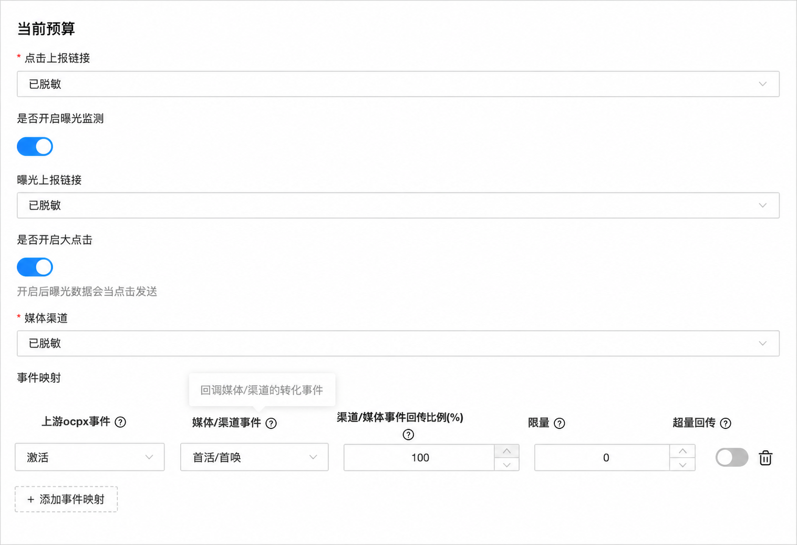
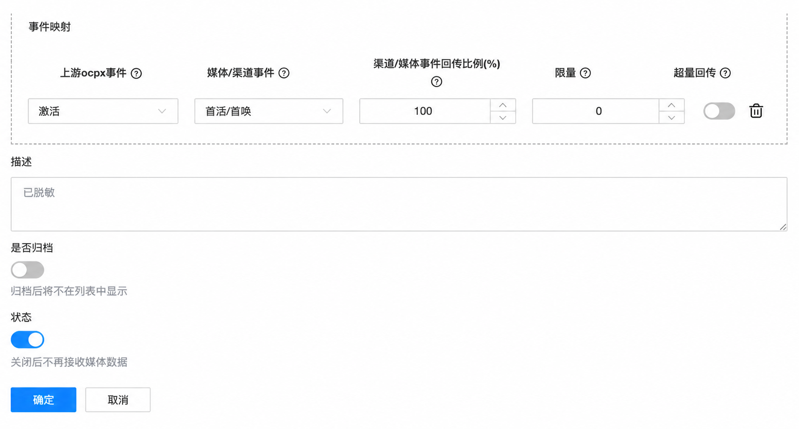

# 07 任务与监测路由发布

> 状态：S5–S7 源码与隔离本地门禁收口；目标环境、真实实例分发、UAT 与生产未验收
> 观察日期：2026-08-09（Asia/Shanghai）
> 现场页面：`/task`；当前授权账号可见范围
> SCX 目标：新增 `Task` 运营聚合；保留 `OcpxMonitorLink` 并演进为可版本化的 `MonitorRoute`
> 证据边界：页面布局与只读交互为现场证据；创建、编辑提交、归档、启停、导出及真实流量均未执行

## 1. 模块职责与数据联通

任务是主数据和运行时之间的编排层，不等于监测链接，也不直接保存线上生效配置。

```text
Advertiser → Product → AppLink ─┐
                               ├→ Task 草稿 → MonitorRoute 草稿
Channel → MediaAccount ────────┤                   │
sys_user（运营人）──────────────┘                   ▼
                                        校验 → RouteVersion
                                                   │
                                  RouteEventSnapshot + Outbox
                                                   │
                                                   ▼
                                       数据面入口与运行事实
                                                   │
                                                   ▼
                                      小时事实 → 报表/仪表盘
```

边界锁定：

- `Task` 保存运营归属、产品、点击上报 AppLink、媒体账户、运营人、曝光/去重/事件策略和生命周期。
- `MonitorRoute` 保存机器入口、路由类型、Adapter、计费和发布版本；只有 `PUBLISHED` 版本承流。
- 页面“确定”只能保存 Task/Route 草稿；发布是独立权限、独立校验和独立动作。
- 现场“状态：关闭后不再接收媒体数据”的含义必须在 SCX 中实现为可审计停流版本或 deny marker，禁止直接改一个布尔值或 Redis 缓存。
- 后置 RTA 可见但在当前 Accepted ADR 约束下必须保持 `OFF`；启用能力为 Blocked。

## 2. 页面布局与状态

### 2.1 列表 `PAGE-TASK-LIST`



页面从上到下为面包屑、两行筛选、数据表和分页。面包屑为“首页 / 任务管理”。

| 区域 | 现场控件/列 | 目标行为 |
|---|---|---|
| 第一行筛选 | 名称/描述、上游客户、产品、上游链接、运营 | 级联下拉仅返回当前对象范围内数据；任一条件变化不立即查询 |
| 第二行筛选 | 媒体渠道、一个当前显示“全部”的下拉、归档（默认“未归档”）、搜索、新增 | “全部”字段语义未由可见标签证明，实施前补 tooltip/请求参数证据，不得猜测为状态 |
| 表格 | 名称、今日转化概况、监测地址、任务概况、事件映射、操作 | 固定操作列；名称、地址和业务值按权限脱敏；动态样例值不进入快照测试 |
| 行动作 | 编辑、时报、日报、链接日报、联调、点击、转化 | 每项独立权限；行上下文固定 `taskId`，不能依赖名称回查 |
| 图标点击区 | 名称旁复制图标、今日概况图标、监测地址文本/相邻图标 | 无可读标签的图标必须补 `aria-label` 和 tooltip；语义以现场点击结果或目标设计标记 |

### 2.2 页面状态

| 状态 | 目标实现 |
|---|---|
| Initial | 默认未归档、默认页码 1；下拉按对象范围加载 |
| Loading | 表格骨架；搜索、翻页和重复加载禁用；保留筛选值 |
| Empty | 区分“尚无任务”和“当前条件无结果”；新增 CTA 受权限控制 |
| Error | 保留筛选和旧数据，展示可重试错误与 `traceId` |
| Forbidden | 403；不返回任务总数、下拉候选或对象是否存在 |
| Archived | 仅显式选择归档状态时展示；行上有归档标识且不可发布 |
| Stale | 编辑/发布发生版本冲突时提示刷新和差异摘要，不静默覆盖 |

## 3. 列表按钮与行级动作

| ID | 位置/触发条件 | 执行流程 | 成功结果 | 失败/取消 | 证据 |
|---|---|---|---|---|---|
| `BTN-TASK-SEARCH` | 筛选区；`ocpx:task:view` | 校验条件 → `GET /ocpx/tasks`，重置到第 1 页 | 刷新 records/total，保留条件 | 旧结果保留，提示重试 | 现场实测 |
| `BTN-TASK-ADD` | 筛选区；`ocpx:task:add` | 打开空抽屉，不发写请求 | 展示默认值 | X/返回不产生对象 | 现场实测 |
| `BTN-TASK-EDIT` | 行；edit + 对象范围 + 非归档 | 拉详情/version → 打开编辑抽屉 | 保存后刷新当前页 | 409 提示刷新；取消不写入 | 现场可见，未提交 |
| `BTN-TASK-NAME-COPY` | 名称旁图标 | 复制允许展示的任务名称 | Toast“已复制” | 剪贴板拒绝则提示 | 图标存在；具体语义待补证 |
| `BTN-TASK-MONITOR-COPY` | 监测地址文本/图标；已发布路由 | 服务端返回当前可复制的公开入口模板 → 写剪贴板 | Toast“监测地址已复制” | 无发布版本时禁用；不复制 Secret | 现场点击并确认复制结构 |
| `BTN-TASK-HOURLY` | 行“时报”；`ocpx:report:view` | 打开 taskId 固定的小时汇总抽屉 | 只读查询，不跳出任务上下文 | 关闭不改变筛选 | 现场实测 |
| `BTN-TASK-DAILY` | 行“日报”；`ocpx:report:view` | 打开 taskId 固定的日汇总抽屉 | 只读查询 | 同上 | 现场实测 |
| `BTN-TASK-LINK-DAILY` | 行“链接日报”；`ocpx:report:view` | 打开 taskId 固定、可再选 AppLink 的链接汇总 | 只读查询 | 同上 | 现场实测 |
| `BTN-TASK-INTEGRATION` | 行“联调”；`ocpx:debug:view` | 打开联调详情；复用 ADR-002 的受控调试事实 | 展示产品/包名/下载地址摘要和联调点击 | 不自动发送流量 | 现场实测 |
| `BTN-TASK-CLICK` | 行“点击”；`ocpx:runtime:view` | 打开 taskId 固定的点击事实抽屉 | 分页只读结果 | 空态/错误态明确 | 现场实测 |
| `BTN-TASK-CONVERSION` | 行“转化”；`ocpx:runtime:view` | 打开 taskId 固定的转化事实抽屉 | 分页结果/可授权导出 | 导出失败不改变查询 | 现场实测 |
| `BTN-TASK-PUBLISH` | 目标设计；publish + 草稿校验通过 | 打开发布检查 → 确认 → 幂等发布 | 新 RouteVersion/Outbox；展示分发状态 | 校验 FAIL 不可提交；取消保留草稿 | SCX目标设计 |
| `BTN-TASK-PAUSE` | 目标设计；ACTIVE + status | 影响预览 → 二次确认 → 发布停流版本 | 新流量拒绝且实例应用可追踪 | 部分实例失败显示 DEGRADED | SCX目标设计 |
| `BTN-TASK-ARCHIVE` | 目标设计；archive + 无活动路由 | 引用检查 → 确认 → 逻辑归档 | 默认列表隐藏 | 409 展示阻塞引用 | SCX目标设计 |

分页统一支持首页/末页、上一页/下一页、页码、跳页和每页条数；当前页越界时回退最后有效页。列表、总数和下拉必须使用同一对象范围。

## 4. 新增/编辑抽屉 `POP-TASK-FORM`

### 4.1 上半段与退出方式



抽屉右侧展开，标题区有“返回 | 新增任务”和 X。下部另有取消，因此返回、X、取消是三条退出路径，统一调用 `beforeClose`：表单未变更直接关闭；已变更弹出未保存确认；提交中禁止关闭。

| 字段 | 必填/默认/来源 | 条件与校验 | SCX 保存值 |
|---|---|---|---|
| 任务名 | 必填；空 | 去首尾空格，1–64；同 Advertiser 下规范化名称唯一 | `name` |
| 运营 | 必填；对象范围内有效 `sys_user` | 被禁用或失去 scope 时不可保存/发布 | `operatorUserId` |
| 后置 RTA | 默认 OFF | 当前版本置 ON 即前端提示 Blocked，服务端/发布/数据面均拒绝 | `rtaMode=OFF` |
| 当前预算 | 现场为分组标题 | 只读预算摘要；不得在 Task 表单直接改账户余额 | `budgetAccountId` 引用 |
| 点击上报链接 | 必填选择器；候选展示“产品 - 链接” | 必须 ACTIVE，且 Product/Advertiser 与 Task 一致；父项变化清空后续配置 | `appLinkId` |
| 是否开启曝光监测 | 默认 OFF | 开启后显示曝光链接和大点击控制 | `exposureEnabled` |
| 媒体渠道 | 必填；现场选项表现为业务账户与协议渠道组合 | SCX 必须实际选择 `MediaAccount`，由其派生 Channel/Adapter；不可只存展示文本 | `mediaAccountId` |
| 设备去重时间 | 必填；默认 `0 秒` | 非负整数；现场说明 0 不去重、N 表示 N 秒窗口；目标上限配置化，建议不超过 86400 | `dedupWindowSeconds` |
| 描述 | 可选 | 0–500；过滤不可见控制字符 | `description` |
| 是否归档 | 默认 OFF | 活动/已发布路由不得直接归档 | `archivedAt`/动作接口 |
| 状态 | 现场默认 ON | SCX 不把它作为直接承流布尔值；保存 DRAFT，启停走发布动作 | `lifecycleStatus` |

设备去重提示的现场语义是“单位秒；0 代表不去重，60 代表 60 秒内去重复，以此类推”。服务端以规范化设备键、route/version 和窗口原子判定；设备标识缺失时采用何种降级策略必须由 Adapter 契约定义，不能将空值都聚为同一设备。

### 4.2 曝光与大点击条件字段



| 条件 | 显示/动作 | 校验与执行语义 |
|---|---|---|
| `exposureEnabled=false` | 隐藏曝光上报链接与大点击；清空草稿中的曝光 AppLink | 只生成点击路由 |
| `exposureEnabled=true` | 显示“曝光上报链接”选择器和“是否开启大点击” | 曝光 AppLink 必填且归属一致；发布生成独立曝光入口/路由类型 |
| `exposureAsClick=true` | 保持提示“开启后曝光数据会当点击发送” | 高风险策略；发布检查显示计费与报表影响；事实仍保留原始 `EXPOSURE` 类型和派生点击决策 |
| 关闭曝光监测 | 隐藏并清空曝光链接、大点击 | 编辑已发布任务时只改变草稿，新版本发布前线上不变 |

### 4.3 事件映射行



| 字段/动作 | 现场行为 | SCX 目标规则 |
|---|---|---|
| 上游 OCPX 事件 | 下拉；可见激活、注册、付费、次日回访等 | 选择 ACTIVE `EventDefinition`；同 Task 内不可重复 |
| 媒体/渠道事件 | 下拉；可见激活、注册、次留、拉活/唤醒/唤起/唤端、首活/首唤、首单/首购、完单等 | 来源为所选 Channel/Adapter 的 ACTIVE 外部事件映射 |
| 渠道/媒体事件回传比例(%) | 数字输入；样例为动态值 | `0..100`，目标允许受控小数精度；基于确定性哈希采样，重放结果一致 |
| 限量 | 非负数字输入 | `0` 在参考页面的确切业务含义未验证；SCX 使用 `NULL=不限量`、`0=不允许`，避免歧义 |
| 超量回传 | 开关 | 超限时是否仍向媒体发送；必须保留“超限原因”和原始事实，不能改写事件 |
| 删除 | 垃圾桶图标 | 仅删除草稿行；已发布快照不变；至少保留业务要求的必需事件 |
| 增加事件映射 | 添加新空行 | 自动聚焦；达到配置上限后禁用；提交前逐行校验 |

现场样例中的具体事件组合、比例和限量只证明控件形态，不是固定业务默认值。运行时最终值来自 `RouteEventSnapshot`，优先级见 [事件字典与事件映射](08-事件字典与事件映射.md)。

### 4.4 抽屉按钮

| ID | 触发条件 | 执行流程 | 预期结果/异常 |
|---|---|---|---|
| `BTN-TASK-FORM-BACK` | 非提交中 | 统一未保存检查 | 关闭或停留 |
| `BTN-TASK-FORM-CLOSE` | X；非提交中 | 同上 | 同上 |
| `BTN-TASK-EVENT-ADD` | 未到上限 | 追加空行 | 不调用后端 |
| `BTN-TASK-EVENT-REMOVE` | 草稿行 | 删除并标记 dirty | 取消整个抽屉则恢复 |
| `BTN-TASK-CONFIRM` | add/edit + 表单有效 | 前端校验 → POST/PUT + Idempotency-Key/version | 保存 Task/Route 草稿；Toast；刷新当前页；不表示发布 |
| `BTN-TASK-CANCEL` | 非提交中 | 统一未保存检查 | 不写入 |

提交时按钮和关闭入口禁用。失败定位到字段/事件行，保留输入；`409 OCPX_VERSION_CONFLICT` 展示服务器新版本和刷新按钮；不得自动覆盖。

## 5. 监测地址与占位符契约

现场点击任务行的监测地址后，剪贴板得到“参考跟踪主机 + `/ocpx/c/{routeCode}` + 查询占位符”的模板。真实主机、路由码和完整业务地址不进入本仓库。参考页面使用明文 HTTP 的现象不作为 SCX 目标；SCX 只生成：

```text
https://<tracking-host>/ocpx/c/{routeCode}?<allowlisted-macro-pairs>
```

| 查询键 | 现场占位符 | 数据类别 | 目标处理 |
|---|---|---|---|
| `imei` | `__IMEI__` | 设备标识 | 原值受策略控制；日志掩码 |
| `imei_md5` | `__IMEI_MD5__` | 设备标识摘要 | 校验十六进制格式；不与原值互相推导 |
| `oaid` | `__OAID__` | 设备标识 | 受控保存/哈希 |
| `oaid_md5` | `__OAID_MD5__` | 设备标识摘要 | 同上 |
| `ip` | `__IP__` | 网络标识 | 解析代理链须使用可信边界；展示脱敏 |
| `android_id` | `__ANDROIDID__` | 设备标识 | 受控保存/哈希 |
| `android_id_md5` | `__ANDROIDID_MD5__` | 设备标识摘要 | 格式校验 |
| `aaid` | `__AAID__` | 广告标识 | 受控保存/哈希 |
| `ua` | `__UA__` | 终端信息 | 长度限制和控制字符过滤 |
| `os` | `__OS__` | 终端信息 | 枚举/规范化 |
| `model` | `__MODEL__` | 终端信息 | 长度限制 |
| `callback` | `__CALLBACK__` | 回调地址 | 仅作为协议字段；SSRF/重定向/域名白名单校验 |
| `clickid` | `__CLICKID__` | 点击幂等关联 | Adapter 规范化，禁止日志全量扩散 |
| `campaign_id` | `__CAMPAIGNID__` | 广告维度 | 字符集和长度限制 |
| `adgroup_id` | `__ADGROUPID__` | 广告维度 | 同上 |
| `creative_id` | `__CREATIVEID__` | 广告维度 | 同上 |
| `advertiser_id` | `__ADVERTISERID__` | 广告维度 | 外部标识，不等同 SCX advertiserId |

实现约束：

- 宏字典属于 Channel Adapter capability；前端只展示服务端生成模板，不能让用户在浏览器自由拼接运行入口。
- 发布时验证必需宏、重复键、未知宏、URL 编码、总长度和协议；未知宏返回逐项错误。
- 接收时保留“原始参数受控密文/摘要 + 规范化字段 + 校验结果”，但普通日志、报表和剪贴板历史不得出现设备原值。
- `routeCode` 使用不可枚举随机值，只映射到 `PUBLISHED` RouteVersion；DRAFT、归档和已停流版本明确拒绝。
- 地址轮换生成新 routeCode/版本；旧地址按重叠窗口停用，不能原地改写导致不可审计。

## 6. 发布检查与状态机

### 6.1 发布检查 `POP-TASK-PUBLISH`

目标弹层展示 Task、MonitorRoute、待发布版本、Product/AppLink/MediaAccount/Adapter/credential revision、事件快照、去重、曝光、大点击、计费、限额、RTA、URL 安全和影响范围。

| 操作 | 逻辑 |
|---|---|
| 重新校验 | 只读，返回逐项 `PASS/WARN/FAIL` 和有效期 |
| 确认发布 | 无 FAIL、publish 权限、对象范围仍有效且结果未过期才可用 |
| 取消/X | 不产生版本；保留草稿 |
| 发布中 | 禁止关闭和重复提交；用 `publishRequestId` 幂等 |

管理面事务成功后状态为 `PUBLISHED/DISTRIBUTING`；达到实例应用门槛后才显示 `ACTIVE`。分发失败不得伪装成发布失败后可重复点，也不得错误显示全量生效。

### 6.2 状态机

```text
Task:         DRAFT → READY → ACTIVE ↔ PAUSED → ARCHIVED
                           │
                           └─ 保存草稿不改变线上版本

MonitorRoute: DRAFT → VALIDATING → PUBLISHED → SUPERSEDED
                        └──────→ VALIDATION_FAILED

Distribution: PENDING → DISTRIBUTING → ACTIVE
                                  └→ DEGRADED/FAILED
```

归档只处理运营对象；停流处理运行入口。恢复 PAUSED Task 必须重新校验并发布新版本，不能把旧缓存布尔值切回。

## 7. 前端实现

```text
views/ocpx/task/index.vue
├── TaskFilter.vue
├── TaskTable.vue
├── TaskFormDrawer.vue
│   ├── TaskOwnershipFields.vue
│   ├── TaskTrafficPolicyFields.vue
│   └── TaskEventBindingEditor.vue
├── RoutePublishDialog.vue
├── TaskHourlyReportDrawer.vue
├── TaskDailyReportDrawer.vue
├── TaskLinkReportDrawer.vue
├── TaskIntegrationDrawer.vue
├── TaskClickDrawer.vue
└── TaskConversionDrawer.vue
```

页面放在 `views/ocpx`，继续使用服务端菜单驱动路由。API 拆到 `src/api/ocpx/task.ts`、`report.ts`、`runtime.ts`，并由现有 `ocpx.ts` 提供兼容导出。父级选择改变前提示影响并清空子字段；下拉服务端搜索、可取消、按 scope 分页，不把敏感候选持久化到 localStorage。

## 8. REST 接口与刷新行为

### 8.1 Task/Route

| 方法 | 路径 | 权限/语义 |
|---|---|---|
| GET | `/ocpx/tasks` | 分页、筛选、对象范围；返回 route/report 摘要 |
| POST | `/ocpx/tasks` | `ocpx:task:add`；Idempotency-Key 创建 DRAFT |
| GET | `/ocpx/tasks/{id}` | view + scope；详情与依赖版本 |
| PUT | `/ocpx/tasks/{id}` | edit + scope；携带 `version` |
| POST | `/ocpx/tasks/{id}/archive` | archive；活动路由引用检查 |
| GET | `/ocpx/tasks/{id}/publish-check` | publish；只读逐项校验 |
| POST | `/ocpx/tasks/{id}/publish` | publish；`publishRequestId, expectedTaskVersion` |
| GET | `/ocpx/tasks/{id}/distribution` | view；实例版本与状态 |
| POST | `/ocpx/tasks/{id}/pause:preview` | status；无副作用影响预览 |
| POST | `/ocpx/tasks/{id}/pause` | status + 二次确认；幂等停流 |
| GET | `/ocpx/monitors/{id}/versions` | route 版本历史 |

Task 请求核心字段：`name, appLinkId, exposureAppLinkId, mediaAccountId, mediaCredentialId, operatorUserId, dedupWindowSeconds, exposureEnabled, exposureAsClick, rtaMode, description, eventBindings[], version`。Product/Advertiser/Channel 从所选对象校验和冻结，不信任客户端重复传值。服务端拒绝客户端传入 `publicUrl`、`routeCode` 或 Secret。

S4 已先收紧现有 MonitorRoute 发布入口：所选 AppLink 必须为 `READY + ACTIVE`，归属同 Advertiser 且父 Product 为 ACTIVE；发布固定冻结 `published_app_link_id/version/type/link_url_template/template_host/template_fingerprint/template_macro_set/redirect_enabled/deeplink_url/download_url`，并与已冻结 Product revision 一致。后续 AppLink/Product 变化只标记待重发，旧发布快照不变；运行时不得回查 AppLink 当前态替换已发布值。

### 8.2 行内报表与运行详情

| 方法 | 路径 | 说明 |
|---|---|---|
| GET | `/ocpx/reports/hourly?groupBy=TASK&taskId=...` | 时/日报；grain 控制 |
| GET | `/ocpx/reports/hourly?groupBy=LINK&taskId=...` | 链接日报 |
| POST | `/ocpx/reports/exports` | 普通导出任务 |
| POST | `/ocpx/reports/deduction-exports` | 审减导出；独立权限 |
| GET | `/ocpx/tasks/{id}/integration-facts` | 联调事实摘要 |
| GET | `/ocpx/runtime/clicks?taskId=...` | 点击明细 |
| GET | `/ocpx/runtime/conversions?taskId=...` | 转化明细 |

抽屉关闭不重置任务列表筛选。新增成功回到第 1 页或按产品规则定位新对象；编辑成功刷新当前页；报表/明细查询只刷新抽屉自身。

## 9. 数据模型、索引与删除策略

### 9.1 `scx_ocpx_task`

```text
id, advertiser_id, product_id, click_app_link_id, exposure_app_link_id,
media_account_id, media_credential_id, operator_user_id,
code, name, dedup_window_seconds, exposure_enabled, exposure_as_click,
rta_profile_id, rta_mode, budget_account_id,
lifecycle_status, archived_at, version, created_by/at, updated_by/at
```

- 唯一 `(advertiser_id, code)`、`(advertiser_id, normalized_name)`；
- 索引 `(product_id, lifecycle_status)`、`(media_account_id, lifecycle_status)`、`(operator_user_id, lifecycle_status)`；
- 所有依赖的 advertiser 必须一致；MediaCredential 必须属于 MediaAccount；
- 不物理删除。归档记录保留，名字复用策略需产品决策。

### 9.2 `scx_ocpx_task_event_binding`

```text
id, task_id, upstream_event_definition_id, channel_event_mapping_id,
callback_ratio_basis_points, limit_value, over_limit_delivery,
source_type, source_id, source_version, status, version, audit fields
```

唯一 `(task_id, upstream_event_definition_id)`；比例用 basis points/明确精度，不存浮点；限额语义禁止用同一个 `0` 同时表示“不限”和“禁止”。

### 9.3 `scx_ocpx_monitor_link` 演进

增加 `task_id, route_type, media_account_id, media_credential_id, media_credential_revision, task_version, product_id, product_version, app_link_id, app_link_version, route_schema_version`。索引 `(task_id, status)`，唯一 `(task_id, route_type, biz_id)` 或经现有 bizId 语义评审后的等价约束。

RouteVersion/RouteEventSnapshot 发布后不可更新，只能新版本替代。生成地址、路由码、Secret revision 不进入 Task 普通列表响应。

## 10. 同步、异步、并发与补偿

- Task CRUD 同步写 MySQL，使用乐观锁；保存草稿不发送配置通知。
- 发布在一个 MySQL 事务内写 RouteVersion、EventSnapshot、发布记录和 Outbox。
- Outbox worker 通知数据面；Redis 只是热更/失效信号，不是版本真相。
- 数据面按 `routeId + version` 幂等应用；部分实例失败显示 DEGRADED 并自动重试。
- 入口以 `routeCode + requestId` 或 Adapter 指纹幂等；设备去重、事件比例、限量判定均产生决策事实。
- 发布响应丢失时客户端按 `publishRequestId` 查询，不能再次盲点发布。
- 紧急停流/恢复均生成新命令或新版本并保留审计；不直接编辑原始运行事实。

## 11. 权限、对象范围与安全

| 权限码 | 用途 |
|---|---|
| `ocpx:task:view/add/edit/archive/status/publish` | Task 功能拆分 |
| `ocpx:task:event:edit` | 事件绑定编辑 |
| `ocpx:monitor:view/publish` | 路由与发布 |
| `ocpx:report:view/export` | 报表查看/普通导出 |
| `ocpx:report:deduction:export` | 审减导出 |
| `ocpx:runtime:view` | 点击/转化明细 |
| `ocpx:debug:view/execute` | 联调查看/受控执行分离 |

对象范围取 Advertiser、Product/AppLink、MediaAccount/Channel 和 Task 的交集。运营人关系不自动授予 edit/publish。当前本人、管理员或任意角色都不能绕过服务端对象校验。

安全要求：

- 监测 URL、下载 URL、Callback、设备标识、clickId、媒体任务 ID 默认掩码；复制动作单独审计。
- Secret/Password 不出现在 Task 响应、发布检查、快照 diff 和普通日志；只冻结受控引用与 revision。
- 联调不实现任意 URL 代理，不因打开抽屉自动发请求；执行复用 ADR-002 一次性授权。
- 导出沿用查询 scope，异步生成、短期下载、再次鉴权；文件名不含业务名称。

## 12. 迁移、灰度、回滚和可观测

1. 前向新增 Task/Binding 表和 Monitor/Fact 可空维度；同步 current schema/验证脚本/契约测试。
2. 对现有 MonitorLink 规则分组形成候选 Task，人工确认 Product/AppLink/MediaAccount/运营归属。
3. 回填 `task_id/media_account_id/product_id`；孤儿和跨广告主关系必须为 0，无法映射项标 `LEGACY_UNMAPPED`。
4. 新写双写维度，新旧路由/报表按天对账；达到门槛后切换读取。
5. 新发布版本开始冻结完整依赖；旧版本保持 N/N-1 读取兼容，不删除历史。
6. 应用回滚不回滚数据库；需要回切时发布引用旧安全配置的新版本。

观测指标：Task 草稿/归档数、发布校验失败项、URL 宏校验失败、Outbox 延迟、实例版本分布、DRAFT 承流拒绝、去重命中、事件比例/限额/超量决策、联调/明细查询越权拒绝、报表 taskId 缺失率。

## 13. 验收用例

| 层级 | 必测 |
|---|---|
| UI | 两行筛选、未归档默认、级联清理、曝光/大点击显隐、事件行增删、三种退出、保存与发布分离、所有空/错/加载/无权限态 |
| API | Idempotency-Key、版本冲突、跨 Advertiser/Product/Link/MediaAccount 拒绝、RTA 非 OFF 拒绝、客户端 publicUrl/routeCode 拒绝 |
| URL | 宏白名单、未知/重复/缺失宏、编码、超长、HTTPS、不可枚举 routeCode、DRAFT/停流/旧地址拒绝 |
| DB | Task/Binding 唯一、比例精度、限额无歧义、Monitor 必有 Task、新快照不可变、版本单调 |
| 权限 | view/edit/publish/status/export/debug 分离；运营人无角色权限不能操作；猜 ID/改 body/导出均拒绝 |
| 集成 | Task→RouteVersion→Outbox→实例→点击→Callback→事件映射/限额/下游→小时事实；credential revision 可追溯 |
| 报表 | 时/日/链接日报固定 taskId；普通/审减导出独立；同筛选与报表中心一致 |
| 异常 | 依赖归档、Adapter 缺失、Redis 不可用、发布响应丢失、部分实例失败、URL 轮换、晚到 Callback |
| RTA 门禁 | UI 锁定、API 拒绝、数据库检查、发布校验和数据面五层确保有效模式 `OFF` |

相关运行详情与补偿边界见 [13-运行中心与失败补偿](13-运行中心与失败补偿.md)，报表字段与指标口径见 [10-报表中心](10-报表中心.md)。

## 14. S5 实施收口（2026-08-10）

当前未提交工作树已完成 S5 源码与本地门禁范围的 Task 运营聚合：

- `V86` 新增 `scx_ocpx_task`、无敏感字段的变更审计，以及 Monitor 的可空 `task_id`、映射状态、路由类型和 Task revision；存量 Monitor 不回填、不分组、不猜测归属，统一保持 `LEGACY_UNMAPPED`。
- `/ocpx/tasks` 提供分页、详情、范围内 options、幂等创建、乐观更新、DRAFT/READY 就绪状态、归档/恢复；请求 DTO 不接收 Advertiser/Channel 派生 ID，也不直接输出实体、Secret、routeCode 或 URL。
- Product/AppLink/Advertiser 与 Channel/MediaAccount/MediaCredential 在服务端重新求交并检查 ACTIVE/READY；负责人按 `sys_user.id` 校验，不按展示名反查；凭据只冻结 `media_credential_id + secret_revision`。
- 保存或编辑只形成草稿并标记已显式关联的已发布 Monitor 待重发；不调用 Monitor 发布服务、不新增承流版本、不写 Outbox、不修改任何 published snapshot。S5 状态只表达配置 DRAFT/READY，`ACTIVE/PAUSED` 返回 409，避免伪装已生效或已停流。
- RTA 固定 OFF；去重窗口 `0..86400`；曝光关闭时曝光 AppLink 和大点击必须清空，开启时曝光 AppLink 必填且须与普通 AppLink 同 Product/Advertiser。
- Element Plus `/ocpx/task` 复用 SCX 现有视觉语言，覆盖两行筛选、分页、初始空/筛选空/失败/403/409/归档、三路径 dirty guard 和完整级联。发布、联调、报告、点击、转化动作禁用并标明后续切片。

证据边界：本地 MySQL 8.4 已验证 current schema 空库、pre-V86 升级、V86 重放、旧 Monitor 不猜测，以及 RTA/去重/曝光/唯一性/旧映射反例。源码测试与全量门禁结果记录在 [91](91-SCX实施依赖与验收矩阵.md)。目标数据库未应用 V86，目标服务、浏览器多角色、第三方 UAT 和生产均未验收；不得据此宣称上线。

## 15. S6 Task 事件绑定边界（2026-08-10）

- Task 事件草稿唯一写入 `scx_ocpx_task_event_binding`，以标准事件去重，并冻结当前 Channel、渠道映射、比例、限额、超量开关、算法和来源 revision；V80 Monitor binding 只作 legacy 兼容，不与 Task binding 双写真相。
- Mapping 必须属于 Task 当前 MediaAccount 派生的 Channel/Adapter，且 EventDefinition、Mapping 和上级对象均为 ACTIVE；所有 options、详情、总数和 body 关联 ID 都重新应用 Advertiser∧Channel∧MediaAccount 范围交集。
- 切换 MediaAccount 时客户端清空事件行，服务端也拒绝不兼容旧 binding；Product 默认策略只作为创建时可追踪模板，Task 保存后不动态重读。
- Task 保存仍只增加 draft/config revision 并标记已发布 Monitor 待重发；不调用发布、不写 Outbox、不生成 RouteVersion、不修改旧 RouteEventSnapshot。
- S6 snapshot preview 只构建 `persisted=false/outboxCreated=false` 的 schema 2 纯配置 DTO。正式发布事务、实例分发、URL 轮换和运行事实仍属于 S7。

本地 MySQL、后端/前端与契约门禁证据见 [08](08-事件字典与事件映射.md) 和 [91](91-SCX实施依赖与验收矩阵.md)。目标环境、真实 Callback/第三方 UAT 与生产均未验收。

## 16. S7 Monitor 发布与运行维度收口（2026-08-10）

- V88 新增不可变 `RouteVersion`、发布记录、运行接受状态、Distribution、InstanceAck、停流命令，并扩展事务 Outbox 的 claim/lease/退避/恢复字段；旧 Monitor 不回填 Task/Event/routeCode，继续保持显式 legacy/unmapped。
- `GET publish-check` 只读返回逐项 PASS/WARN/FAIL、冻结 revision、有效期与签名 token，不返回 Secret、密文、对象键、主机或完整 URL。默认 tracking host 为字面量 `https://tracking.invalid`，因此未由负责人安全配置目标 host 前始终 FAIL；修改配置后须重新打包。
- 宏 schema 来自 Channel Adapter capability。服务端唯一生成 HTTPS 模板并拒绝未知/重复/缺失/编码异常/超长宏及不受控 callback；routeCode 使用 32 字节安全随机值，只保存 blind index 与密文，普通 Task/Monitor DTO 不返回。
- `publishRequestId + expectedTaskVersion` 在 Task 行锁内幂等；同一事务冻结 Advertiser/Product/AppLink/MediaAccount/MediaCredential/Task/事件/宏 revision，写 RouteVersion、schema 2 EventSnapshot、发布记录、Outbox 与初始 Distribution。管理事务结果只显示 PUBLISHED/PENDING 或 DISTRIBUTING。
- Redis 仅传递失效/应用信号，数据库 Distribution/InstanceAck 才是状态真相。默认关闭的运行实例 worker 启用后先从数据库扫描/恢复待分发版本、解密并校验精确不可变快照，再按进程实例写幂等 ACK；达到门槛才进入 ACTIVE，跌破门槛退回待分发并发出失效信号。旧 routeCode 进入显式 overlap 窗口后拒绝；部分失败显示 DEGRADED，绝不显示全量生效。
- runtime 只从已加密的不可变 schema 3 snapshot 装载 `PUBLISHED + ACTIVE/OVERLAP + ACTIVE/DEGRADED distribution`；DRAFT、PENDING、PAUSED/DENIED、SUPERSEDED、过期、未知 routeCode 和无 schema 2 事件快照均拒绝，不回读主表拼配置。
- 停流先 preview，再要求 `ocpx:task:status + ocpx:monitor:status`、对象范围、显式确认和 Sa-Token 二次认证；命令幂等写 deny marker 与 Outbox。恢复只能重新检查并发布新版本，不能翻转旧缓存布尔值。
- Element Plus Task 页已启用真实发布检查、确认发布、实例 ACK/分发状态、不可变版本历史、独立授权复制地址、409/过期/FAIL/DEGRADED/FAILED/403 与二次认证停流；S8 已接入固定 `taskId` 的时/日/链接报表，S10 已接入固定 `taskId` 的联调/点击/转化只读事实抽屉。重放只创建默认关闭 worker 的命令，不代表真实执行。

证据边界：源码与隔离本地 MySQL 8.4 已覆盖 current schema 空库、pre-V88 升级、V88 重放、RTA 反例、RouteVersion 不可变触发器和 verifier。真实 worker 默认关闭，测试未连接目标 Redis/RocketMQ/实例，也未访问 tracking host。目标数据库未应用 V88；目标服务、浏览器多角色、真实实例分发、第三方 UAT 和生产均未验收，生产保持 No-Go。

## 17. S8 运行事实与 Task 报表边界（2026-08-10）

- 新 runtime 写入只使用 S7 不可变发布快照中的 tenant、Advertiser、Product、AppLink、Task、Channel、MediaAccount、operator、routeId/routeVersion 维度，不在聚合或查询时回读可变 Task/Link 覆盖历史归属。旧版本缺维度时保持 `UNMAPPED`，不按名称、URL 或当前关系猜测。
- Callback/投递结果先形成幂等贡献事实；默认关闭的 S8 worker 才按游标聚合。晚到事实按已锁定的 eventTime 所属小时写回，receivedTime 只驱动水位/finality；本切片没有对既有事实执行回补。
- Task 行“时报、日报、链接日报”共用统一报表服务，固定 `taskId`，分别使用 `HOUR+TASK`、`DAY+TASK`、`DAY+LINK`。抽屉的筛选、分页和列设置独立，关闭不重置 Task 列表。
- Task 行报表只读；普通导出、审减导出、敏感指标分别授权。S10 的联调、点击、转化已作为脱敏事实视图启用；补偿必须 preview/confirm 且默认 worker 关闭，未连接真实 processor、媒体或第三方。

证据边界：S8 源码和隔离本地数据库/夹具门禁已覆盖上述合同；未连接目标 Redis/RocketMQ/对象存储，未生成或下载真实业务导出，目标环境、第三方 UAT 和生产均未验收。

## 18. S10 运行中心复用发布/停流真相（2026-08-10）

- Runtime fact 与 failure 固定引用 S7 RouteVersion、EventSnapshot 和 route runtime state，不回读当前 Task/AppLink/credential 重拼历史配置。
- 运行中心 emergency-stop 仅是 S7 pause preview/confirm 的受控入口，继续要求 task/monitor status 权限、三对象 scope 和二次认证；没有第二套停流布尔值或命令真相。
- replay request 只能引用原冻结 RouteVersion/EventSnapshot。Task 为 PAUSED/ARCHIVED 或 route 已 DENIED 时 worker 不 claim；恢复只能重新检查并发布新版本。
- 当前源码和隔离测试没有执行真实发布、停流、地址轮换、实例通知或重放；目标、UAT 和生产仍为 No-Go。
