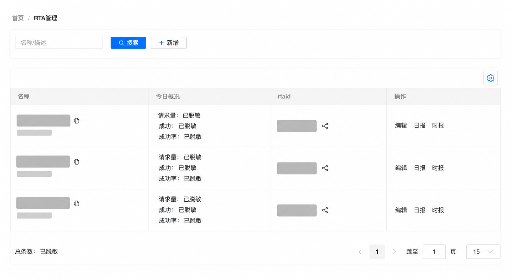
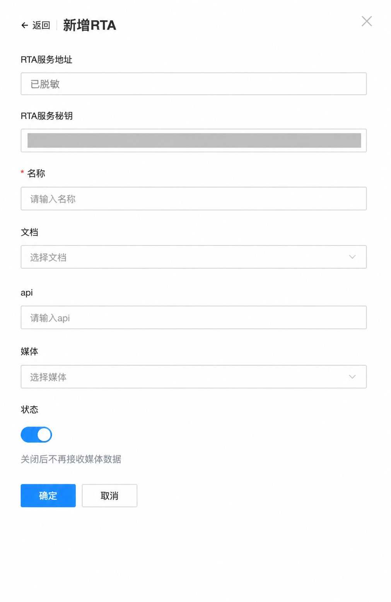
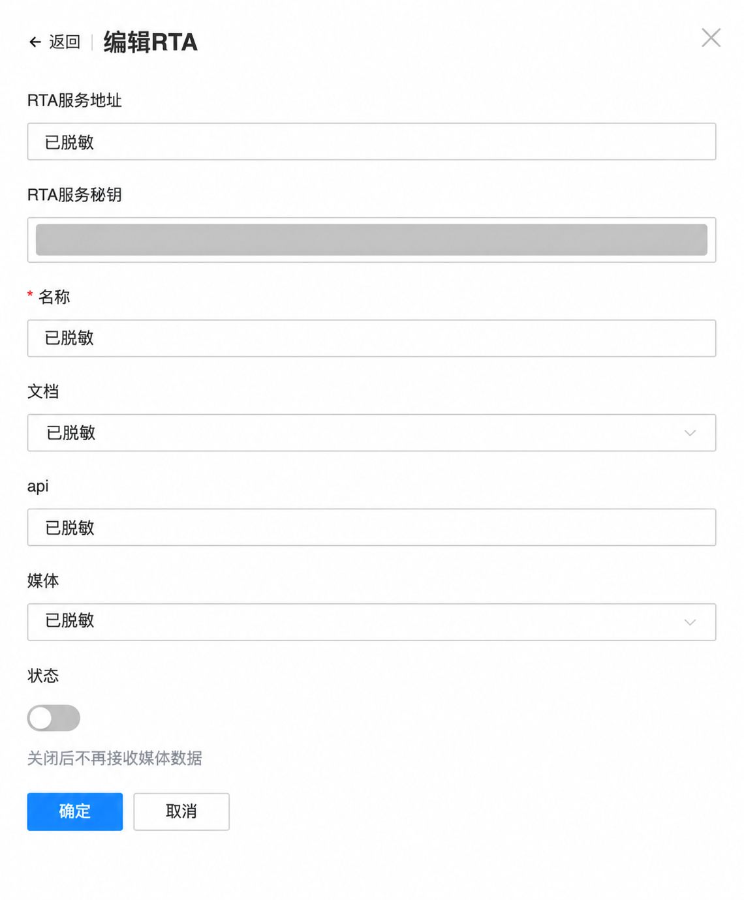
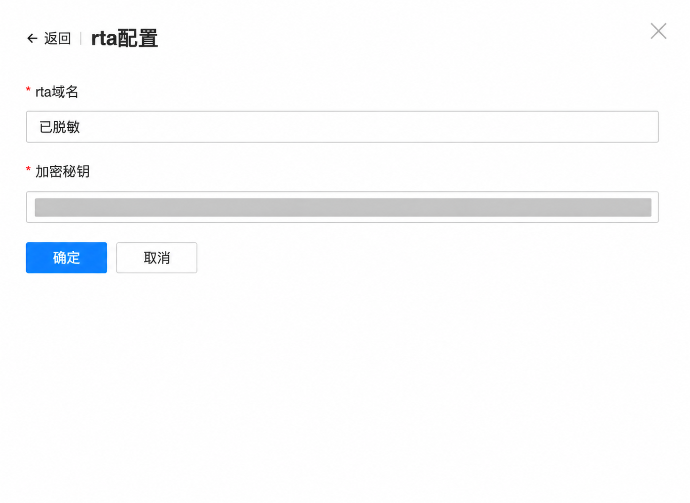
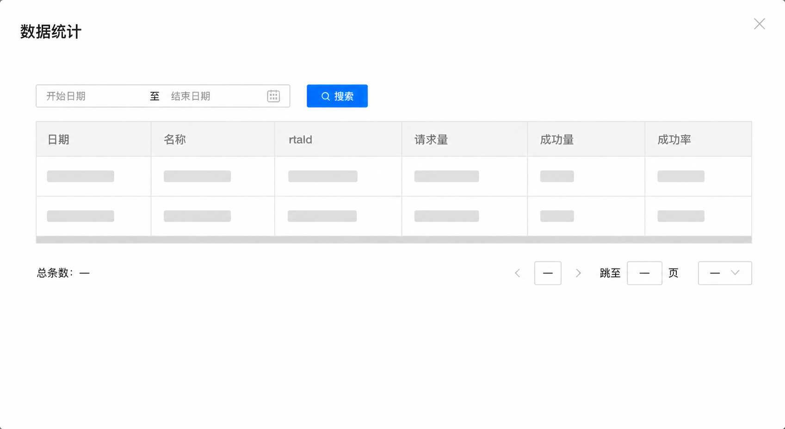

# 09 RTA 管理

> 状态：**Blocked / Draft**
> 观察日期：2026-08-09（Asia/Shanghai）
> 现场路由：`/rta`
> 账号边界：本轮授权账号当前可见范围
> 阻塞原因：Accepted ADR-001 与当前实现约束将有效 RTA 模式锁定为 `OFF`；主动决策必须先有替代 ADR
> 证据边界：页面、字段和只读交互来自本轮截图与现场观察；未执行新增、编辑保存、启停、真实请求或密钥轮换
> 决策准备：[ADR-003 RTA 主动决策解锁门禁](../adr/ADR-003-RTA主动决策解锁门禁.md) 为 **Proposed / Not Accepted**，文件存在不解除 Blocked，不得据此启用 ACTIVE、外呼、shadow 或 UAT

## 1. 模块目标与非目标

本模块描述 RTA 配置目录、任务/路由引用、日报/时报统计和未来决策事实的目标实现。它用于后续 SCX 评审与拆分，不表示 RTA 已获准上线，也不能从浏览器界面证明参考系统的接口协议、加密方式、成功判定、数据库结构或真实调用链。

当前阶段可以实现或评审只读目录、禁用态配置、密钥治理模型和统计契约；不得让任何 Task、MonitorRoute 或数据面实例产生有效的非 `OFF` RTA 行为。

## 2. 现场页面与状态

### 2.1 列表页 `PAGE-RTA-LIST`



`现场实测`页面由全局壳层、面包屑、筛选工具栏、表格和分页组成：

- 面包屑为“首页 / RTA管理”；
- 工具栏含“名称/描述”关键词输入、搜索、新增；
- 表格右上角有无文字齿轮图标；现场点击后进入全局 RTA 配置抽屉；
- 表头依次为名称、今日概况、`rtaid`、操作；
- 名称单元格含名称、无文字复制图标、最近状态时间和“开启/关闭”文本；
- 今日概况按行展示请求量、成功量、成功率；样例数值仅是动态数据，不是固定实现；
- `rtaid` 单元格含蓝色标识和无文字分享/复制图标，其确切剪贴板或分享语义仍需在实现前用 tooltip 与点击结果确认；
- 行操作为编辑、日报、时报；
- 底部含总条数、上一页、当前页、下一页、跳页和每页条数。

列表必须补齐 `loading / empty / error / no-permission` 四类状态。失败时保留筛选条件与上一份成功结果，不能将请求失败渲染成“总数 0”。

### 2.2 新增、编辑与状态差异

| 现场状态 | 观察结果 | SCX 处理 |
|---|---|---|
| 新增抽屉 | “状态”开关现场显示为开启 | **冲突**：SCX 必须强制显示关闭且不可切换；提交 body 被篡改为 ACTIVE 时服务端仍拒绝 |
| 编辑抽屉 | 样例配置显示关闭 | 只允许保存为 `DISABLED`；不能借编辑绕过门禁 |
| 列表行 | 显示最近状态时间和关闭文本 | 作为状态投影；不得仅依赖前端文案判定真实运行状态 |
| Task 抽屉 | 可见“后置 RTA” | 同步锁定为 OFF；发布快照与数据面再次校验 |

新增页默认开启是参考页面事实，不是 SCX 目标默认值。SCX 的四层约束为：前端禁用、管理 API 拒绝、发布校验拒绝、数据面 fail-safe 旁路并告警。

## 3. 控件与按钮精确规格

| ID | 位置/用途 | 可见与启用条件 | 触发与执行流程 | 成功结果 | 失败/取消 |
|---|---|---|---|---|---|
| `BTN-RTA-SEARCH` | 工具栏搜索 | `adx:rta:view` 且未在加载 | 规范化关键词，重置到第 1 页，GET 列表 | 替换表格、总数和分页 | 失败保留条件/旧表并显示可重试错误 |
| `BTN-RTA-ADD` | 工具栏新增 | `adx:rta:add`；Blocked 期间可见策略由产品决定 | 打开空抽屉，不发保存请求 | 展示禁用态草稿表单 | 无副作用；X/返回/取消关闭 |
| `BTN-RTA-NAME-COPY` | 名称旁无文字图标 | view + 对象范围 | 写入被允许的非敏感名称 | 剪贴板成功 Toast | 浏览器拒绝时提示；现场图标语义待复核 |
| `BTN-RTA-ID-ACTION` | `rtaid` 旁图标 | view + 对象范围 | 目标侧只允许复制外部标识，不生成公开分享链接 | 复制成功并记审计 | 现场究竟是复制还是分享待验证 |
| `BTN-RTA-EDIT` | 行“编辑” | `adx:rta:edit` + 对象范围 | GET 掩码详情和版本，打开编辑抽屉 | 预填非密字段；Secret 只显示 configured/revision | 详情失败不开层；范围外泛化拒绝 |
| `BTN-RTA-CONFIG` | 表格右上齿轮 | `adx:rta:config` | GET 全局配置元数据，打开配置抽屉 | 只展示域名掩码、密钥配置状态和 revision | 不返回 Secret 原文；失败不开层 |
| `BTN-RTA-DAILY` | 行“日报” | `adx:rta:report:view` + scope | 打开统计抽屉，以 `grain=DAY` 请求 | 展示六列日报与分页 | 空态/失败态明确；关闭无副作用 |
| `BTN-RTA-HOURLY` | 行“时报” | 同上 | 打开同一统计抽屉，以 `grain=HOUR` 请求 | 展示六列时报与分页 | 不擅自增加“小时”列；小时桶显示规则待协议确认 |
| `BTN-RTA-SUBMIT` | 新增/编辑确定 | 表单合法、非提交中 | 单航班 POST/PUT，带幂等键或版本 | 仅能产生/更新 `DISABLED` 配置，Toast 后刷新 | ACTIVE 返回固定阻塞错误；字段错误定位；保留输入 |
| `BTN-RTA-CONFIG-SUBMIT` | 全局配置确定 | config + credential rotate；非 Blocked 旁路 | 域名校验；密钥采用独立只写轮换命令 | 生成新 revision 和审计记录 | 原文不回显；失败不改变旧 revision |
| `BTN-RTA-BACK/CLOSE/CANCEL` | 抽屉返回、X、取消 | 非提交中 | 共用 dirty guard | 无修改直接关闭；有修改需确认 | 取消不发写请求；Esc/遮罩行为需统一 |
| `BTN-RTA-PAGER-*` | 列表/统计分页 | 边界、页码和加载状态合法 | 传 `current/size` 重查 | 更新列表与总数 | 越界归一化；失败保持当前页 |
| `CTRL-RTA-STATUS` | 表单状态开关 | Blocked 期间永远不可编辑 | 前端展示 Blocked 原因；API、发布、数据面重复校验 | 维持 `DISABLED/OFF` | 任意 ACTIVE 请求返回 `ADX_RTA_BLOCKED_BY_ADR` |

所有无文字图标必须有可访问名称、键盘焦点和 tooltip；不能根据图标外形在文档中擅自命名。

## 4. 抽屉与字段交互

### 4.1 新增/编辑 `POP-RTA-FORM`





| 现场字段 | 现场状态 | SCX 目标字段/校验 | 条件与联动 |
|---|---|---|---|
| RTA 服务地址 | 输入框；现场存在真实 HTTP 地址 | `endpointRef` 或受控 HTTPS endpoint；scheme/host/解析 IP/重定向链白名单 | 仅替代 ADR 接受后可用于连接；Blocked 期间不外呼 |
| RTA 服务秘钥 | 新增页有预置/掩码，编辑页现场可读取真实值 | `credentialRef + credentialRevision + credentialConfigured`；输入只用于创建/轮换 | **禁止 GET/日志/Toast/浏览器缓存回显 Secret** |
| 名称 | 红星必填 | `name` 必填、trim、长度限制；对象范围内唯一 | 重名返回字段级 `409` |
| 文档 | 下拉，无红星 | `documentId/documentVersion`；只能选有权且有效的受控接入资料 | 选择变化重新校验 Adapter 能力 |
| api | 文本输入 | 暂定 `adapterApiRef`；语义未验证，不能直接等同服务地址或回调地址 | 正式协议明确前只保存草稿元数据或不实现 |
| 媒体 | 下拉，无红星 | `mediaAccountId`；候选必须在调用者对象范围且 Adapter 兼容 | 变更媒体清除不兼容文档/API 引用 |
| 状态 | 开关；新增现场默认开、编辑样例关 | `status=DISABLED` 固定 | Blocked 期间禁用并显示 ADR 原因 |
| 辅助文案 | “关闭后不再接收媒体数据” | 改为准确文案：“RTA 主动决策未获授权，当前始终旁路” | 不能暗示关闭会停止 Feedback/Callback 主链 |

参考编辑页将服务密钥原文回填到浏览器，这是明确的安全缺陷。SCX 不复制该行为：详情响应只返回 `credentialConfigured`、`credentialRevision`、`rotatedAt` 和掩码状态；轮换使用独立权限、独立接口和二次确认，旧值永远不可取回。

关闭方式：返回、X、取消共用一套未保存检查；提交中三者禁用。新增/编辑成功后的 Toast、关闭和列表刷新属于目标设计，本轮未实际提交验证。

### 4.2 全局配置 `POP-RTA-CONFIG`



现场字段为必填“rta域名”和必填“加密秘钥”，操作为确定、取消、返回和 X。目标侧必须将其与单个 Profile 分开：

- `rta域名`：平台级受控域名/入口元数据，具体含义待协议确认；只允许 HTTPS 和配置白名单；
- `加密秘钥`：平台级 credential revision，API 只返回 configured/revision；页面不预填原值；
- 保存域名与轮换密钥不能复用同一个宽泛 PUT。密钥轮换采用命令式接口并记录影响范围；
- 若 revision 被 RouteVersion 引用，旧 revision 只能按经评审的重叠窗口退役，不得原地覆盖；
- Blocked 期间允许评审页面和存储模型，但不得通过全局配置激活真实 RTA 流量。

### 4.3 日报/时报 `POP-RTA-STATS`



现场含日期范围、搜索、表格、总条数与分页。用户补充确认日报和时报均展示以下六列，顺序固定：

| 顺序 | 页面列 | API 字段 | 口径 |
|---:|---|---|---|
| 1 | 日期 | `bucketStart` + `timezone` | 日报为业务日；时报仍使用同一列名，具体显示日期还是日期小时待协议确认 |
| 2 | 名称 | `profileNameSnapshot` | 使用事实发生时快照名称，不能用当前名称改写历史 |
| 3 | `rtaId` | `externalRtaId` | 外部标识；列表与导出按权限脱敏/复制 |
| 4 | 请求量 | `requestCount` | 进入 RTA 决策端口的有效请求事实数；不等同 Feedback 接收量 |
| 5 | 成功量 | `successCount` | “成功”必须由替代 ADR/供应商协议定义，不能从 HTTP 2xx 自行推断 |
| 6 | 成功率 | `successRate` + numerator/denominator | `successCount / requestCount`；分母为 0 返回 `null`，前端显示 `--` |

日报与时报共享组件、接口和投影，只通过 `grain=DAY/HOUR` 区分。因为现场六列完全相同，SCX 不擅自给时报增加“小时”列；但接口必须返回明确的 `grain`、`bucketStart`、`timezone`，前端标题或 tooltip 必须让用户能辨认小时桶。日期区间按 `Asia/Shanghai` 解释并在接口契约中规定闭区间/半开区间。

## 5. SCX 当前能力、缺口与冲突

| 类别 | 当前事实/目标 | 结论 |
|---|---|---|
| 决策端口 | 当前存在 `RtaDecisionPort` 扩展边界 | 可复用接口边界，不代表主动决策已实现或获批 |
| 有效模式 | Accepted ADR-001 与当前实现锁定 `OFF` | 列表、表、接口均不得产生 ACTIVE 配置或非 OFF 快照 |
| 管理面 | `scx-adx` 可承载 Profile 元数据和权限 | 不为 RTA 单独建 Maven 模块 |
| 身份权限 | 复用 `scx-system`、Sa-Token 和 ADX 对象范围 | 不建立平行用户/角色表 |
| 运行面 | 高 QPS 决策只能在 OCPX data plane 内 | 不把机器请求塞进 `scx-boot`，不从浏览器代理任意 URL |
| 统计 | 必须来自持久化决策事实和小时/日聚合 | 页面不能实时扫供应商或本地计算成功率 |

解除阻塞的替代 ADR 至少决定：业务价值与合规、请求/响应协议、字段最小化、成功定义、超时、失败模式、重试、熔断、容量、费用、SLA、shadow、停流、统计口径、密钥生命周期和供应商 UAT。

## 6. 目标领域模型与跨模块联通

```text
Channel/Adapter ── MediaAccount
                        │
                        ▼
                  RtaProfile (DISABLED)
                        │
Task ── MonitorRoute ── RouteVersion ── RtaSnapshot(OFF)
                                           │
FeedbackFact ── 未来 RtaDecisionPort ── RtaDecisionFact
                                           │
                                     RtaHourlyStat
                                           │
                                      日报 / 时报

RtaGlobalSetting ── GlobalCredentialRevision
```

必须区分三个现场概念，不能合并成一个 URL 字段：

1. Profile 的“RTA 服务地址”：候选决策服务 endpoint；
2. Profile 的“api”：其协议语义尚未验证，先记为 Adapter 元数据；
3. 齿轮配置中的“rta域名/加密秘钥”：平台级设置与独立 credential revision。

Task 只引用 `rta_profile_id` 候选关系；MonitorRoute 发布时冻结 profile/version/credential revision 与模式。Blocked 期间发布器必须把有效 `rtaMode` 固定为 `OFF`，数据面也必须拒绝异常注入的非 OFF 快照。

## 7. 前端目标实现

建议路由与组件：

- `views/adx/rta/index.vue`：`RtaProfileTable`、`RtaFilterBar`、`RtaBlockedAlert`；
- `RtaProfileDrawer`：新增/编辑禁用态配置；
- `RtaGlobalConfigDrawer`：平台域名元数据；
- `RtaCredentialRotateDialog`：独立密钥轮换；
- `RtaStatsDrawer`：DAY/HOUR 共用六列表格；
- API：`src/api/adx/rta.ts`，保留现有聚合 API 的兼容导出方式。

前端状态要求：

- 初始加载用骨架或表格 loading，不闪现“无数据”；
- 空态保留筛选区和新增入口，但 Blocked 原因始终可见；
- 失败态显示 traceId/重试，不将旧数据清空；
- 无权限时隐藏写操作，页面级无 view 权限由路由守卫和服务端共同拒绝；
- 切换日报/时报或日期时取消旧请求，只接受最后一次响应；
- Secret 输入关闭 autocomplete，不持久化到 Pinia、localStorage、URL、错误对象或埋点。

## 8. 候选 REST 接口

以下接口均为 `SCX目标设计`；主动调用相关能力须等替代 ADR。管理端响应沿用 `Result<T>` 和统一分页。

| 方法 | 路径 | 请求/响应与限制 |
|---|---|---|
| GET | `/adx/rta-profiles` | `keyword/status/mediaAccountId/current/size`；Blocked 时只读分页 |
| POST | `/adx/rta-profiles` | `Idempotency-Key`；忽略/拒绝客户端 ACTIVE，只能创建 `DISABLED` |
| GET | `/adx/rta-profiles/{id}` | 返回非密详情、configured/revision/version；不返回 Secret |
| PUT | `/adx/rta-profiles/{id}` | `If-Match` 或 `version`；关联一致性校验；只能保持 `DISABLED` |
| POST | `/adx/rta-profiles/{id}/credentials:rotate` | 只写新 Secret，独立权限和二次确认；返回新 revision 元数据 |
| POST | `/adx/rta-profiles/{id}/status` | 当前请求 ACTIVE 固定返回 `ADX_RTA_BLOCKED_BY_ADR` |
| GET | `/adx/rta-profiles/{id}/stats` | `grain=DAY|HOUR&start&end&current&size`；固定六列投影 |
| GET | `/adx/rta-settings` | 返回域名元数据和 credential configured/revision，不返回密钥 |
| PUT | `/adx/rta-settings/domain` | 仅域名元数据，HTTPS/白名单/并发版本校验 |
| POST | `/adx/rta-settings/credentials:rotate` | 全局密钥独立轮换；记录影响 revision |
| POST | `/adx/rta-profiles/{id}/connectivity:check` | **Blocked**；替代 ADR 后才由受控 worker 执行，禁止浏览器任意代理 |

统一错误码：

| 错误码 | HTTP | 场景 |
|---|---:|---|
| `ADX_RTA_BLOCKED_BY_ADR` | 409 | 新增/编辑/启用/发布试图产生有效 RTA |
| `ADX_RTA_SCOPE_DENIED` | 403 或泛化 404 | 对象范围不允许且不泄露存在性 |
| `ADX_RTA_VERSION_CONFLICT` | 409 | 乐观锁/credential revision 冲突 |
| `ADX_RTA_ENDPOINT_REJECTED` | 422 | 非 HTTPS、私网/保留 IP、域名/重定向不允许 |
| `ADX_RTA_DOCUMENT_INCOMPATIBLE` | 422 | 文档/Adapter/MediaAccount 不兼容 |
| `ADX_RTA_SECRET_INVALID` | 422 | Secret 缺失或不满足未来协议规则；日志只记分类 |

创建幂等键绑定用户、scope 和请求哈希；同键不同 body 返回冲突。所有状态变化、域名保存和 credential 轮换采用版本检查，不能最后写入者静默覆盖。

## 9. 候选表结构与索引

| 表 | 核心字段 | 约束/索引 | 删除策略 |
|---|---|---|---|
| `scx_adx_rta_profile` | `id, code, name, adapter_key, endpoint_ref, document_id, media_account_id, status, config_version, version, audit` | `uk(code)`；`idx(media_account_id,status)`；status 当前只允许 DISABLED | 被 Task/Route 引用时禁止物理删除 |
| `scx_adx_rta_credential_revision` | `id, profile_id, secret_ref, revision, status, rotated_at, retired_at` | `uk(profile_id,revision)`；Secret 仅保存受控引用/密文 | 只可退役，不原地覆盖 |
| `scx_adx_rta_global_setting` | `id, domain_ref, credential_revision, version, audit` | 单租户逻辑唯一；域名与 credential 分版本 | 版本化，不物理删除 |
| `scx_adx_rta_decision_fact` | `request_id, route_id, route_version, task_id, profile_id, outcome, success_flag, reason_code, latency_ms, status_class, credential_revision, occurred_at` | `uk(profile_id,request_id)`；按时间/profile 分区或索引 | 最终事实不可改写；按保留策略归档 |
| `scx_adx_rta_hourly_stat` | `stat_hour, profile_id, request_count, success_count, timeout_count, reject_count, metric_version` | `uk(stat_hour,profile_id,metric_version)` | 聚合可回补，不能重复累加 |

Secret 不进入 Profile、决策事实、统计表、RouteSnapshot 明文或普通审计日志。发布快照只冻结 credential revision/引用和非密配置。

候选状态机：

```text
RtaProfile: DRAFT → DISABLED
                    └─X─→ ACTIVE   # 替代 ADR 前不可达
Credential: PENDING → ACTIVE_REVISION → RETIRING → RETIRED
RtaFact: RECEIVED → SUCCESS | REJECTED | TIMEOUT | ERROR
```

## 10. 权限与对象数据范围

| 权限码 | 作用 | 对象范围 |
|---|---|---|
| `adx:rta:view` | 列表/详情/复制非密 ID | Profile 绑定的 Advertiser/Channel/MediaAccount 交集 |
| `adx:rta:add` | 新增禁用态 Profile | 可管理 MediaAccount 范围 |
| `adx:rta:edit` | 编辑非密配置 | 同范围且非历史冻结版本 |
| `adx:rta:status` | 状态命令 | 当前仍被 ADR 全局门禁拒绝 ACTIVE |
| `adx:rta:config` | 全局域名元数据 | 平台管理员/专门角色 |
| `adx:rta:credential` | Profile/全局密钥轮换 | 高敏独立权限、二次认证、全审计 |
| `adx:rta:report:view` | 日报/时报 | 与 Profile 相同的对象范围 |
| `adx:rta:debug` | 未来受控连通检查 | 替代 ADR 后的极小角色；不等同 view/edit |

前端按钮显隐只是体验；Controller/Service/Mapper 查询、统计总数、导出和缓存键都必须应用同一对象范围。当前用户猜测 Profile ID、替换 `mediaAccountId` 或复用历史 URL 均不能读取对象存在性。

## 11. 运行、幂等与失败补偿边界

- RTA 是未来同步限时决策，不应依赖 Redis Stream 完成同步答复；请求事实仍必须落 MySQL，统计由事实异步聚合；
- 同一 `profile_id + request_id` 只形成一个业务决策事实；是否允许单次网络重试必须由协议明确，默认不重试；
- 超时、熔断和 failure mode 只能读取 RouteVersion 冻结值，不能运行时回读当前 Profile；
- shadow 只记录对比事实，不影响投递/计费；没有 Accepted ADR 也不得偷偷开启 shadow 外呼；
- credential 轮换失败保留旧 revision；发布/加载失败经 Outbox 重试，不能显示为已全量生效；
- Blocked 期间若收到非 OFF 快照，数据面必须 fail-safe 旁路/拒绝加载并增加 `rta_non_off_snapshot_rejected_total`；
- RTA 供应商不可用不能阻断 Feedback/Callback 的可靠接受，未来失败策略必须明确投递、计费和统计影响。

## 12. 安全、隐私与审计

- 现场截图中出现过真实服务地址、API 地址、密钥和业务标识；交付资产全部脱敏，文档不复述任何值；
- endpoint 只允许 `https`，解析并固定允许域名，拒绝私网/回环/链路本地/保留 IP，逐跳校验重定向并防 DNS rebinding；
- Secret 只写、不可回读；前端不预填，后端日志仅记录 credential ID/revision，响应、异常、审计正文均不得含原文；
- 进入 RTA 的设备标识、广告标识和 URL 参数按最小必要原则发送；协议、法律依据、保留时间和供应商子处理方须先评审；
- 统计和日志不记录请求/响应原文；确需诊断时使用受控、限期、字段级脱敏证据并绑定工单；
- 域名修改、密钥轮换、启停尝试、发布拒绝和受控检查全部写不可抵赖审计，含操作者、scope、前后 revision、理由、traceId，不含 Secret。

## 13. 前向迁移、灰度与可观测

迁移只允许新增前向 SQL，并同步 current schema、required tables 和校验脚本。顺序建议：

1. 增加 Profile/credential/global setting/decision fact/hourly stat 表，Profile 状态约束默认 `DISABLED`；
2. 增加 Task/Route 的可空 `rta_profile_id` 与冻结 revision 字段，回填为 `NULL/OFF`；
3. 上线只读列表和统计空态，开启 API/发布/数据面的阻断指标；
4. 替代 ADR 未接受前不进入 shadow、连通检查或真实供应商 UAT；
5. 未来解除阻塞后按禁用配置→受控连通→shadow→小流量→扩大灰度推进，每步均可通过新 RouteVersion 回到 OFF；数据库回滚不删新表和事实。

Blocked 期间指标：

- `rta_active_command_rejected_total`；
- `rta_non_off_publish_rejected_total`；
- `rta_non_off_snapshot_rejected_total`；
- `rta_secret_read_attempt_total`；
- `rta_stats_query_latency/error_total`。

未来运行指标还包括请求/成功/拒绝/超时、P50/P95/P99、熔断、shadow 差异、failure mode 触发与 credential revision 分布。

## 14. 验收用例

| 层级 | Case | 预期 |
|---|---|---|
| UI | `UI-RTA-001` 打开列表/新增/编辑/配置/日报/时报 | 布局、字段、六列统计、分页和证据一致；所有密值掩码 |
| UI | `UI-RTA-002` 新增参考态曾默认开启 | SCX 显示关闭且不可切换，明确 Blocked 原因 |
| UI | `UI-RTA-003` 关闭有未保存内容的抽屉 | 返回/X/取消共用 dirty guard；取消无写请求 |
| API | `API-RTA-001` POST body 注入 ACTIVE | `409 ADX_RTA_BLOCKED_BY_ADR`，数据库无 ACTIVE |
| API | `API-RTA-002` GET 详情/配置 | 仅 configured/revision，不含 Secret、endpoint 敏感查询参数或原始凭据 |
| API | `API-RTA-003` 同幂等键重复创建 | 返回同一禁用对象；同键不同 body 冲突 |
| API | `API-RTA-004` 并发编辑/轮换 | 旧 version/revision 返回 409，不静默覆盖 |
| DB | `DB-RTA-001` 查状态/快照 | 无 ACTIVE Profile；所有 PUBLISHED Route 的有效 rtaMode 为 OFF |
| DB | `DB-RTA-002` 查敏感列/日志 | Profile、事实、统计和日志无 Secret 明文 |
| 权限 | `AUTH-RTA-001` 猜 ID/改关联/查总数 | 范围外拒绝且不泄露对象存在、总数或统计 |
| 发布 | `PUB-RTA-001` UI 篡改、直接 API、历史请求重放 | 均不能发布非 OFF 快照 |
| 数据面 | `RUN-RTA-001` 注入非 OFF 异常快照 | 拒绝加载或安全旁路并告警，不真实外呼 |
| 报表 | `REPORT-RTA-001` DAY/HOUR 查询 | 两者严格六列；grain/bucket/timezone 正确，名称使用快照 |
| 报表 | `REPORT-RTA-002` 请求量为 0 | 成功率为 `null/--`，不展示误导性 0% |
| 安全 | `SEC-RTA-001` Secret 创建/编辑/轮换 | 浏览器响应、状态、日志、审计、异常和埋点均不回显原文 |
| 安全 | `SEC-RTA-002` URL 指向私网/重定向私网/DNS rebinding | 在外呼前拒绝；Blocked 期间所有连通请求均拒绝 |

替代 ADR 接受后还需补供应商 Mock 合同、成功判定、超时/熔断、shadow 对比、容量、隐私评审和真实 UAT。全部完成前不得把本模块标为可上线。

## 15. 待决策事项

1. 现场“api”字段与“RTA 服务地址”“rta域名”各自的协议含义和所有权；
2. `rtaId` 是平台生成、供应商分配还是配置派生，以及复制图标的真实语义；
3. 日报/时报相同“日期”列在 HOUR 粒度下的展示格式；
4. 请求量、成功量和成功的精确定义，HTTP、业务码、allow/deny 是否分别计数；
5. RTA Profile 应绑定 MediaAccount、Channel、Task 还是 RouteVersion，以及一对多约束；
6. 设备/广告字段最小集合、加密/签名协议、保留和删除要求；
7. timeout、failure mode、重试、熔断、shadow、计费和停流策略；
8. 全局密钥与 Profile 密钥是否为不同 credential 域，以及轮换重叠窗口。

## 16. 当前 fail-closed 源码审计（2026-08-10）

S11 仍为 `Blocked`，本节只记录阻断证据，不表示 Profile、统计或主动决策已经实现：

- Task 创建/编辑 DTO 与 Service 均只接受 `OFF`，V86 当前态约束再次拒绝非 `OFF`；兼容 Monitor DTO 只接受 `OFF`，既有发布服务也在发布前拒绝非 `OFF`。
- S7 publish-check 将非 `OFF` 标为 `FAIL`，正式冻结快照和 RouteVersion 写入固定 `OFF`，V88 RouteVersion 约束再次校验。
- `RouteSnapshot` 合同现已在构造和反序列化边界拒绝任何非 `OFF` 值，因此异常密文快照不能进入运行缓存；唯一的 `RtaDecisionPort` 生产 Bean 是无网络依赖的 `DisabledRtaDecisionPort`，只返回 `SKIPPED/RTA_OFF`。
- 当前源码没有 RTA Profile/全局设置/统计 Controller，没有 RTA 菜单或前端路由，也没有 RTA 连通检查、HTTP 客户端、shadow 或 ACTIVE 配置。因而不存在可读取的 RTA Secret；未来若实现禁用态 Profile，仍必须遵守只写 revision 且不回显原文。
- 本地定向测试只证明非 `OFF` RouteSnapshot 构造失败和现有四层阻断合同；没有执行外呼、连通检查、供应商 Mock/UAT 或真实数据面验收。

缺失的替代 ADR、供应商协议、成功口径、隐私/费用/容量/故障模式和 UAT 未发生变化，S11 不得标为完成。

第二次 Blocked 审计只新增了 Proposed 决策清单；当前 OFF/409 防护是评审前置证据，不是 RTA 业务完成或外部决策已取得的证据。
