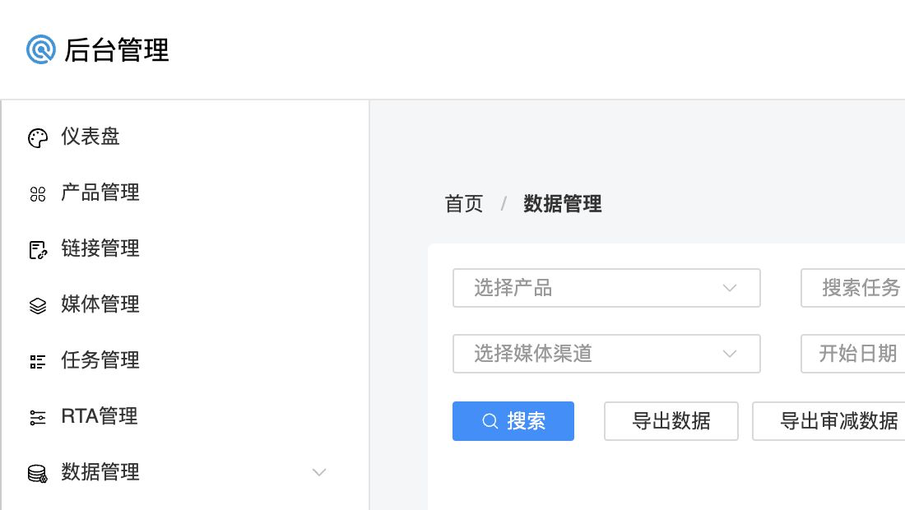
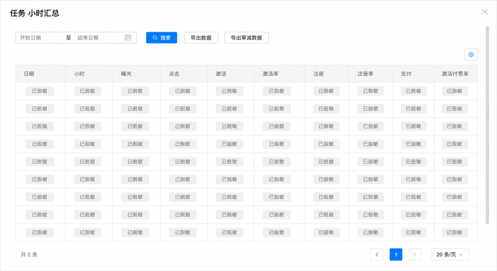
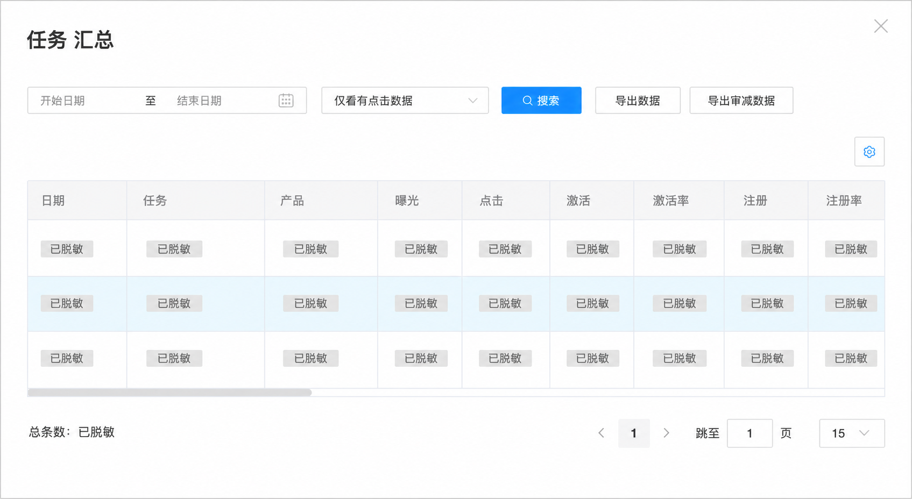
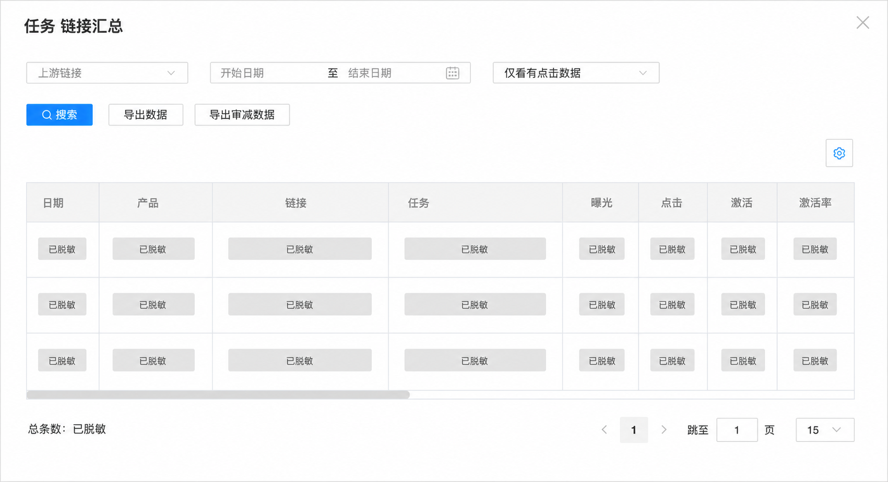

# 10 报表中心

> 状态：Draft；依赖统一小时事实和新维度回填
> 现场页面：`/summary`、`/task-product`、`/link-summary`、`/task-summary`、`/media-summary`
> 核心原则：五页共享同一事实、指标字典、时区和权限过滤

## 1. 公共布局与交互

五页均为筛选区 → 搜索/导出 → 横向指标表 → 本页汇总 → 分页。日期范围使用双月面板，可前后切换年月。



日期面板的双月结构和年月导航已现场展开；为避免错误裁剪混入其他页面区域，未单独保存该弹层截图。

| ID | 条件 | 执行 | 结果/异常 | 证据 |
|---|---|---|---|---|
| `BTN-REPORT-SEARCH` | view；日期合法 | GET 第 1 页 | 更新数据/汇总/总数；失败保留旧结果并提示 | 现场实测 |
| `BTN-REPORT-EXPORT` | export；查询合法 | 创建导出任务 | Toast + 任务入口；失败可重试 | 现场可见，未下载 |
| `BTN-REPORT-DEDUCTION-EXPORT` | deduction export | 任务行的时报、日报、链接日报及任务汇总现场可见 | 导出调整/审减明细；未执行 | 现场实测 |
| `CTRL-REPORT-DATE` | 查看权限 | 开双月面板；选择起止 | 起始不得晚于结束；取消不变 | 现场实测 |
| `CTRL-REPORT-DATA-VIEW` | 部分页面 | 默认现场可见“仅看有点击数据” | 服务端转成 having 条件 | 现场实测 |
| `CTRL-REPORT-COLUMNS` | 齿轮图标 | 打开列显隐/顺序设置 | 具体弹层未展开；实施前补现场证据 | 图标现场可见，语义推断 |
| `CTRL-REPORT-PAGER` | 查询成功 | 翻页/跳页/改页大小 | 汇总口径明确为本页，另返回全量汇总可选 | 现场实测 |

日期区间目标使用业务日闭区间 `startDate..endDate`，服务端转换为 `[start 00:00, end+1 00:00)` Asia/Shanghai。默认范围、最大跨度和导出跨度必须由统一配置给出。

## 2. 五个页面

### 2.1 数据汇总 `PAGE-REPORT-TIME`

- 筛选：开始/结束日期。
- 粒度：日期（目标可支持小时）。
- 现场列：日期、曝光、点击、激活/率、注册/率、支付/激活付费率、下单、首单/率、首活/率、拉活/率、次留/率、3 留/率、7 留、自定义、授信。
- 目标 `groupBy=TIME`，不得附带业务名称维度。

### 2.2 产品汇总 `PAGE-REPORT-PRODUCT`

- 筛选：Product、日期范围、数据查看方式。
- 列：日期、Product + 公共指标。
- 目标 `groupBy=PRODUCT`，事实直接使用 productId；存量缺失维度单列“未映射”，不分摊。

### 2.3 链接汇总 `PAGE-REPORT-LINK`

- 筛选：上游客户、Product、AppLink、日期范围。
- 列：日期、上游/Product/Link 维度、曝光、点击、重复点击及转化/留存指标。
- 目标 `groupBy=LINK`；上游由事实/快照维度确定，不按当前 Link 反查后覆盖历史。

### 2.4 任务汇总 `PAGE-REPORT-TASK`

- 筛选：Product、Task、上游 AppLink、运营、Media/Channel、日期范围、数据查看方式。
- 操作：导出数据、导出审减数据。
- 列：日期、Product、Task、运营、媒体渠道、曝光、点击、重复点击、激活/率、注册/率、支付、激活付费率、注册付费率、订单/留存/首次/拉活、自定义、授信。
- 目标 `groupBy=TASK`；运营人按 Task/Route 快照 ID，不因用户改名改变历史归属。

### 2.5 媒体汇总 `PAGE-REPORT-MEDIA`

- 筛选：Product、Media/Channel、媒体文档、Task、日期范围、数据查看方式。
- 列：日期、Product、MediaAccount/Channel/Task + 公共指标。
- 目标 `groupBy=MEDIA`，支持 `mediaLevel=ACCOUNT|CHANNEL` 明确粒度。

## 3. 任务行内报表抽屉

任务列表的“时报、日报、链接日报”不是独立计算器，而是统一报表 API 在固定 `taskId` 上的三个预设视图。抽屉关闭后保持任务列表筛选；抽屉查询、翻页、列设置和导出不刷新列表。

### 3.1 小时汇总 `POP-TASK-HOURLY-REPORT`



- 触发：任务行“时报”；标题为“任务名 + 小时汇总”。
- 筛选：开始日期至结束日期；搜索。
- 操作：导出数据、导出审减数据、齿轮列设置、X 关闭。
- 粒度：`taskId + statDate + hour`；目标参数 `grain=HOUR&groupBy=TASK`。
- 现场有横向滚动；列设置弹层未展开，保存行为标记未验证。

现场确认的有序字段为：

```text
日期、小时、曝光、点击、激活、激活率、注册、注册率、支付、激活付费率、
下单、次留、次留率、3留、3留率、7留、7留率、首活、首活率、
用户当日首次DAU、用户当日首次DAU率、首单、首单率、拉活、拉活率、自定义、授信
```

### 3.2 日汇总 `POP-TASK-DAILY-REPORT`



- 触发：任务行“日报”；标题为“任务名 + 汇总”。
- 筛选：日期范围、数据查看方式；现场默认“仅看有点击数据”。
- 操作：搜索、导出数据、导出审减数据、齿轮列设置、X、分页。
- 粒度：`taskId + statDate`；目标参数 `grain=DAY&groupBy=TASK`。

现场确认的有序字段为：

```text
日期、任务、产品、曝光、点击、激活、激活率、注册、注册率、支付、
激活付费率、注册付费率、下单、次留、次留率、3留、3留率、7留、7留率、
首活、首活率、用户当日首次DAU、用户当日首次DAU率、首单、首单率、
拉活、拉活率、自定义、授信
```

### 3.3 链接汇总 `POP-TASK-LINK-REPORT`



- 触发：任务行“链接日报”；标题为“任务名 + 链接汇总”。
- 筛选：该 Task 下的上游链接、日期范围、数据查看方式；现场默认“仅看有点击数据”。
- 操作：搜索、导出数据、导出审减数据、齿轮列设置、X、分页。
- 粒度：`taskId + appLinkId + statDate`；目标参数 `grain=DAY&groupBy=LINK&taskId=...`。
- AppLink 下拉必须限制在该 Task/同 Product/同 Advertiser 的可见链接，不接受 body/query 篡改跨范围。

现场确认的有序字段为：

```text
日期、产品、链接、任务、曝光、点击、激活、激活率、注册、注册率、支付、
激活付费率、下单、次留、次留率、3留、3留率、7留、7留率、首活、首活率、
用户当日首次DAU、用户当日首次DAU率、首单、首单率、拉活、拉活率、自定义、授信
```

三个视图的动态样例数值只作为数据存在性证据，不能写成默认值。普通导出和审减导出均为有副作用的文件任务，本轮未实际执行。

## 4. 指标与展示规则

指标血缘以 [总体设计 §8](00-总体领域模型与跨模块数据流.md) 为准。页面规则：

- 响应同时返回 `value/numerator/denominator/status`；前端不自行用四舍五入后的值再计算。
- 分母 0 或事实不完整显示 `--`；Provisional 数据提供标记/tooltip。
- 本页汇总只对当前页 records 计算并标“本页”；若提供全量汇总，单列 `querySummary` 且按完整筛选计算。
- 计数千分位，金额按币种，比率统一精度；导出保留原始分子分母。
- 动态业务样例名和数值不是固定实现，也不得写入测试快照。

### 4.1 字段差异与目标口径

| 指标 | 三个任务视图可见性 | SCX 目标公式/状态 |
|---|---|---|
| 激活率 | 时/日/链接 | `activationCount / validClickCount`；指标字典版本化 |
| 注册率 | 时/日/链接 | `registrationCount / validClickCount`；若业务要求以激活为分母，必须经指标 RFC 替换，不由页面猜测 |
| 激活付费率 | 时/日/链接 | `paymentCount / activationCount` |
| 注册付费率 | 仅日报字段清单确认 | `paymentCount / registrationCount`；其他视图不擅自补列 |
| 次留率/3留率/7留率 | 时/日/链接 | 对应留存人数 / D0 激活 cohort；小时视图展示归属小时的回填结果 |
| 首活率/首单率/拉活率 | 时/日/链接 | 默认候选分母为有效点击；上线前须在指标字典 Accepted 版本锁定 |
| 用户当日首次DAU率 | 时/日/链接 | 现场只证明字段名，分母未由 UI 证明；上线前必须决策，未决时不展示比率 |
| 自定义/授信 | 时/日/链接 | 来源事件字典；仅返回有权限列，不在页面本地拼事件 code |

所有比例都由服务端返回 `value/numerator/denominator/status`；分母为 0 返回 `null`，前端显示 `--`。参考画面中的 `0%` 只反映样例展示，不作为 SCX 零分母语义。

## 5. 前端设计

```text
views/adx/report/
├── index.vue                 共享容器
├── report-filter-schema.ts   五页筛选配置
├── report-column-schema.ts   指标/维度列配置
├── ReportGrid.vue
├── ReportSummaryRow.vue
├── ReportDateRange.vue
├── TaskReportDrawer.vue       时报/日报/链接日报共享容器
├── ReportColumnSettings.vue
└── ExportTaskDrawer.vue
```

API 放 `src/api/adx/report.ts`。页面路由只传 `reportView` 配置，不复制五套查询/计算。列宽、冻结维度列、横向滚动和列显隐按用户偏好保存；不把敏感业务值写 localStorage。

## 6. API

### 6.1 统一查询

`GET /adx/reports/hourly`

参数：

```text
startDate, endDate, grain=HOUR|DAY,
groupBy=TIME|PRODUCT|LINK|TASK|MEDIA,
advertiserId, productId, appLinkId, taskId,
channelId, mediaAccountId, operatorUserId,
dataView=ALL|HAS_CLICK|HAS_CONVERSION,
metrics[], current, size, sort
```

响应：`records, pageSummary, querySummary?, total, asOf, timezone, freshnessStatus, metricDefinitionsVersion`。排序字段和 metrics 走白名单；范围外 ID 统一拒绝或返回空的策略需全站一致，优先 `403 ADX_OBJECT_FORBIDDEN` 且不泄露存在性。

### 6.2 导出

| 方法 | 路径 | 说明 |
|---|---|---|
| POST | `/adx/reports/exports` | 保存查询快照，返回 exportJobId |
| GET | `/adx/reports/exports/{id}` | 状态、行数、过期时间 |
| GET | `/adx/reports/exports/{id}/download` | 短期授权下载 |
| POST | `/adx/reports/deduction-exports` | 独立权限的审减明细 |

导出幂等键为 `userId + scopeHash + queryHash + type + timeBucket`；重复请求复用未过期任务。下载再次鉴权，文件过期返回 410。

## 7. 数据模型与聚合

演进 `AdxHourlyReport` 或其当前表，目标唯一键：

```text
(stat_hour, advertiser_id, product_id, app_link_id,
 task_id, monitor_route_id, channel_id, media_account_id)
```

字段至少区分 `raw_clicks, valid_clicks, duplicate_clicks`，各标准事件计数，adjustment/deduction 计数和事实水位。比率查询时计算或使用受控投影，不单独存可能漂移的百分比。

聚合 worker 按事实游标增量 Upsert；回补使用相同聚合函数和幂等键。晚到 callback 按业务事件时间/接收时间规则回补原小时，并更新 `asOf`/finality。

## 8. 权限与隐私

| 权限 | 说明 |
|---|---|
| `adx:report:view` | 查询有权维度 |
| `adx:report:export` | 普通导出 |
| `adx:report:deduction:export` | 审减/调整明细，独立高权限 |
| `adx:report:metric:sensitive` | 金额/授信等敏感指标可见性（如需要） |

对象范围在 SQL/服务层生效；下拉、总数、汇总、导出完全一致。文件名不含客户名/手机号；内容按列级权限删除而非前端隐藏。导出审计记录查询哈希、行数、范围摘要和下载结果。

## 9. 失败、性能与观测

- 查询超时：返回明确错误，不返回半张无标记表；允许按日期拆分建议。
- 聚合延迟：结果带 DELAYED 和水位；页面不自动触发回补。
- 导出失败：任务可重试；不重复生成无限文件；临时对象清理。
- 指标：查询 P50/P95/P99、扫描行数、缓存命中、聚合延迟、回补量、空结果率、导出队列/失败/下载、页面间口径差异。
- 保护：在线查询最大日期/维度/页大小；大范围强制异步导出；避免 count distinct 热点。

## 10. 迁移与灰度

1. 小时事实加新维度可空列和索引；运行链双写。
2. 建维度缺失质量报表，完成人工映射；不伪造归属。
3. 新旧投影按日/维度对账，计数差异和金额差异分别设门槛。
4. 五页逐一切到统一 API，但只有一套指标实现；任一页面异常可回切旧读路径。
5. 稳定后再收紧非空/唯一键并移除兼容读取。

## 11. 验收用例

| 层级 | 必测 |
|---|---|
| UI | 五页筛选；任务时报/日报/链接日报；默认 dataView；日期边界；列设置；横向表；空/错/加载；本页/全量汇总标签 |
| API | groupBy 白名单、同口径跨页一致、零分母 null、范围上限、非法排序拒绝 |
| DB | 唯一粒度、回补幂等、晚到事实、维度缺失可追踪、原始/调整事实不互改 |
| 权限 | 列表/汇总/总数/导出同一 scope；审减导出独立授权；下载过期/越权拒绝 |
| 集成 | Feedback/Callback→事实→小时聚合→三个任务抽屉/五页/Dashboard 对账 |
| 异常 | Redis/聚合中断、部分小时缺失、导出 worker 重启、对象改名/归档、时区切日 |

## 12. S8 源码与本地收口（2026-08-10）

### 12.1 单一事实、聚合与指标字典

- `V89` 扩展统一小时事实的冻结维度，新增幂等贡献、聚合游标、不可变 adjustment/deduction、导出任务与审计。存量维度只标记 `UNMAPPED`，不根据当前名称、URL 或外键猜测历史归属。
- runtime 新事实从 S7 不可变快照携带 tenant、Advertiser、Product、AppLink、Task、Channel、MediaAccount、operator、routeId/routeVersion。贡献事实按稳定幂等键写入；聚合 worker 默认关闭，正常增量与经授权回补共用同一游标/upsert 函数。
- `S8_V1` 是五页与 Task 抽屉的唯一指标实现。基础计数分别保存，比率查询时由分子/分母计算；零分母返回 `value=null/status=ZERO_DENOMINATOR`。只开放已锁定的激活率、注册率、付费率；未决指标返回 `UNAVAILABLE`，不猜测公式。
- `Asia/Shanghai` 日期闭区间在服务端转换成半开时间区间；查询跨度、导出跨度、页大小、worker 开关均为配置文件字面量，无新增环境变量占位。

### 12.2 正式接口、页面与导出

- `GET /adx/reports/hourly` 用一个 SQL/服务支持 HOUR/DAY 与 TIME/PRODUCT/LINK/TASK/MEDIA，响应包含 records、pageSummary、querySummary、total、asOf、timezone、freshnessStatus、metricDefinitionsVersion；metrics/groupBy/sort 全部白名单。
- options、records、total、两类 summary 和导出都在服务端应用 Advertiser∧Channel∧MediaAccount/Task 范围交集。金额列另需 `adx:report:metric:sensitive`，无权限时前端也不提供该列候选。
- 五个 Element Plus 视图共用筛选、表格、汇总、分页和列设置，覆盖 loading、初始空、筛选空、error+traceId、403、DELAYED/PROVISIONAL/FINAL、横向滚动与汇总标签。Task 三抽屉固定 `taskId`，日报独有注册付费率，不污染其他视图。
- 普通/审减导出分别使用 `adx:report:export` 与 `adx:report:deduction:export`；任务按 userId+scopeHash+queryHash+type+timeBucket 幂等，下载再次鉴权且过期为 410。复用受管对象存储，普通响应不返回 object key；本地测试只用 fake/受控存储边界，未真实上传或下载。

### 12.3 证据层与未验收边界

- **源码**：V89/current schema/verifier/migration contract、冻结事实、聚合与查询服务、异步导出、五页和 Task 三抽屉已实现。
- **本地门禁**：一次性 MySQL 8.4 已验证空库 current schema、pre-S8 升级、V89 重放、唯一/检查/不可变触发器反例；Java/前端/契约/构建门禁以 [91](91-SCX实施依赖与验收矩阵.md) 最终记录为准。
- **目标环境**：未应用 V89，未执行目标事实双写、历史回填、质量对账、性能压测或真实存储导出。
- **第三方 UAT**：未产生或回放真实事件，未访问第三方，也未做真实 callback/媒体账单对账。
- **生产**：未部署、未迁移、未切流，保持 **No-Go**。

## 13. S9 Dashboard 投影约定（2026-08-10）

- Dashboard 只调用本章 S8 统一查询服务与 `S8_V1` 指标字典；卡片、趋势、Product/Task/Media 排行不持有第二套 SQL、公式或事实表。
- 同一请求冻结一次 Advertiser∧Channel∧MediaAccount scope snapshot。摘要、排行分页、候选和缓存键都使用该 snapshot/revision；显式猜测或混合越权 ID 在任何事实查询前泛化拒绝。
- 区间排行先取得统一服务的有界分页记录，再按冻结对象 ID 汇总基础计数并由指标字典重算比率；不能把“日期×对象”单行误当区间排行，也不回读对象当前名称覆盖历史归组。
- Dashboard 缓存键额外包含用户、范围哈希/revision、完整查询、指标版本和 scoped `MAX(as_of)` 水位。45 秒缓存只是投影加速，故障回退实时查询；Redis 未成为报表真相。
- V90 仅补三对象范围查询复合索引和规范权限迁移。隔离库夹具对账、缓存 fake 与受控 EXPLAIN 不是目标经营数据、目标性能或线上缓存验收。
