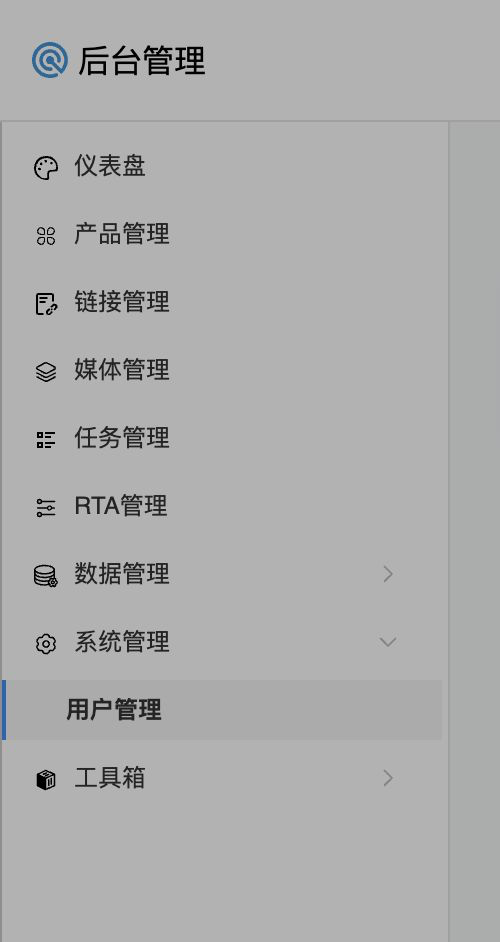
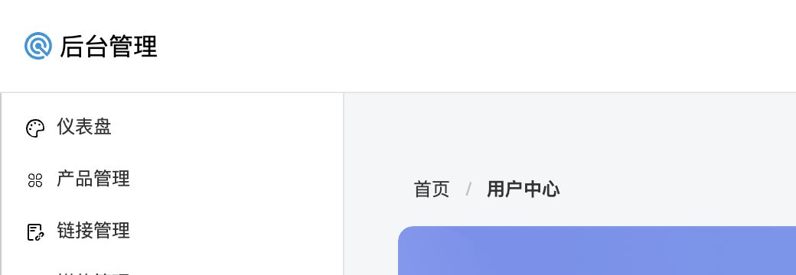

# 11 用户权限与个人中心

> 状态：Draft
> 现场页面：`/users`、`/setting`、顶部账号菜单
> SCX 原则：账号/角色/菜单/密码完全复用 `scx-system` 与 Sa-Token；仅新增 ADX 对象范围

## 1. 用户管理页面 `PAGE-USER-LIST`

筛选包含用户名/手机号/邮箱；列表现场列为序号、用户、角色、任务数、手机、邮箱、状态、创建时间、操作。数据异步加载后出现；多数行有编辑、重置密码、禁用，当前/受保护账号行不显示危险操作。手机号、邮箱在本包截图中未保留。

| ID | 条件 | 执行流程 | 结果/失败 | 证据 |
|---|---|---|---|---|
| `BTN-USER-SEARCH` | `system:sysuser:page` 或现有等价权限 | 分页查询 | 更新列表 | 现场实测 |
| `BTN-USER-ADD` | user add | 打开空抽屉 | 不发请求 | 现场实测 |
| `BTN-USER-EDIT` | user edit；非越权目标 | 读取详情 | 保存后刷新；版本冲突提示 | 现场可见，未提交 |
| `BTN-USER-RESET-PASSWORD` | 独立权限；非本人/保护账号 | 二次确认并输入/生成临时密码 | 成功使旧会话失效；本轮未执行 | 现场可见 |
| `BTN-USER-DISABLE` | status 权限；非本人/保护账号 | 显示任务/范围影响后确认 | 禁用会话；失败展示阻塞 | 现场可见，未执行 |
| `BTN-USER-TASKS` | 任务计数可见 | 打开/悬停任务摘要 | 只显示有权任务 | 现场实测 |

仅隐藏危险按钮不足以保护本人和系统账号；服务端必须校验“不能禁用自己、不能移除最后一个系统管理员、保护账号按策略不可重置”。

## 2. 用户弹层

### 2.1 新增/编辑 `POP-USER-FORM`

| 字段 | 新增 | 编辑 |
|---|---|---|
| 用户名 | 必填、登录用、唯一；创建后按现有系统规则锁定 | 只读或受控修改 |
| 昵称 | 必填/长度限制 | 可编辑 |
| 密码 | 新增可见；满足全局复杂度 | 编辑抽屉不出现，使用独立重置 |
| 角色 | 至少一个；不能授予操作者没有管理权的角色 | 变更后会话/权限缓存失效 |
| 手机/邮箱 | 格式校验；列表与日志脱敏 | 空值语义明确，不用空字符串覆盖 |
| ADX 对象范围 | 参考页面未见 | 目标新增独立页签或抽屉，不与角色混存 |

### 2.2 重置密码 `POP-USER-PASSWORD-RESET`

展示目标脱敏身份、影响会话、重置模式（管理员输入/生成临时密码）和确认。成功只允许一次性展示临时密码或安全传递，普通响应/日志不回显；要求用户下次登录修改。取消不产生变化。

### 2.3 禁用确认 `POP-USER-DISABLE`

展示有效角色、负责 Task 数、MediaAccount 负责人关系、当前会话数量和需交接事项。若是唯一负责人或存在 ACTIVE Task，按决策返回阻塞/警告；不能静默把任务指派给管理员。

## 3. 用户中心 `PAGE-USER-SETTING`

现场账号菜单进入 `/setting`，页签为个人信息和安全设置。

### 3.1 个人信息

字段：用户名（只读/登录用）、昵称、邮箱、手机，提交按钮。目标提交只允许本人可编辑字段；角色、状态、范围不能通过此接口修改。手机号/邮箱变更若有验证流程，必须明确验证码/确认状态。

### 3.2 安全设置

现场字段为旧密码、新密码和提交。目标增加确认新密码、复杂度提示、Caps Lock 提示和提交 Loading；成功后按安全策略注销其他/全部会话并跳转重新登录。本轮未提交。

## 4. SCX 复用与前端设计

系统用户 CRUD、角色、菜单、密码与会话全部调用现有 `scx-system/scx-auth`，不增加 `/adx/users` 平行接口。`views/system/user` 继续承载用户管理；ADX scope 可以作为用户详情的业务页签，组件位于 `views/adx/access-scope` 并受 ADX 权限。

任务计数不能在前端拿全量 Task 后计算；由服务端按调用者 scope 返回。API 数据脱敏在服务端完成，前端不接收完整手机号/邮箱再遮罩。

## 5. ADX 对象范围

建议 `scx_adx_user_scope`：

| 字段 | 规则 |
|---|---|
| `user_id` | `sys_user.id`，必填 |
| `scope_type` | `ALL/ADVERTISER/CHANNEL/MEDIA_ACCOUNT` |
| `scope_id` | ALL 时 null，其余必填 |
| `permission_level` | `VIEW/OPERATE/MANAGE`，仍需功能权限 |
| `valid_from/valid_to` | 可选授权有效期 |
| `version/status/audit` | 乐观锁、审计、不物理删除 |

唯一 `(user_id, scope_type, scope_id)`。授权接口：

| 方法 | 路径 | 权限 |
|---|---|---|
| GET | `/adx/access-scopes/users/{userId}` | `adx:scope:view` |
| PUT | `/adx/access-scopes/users/{userId}` | `adx:scope:edit` |
| GET | `/adx/access-scopes/users/{userId}/impact` | `adx:scope:view` |

PUT 携带整体 `version`，在事务内替换/版本化关系，并发布权限缓存失效事件。不能由前端逐行写导致短暂全量授权。

## 6. 权限矩阵

| 角色示例 | 用户管理 | 角色/范围 | 业务编辑 | 发布 | 报表/导出 |
|---|---|---|---|---|---|
| 系统管理员 | 是 | 全部 | 按显式 scope/ALL | 需 publish 权限 | 按权限 |
| ADX 管理员 | 可选 | 仅 ADX scope | 管理范围内 | 可授予 | 可授予 |
| 运营 | 否 | 否 | 负责且授权对象 | 默认否 | 查看范围内 |
| 分析 | 否 | 否 | 否 | 否 | 查看；导出独立授权 |
| 只读审计 | 否 | 否 | 否 | 否 | 脱敏只读 |

角色只是示例，最终以权限码为准；禁止用前端角色名称写业务分支。

## 7. 安全、并发与审计

- 新增/重置密码调用现有密码策略与哈希；任何响应、日志、截图不保存明文。
- 手机/邮箱服务端脱敏；具有独立 PII 权限时才返回完整值，且记录访问审计。
- 用户、角色、scope 更新用乐观锁；权限缓存失效失败时使用短 TTL/版本校验，避免旧权限长期生效。
- 禁用用户同步使会话失效；异步清理缓存可重试，但接口成功前必须满足安全失效条件。
- 审计 before/after 只记角色 ID/scope ID 摘要；不记密码和完整 PII。

## 8. 异常、迁移与观测

- 用户是唯一 Task 运营：禁用前要求交接或允许 Task 暂停，不能删除外键。
- 用户是唯一 MediaAccount 负责人：阻塞或明确交接。
- 自己禁用/重置、最后管理员降权、并发角色变更：服务端 409/403。
- 存量系统用户默认不自动获得 ALL；按现有管理员映射显式迁移并审计。
- 指标：登录失败/锁定、密码重置、禁用会话失效延迟、scope 变更、范围拒绝、无负责人对象。

## 9. 验收用例

| 层级 | 必测 |
|---|---|
| UI | 新增/编辑字段差异、本人行保护、任务数弹层、密码表单与未保存退出 |
| API | 用户名唯一、重置使会话失效、本人/最后管理员保护、scope 整体版本冲突 |
| DB | 无平行用户表；scope 唯一；停用关系可追溯；密码仅哈希 |
| 权限 | 按钮隐藏和服务端拒绝一致；PII 列级权限；范围外总数/任务数不泄露 |
| 集成 | 用户禁用影响 Task/owner；scope 变更使菜单/查询/缓存及时一致 |
| 异常 | 缓存失效失败、并发管理员操作、验证码/邮件失败、旧会话重放 |
