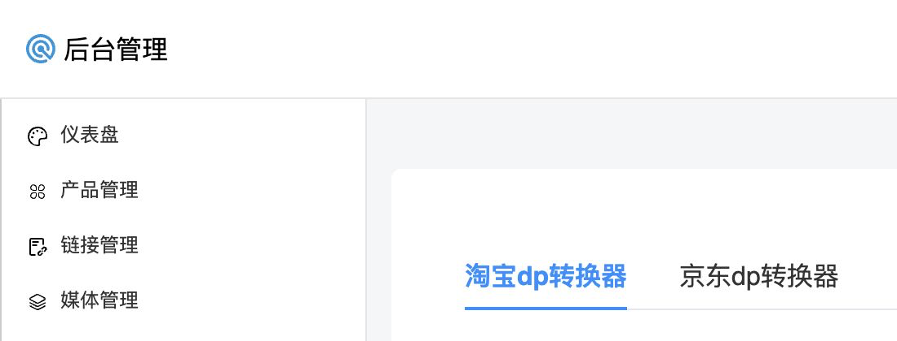
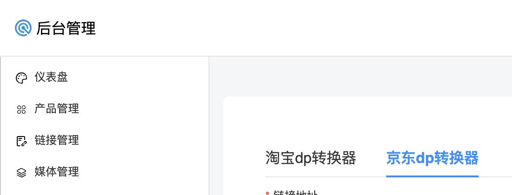

# 12 DP 转换工具

> 状态：**Blocked**
> 现场页面：`/dp`，淘宝/京东两个页签
> 阻塞原因：SCX 当前产品边界和正式契约未定义供应商协议、数据所有权、安全、保留期、幂等及报表血缘

## 1. 参考页面与交互

`PAGE-DP-CONVERT` 位于工具箱。现场有淘宝 DP 转换器和京东 DP 转换器两个页签；每页包含链接地址、供应商说明和确定按钮。本轮只切换页签，未输入业务链接、未点击确定。





| ID | 条件 | 目标流程 | 结果/失败 | 证据 |
|---|---|---|---|---|
| `TAB-DP-TAOBAO` | view | 切换 provider=TAOBAO；清理另一供应商结果 | 显示对应帮助 | 现场实测 |
| `TAB-DP-JD` | view | 切换 provider=JD；清理另一供应商结果 | 显示对应帮助 | 现场实测 |
| `CTRL-DP-URL` | 可编辑 | 粘贴后本地只做格式提示，服务端做安全校验 | 不把 URL 写浏览器持久化 | 现场实测 |
| `BTN-DP-CONVERT` | 权限、URL 合法、未提交 | 调用受控供应商适配接口 | 成功显示脱敏结果和复制；失败分类提示 | 按界面文案推断，未执行 |
| `BTN-DP-COPY` | 成功结果 | 用户主动复制 | Toast；失败提示 | SCX目标设计 |
| `BTN-DP-CLEAR` | 有输入/结果 | 仅清本地状态 | 不发业务请求 | SCX目标设计 |

## 2. 不可越过的边界

- `/adx/tools/dp/convert` 不是任意 URL 代理；只能接受已注册 provider 和该 provider 允许的域名/路径。
- 浏览器不能传自定义 method、headers、body、DNS 或代理地址。
- 服务端每次请求都校验 scheme、host、解析 IP、重定向每跳、响应大小/类型和超时，防 SSRF/DNS 重绑定。
- 输入/输出链接可能包含用户/推广标识，默认不写普通日志、不进入报表；审计只存哈希、provider、host、结果码和 traceId。
- 供应商协议和许可不明确前，不抓取、不模拟、不上线菜单。

## 3. 前端目标

路由 `views/adx/tools/dp/index.vue`，API `src/api/adx/dp.ts`。Blocked 期间不注册生产菜单；如展示设计占位，转换按钮禁用并说明 RFC/ADR 门禁。

组件：`DpProviderTabs`、`DpUrlInput`、`DpConversionResult`、`DpSafetyNotice`。切换页签清理输入/结果需要用户设置决定；为防误投，推荐默认清理结果并保留未提交输入需二次确认。

状态：`idle → validating → submitting → success|error`。提交时禁用页签/按钮；请求超时后允许按同 idempotency key 查询，不盲目重复供应商调用。

## 4. 候选 API（RFC/ADR 接受后）

`POST /adx/tools/dp/convert`

```json
{
  "provider": "TAOBAO",
  "sourceUrl": "https://allowed.example/path",
  "purpose": "CAMPAIGN_LINK",
  "idempotencyKey": "client-generated"
}
```

```json
{
  "conversionId": "...",
  "provider": "TAOBAO",
  "resultUrl": "https://allowed-result.example/...",
  "expiresAt": null,
  "cacheStatus": "MISS",
  "traceId": "..."
}
```

错误：`ADX_DP_PROVIDER_UNSUPPORTED`、`ADX_DP_URL_NOT_ALLOWED`、`ADX_DP_REDIRECT_BLOCKED`、`ADX_DP_PROVIDER_TIMEOUT`、`ADX_DP_PROVIDER_REJECTED`、`ADX_DP_RESPONSE_TOO_LARGE`、`ADX_DP_BLOCKED_BY_DECISION`。

结果 URL 仅返回给有权限的当前请求；列表/日志不回显完整值。若供应商是异步协议，改为 job API，不能用同步接口伪装完成。

## 5. Adapter 设计

```java
interface DpProviderAdapter {
  ProviderKey key();
  ValidationResult validate(URI source);
  ConversionResult convert(ConversionCommand command);
  Set<String> allowedSourceHosts();
  Set<String> allowedResultHosts();
}
```

Adapter 只负责正式协议映射，不自行实现通用 HTTP 调试、队列、审计或 Secret 管理。供应商凭据在服务端只写配置/受控 credential store；绝不下发浏览器。

## 6. 数据与幂等候选

默认设计为短期、最小化存储：`scx_adx_dp_conversion_audit(id, user_id, provider, source_hash, source_host, purpose, idempotency_key_hash, provider_request_id, result_hash, result_host, status, error_code, latency_ms, created_at, expires_at)`。

- 不保存完整输入/结果，除非业务和合规 RFC 明确需要；
- 唯一 `(user_id, provider, idempotency_key_hash)`；同键异载荷返回 409；
- 若允许缓存，键为 provider + canonical source hash + adapter version，TTL 按供应商协议；缓存内容加密且受 scope；
- 过期清理有指标和审计，不把链接同步到通用报表。

## 7. 权限、安全与限流

权限：`adx:tool:dp:view`、`adx:tool:dp:convert`，必要时按 provider 细分。接口按 user/provider/IP 限流和并发隔离；返回体大小上限、连接/总超时、TLS 校验固定。

Provider 白名单来自代码/受控配置，不接受前端覆盖。禁止 localhost、私网、链路本地、云元数据、非 HTTP(S)、URL 用户信息段、超长 URL 和多跳开放重定向。

## 8. 可观测与失败补偿

指标：provider 请求率、成功/拒绝/超时、P95、限流、SSRF 拦截、重定向拦截、缓存命中、幂等冲突、过期清理。供应商错误使用稳定分类，响应正文脱敏截断。

转换不产生计费/投放事实；供应商调用成功但客户端断线时，通过 idempotency key 重取相同结果。不可确认结果时返回 UNKNOWN 并提供查询，不自动重复可能收费的调用。

## 9. 解除阻塞与验收

RFC/ADR 必须确认：淘宝/京东正式协议与授权、域名/返回规则、凭据所有权、是否收费、幂等语义、链接保留期、隐私分类、错误码、SLO、对账和报表边界。

| 层级 | Blocked 期间/未来必测 |
|---|---|
| UI | 两页签、输入清理、禁用原因、提交单航班、复制/清空 |
| API | provider 白名单、同键幂等、同键异载荷冲突、大小/超时/限流 |
| 安全 | 私网/元数据/DNS 重绑定/重定向链/恶意 scheme 全部拦截 |
| DB | 默认无完整 URL；审计 TTL 清理；唯一键和访问范围 |
| 集成 | 供应商 Mock 成功/拒绝/超时/未知；客户端断线重取 |
| 门禁 | RFC/ADR 未接受时无生产菜单、convert 返回 Blocked、无供应商外呼 |
