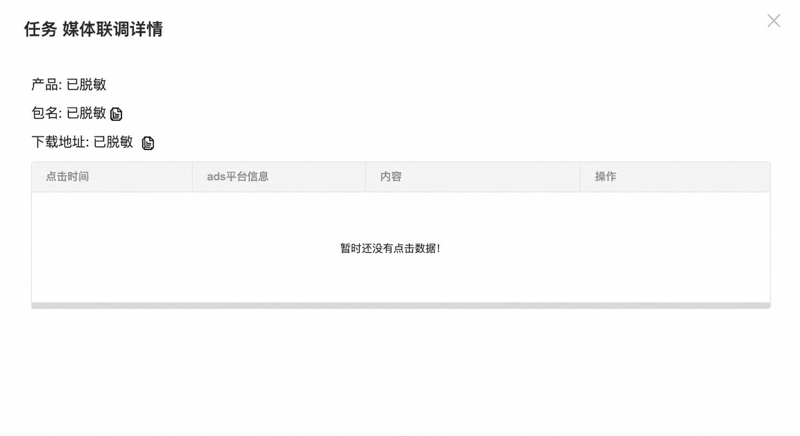
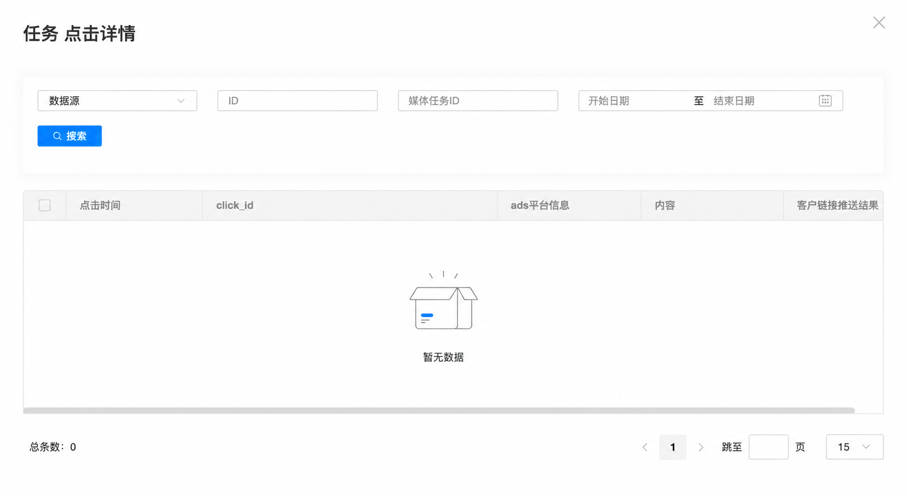
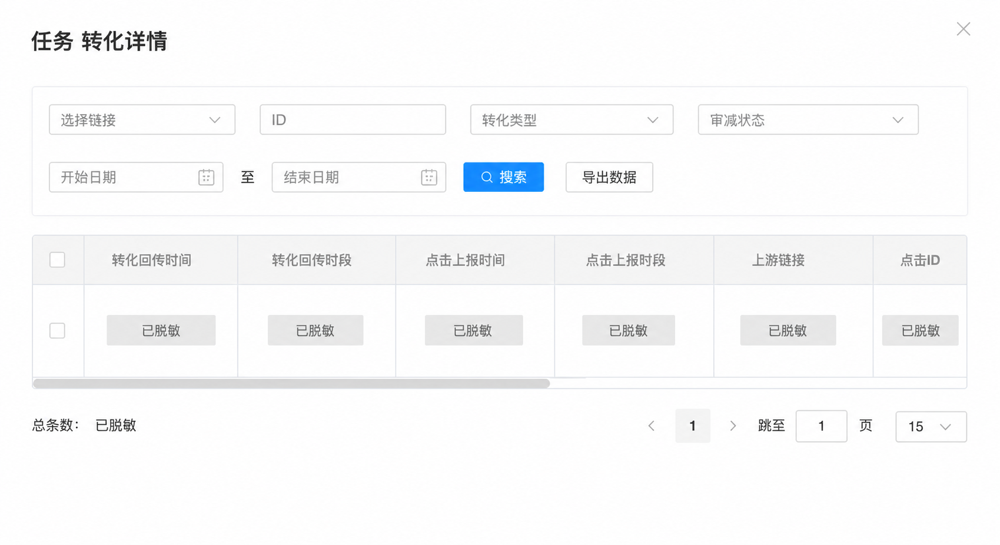

# 13 运行中心与失败补偿

> 状态：S10 源码与隔离本地门禁收口；目标环境、第三方 UAT、生产均未验收
> 现场来源：任务行的“联调/点击/转化”等运行入口语义；参考站点未见独立完整运行中心页面
> SCX 归属：`scx-ocpx-contract/runtime/engine` + `scx-adx` 管理查询；遵守 Accepted ADR-001/002

## 1. 目标页面 `PAGE-RUNTIME-CENTER`

运行中心不是浏览器网络代理，而是对已接入 Route 的可审计运行事实、投递、DLQ、配置分发和受控调试的统一入口。

```text
运行概览
├── 路由版本/实例应用状态
├── Feedback 接收与处理
├── Callback 接收与事件映射
├── 上游/下游投递任务与尝试
├── 计费/调整事实
├── DLQ 与人工补偿
└── ADR-002 受控调试工作台
```

公共筛选：时间、requestId/traceId（精确）、Advertiser/Product/AppLink/Task/Route、Channel/MediaAccount、方向、状态、事件 code、错误分类。默认近 1 小时且限制最大跨度；设备标识不作为普通模糊搜索。

## 2. 任务行内运行详情

参考任务页提供“联调、点击、转化”三个抽屉。SCX 将它们实现为运行中心的 taskId 预设视图：固定对象范围和只读事实查询，不复制一套数据链路，也不因打开抽屉自动产生外发。

### 2.1 媒体联调详情 `POP-TASK-INTEGRATION`



| 区域 | 现场内容 | 目标交互/安全 |
|---|---|---|
| 标题 | “任务名 + 媒体联调详情” | taskId 固定；标题按对象范围返回，日志不记业务名 |
| 基础信息 | 产品、包名、下载地址 | 包名/下载地址按列级权限显示；复制动作独立审计；普通权限只见掩码 |
| 表格 | 点击时间、ads 平台信息、内容、操作 | 展示受控 debug/integration facts；内容默认摘要，不显示设备原值或 Secret |
| 空态 | “暂时还没有点击数据!” | 不自动创建测试点击；提示进入 ADR-002 工作台的条件化入口 |
| 关闭 | X | 无副作用；保持任务列表筛选 |

下载地址是 AppLink/Product 的受控资料，不是 MonitorRoute 入口。复制前重新鉴权；剪贴板写入失败明确提示；禁止把地址写入前端埋点、localStorage 或普通审计 diff。

### 2.2 点击详情 `POP-TASK-CLICK-DETAIL`



| 区域 | 现场内容 | 目标实现 |
|---|---|---|
| 筛选 | 数据源、ID、媒体任务 ID、开始/结束日期、搜索 | taskId 由路由上下文固定；ID 精确匹配；日期按 Asia/Shanghai 半开区间转换 |
| 表格 | 选择框、点击时间、`click_id`、ads 平台信息、内容、客户链接推送结果 | 选择框只为受控批量操作预留；无操作权限时不渲染；正文默认摘要 |
| 空态/分页 | “暂无数据”、总条数、上一/下一、页码、跳页、每页条数 | 查询失败与空态分离；总数与 records 使用同一 scope |

`click_id` 属于外部关联标识，不作为数据库主键。普通用户只见截断/哈希；精确查询由服务端以受控索引执行，响应仍按权限脱敏。客户链接推送结果必须区分 transport 状态、业务成功判定和最后尝试，不能把 HTTP 200 等同业务成功。

### 2.3 转化详情 `POP-TASK-CONVERSION-DETAIL`



| 区域 | 现场内容 | 目标实现 |
|---|---|---|
| 筛选 | 链接、ID、转化类型、审减状态、开始/结束日期 | 链接限当前 Task；转化类型来自事件字典；审减状态为枚举 |
| 操作 | 搜索、导出数据、X | 导出为异步任务，独立权限；关闭无副作用 |
| 分页 | 总条数、上一/下一、页码、跳页、每页条数 | 最大页大小和日期跨度受控 |

现场确认的完整有序字段为：

```text
转化回传时间、转化回传时段、点击上报时间、点击上报时段、上游链接、点击ID、
转化类型、媒体数据、任务超量转化、链接超量转化、审减、媒体响应
```

字段语义：

| 字段组 | 记录系统/规则 |
|---|---|
| 转化回传时间/时段 | 原始 Callback 接收时间及 Asia/Shanghai 小时投影；保留原事件时间（若协议提供） |
| 点击上报时间/时段 | 关联 Click fact 的接收时间；关联失败不得伪造时间 |
| 上游链接/点击 ID | RouteVersion/AppLink 快照维度和外部关联 ID；展示脱敏 |
| 转化类型 | 标准事件 code + 当时 RouteEventSnapshot；不按当前中文名重算历史 |
| 媒体数据 | 规范化媒体字段摘要；原 payload 独立高权限正文端点 |
| 任务超量转化/链接超量转化 | 两个不同策略层的决策事实；必须记录规则版本、计数水位和结果 |
| 审减 | adjustment/deduction 事实；不改写原始转化 |
| 媒体响应 | 下游投递最后结果摘要，并可下钻所有尝试 |

三个抽屉均支持 Initial/Loading/Empty/Error/Forbidden/Stale 状态；禁止通过已知 taskId、clickId 或导出任务 ID 绕过对象范围。

## 3. 标签页、按钮与弹层

| ID | 位置/权限 | 执行 | 结果/失败 |
|---|---|---|---|
| `BTN-RUNTIME-SEARCH` | runtime view | 查询脱敏事实 | 分页结果；失败保留筛选 |
| `BTN-RUNTIME-DETAIL` | 行详情 | 拉取关联事实图 | 抽屉展示入口→队列→投递→计费链 |
| `BTN-RUNTIME-REFRESH` | 只读 | 重查当前筛选 | 不启动 worker/聚合 |
| `BTN-RUNTIME-RETRY` | retry + 可重试状态 | 打开补偿确认 | 创建 replay command，不直接改原事实 |
| `BTN-RUNTIME-DLQ` | dlq view | 进入 DLQ | 展示失败分类/尝试/可重放性 |
| `BTN-RUNTIME-REPLAY` | replay + 二次授权 | 预览→确认→创建命令 | 幂等重放；结果可跟踪 |
| `BTN-RUNTIME-STOP-ROUTE` | emergency 高权限 | 影响预览→二次确认 | 发布停流版本/deny marker |
| `BTN-RUNTIME-DEBUG` | ADR-002 debug | 绑定已有 Route 和一次性授权 | 调试执行与生产投递隔离 |

### 3.1 事实详情 `POP-RUNTIME-DETAIL`

展示：入口时间、方向、route/version/task、幂等摘要、验证结果、队列 ID、worker 状态、适配器、每次投递尝试、业务成功判定、计费/调整、Callback 映射、下游结果、trace/debugExecutionId。请求/响应默认只显示脱敏摘要；查看受控正文需要独立权限并记录审计。

### 3.2 重放预览 `POP-RUNTIME-REPLAY`

字段：目标事实、失败原因、原 route/version、当前 route/version、重放版本选择、预计外发/计费影响、幂等状态、原因、工单号。默认使用原版本以保证可解释；切当前版本需高风险确认。预览只读，确认生成 commandId。

禁止重放：已成功且会重复收费的任务、缺少原快照、超出保留期、对象范围外、Secret revision 已销毁且协议不可恢复。若允许“仅重新解析/不外发”，必须是独立模式。

### 3.3 紧急停流 `POP-RUNTIME-STOP`

展示影响 Task/Route、当前流量、最后版本、原因和恢复方式。确认需 `adx:runtime:emergency-stop` 与二次认证；成功不是直接删 Redis，而是产生可审计版本/标记并跟踪实例应用。

## 4. 当前 SCX 能力与边界

`SCX仓库事实`：独立 OCPX 数据面、可靠 Redis 接受、MySQL 最终事实、投递/DLQ、运行查询和 ADR-002 调试关联已经有源码边界。当前累计工作树已用 S10 正式 DTO/API/UI 收口管理查询和命令边界，但全部仍为用户未暂存、未提交源码；默认 worker 关闭，不能据此推断真实执行状态。

必须保持：

- 高 QPS Feedback/Callback 入口不回到 `scx-boot`；
- `202` 仅表示可靠接受，不表示业务完成；
- 原始事实不可被扣量/重放覆写；
- 调试工作台只能调用已接入链路或受控 HTTPS，一次性授权，不能复制一条浏览器直发路径。

## 5. 前端设计

路由 `views/adx/runtime/index.vue`；页面拆 `RuntimeOverview`、`FactSearchTable`、`ExecutionTimelineDrawer`、`DlqTable`、`ReplayPreviewDialog`、`RouteDistributionPanel`。任务页复用查询组件封装 `TaskIntegrationDrawer`、`TaskClickDrawer`、`TaskConversionDrawer`，不复制指标和正文权限逻辑。API 从现有 `adx.ts` 拆到 `src/api/adx/runtime.ts` 并兼容导出。

长轮询/刷新必须退避和可取消；详情请求按 requestId 单航班。状态颜色配文字；traceId 可复制但正文/设备 ID 不进入剪贴板默认值。

## 6. 管理查询与补偿 API

| 方法 | 路径 | 说明 |
|---|---|---|
| GET | `/adx/runtime/overview` | 指标、水位、队列/DLQ、实例版本 |
| GET | `/adx/runtime/facts` | 统一运行事实搜索 |
| GET | `/adx/tasks/{id}/integration-facts` | 固定 Task 的联调摘要和分页点击；只读 |
| GET | `/adx/runtime/clicks` | `taskId/source/id/mediaTaskId/date` 点击明细 |
| GET | `/adx/runtime/conversions` | `taskId/appLinkId/id/eventCode/deductionStatus/date` 转化明细 |
| POST | `/adx/runtime/conversion-exports` | 按查询快照异步导出；独立权限 |
| GET | `/adx/runtime/executions/{id}` | 关联时间线；服务端对象范围 |
| GET | `/adx/runtime/dlq` | DLQ 分页 |
| POST | `/adx/runtime/replays:preview` | 无副作用影响预览 |
| POST | `/adx/runtime/replays` | 幂等创建重放命令 |
| GET | `/adx/runtime/replays/{id}` | 重放状态 |
| POST | `/adx/runtime/routes/{id}/emergency-stop:preview` | 停流预览 |
| POST | `/adx/runtime/routes/{id}/emergency-stop` | 二次确认、幂等停流 |

查询不能直接透传任意 SQL/filter expression。请求/响应正文使用单独端点、一次性授权、大小限制和字段脱敏。

列表响应只返回展示摘要与 `hasBody`，不直接返回原始 ads 平台信息、设备参数或上/下游正文。普通详情查询和导出使用同一对象范围、日期边界、事件字典版本和审减口径。

机器接口仍在 engine：Feedback/Callback 的 OpenAPI/签名/成功语义以正式契约为准，本包只增加新维度，不改公开路径。

## 7. 事实与命令数据

运行表/事实至少可关联：`request_fact_id, direction, request_id, trace_id, debug_execution_id, route_id, route_version, task_id, product_id, app_link_id, advertiser_id, channel_id, media_account_id, event_code, external_click_id_hash, media_task_id_hash, acceptance_status, processing_status, occurred_at`。

转化投影增加 `callback_received_at/hour, click_received_at/hour, task_over_limit_decision_id, link_over_limit_decision_id, deduction_adjustment_id, last_media_delivery_attempt_id`。这些字段引用不可变事实/决策/尝试；展示投影可重建，不能成为原始事实真相。

投递尝试：`delivery_task_id, attempt_no, adapter_key/version, credential_revision, started/finished, transport_status, business_status, error_class, next_retry_at`。唯一 `(delivery_task_id, attempt_no)`；任务幂等按方向+事实+目标。

补偿命令：`command_id, command_type, source_fact_id, source_version, target_version, mode, requested_by, reason, ticket, idempotency_key, status, result_fact_id, audit timestamps`。重放生成新事实/尝试并引用原事实，不修改原状态为“从未失败”。

## 8. 队列、幂等与失败策略

| 阶段 | 可靠性 | 失败策略 |
|---|---|---|
| 入口验签/校验 | 同步 | 4xx 明确拒绝，不入队 |
| Redis 可靠接受 | 同步门槛 | 不可可靠写入则 503，不返回 202 |
| Worker 消费 | consumer group | ACK 只在最终事实/下一任务可靠落地后 |
| Pending 恢复 | claim/visibility timeout | 实例崩溃后认领；幂等防重复副作用 |
| 上下游投递 | 有界重试 | 可重试分类指数退避；业务拒绝通常不重试 |
| DLQ | MySQL/Stream 可追溯 | 只读分类、授权重放、保留期告警 |
| 计费 | MySQL 唯一账务键 | 重放不重复扣费；余额不足落明确事实 |

Redis 是队列/幂等/短期状态，不是最终审计真相。缓存丢失后可由 MySQL 事实恢复，不允许反向覆盖最终状态。

## 9. 权限与隐私

权限：`adx:runtime:view/detail:body/export/dlq:view/retry/replay/debug/emergency-stop` 分离。联调复制敏感字段建议再加 `adx:debug:copy-sensitive`。所有查询先按 route 关联的对象 scope 过滤；知道 requestId 也不能越权。

正文查看、重放、停流、调试为高风险操作：二次认证/一次性 grant、原因与工单必填、速率限制、完整审计。设备 ID/hash、URL query、手机号等按字段策略掩码；Secret 永不展示。

## 10. 观测、告警与 SLO

| 类别 | 指标 |
|---|---|
| 接入 | accepted/rejected/503、验签/校验错误、P95/P99 |
| 队列 | lag、pending、oldest age、claim、duplicate |
| 投递 | success/retry/DLQ、业务拒绝、超时、Adapter/credential revision |
| 配置 | route version 分布、实例落后、snapshot 加载失败 |
| 计费 | 成功/幂等命中/余额不足/对账差异 |
| 补偿 | preview、replay、重复阻止、停流应用延迟 |

告警必须能下钻到脱敏 route/task/version 和 traceId，不要求查看完整 payload 才定位。

## 11. 迁移、灰度与验收

新 product/task/mediaAccount/event snapshot 维度先加可空列并双写；事实缺失率达门槛后再切运行中心筛选/报表。索引按高频精确 requestId、时间+route/status 建，不为任意多条件组合堆索引。

| 层级 | 必测 |
|---|---|
| UI | 联调/点击/转化三个任务抽屉；搜索/分页/导出；详情时间线/DLQ/预览/确认；正文默认隐藏；刷新可取消 |
| API | taskId 固定且不可篡改跨范围；点击/转化筛选；导出同 scope；预览无副作用；命令幂等；不可重放分类；停流二次授权 |
| DB | 原事实不可变；尝试号唯一；重放引用原事实；计费唯一键 |
| 队列 | worker 崩溃恢复、重复消息、Redis 短暂故障、DLQ、积压恢复 |
| 集成 | Feedback→点击明细→上游→Callback→转化明细/超量/审减/媒体响应→下游→计费/报表全 trace；route version 可追溯 |
| 安全 | requestId 猜测、正文越权、设备/URL/Secret 脱敏、grant 重放全部拒绝 |
| 灾难 | Redis 恢复、实例版本分裂、Adapter 故障、停流/恢复、重放错误版本 |

## 12. S10 实施收口（2026-08-10）

- `V91` 新增只追加的 `scx_adx_runtime_fact`、`scx_adx_runtime_failure`、`scx_adx_runtime_replay_attempt` 与命令审计，以及可恢复的 `scx_adx_runtime_replay_request`。事实冻结 tenant、Advertiser、Product、AppLink、Task、Channel、MediaAccount、operator、RouteVersion、EventSnapshot 与 event/received time；旧事实只能保持 `UNMAPPED/NULL`，不按当前对象、名称、URL 或 code 猜测。
- 管理查询统一使用 `/adx/runtime/facts|clicks|conversions|dlq|executions/{id}` 和固定 Task 的 `/adx/tasks/{id}/integration-facts`；日期转换为半开区间，筛选、排序、跨度和分页均为白名单。列表、总数、详情、时间线与 command 状态在 SQL/服务层重新执行 Advertiser∧Channel∧MediaAccount/Task 范围交集。
- 普通 DTO 只返回盲索引掩码、摘要、trace/correlation 和质量标记，不返回 credential、签名、header、callback body、完整手机号/IP/deviceId、原始 URL 或第三方响应正文。因当前规范没有锁定允许正文的字段清单，S10 不暴露正文端点；转换事实原文导出也不在本切片伪装可用。
- 重放严格为 `preview → 二次认证 → confirm`。预览只读并签发短期 token；确认重新校验 failure revision、对象范围、原 RouteVersion/EventSnapshot、可重试分类、reason/ticket 与 requestId 幂等，只写入 `QUEUED` 命令，不在 HTTP 线程调用 processor、第三方或计费。
- replay worker 的字面量配置固定默认关闭，且默认 processor 为 unavailable；未显式受控启用时不会 claim 数据。源码采用数据库 `FOR UPDATE SKIP LOCKED`、租约、指数退避、有界 attempt 与 poison terminal；成功只追加 attempt/result fact，并用 S8 唯一贡献键防止重复计数，不改写原失败。
- 运行中心停流入口直接复用 S7 的 pause preview/confirm、`adx:task:status + adx:monitor:status`、对象范围与二次认证，不新增第二套停流表。停止后的 Task/deny Route 不再允许新 claim；恢复仍须重新 publish 新版本。
- Element Plus 运行中心覆盖概览、事实/点击/转化/DLQ、两类空态、loading/error+traceId/403、UNMAPPED、分页、时间线和重放预览/确认；Task 行新增联调/点击/转化三个固定 taskId 的只读抽屉。前端不能编辑原 payload/URL，且明确显示默认 worker 关闭时的“已排队、未执行”状态。

证据分层：上述为当前未提交源码和隔离本地数据库/测试门禁，不代表目标运行事实、真实重放、真实停流或实例执行。目标数据库尚未应用 V91；目标服务、多角色浏览器、目标规模性能、真实实例恢复、第三方 UAT 与生产均未验收，生产保持 No-Go。

本地门禁：`make backend-test` 通过（ADX 119、OCPX runtime 76、boot/迁移合同 31；engine 3 项中 1 项既有外部 MySQL 条件验收跳过）；前端 `check:type`、lint（0 error，4 个累计基线 warning）、326 项单测和 Element Plus 生产构建通过。S10 Java 定向格式、契约检查、配置占位/敏感响应/网络客户端/双停流真相扫描和 `git diff --check` 通过。隔离 MySQL 8.4 current 空库、pre-S10 升级、V91 重放、撤权后误重放不回授、不变/唯一/冻结维度反例、claim 竞争、受控 EXPLAIN 与 verifier 通过；一次性容器已清理。
